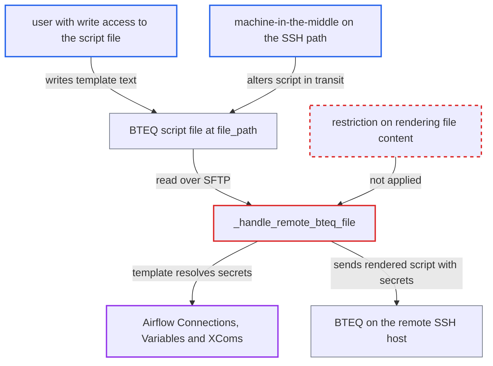

# BteqOperator renders remote script file content as Jinja template with task context

| Field | Value |
|---|---|
| ID | `find_01NegjRnse9FwBmR4yWLNihR` |
| Severity | **Critical** |
| Status | open |
| CWE | CWE-1336 — Server-side template injection |
| Created | 2026-10-27T21:38:14.753168Z |
| Claude Security | https://claude.ai/security/findings/find_01NegjRnse9FwBmR4yWLNihR |

## Description

Anyone who can write the BTEQ script file on the SSH host can make Airflow reveal its stored Connections, Variables and XComs, and can run BTEQ commands and OS commands on that host. The deployment must use `BteqOperator` with `ssh_conn_id` and `file_path`. The cause is that `_handle_remote_bteq_file` passes the fetched file text to `render_template` as a Jinja template with the full task context.

1. **attacker with write access to the script** puts Jinja expressions into the BTEQ script file. The file is the one named by `file_path` on the SSH host, for example a line like `.OS echo '{{ conn.aws_default.password }} {{ var.value.api_key }}' >> /tmp/x`.
2. **the handler `_handle_remote_bteq_file`** reads the script from the remote host over SFTP on the next run. It only checks that the remote path is a regular file, and it does not check who wrote it. ([`providers/teradata/src/airflow/providers/teradata/operators/bteq.py:206-239`](https://github.com/cx-benchmark/airflow/blob/a462d683469bb9f55646b0515ef84c41e16650fb/providers/teradata/src/airflow/providers/teradata/operators/bteq.py#L206-L239))
3. **`render_template`** compiles the file text as a Jinja template and renders it. It restricts nothing about which context names the template may use. ([`task-sdk/src/airflow/sdk/definitions/_internal/templater.py:255-260`](https://github.com/cx-benchmark/airflow/blob/a462d683469bb9f55646b0515ef84c41e16650fb/task-sdk/src/airflow/sdk/definitions/_internal/templater.py#L255-L260))
4. **the task context** resolves `conn` and `var` expressions to real secrets. `conn` and `var` resolve any Connection or Variable the task's execution token can fetch, and the report also names `ti.xcom_pull` for XComs. ([`task-sdk/src/airflow/sdk/execution_time/task_runner.py:359-363`](https://github.com/cx-benchmark/airflow/blob/a462d683469bb9f55646b0515ef84c41e16650fb/task-sdk/src/airflow/sdk/execution_time/task_runner.py#L359-L363))
5. **BTEQ on the remote host** runs the rendered script, now holding the secrets, as the SSH user. The script is prefixed with a `.LOGON` line, and the attacker's `.OS` and `.EXPORT` commands can write the secrets to disk or run commands. BTEQ output also flows back into the Airflow task log. ([`providers/teradata/src/airflow/providers/teradata/operators/bteq.py:206-239`](https://github.com/cx-benchmark/airflow/blob/a462d683469bb9f55646b0515ef84c41e16650fb/providers/teradata/src/airflow/providers/teradata/operators/bteq.py#L206-L239))

## Assessment

The attacker needs no Airflow account and no user interaction. They must be able to write the script file at `file_path` on the SSH host used by a `BteqOperator` task with `ssh_conn_id` set. That could be a lower-privileged user on a shared edge node, anyone with write access to the script directory or the NFS share, or a machine-in-the-middle on the SSH path when the SSH connection sets the `no_host_key_check` extra. The next scheduled run triggers the attack. The local-file handler `_handle_local_bteq_file` renders file content the same way. The default templating environment is `SandboxedEnvironment`, which blocks `__` attribute access but still exposes the context objects. With `render_template_as_native_obj=True` the environment is the unsandboxed `NativeEnvironment`, and the file content becomes arbitrary Python-level code on the worker.

Impact: The attacker can read any Connection or Variable the task can reach, and any XCom through `ti.xcom_pull`. They also control the BTEQ script that runs with the Teradata connection. Integrity inside Airflow is limited: `ti.xcom_push` can be called from a template, but Airflow state is otherwise not writable under the sandboxed environment. Full code execution on the worker happens only with `render_template_as_native_obj=True`.

Subsequent-system impact: Leaked credentials for Teradata, cloud services or any other Connection in the deployment allow movement into those systems with their stored privileges. The attacker can also run arbitrary BTEQ/SQL against Teradata with the connection's rights. Through `.OS` they can run OS commands on the remote host as the SSH user.

## Recommendation

Content read at runtime from `file_path`, on the remote host or locally, is passed to `render_template`. File authors on the SSH host therefore become template authors with access to the `conn`, `var` and `ti` accessors. Airflow's security model reserves that trust for DAG authors.

Fix criteria: Script file contents fetched from `file_path` are never evaluated as Jinja with the task context. They are either executed verbatim, or rendered only through an explicit opt-in that uses a restricted environment and context without `conn`, `var`, `ti` and other secret-bearing objects. To confirm, place a remote script containing `{{ conn.some_conn.password }}` on the host. The executed BTEQ script must still contain that literal text, or the task must fail. Nothing from the Airflow context may be resolved.

## Evidence

**https://github.com/cx-benchmark/airflow**

- [`providers/teradata/src/airflow/providers/teradata/operators/bteq.py:206-239`](https://github.com/cx-benchmark/airflow/blob/a462d683469bb9f55646b0515ef84c41e16650fb/providers/teradata/src/airflow/providers/teradata/operators/bteq.py#L206-L239)
- [`providers/teradata/src/airflow/providers/teradata/operators/bteq.py:241-262`](https://github.com/cx-benchmark/airflow/blob/a462d683469bb9f55646b0515ef84c41e16650fb/providers/teradata/src/airflow/providers/teradata/operators/bteq.py#L241-L262)
- [`task-sdk/src/airflow/sdk/definitions/_internal/templater.py:255-260`](https://github.com/cx-benchmark/airflow/blob/a462d683469bb9f55646b0515ef84c41e16650fb/task-sdk/src/airflow/sdk/definitions/_internal/templater.py#L255-L260)
- [`task-sdk/src/airflow/sdk/execution_time/task_runner.py:359-363`](https://github.com/cx-benchmark/airflow/blob/a462d683469bb9f55646b0515ef84c41e16650fb/task-sdk/src/airflow/sdk/execution_time/task_runner.py#L359-L363)
- [`task-sdk/src/airflow/sdk/definitions/_internal/templater.py:309-330`](https://github.com/cx-benchmark/airflow/blob/a462d683469bb9f55646b0515ef84c41e16650fb/task-sdk/src/airflow/sdk/definitions/_internal/templater.py#L309-L330)
- [`providers/slack/src/airflow/providers/slack/transfers/sql_to_slack_webhook.py:100-103`](https://github.com/cx-benchmark/airflow/blob/a462d683469bb9f55646b0515ef84c41e16650fb/providers/slack/src/airflow/providers/slack/transfers/sql_to_slack_webhook.py#L100-L103)

