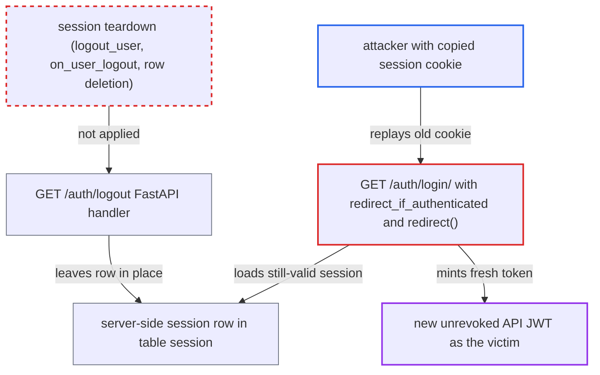

# FAB logout leaves database-backed Flask session valid, so a captured session cookie re-mints API JWTs

| Field | Value |
|---|---|
| ID | `find_017mGD9kJRxpEjUaqv23ic9k` |
| Severity | **Critical** |
| Status | open |
| CWE | CWE-613 — Insufficient Session Expiration |
| Created | 2026-10-27T21:17:45.838562Z |
| Claude Security | https://claude.ai/security/findings/find_017mGD9kJRxpEjUaqv23ic9k |

## Description

Someone who has a copy of a victim's FAB `session` cookie can stay logged in as that victim after the victim logs out. This works with the default `[fab] session_backend = database`. The logout route `GET /auth/logout` only deletes the browser's cookies. It never ends the server-side session, so the old cookie still gets a fresh API token.

1. **attacker** captures a copy of the victim's `session` cookie. The report names a shared or kiosk device, proxy or log capture, or a compromised client as ways to get it, and this happens before the logout.
2. **victim** logs out through the UI at `/api/v2/auth/logout`. The core route revokes the presented JWT by `jti`, then redirects to the URL from `get_url_logout()`, which is `{base_url}/auth/logout`. ([`airflow-core/src/airflow/api_fastapi/core_api/routes/public/auth.py:62-95`](https://github.com/cx-benchmark/airflow/blob/a462d683469bb9f55646b0515ef84c41e16650fb/airflow-core/src/airflow/api_fastapi/core_api/routes/public/auth.py#L62-L95))
3. **the handler for `GET /auth/logout`** deletes the `session` and `_token` cookies in the browser and redirects to the login page. It runs in a bare Flask `app_context()`, so it never calls `logout_user()`, never runs the `on_user_logout` hook, and leaves the server-side session row in table `session` untouched. ([`providers/fab/src/airflow/providers/fab/auth_manager/api_fastapi/routes/login.py:98-121`](https://github.com/cx-benchmark/airflow/blob/a462d683469bb9f55646b0515ef84c41e16650fb/providers/fab/src/airflow/providers/fab/auth_manager/api_fastapi/routes/login.py#L98-L121))
4. **`auth_router`** is the router that serves this path instead of the Flask logout. It is registered before the Flask app is mounted at `/`, so FAB's Flask `AuthView.logout`, which would call `logout_user()`, is never reached. ([`providers/fab/src/airflow/providers/fab/auth_manager/fab_auth_manager.py:258-285`](https://github.com/cx-benchmark/airflow/blob/a462d683469bb9f55646b0515ef84c41e16650fb/providers/fab/src/airflow/providers/fab/auth_manager/fab_auth_manager.py#L258-L285))
5. **attacker** sends `GET /auth/login/?next=/` with the old `session` cookie. Flask-Session still finds the row, and `redirect_if_authenticated()` treats the request as logged in. ([`providers/fab/src/airflow/providers/fab/auth_manager/views/auth_login.py:34-45`](https://github.com/cx-benchmark/airflow/blob/a462d683469bb9f55646b0515ef84c41e16650fb/providers/fab/src/airflow/providers/fab/auth_manager/views/auth_login.py#L34-L45))
6. **`redirect()` in `www/views.py`** calls `generate_jwt(g.user)` and sets a new `_token` cookie. The new token has a fresh `jti` that has not been revoked, so the logout's revocation is undone. ([`providers/fab/src/airflow/providers/fab/www/views.py:137-156`](https://github.com/cx-benchmark/airflow/blob/a462d683469bb9f55646b0515ef84c41e16650fb/providers/fab/src/airflow/providers/fab/www/views.py#L137-L156))

## Assessment

The attacker needs no account. They need a copy of the victim's FAB `session` cookie taken before the victim logs out. The report names a shared or kiosk device, proxy or log capture, or a compromised client as ways to get it. Capturing the cookie is outside the attacker's control. The attack works with the default `[fab] session_backend = database`. Flask-Session 0.8.0 keeps the row valid until `[fab] session_lifetime_minutes` expires (default 43200, about 30 days). Every request pushes that expiry forward. `[fab] session_max_lifetime_minutes` defaults to `0`, which means disabled. The `securecookie` backend is excluded from this finding. Its inability to revoke sessions on the server is documented in the `session_backend` option description.

Impact: The attacker keeps the victim's full Airflow identity after the victim logs out. They can extend it indefinitely with periodic requests while `session_max_lifetime_minutes` is `0`. Their reach is limited to the victim's roles. For an Admin victim that includes reading and editing variables and connections, triggering and deleting DAG runs, and managing users. The logout also fails to withdraw the session at once, as `security_model.rst` documents.

## Recommendation

`/auth/logout` in the FAB FastAPI app clears only the browser cookies. It never ends the server-side Flask-Login and Flask-Session state, which is what re-issues JWTs. Logout therefore does not end the session as documented.

Fix criteria: After logout with the `database` backend, the `session` cookie sent on the logout request no longer authenticates. Its row is removed, or emptied of the login keys. A later `GET /auth/login/` with the old cookie shows the login form and does not set `_token`. Flask views treat the old cookie as anonymous. The `on_user_logout` hook runs. A test that replays the pre-logout cookie after logout confirms all of this.

## Evidence

**https://github.com/cx-benchmark/airflow**

- [`providers/fab/src/airflow/providers/fab/auth_manager/api_fastapi/routes/login.py:98-121`](https://github.com/cx-benchmark/airflow/blob/a462d683469bb9f55646b0515ef84c41e16650fb/providers/fab/src/airflow/providers/fab/auth_manager/api_fastapi/routes/login.py#L98-L121)
- [`airflow-core/src/airflow/api_fastapi/core_api/routes/public/auth.py:62-95`](https://github.com/cx-benchmark/airflow/blob/a462d683469bb9f55646b0515ef84c41e16650fb/airflow-core/src/airflow/api_fastapi/core_api/routes/public/auth.py#L62-L95)
- [`providers/fab/src/airflow/providers/fab/auth_manager/fab_auth_manager.py:258-285`](https://github.com/cx-benchmark/airflow/blob/a462d683469bb9f55646b0515ef84c41e16650fb/providers/fab/src/airflow/providers/fab/auth_manager/fab_auth_manager.py#L258-L285)
- [`providers/fab/src/airflow/providers/fab/auth_manager/fab_auth_manager.py:736-738`](https://github.com/cx-benchmark/airflow/blob/a462d683469bb9f55646b0515ef84c41e16650fb/providers/fab/src/airflow/providers/fab/auth_manager/fab_auth_manager.py#L736-L738)
- [`providers/fab/src/airflow/providers/fab/auth_manager/views/auth_login.py:34-45`](https://github.com/cx-benchmark/airflow/blob/a462d683469bb9f55646b0515ef84c41e16650fb/providers/fab/src/airflow/providers/fab/auth_manager/views/auth_login.py#L34-L45)
- [`providers/fab/src/airflow/providers/fab/www/views.py:137-156`](https://github.com/cx-benchmark/airflow/blob/a462d683469bb9f55646b0515ef84c41e16650fb/providers/fab/src/airflow/providers/fab/www/views.py#L137-L156)
- [`providers/fab/src/airflow/providers/fab/www/extensions/init_session.py:55-65`](https://github.com/cx-benchmark/airflow/blob/a462d683469bb9f55646b0515ef84c41e16650fb/providers/fab/src/airflow/providers/fab/www/extensions/init_session.py#L55-L65)
- [`providers/fab/src/airflow/providers/fab/www/utils.py:51-60`](https://github.com/cx-benchmark/airflow/blob/a462d683469bb9f55646b0515ef84c41e16650fb/providers/fab/src/airflow/providers/fab/www/utils.py#L51-L60)
- [`providers/fab/src/airflow/providers/fab/auth_manager/security_manager/override.py:631-660`](https://github.com/cx-benchmark/airflow/blob/a462d683469bb9f55646b0515ef84c41e16650fb/providers/fab/src/airflow/providers/fab/auth_manager/security_manager/override.py#L631-L660)
- [`airflow-core/docs/security/security_model.rst:1047-1051`](https://github.com/cx-benchmark/airflow/blob/a462d683469bb9f55646b0515ef84c41e16650fb/airflow-core/docs/security/security_model.rst#L1047-L1051)

