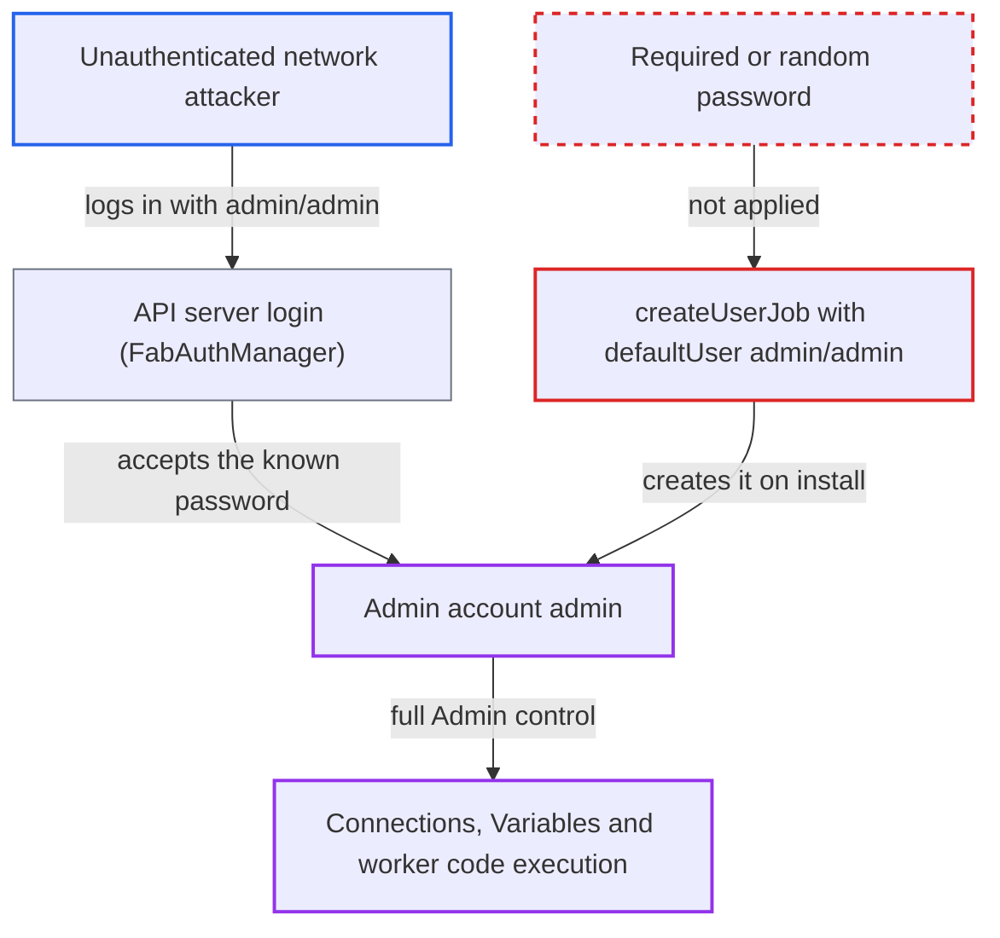

# Helm chart creates an Admin UI user with default credentials admin/admin by default

| Field | Value |
|---|---|
| ID | `find_019uXyfVZaxvDmpaF3RNBAdk` |
| Severity | **Critical** |
| Status | open |
| CWE | CWE-1392 — Use of default credentials |
| Created | 2026-10-27T21:16:49.115637Z |
| Claude Security | https://claude.ai/security/findings/find_019uXyfVZaxvDmpaF3RNBAdk |

## Description

Anyone who can reach the login of a default Helm install of the chart can sign in as an Admin and take over the Airflow deployment. The chart creates the account `admin` with password `admin` unless the deployer overrides the values. The cause is `createUserJob` being enabled by default with a fixed `defaultUser` password in `chart/values.yaml`.

1. **Deployer** installs the chart with default values. `createUserJob.enabled` is true and `defaultUser` is `admin` with password `admin` and role `Admin`, so nothing forces a different password. ([`chart/values.yaml:1435-1446`](https://github.com/cx-benchmark/airflow/blob/a462d683469bb9f55646b0515ef84c41e16650fb/chart/values.yaml#L1435-L1446))
2. **the Helm hook job `create-user-job`** runs `airflow users create` with the default credentials after install and upgrade. The job template renders whenever `createUserJob.enabled` is true and passes `-r Admin -u admin` and `-p admin` from the values. ([`chart/templates/jobs/create-user-job.yaml:23-48`](https://github.com/cx-benchmark/airflow/blob/a462d683469bb9f55646b0515ef84c41e16650fb/chart/templates/jobs/create-user-job.yaml#L23-L48))
3. **`users_create` in the FAB provider** returns early when the user already exists. The default password is therefore never rotated by later upgrades; only an operator changing it by hand removes it. ([`providers/fab/src/airflow/providers/fab/auth_manager/cli_commands/user_command.py:74-79`](https://github.com/cx-benchmark/airflow/blob/a462d683469bb9f55646b0515ef84c41e16650fb/providers/fab/src/airflow/providers/fab/auth_manager/cli_commands/user_command.py#L74-L79))
4. **Attacker** sends a login request with `admin`/`admin` to the API server. The default auth manager is `FabAuthManager`, so the API server login accepts the account the job created. ([`chart/values.yaml:3420`](https://github.com/cx-benchmark/airflow/blob/a462d683469bb9f55646b0515ef84c41e16650fb/chart/values.yaml#L3420))
5. **Attacker** uses the Admin role to control the deployment. An Admin can read and change Connections and Variables, edit and trigger DAGs, manage users and roles, and configure connections that can run code on workers.

## Assessment

The attacker is unauthenticated and needs no victim action. They only need network access to the API server Service (`{release}-api-server:8080`), and the install must keep the default values. The Service is `ClusterIP` by default, so reach comes from any pod in the cluster or a port-forward. It extends to the Internet once `ingress.apiServer.enabled` or `httpRoute` is turned on, which the report says is a one-line change. The chart also prints the credentials in `NOTES.txt` after install.

Impact: The attacker gets a fully privileged Admin account on the Airflow deployment. They can read and change all Connections and Variables, edit and trigger any DAG, manage users and roles, and set up connections that can run code on workers.

Subsequent-system impact: An Admin can read every stored Connection, which holds credentials to the external systems Airflow integrates with, and can use them through tasks. This exposes and allows changes to those external systems.

## Recommendation

The chart ships a hard-coded, well-known administrator password (`admin`) and creates the account automatically on every default install, so the privileged account has no unique credential.

Fix criteria: A default `helm install` produces no account with a fixed password. Any one of these achieves it: the deployer must supply `createUserJob.defaultUser.password` or an existing Secret, and rendering fails otherwise; or a random password is generated into a Secret like the Fernet and JWT secrets; or `createUserJob.enabled` defaults to false. Rendering with default values shows no `users create ... -p admin` args. Logging in with admin/admin on a fresh install fails.

## Evidence

**https://github.com/cx-benchmark/airflow**

- [`chart/values.yaml:1435-1446`](https://github.com/cx-benchmark/airflow/blob/a462d683469bb9f55646b0515ef84c41e16650fb/chart/values.yaml#L1435-L1446)
- [`chart/values.yaml:1455-1475`](https://github.com/cx-benchmark/airflow/blob/a462d683469bb9f55646b0515ef84c41e16650fb/chart/values.yaml#L1455-L1475)
- [`chart/values.yaml:3420`](https://github.com/cx-benchmark/airflow/blob/a462d683469bb9f55646b0515ef84c41e16650fb/chart/values.yaml#L3420)
- [`chart/templates/jobs/create-user-job.yaml:23-48`](https://github.com/cx-benchmark/airflow/blob/a462d683469bb9f55646b0515ef84c41e16650fb/chart/templates/jobs/create-user-job.yaml#L23-L48)
- [`providers/fab/src/airflow/providers/fab/auth_manager/cli_commands/user_command.py:74-79`](https://github.com/cx-benchmark/airflow/blob/a462d683469bb9f55646b0515ef84c41e16650fb/providers/fab/src/airflow/providers/fab/auth_manager/cli_commands/user_command.py#L74-L79)
- [`chart/templates/NOTES.txt:54-56`](https://github.com/cx-benchmark/airflow/blob/a462d683469bb9f55646b0515ef84c41e16650fb/chart/templates/NOTES.txt#L54-L56)

