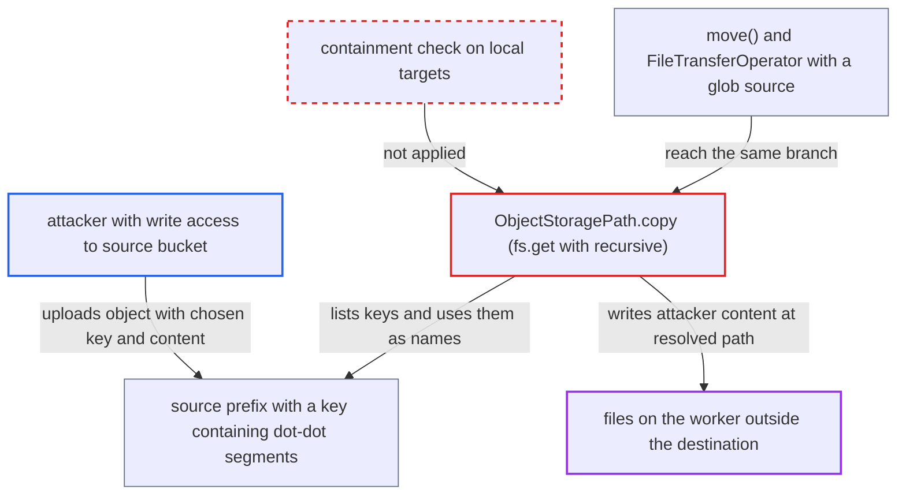

# ObjectStoragePath.copy remote-to-local writes worker files named by the remote listing

| Field | Value |
|---|---|
| ID | `find_01CimTefpm3DaAPB3LjJLdkg` |
| Severity | **Critical** |
| Status | open |
| CWE | CWE-23 — Path traversal |
| Created | 2026-10-27T22:10:13.816557Z |
| Claude Security | https://claude.ai/security/findings/find_01CimTefpm3DaAPB3LjJLdkg |

## Description

Someone who can create objects in a source bucket or prefix can make an Airflow worker write files of their choosing to any path the task's OS user can write. This needs a DAG task that copies a remote directory to a local `file://` destination with `recursive=True`. `ObjectStoragePath.copy()` passes the copy to fsspec's `get`, which builds local file names from the remote object names and never checks that they stay inside the destination.

1. **attacker with write access to the source bucket** uploads an object whose key contains `..` segments. For example the key `incoming/../../../../home/airflow/.ssh/authorized_keys` is accepted by the object store, and the attacker chooses the file content.
2. **a DAG task** calls `ObjectStoragePath("s3://bucket/incoming").copy("file:///data/landing", recursive=True)`. This is the documented way to copy a directory from an object store to local disk, so every local file name comes from the contents of the source bucket. ([`task-sdk/src/airflow/sdk/io/path.py:357-372`](https://github.com/cx-benchmark/airflow/blob/a462d683469bb9f55646b0515ef84c41e16650fb/task-sdk/src/airflow/sdk/io/path.py#L357-L372))
3. **the method `copy()`** hands the whole copy to `self.fs.get(self.path, dst.path, recursive=recursive)`. Airflow does not validate the names the remote store returns, and does not check the resulting local paths, before or after this call. ([`task-sdk/src/airflow/sdk/io/path.py:389-391`](https://github.com/cx-benchmark/airflow/blob/a462d683469bb9f55646b0515ef84c41e16650fb/task-sdk/src/airflow/sdk/io/path.py#L389-L391))
4. **fsspec** lists every object under the prefix and maps each name onto the destination. `fsspec.utils.other_paths` swaps the common prefix for the local destination string, so the key above becomes `/data/landing/../../../../home/airflow/.ssh/authorized_keys`. ([`task-sdk/src/airflow/sdk/io/path.py:389-391`](https://github.com/cx-benchmark/airflow/blob/a462d683469bb9f55646b0515ef84c41e16650fb/task-sdk/src/airflow/sdk/io/path.py#L389-L391))
5. **fsspec and the storage backend** create the parent directories and open the target file for writing. `os.makedirs` and `open(lpath, "wb")` run on the worker's own filesystem, and the operating system resolves the `..` components, so the file lands outside the destination directory. ([`task-sdk/src/airflow/sdk/io/fs.py:41-48`](https://github.com/cx-benchmark/airflow/blob/a462d683469bb9f55646b0515ef84c41e16650fb/task-sdk/src/airflow/sdk/io/fs.py#L41-L48))

## Assessment

The attacker needs no Airflow privileges. They only need to be able to create objects in the bucket or prefix that a task copies from. They rely on a deployment that runs a directory copy from an object store to local disk, such as `ObjectStoragePath("s3://bucket/incoming").copy("file:///data/landing", recursive=True)`, and no user interaction is needed. A second route is `move()` to a local destination, which uses the same branch. A third is the shipped `FileTransferOperator`, which does not pass `recursive`, so a plain prefix source writes nothing. A glob source such as `s3://bucket/incoming/**` is expanded and mapped the same way, but the report infers this from fsspec's `get` logic and not from a shipped example. The report assumes S3 and GCS accept such keys and that the s3fs and gcsfs backends return listing keys unchanged. It notes that these libraries were not installed where the scanner ran.

Impact: The attacker can write a file with chosen content at a chosen absolute path on the worker, limited to locations the task's OS user can write. The report's reasonable worst case is code execution as that user in later tasks, by writing `authorized_keys`, a `.pth` file or `sitecustomize.py` in the Python environment, or a DAG file. That would expose the task-side Execution API token and any secrets the tasks can read. It would also let the attacker change task behaviour or stop the worker.

## Recommendation

The remote-to-local branch of `copy()` (path.py:389-391) delegates directory copies to fsspec's `get`. fsspec names local files from the remote listing with no containment check, so the source store decides where the worker writes. `move()` goes through the same branch.

Fix criteria: Before any local write, every local target derived from a remote listing entry is normalised and confirmed to lie strictly inside the destination directory, rejecting `..`, `\..`, absolute and empty components. Offending entries are skipped, or the copy fails with an error naming the key. The same guarantee holds for `move()`. To verify, copy a prefix containing objects named `p/../../x` and `p\..\..\x` to a local directory with `recursive=True`, and confirm no file is created outside it.

## Evidence

**https://github.com/cx-benchmark/airflow**

- [`task-sdk/src/airflow/sdk/io/path.py:389-391`](https://github.com/cx-benchmark/airflow/blob/a462d683469bb9f55646b0515ef84c41e16650fb/task-sdk/src/airflow/sdk/io/path.py#L389-L391)
- [`task-sdk/src/airflow/sdk/io/path.py:357-372`](https://github.com/cx-benchmark/airflow/blob/a462d683469bb9f55646b0515ef84c41e16650fb/task-sdk/src/airflow/sdk/io/path.py#L357-L372)
- [`task-sdk/src/airflow/sdk/io/fs.py:41-48`](https://github.com/cx-benchmark/airflow/blob/a462d683469bb9f55646b0515ef84c41e16650fb/task-sdk/src/airflow/sdk/io/fs.py#L41-L48)
- [`task-sdk/src/airflow/sdk/io/path.py:444-466`](https://github.com/cx-benchmark/airflow/blob/a462d683469bb9f55646b0515ef84c41e16650fb/task-sdk/src/airflow/sdk/io/path.py#L444-L466)
- [`providers/common/io/src/airflow/providers/common/io/operators/file_transfer.py:73-81`](https://github.com/cx-benchmark/airflow/blob/a462d683469bb9f55646b0515ef84c41e16650fb/providers/common/io/src/airflow/providers/common/io/operators/file_transfer.py#L73-L81)
- [`airflow-core/docs/core-concepts/objectstorage.rst:302-310`](https://github.com/cx-benchmark/airflow/blob/a462d683469bb9f55646b0515ef84c41e16650fb/airflow-core/docs/core-concepts/objectstorage.rst#L302-L310)

