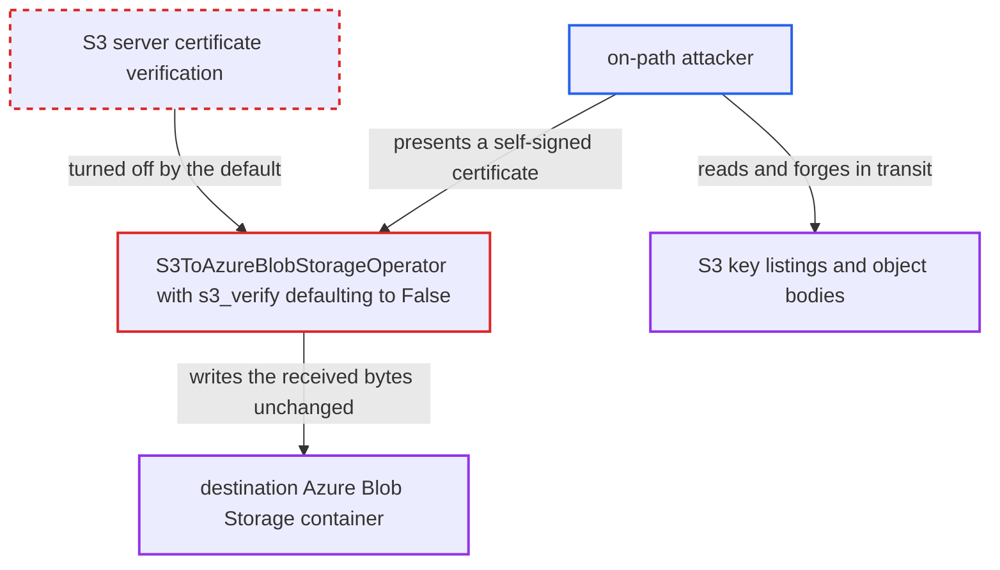

# S3ToAzureBlobStorageOperator disables S3 TLS certificate verification by default

| Field | Value |
|---|---|
| ID | `find_01Jz5tTHpNf9gnLA441bepo6` |
| Severity | **Critical** |
| Status | open |
| CWE | CWE-295 — Improper Certificate Validation |
| Created | 2026-10-27T21:35:51.806688Z |
| Claude Security | https://claude.ai/security/findings/find_01Jz5tTHpNf9gnLA441bepo6 |

## Description

An attacker on the network path between an Airflow worker and the S3 endpoint can read the S3 objects and key listings that `S3ToAzureBlobStorageOperator` transfers. They can also swap in forged data, which the operator then writes to Azure Blob Storage. No Airflow account is needed, but any DAG that leaves out `s3_verify` is exposed. The cause is that `s3_verify` defaults to `False`, which turns off TLS certificate checking.

1. **the constructor of `S3ToAzureBlobStorageOperator`** defaults `s3_verify` to `False`. Every instance built without an explicit `s3_verify` runs with certificate verification off, and the docstring wrongly says certificates are verified by default. ([`providers/microsoft/azure/src/airflow/providers/microsoft/azure/transfers/s3_to_wasb.py:130`](https://github.com/cx-benchmark/airflow/blob/a462d683469bb9f55646b0515ef84c41e16650fb/providers/microsoft/azure/src/airflow/providers/microsoft/azure/transfers/s3_to_wasb.py#L130))
2. **the `s3_hook` property** passes `verify=self.s3_verify` to `S3Hook`. The operator uses this hook for `list_keys` and for the `download_file` call, so both go through the unverified client. ([`providers/microsoft/azure/src/airflow/providers/microsoft/azure/transfers/s3_to_wasb.py:155-158`](https://github.com/cx-benchmark/airflow/blob/a462d683469bb9f55646b0515ef84c41e16650fb/providers/microsoft/azure/src/airflow/providers/microsoft/azure/transfers/s3_to_wasb.py#L155-L158))
3. **`AwsConnectionWrapper`** keeps the `False` value. It reads the connection's `verify` extra only when the hook value is `None`, so the connection setting and `AWS_CA_BUNDLE` cannot turn verification back on. ([`providers/amazon/src/airflow/providers/amazon/aws/utils/connection_wrapper.py:221-223`](https://github.com/cx-benchmark/airflow/blob/a462d683469bb9f55646b0515ef84c41e16650fb/providers/amazon/src/airflow/providers/amazon/aws/utils/connection_wrapper.py#L221-L223))
4. **`get_client_type` in `AwsBaseHook`** builds the boto3 S3 client with `verify=False`. The client keeps TLS on but accepts any server certificate, according to the report's assumption about the pinned `botocore>=1.42.93`. ([`providers/amazon/src/airflow/providers/amazon/aws/hooks/base_aws.py:775-780`](https://github.com/cx-benchmark/airflow/blob/a462d683469bb9f55646b0515ef84c41e16650fb/providers/amazon/src/airflow/providers/amazon/aws/hooks/base_aws.py#L775-L780))
5. **on-path attacker** presents a self-signed certificate and relays traffic to real S3. Because the client accepts any certificate, the attacker can read the listing pages and object bodies, or return forged ones.
6. **`S3ToAzureBlobStorageOperator`** uploads the downloaded bytes to the Azure container unchanged. Forged content therefore ends up as the pipeline's output in Azure Blob Storage.

## Assessment

The attacker needs an on-path position between the Airflow worker and the S3 endpoint. Examples are a hostile proxy, a DNS or route hijack, or a shared network segment. No Airflow account and no action by a victim are needed. The attack works whenever any DAG runs `S3ToAzureBlobStorageOperator` without `s3_verify`. The shipped how-to example does not pass it, so documented usage is affected. Only a DAG author who passes `s3_verify=True` gets a verified connection. The AWS connection's `verify` extra and `AWS_CA_BUNDLE` cannot override the explicit `False`.

Impact: The attacker can read every S3 object and key listing the task transfers. They can also replace the downloaded bytes and the key list, so the content written to Azure is attacker-controlled. AWS secret keys are not exposed, because SigV4 does not send the secret, and the assume-role STS client still verifies certificates. Signed requests cannot be altered to perform other S3 operations, so the damage is limited to the data this task handles.

## Recommendation

`s3_verify` defaults to `False` and that value is forwarded to `S3Hook`, so the S3 client skips certificate validation by default. The explicit `False` also overrides the connection's `verify` extra, and the docstring says the opposite.

Fix criteria: Built without `s3_verify`, the operator gives `S3Hook` a value that is not `False`, for example the `None` that comparable Amazon transfer operators use. The connection's `verify` extra then applies. A test that builds the operator with no `s3_verify` sees that the value reaching `AwsConnectionWrapper.verify` and `boto3` is not `False`. Disabling verification needs an explicit `s3_verify=False`. The docstring and the unit-test assertion match the new default.

## Evidence

**https://github.com/cx-benchmark/airflow**

- [`providers/microsoft/azure/src/airflow/providers/microsoft/azure/transfers/s3_to_wasb.py:130`](https://github.com/cx-benchmark/airflow/blob/a462d683469bb9f55646b0515ef84c41e16650fb/providers/microsoft/azure/src/airflow/providers/microsoft/azure/transfers/s3_to_wasb.py#L130)
- [`providers/microsoft/azure/src/airflow/providers/microsoft/azure/transfers/s3_to_wasb.py:92-93`](https://github.com/cx-benchmark/airflow/blob/a462d683469bb9f55646b0515ef84c41e16650fb/providers/microsoft/azure/src/airflow/providers/microsoft/azure/transfers/s3_to_wasb.py#L92-L93)
- [`providers/microsoft/azure/src/airflow/providers/microsoft/azure/transfers/s3_to_wasb.py:155-158`](https://github.com/cx-benchmark/airflow/blob/a462d683469bb9f55646b0515ef84c41e16650fb/providers/microsoft/azure/src/airflow/providers/microsoft/azure/transfers/s3_to_wasb.py#L155-L158)
- [`providers/amazon/src/airflow/providers/amazon/aws/utils/connection_wrapper.py:221-223`](https://github.com/cx-benchmark/airflow/blob/a462d683469bb9f55646b0515ef84c41e16650fb/providers/amazon/src/airflow/providers/amazon/aws/utils/connection_wrapper.py#L221-L223)
- [`providers/amazon/src/airflow/providers/amazon/aws/hooks/base_aws.py:775-780`](https://github.com/cx-benchmark/airflow/blob/a462d683469bb9f55646b0515ef84c41e16650fb/providers/amazon/src/airflow/providers/amazon/aws/hooks/base_aws.py#L775-L780)
- [`providers/microsoft/azure/tests/system/microsoft/azure/example_s3_to_wasb.py:75-83`](https://github.com/cx-benchmark/airflow/blob/a462d683469bb9f55646b0515ef84c41e16650fb/providers/microsoft/azure/tests/system/microsoft/azure/example_s3_to_wasb.py#L75-L83)

