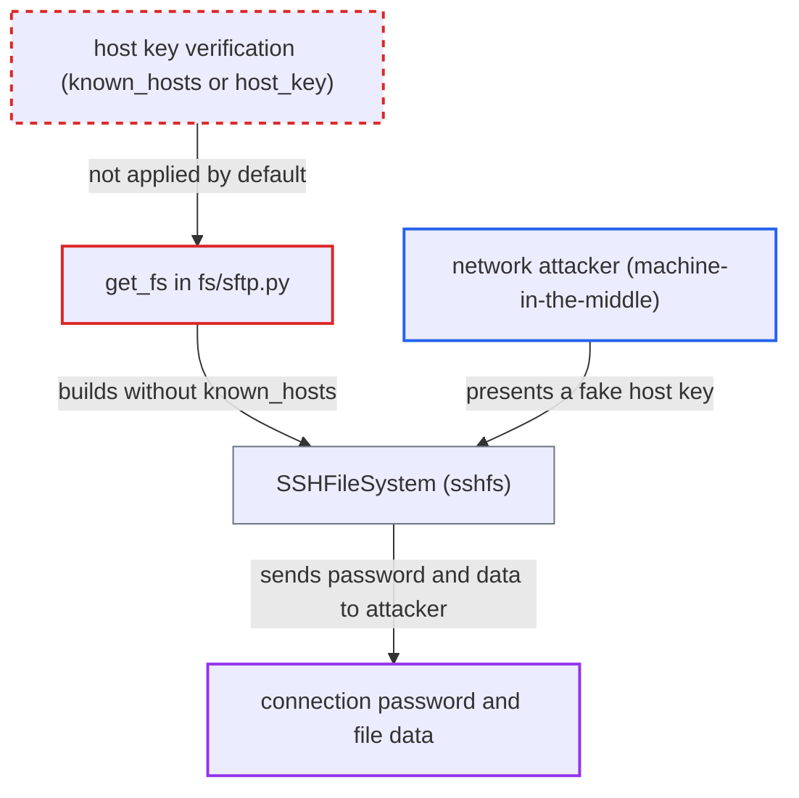

# SFTP/SSH ObjectStoragePath filesystem skips SSH host key verification by default

| Field | Value |
|---|---|
| ID | `find_01L2AG4m4ouUsj4c899npidL` |
| Severity | **Critical** |
| Status | open |
| CWE | CWE-322 — Key exchange without entity authentication |
| Created | 2026-10-27T21:31:32.710575Z |
| Claude Security | https://claude.ai/security/findings/find_01L2AG4m4ouUsj4c899npidL |

## Description

A network attacker between an Airflow worker and an SFTP server can impersonate the server. They can capture the connection's password and the files the task reads or writes. No Airflow account is needed, but the attacker must be able to intercept traffic. The factory `get_fs` passes no `known_hosts` by default, so sshfs turns host key checking off.

1. **task code** opens an `ObjectStoragePath` with an `sftp://` or `ssh://` URL. The scheme is routed to the provider's `get_fs` factory, and `ObjectStore.fs` passes it no storage options. ([`task-sdk/src/airflow/sdk/io/store.py:59-63`](https://github.com/cx-benchmark/airflow/blob/a462d683469bb9f55646b0515ef84c41e16650fb/task-sdk/src/airflow/sdk/io/store.py#L59-L63))
2. **the factory `get_fs`** builds `SSHFileSystem` with the connection's host, port, login and password. These values go into the options that are sent to whichever server answers. ([`providers/sftp/src/airflow/providers/sftp/fs/sftp.py:44-51`](https://github.com/cx-benchmark/airflow/blob/a462d683469bb9f55646b0515ef84c41e16650fb/providers/sftp/src/airflow/providers/sftp/fs/sftp.py#L44-L51))
3. **the factory `get_fs`** leaves out `known_hosts` unless `no_host_key_check` is `true`. The `host_key` extra is never read, so sshfs applies its own default of `known_hosts=None`. The report assumes asyncssh then skips server key validation. ([`providers/sftp/src/airflow/providers/sftp/fs/sftp.py:61-65`](https://github.com/cx-benchmark/airflow/blob/a462d683469bb9f55646b0515ef84c41e16650fb/providers/sftp/src/airflow/providers/sftp/fs/sftp.py#L61-L65))
4. **network attacker** answers in place of the real SFTP server. The attacker needs a machine-in-the-middle position, for example through DNS or ARP spoofing, a compromised hop, or a re-assigned IP. The impostor's host key is accepted.
5. **the worker** authenticates to the impostor and exchanges file data with it. The connection's password is sent to the impostor, and the task reads or writes files through it.

## Assessment

The attacker is a network adversary on the path between the Airflow worker and the SFTP server. They need no Airflow privileges. A task must open an `ObjectStoragePath` with an `sftp://<conn_id>@host/...` or `ssh://` URL, which a normal scheduled run does, and no one has to do anything extra. The `conn_id=None` branch gets the same library default. A connection-based path gives its owner no way to turn verification on. The finding depends on an assumption about dependencies. The report assumes sshfs sets `known_hosts` to `None` in `SSHFileSystem.__init__` and that asyncssh 2.24.1 then disables host key validation.

Impact: The attacker captures the SFTP connection's password and every file the task reads or writes through this filesystem. They can also feed forged file contents to the task, but only for data moving over that connection. Airflow's own state, code execution and availability are not affected.

Subsequent-system impact: With a captured password, the attacker can log in to the real SFTP server as the Airflow service account. They can read or modify everything that account can reach. Key-based connections leak no reusable credential, only the data in transit.

## Recommendation

`get_fs` leaves `known_hosts` unset unless verification is explicitly disabled. This hands the decision to an sshfs default that turns server authentication off, and the connection's `host_key` extra is ignored.

Fix criteria: An `SSHFileSystem` built from a connection verifies the server host key by default. It checks against `~/.ssh/known_hosts`, a `known_hosts` extra, or the `host_key` extra, consistent with `SFTPHookAsync`. It refuses unknown or mismatched hosts. Only an explicit `no_host_key_check=true` may pass `known_hosts=None`. In the default case, the kwarg passed to `SSHFileSystem` is a real known-hosts source, never absent or `None`. A server presenting an unexpected key is rejected.

## Evidence

**https://github.com/cx-benchmark/airflow**

- [`providers/sftp/src/airflow/providers/sftp/fs/sftp.py:61-65`](https://github.com/cx-benchmark/airflow/blob/a462d683469bb9f55646b0515ef84c41e16650fb/providers/sftp/src/airflow/providers/sftp/fs/sftp.py#L61-L65)
- [`providers/sftp/src/airflow/providers/sftp/fs/sftp.py:44-51`](https://github.com/cx-benchmark/airflow/blob/a462d683469bb9f55646b0515ef84c41e16650fb/providers/sftp/src/airflow/providers/sftp/fs/sftp.py#L44-L51)
- [`task-sdk/src/airflow/sdk/io/store.py:59-63`](https://github.com/cx-benchmark/airflow/blob/a462d683469bb9f55646b0515ef84c41e16650fb/task-sdk/src/airflow/sdk/io/store.py#L59-L63)
- [`task-sdk/src/airflow/sdk/io/fs.py:52-104`](https://github.com/cx-benchmark/airflow/blob/a462d683469bb9f55646b0515ef84c41e16650fb/task-sdk/src/airflow/sdk/io/fs.py#L52-L104)
- [`providers/sftp/docs/connections/sftp.rst:68-71`](https://github.com/cx-benchmark/airflow/blob/a462d683469bb9f55646b0515ef84c41e16650fb/providers/sftp/docs/connections/sftp.rst#L68-L71)
- [`providers/sftp/docs/filesystems/sftp.rst:32-39`](https://github.com/cx-benchmark/airflow/blob/a462d683469bb9f55646b0515ef84c41e16650fb/providers/sftp/docs/filesystems/sftp.rst#L32-L39)
- [`providers/sftp/src/airflow/providers/sftp/hooks/sftp.py:1010-1015`](https://github.com/cx-benchmark/airflow/blob/a462d683469bb9f55646b0515ef84c41e16650fb/providers/sftp/src/airflow/providers/sftp/hooks/sftp.py#L1010-L1015)

