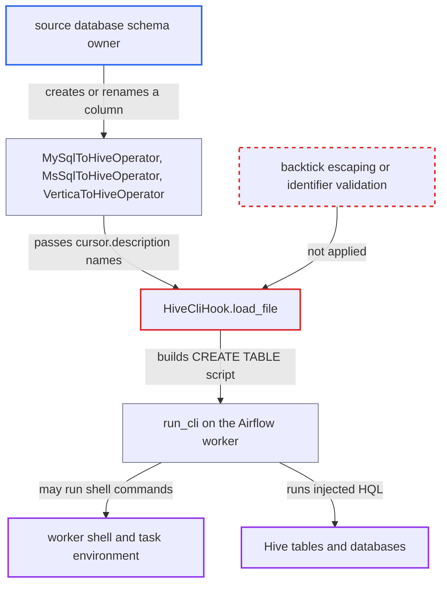

# Source-database column names injected unescaped into Hive CREATE TABLE by *ToHive transfers

| Field | Value |
|---|---|
| ID | `find_01SmHnMvYdWFqKdzZzsWnbeH` |
| Severity | **Critical** |
| Status | open |
| CWE | CWE-89 — SQL injection |
| Created | 2026-10-27T21:44:06.525176Z |
| Claude Security | https://claude.ai/security/findings/find_01SmHnMvYdWFqKdzZzsWnbeH |

## Description

Someone who can create or rename columns or views in a MySQL, SQL Server or Vertica database can make Airflow run their text as HQL on Hive, and possibly as shell commands on the worker. This needs a DAG that uses a `*ToHive` transfer with a query whose column names come from the source schema, such as `SELECT *`. `HiveCliHook.load_file` puts column names into `CREATE TABLE` after removing only outer backticks.

1. **source database schema owner** creates or renames a column to a malicious name. The name contains a backtick, a closing parenthesis, a semicolon and a newline, which MySQL, SQL Server and Vertica accept in delimited identifiers; the attacker needs no Airflow role.
2. **the operator `MySqlToHiveOperator`** reads the column names from `cursor.description` and passes them to `load_file`. The names become `field_dict` keys unchanged, and `create` defaults to `True`; `MsSqlToHiveOperator` and `VerticaToHiveOperator` do the same. ([`providers/apache/hive/src/airflow/providers/apache/hive/transfers/mysql_to_hive.py:151-171`](https://github.com/cx-benchmark/airflow/blob/a462d683469bb9f55646b0515ef84c41e16650fb/providers/apache/hive/src/airflow/providers/apache/hive/transfers/mysql_to_hive.py#L151-L171))
3. **the hook method `load_file`** writes each key into `CREATE TABLE IF NOT EXISTS` inside backticks. It only calls 'k.strip(''')', which removes backticks at the ends of the name, so a backtick inside the name closes the identifier and the rest is parsed as HQL. ([`providers/apache/hive/src/airflow/providers/apache/hive/hooks/hive.py:524-539`](https://github.com/cx-benchmark/airflow/blob/a462d683469bb9f55646b0515ef84c41e16650fb/providers/apache/hive/src/airflow/providers/apache/hive/hooks/hive.py#L524-L539))
4. **the hook method `run_cli`** writes the script to a file and runs it with `hive -f` or `beeline -f` on the worker. The script body is not checked; only `schema` is. The injected statements run with the Hive connection's identity. ([`providers/apache/hive/src/airflow/providers/apache/hive/hooks/hive.py:338-376`](https://github.com/cx-benchmark/airflow/blob/a462d683469bb9f55646b0515ef84c41e16650fb/providers/apache/hive/src/airflow/providers/apache/hive/hooks/hive.py#L338-L376))
5. **the Hive client** may run a line starting with `!` or `!sh` as a shell command. The report marks this as an assumption about external Hive CLI and Beeline binaries, whose version this repository does not pin.

## Assessment

The attacker holds rights to change the schema (create or rename columns or views) of a MySQL, SQL Server or Vertica database that an Airflow `MySqlToHiveOperator`, `MsSqlToHiveOperator` or `VerticaToHiveOperator` reads. The DAG's query must take column names from that schema, for example `SELECT *`, which the provider's own integration test uses. The attacker needs no Airflow role. The transfer must run with `create` or `recreate`, and `create` is `True` by default. The injected text is carried in on the next scheduled run. Shell execution depends on the Hive client's handling of `!` and `!sh` lines, which the report treats as an assumption.

Impact: The attacker's text runs as HQL in the Hive client process on the Airflow worker, in the task's environment. If the client runs shell lines, the attacker gets shell access as the worker user. That access exposes the task's Execution API token, which can fetch any Connection or Variable. With the Hive CLI, `LOAD DATA LOCAL INPATH` can also copy worker-local files into tables the attacker can read.

Subsequent-system impact: Arbitrary HQL runs on the Hive cluster with the identity of the Airflow Hive connection. The attacker can read and exfiltrate data with `INSERT OVERWRITE DIRECTORY`. They can also overwrite or drop any table or database that identity can reach. A schema owner on the upstream database holds none of these rights.

## Recommendation

(1) `HiveCliHook.load_file`, and `load_df` which delegates to it, writes `field_dict` keys into HQL as quoted identifiers after removing only the outer backticks. An embedded backtick breaks out of the identifier and adds statements to the script that `run_cli` executes.

Fix criteria: Every identifier `load_file` puts into HQL is either escaped by Hive's rules (each embedded backtick doubled) or rejected unless it matches a strict identifier pattern. Statement separators and newlines cannot add statements. A source column whose name has a backtick, a closing parenthesis, a semicolon, a newline, a `!sh id` line and a comment marker produces either a single `CREATE TABLE` with that literal column name or a rejection. It never produces extra HQL or shell commands, under both the Hive CLI and Beeline.

(2) `MySqlToHiveOperator`, `MsSqlToHiveOperator` and `VerticaToHiveOperator` pass column names reported by an external database to `load_file` as if they were trusted identifiers.

Fix criteria: Column names taken from `cursor.description` are validated or escaped before they reach HQL, either in these operators or in the hook. A test shows that a malicious source column name cannot change the statements sent to Hive.

## Evidence

**https://github.com/cx-benchmark/airflow**

- [`providers/apache/hive/src/airflow/providers/apache/hive/hooks/hive.py:524-539`](https://github.com/cx-benchmark/airflow/blob/a462d683469bb9f55646b0515ef84c41e16650fb/providers/apache/hive/src/airflow/providers/apache/hive/hooks/hive.py#L524-L539)
- [`providers/apache/hive/src/airflow/providers/apache/hive/transfers/mysql_to_hive.py:151-171`](https://github.com/cx-benchmark/airflow/blob/a462d683469bb9f55646b0515ef84c41e16650fb/providers/apache/hive/src/airflow/providers/apache/hive/transfers/mysql_to_hive.py#L151-L171)
- [`providers/apache/hive/src/airflow/providers/apache/hive/transfers/mssql_to_hive.py:118-139`](https://github.com/cx-benchmark/airflow/blob/a462d683469bb9f55646b0515ef84c41e16650fb/providers/apache/hive/src/airflow/providers/apache/hive/transfers/mssql_to_hive.py#L118-L139)
- [`providers/apache/hive/src/airflow/providers/apache/hive/transfers/vertica_to_hive.py:123-143`](https://github.com/cx-benchmark/airflow/blob/a462d683469bb9f55646b0515ef84c41e16650fb/providers/apache/hive/src/airflow/providers/apache/hive/transfers/vertica_to_hive.py#L123-L143)
- [`providers/apache/hive/src/airflow/providers/apache/hive/hooks/hive.py:338-376`](https://github.com/cx-benchmark/airflow/blob/a462d683469bb9f55646b0515ef84c41e16650fb/providers/apache/hive/src/airflow/providers/apache/hive/hooks/hive.py#L338-L376)
- [`providers/apache/hive/tests/integration/apache/hive/transfers/test_mssql_to_hive.py:46-49`](https://github.com/cx-benchmark/airflow/blob/a462d683469bb9f55646b0515ef84c41e16650fb/providers/apache/hive/tests/integration/apache/hive/transfers/test_mssql_to_hive.py#L46-L49)

