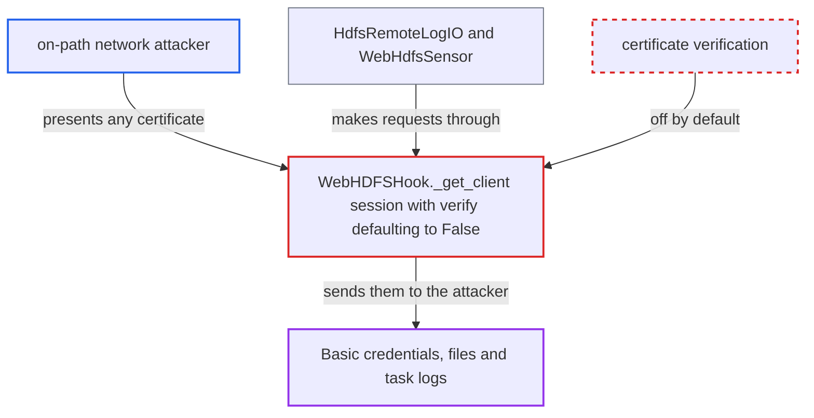

# WebHDFS hook disables TLS certificate verification by default when use_ssl is enabled

| Field | Value |
|---|---|
| ID | `find_01JUVPEiiURLnxHqgmr6FhyD` |
| Severity | **Critical** |
| Status | open |
| CWE | CWE-295 — Improper certificate validation |
| Created | 2026-10-27T21:39:25.250569Z |
| Claude Security | https://claude.ai/security/findings/find_01JUVPEiiURLnxHqgmr6FhyD |

## Description

A network attacker between an Airflow worker, triggerer or API server and the WebHDFS endpoint can read the traffic and forge responses. That includes the connection's Basic login and password, file contents and task logs. It applies when a `webhdfs` connection sets `use_ssl` without `verify`. The cause is `WebHDFSHook._get_client`, which defaults `session.verify` to `False`.

1. **operator** enables `use_ssl` on a `webhdfs` connection and leaves out `verify`. The user-facing `connections.rst` does not say that leaving `verify` out turns certificate checking off, so the operator has no reason to expect it. ([`providers/apache/hdfs/docs/connections.rst:44-47`](https://github.com/cx-benchmark/airflow/blob/a462d683469bb9f55646b0515ef84c41e16650fb/providers/apache/hdfs/docs/connections.rst#L44-L47))
2. **the hook `WebHDFSHook._get_client`** switches to `https://` and sets `session.verify` from the `verify` extra, defaulting to `False`. The `requests` default is `True`. The `False` default replaces it, so the session accepts any server certificate and does no hostname check. ([`providers/apache/hdfs/src/airflow/providers/apache/hdfs/hooks/webhdfs.py:118-120`](https://github.com/cx-benchmark/airflow/blob/a462d683469bb9f55646b0515ef84c41e16650fb/providers/apache/hdfs/src/airflow/providers/apache/hdfs/hooks/webhdfs.py#L118-L120))
3. **the hook `_find_valid_server`** builds the client and calls `client.status("/")` on every `get_conn()`. This sends an authenticated request over the unverified channel before any user operation runs. ([`providers/apache/hdfs/src/airflow/providers/apache/hdfs/hooks/webhdfs.py:83-94`](https://github.com/cx-benchmark/airflow/blob/a462d683469bb9f55646b0515ef84c41e16650fb/providers/apache/hdfs/src/airflow/providers/apache/hdfs/hooks/webhdfs.py#L83-L94))
4. **on-path attacker** completes the TLS handshake with their own certificate. The client does not check the certificate, so it sends the Basic-auth header (when a password is set) to the attacker. ([`providers/apache/hdfs/src/airflow/providers/apache/hdfs/hooks/webhdfs.py:113-116`](https://github.com/cx-benchmark/airflow/blob/a462d683469bb9f55646b0515ef84c41e16650fb/providers/apache/hdfs/src/airflow/providers/apache/hdfs/hooks/webhdfs.py#L113-L116))
5. **Airflow code using the session** sends file, listing and log requests through the same session and accepts the attacker's replies. `check_for_path`, `load_file`, `read_file` and `WebHdfsSensor` all go through this session, and so does the remote task-log handler. ([`providers/apache/hdfs/src/airflow/providers/apache/hdfs/hooks/webhdfs.py:146-149`](https://github.com/cx-benchmark/airflow/blob/a462d683469bb9f55646b0515ef84c41e16650fb/providers/apache/hdfs/src/airflow/providers/apache/hdfs/hooks/webhdfs.py#L146-L149))

## Assessment

The attacker sits on the network path between an Airflow worker, triggerer or API server and the WebHDFS endpoint, for example through DNS or route hijack or a hostile proxy. They need no Airflow privileges and no victim action. The connection must set `use_ssl` without `verify`. The attack also needs no CA-bundle environment variable set: `REQUESTS_CA_BUNDLE` or `CURL_CA_BUNDLE` can override the session's `False`, and the reference image sets neither. The hook is used by `WebHdfsSensor`, by DAG code and by the shipped HDFS remote-log path. That path uploads task logs from workers and reads them back for display.

Impact: The attacker can read the connection's Basic login and password when one is set. They can also read every file, listing and task log the hook transfers. They can forge what `read_file` and `check_for_path` return to DAG code and the log reader, and alter or drop uploads. With Kerberos, no reusable Basic password is exposed, but file contents still are. Airflow's availability is not affected beyond failed requests.

Subsequent-system impact: In non-Kerberos mode with a password configured, the captured Basic credential lets the attacker authenticate directly to the WebHDFS endpoint or gateway as Airflow's identity. The report does not say how far that access reaches, so the impact on HDFS is rated limited.

## Recommendation

`_get_client` defaults `session.verify` to `False` when `use_ssl` is enabled. This silently turns off server certificate validation and exposes credentials and data to machine-in-the-middle attackers.

Fix criteria: With `use_ssl` enabled and no `verify` extra, the session verifies the server certificate against the system or CA bundle (`verify=True` semantics). Turning verification off needs an explicit opt-out. A test builds the hook from a connection with only `use_ssl` set and asserts `session.verify` is `True`. The same test shows that an untrusted certificate makes the connection fail. An explicit `verify: false` or a CA path still behaves as configured. `connections.rst` documents the default.

## Evidence

**https://github.com/cx-benchmark/airflow**

- [`providers/apache/hdfs/src/airflow/providers/apache/hdfs/hooks/webhdfs.py:118-120`](https://github.com/cx-benchmark/airflow/blob/a462d683469bb9f55646b0515ef84c41e16650fb/providers/apache/hdfs/src/airflow/providers/apache/hdfs/hooks/webhdfs.py#L118-L120)
- [`providers/apache/hdfs/src/airflow/providers/apache/hdfs/hooks/webhdfs.py:106-111`](https://github.com/cx-benchmark/airflow/blob/a462d683469bb9f55646b0515ef84c41e16650fb/providers/apache/hdfs/src/airflow/providers/apache/hdfs/hooks/webhdfs.py#L106-L111)
- [`providers/apache/hdfs/src/airflow/providers/apache/hdfs/hooks/webhdfs.py:113-116`](https://github.com/cx-benchmark/airflow/blob/a462d683469bb9f55646b0515ef84c41e16650fb/providers/apache/hdfs/src/airflow/providers/apache/hdfs/hooks/webhdfs.py#L113-L116)
- [`providers/apache/hdfs/src/airflow/providers/apache/hdfs/hooks/webhdfs.py:83-94`](https://github.com/cx-benchmark/airflow/blob/a462d683469bb9f55646b0515ef84c41e16650fb/providers/apache/hdfs/src/airflow/providers/apache/hdfs/hooks/webhdfs.py#L83-L94)
- [`providers/apache/hdfs/src/airflow/providers/apache/hdfs/hooks/webhdfs.py:146-149`](https://github.com/cx-benchmark/airflow/blob/a462d683469bb9f55646b0515ef84c41e16650fb/providers/apache/hdfs/src/airflow/providers/apache/hdfs/hooks/webhdfs.py#L146-L149)
- [`providers/apache/hdfs/src/airflow/providers/apache/hdfs/log/hdfs_task_handler.py:86-103`](https://github.com/cx-benchmark/airflow/blob/a462d683469bb9f55646b0515ef84c41e16650fb/providers/apache/hdfs/src/airflow/providers/apache/hdfs/log/hdfs_task_handler.py#L86-L103)
- [`airflow-core/src/airflow/config_templates/airflow_local_settings.py:295-310`](https://github.com/cx-benchmark/airflow/blob/a462d683469bb9f55646b0515ef84c41e16650fb/airflow-core/src/airflow/config_templates/airflow_local_settings.py#L295-L310)
- [`providers/apache/hdfs/docs/connections.rst:44-47`](https://github.com/cx-benchmark/airflow/blob/a462d683469bb9f55646b0515ef84c41e16650fb/providers/apache/hdfs/docs/connections.rst#L44-L47)

