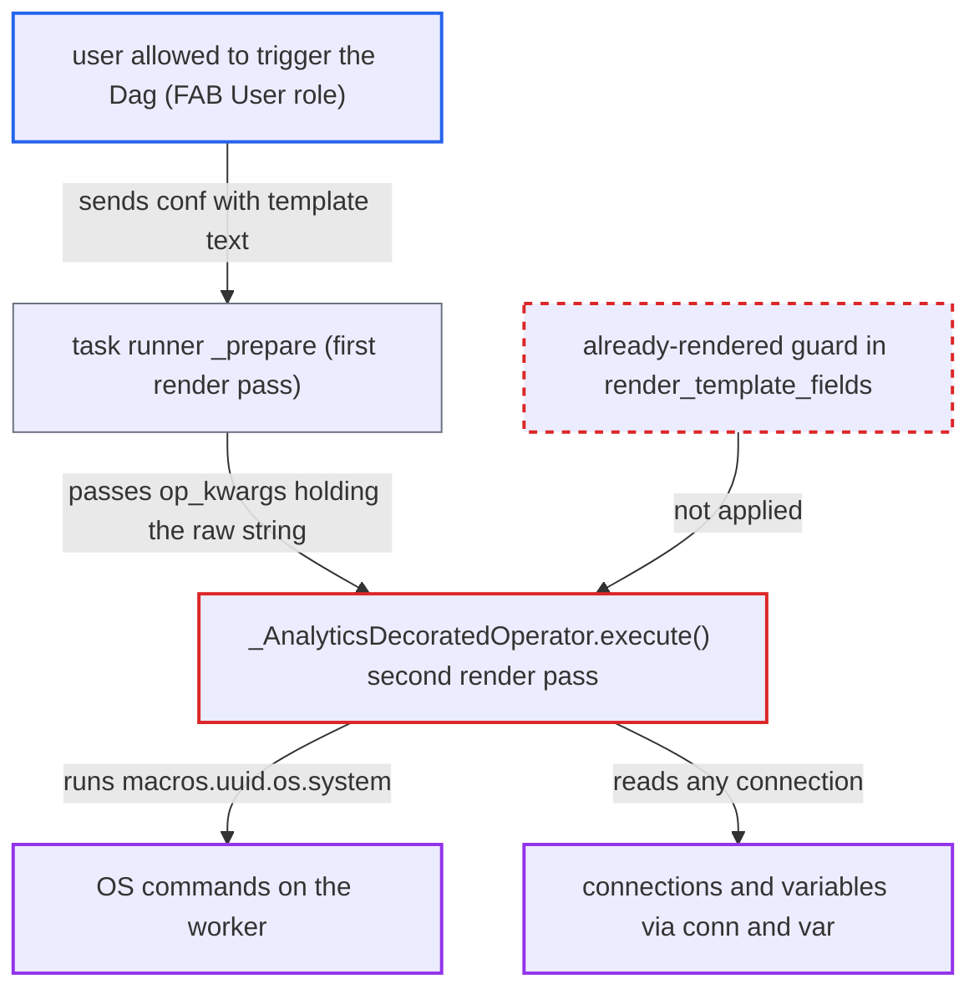

# @task.analytics re-renders already-rendered TaskFlow arguments: SSTI from dag_run.conf, params, XCom

| Field | Value |
|---|---|
| ID | `find_01TRpTWNZyGtyhm2d74N32eu` |
| Severity | **High** |
| Status | open |
| CWE | CWE-1336 — Server-side template injection |
| Created | 2026-10-27T21:35:09.508471Z |
| Claude Security | https://claude.ai/security/findings/find_01TRpTWNZyGtyhm2d74N32eu |

## Description

A logged-in user who can only trigger a Dag can run operating-system commands on the Airflow worker and read any connection or variable. This works when the Dag has a `@task.analytics` task that passes `dag_run.conf`, `params` or an upstream XComArg as a TaskFlow argument. `_AnalyticsDecoratedOperator.execute()` renders all template fields a second time, so the already-substituted user text is run as Jinja code.

1. **Attacker** triggers the Dag with template text in `conf`. The attacker POSTs to `/api/v2/dags/{id}/dagRuns` with `conf={"table": "{{ macros.uuid.os.system('id') }}"}`. Only the right to create a Dag run is needed, and the `conf` is stored on the DagRun. ([`airflow-core/src/airflow/api_fastapi/core_api/routes/public/dag_run.py:776-853`](https://github.com/cx-benchmark/airflow/blob/a462d683469bb9f55646b0515ef84c41e16650fb/airflow-core/src/airflow/api_fastapi/core_api/routes/public/dag_run.py#L776-L853))
2. **Dag author's call** hands the runtime value to the task as `op_kwargs` or `op_args`. TaskFlow call arguments such as `my_queries(table="{{ dag_run.conf['table'] }}")` become the templated fields `op_args` and `op_kwargs`. ([`task-sdk/src/airflow/sdk/bases/decorator.py:563-575`](https://github.com/cx-benchmark/airflow/blob/a462d683469bb9f55646b0515ef84c41e16650fb/task-sdk/src/airflow/sdk/bases/decorator.py#L563-L575))
3. **task runner `_prepare`** renders every template field once. This first pass substitutes the `conf` value, so `op_kwargs` now holds the attacker's raw string. ([`task-sdk/src/airflow/sdk/execution_time/task_runner.py:1500-1508`](https://github.com/cx-benchmark/airflow/blob/a462d683469bb9f55646b0515ef84c41e16650fb/task-sdk/src/airflow/sdk/execution_time/task_runner.py#L1500-L1508))
4. **the operator's `execute()`** stores the callable's result in `self.queries` and calls `self.render_template_fields(context)` again. The second pass is meant only for the new `queries`, but it also covers `op_args`, `op_kwargs`, `max_rows_check` and `result_output_format`. ([`providers/common/sql/src/airflow/providers/common/sql/decorators/analytics.py:117-122`](https://github.com/cx-benchmark/airflow/blob/a462d683469bb9f55646b0515ef84c41e16650fb/providers/common/sql/src/airflow/providers/common/sql/decorators/analytics.py#L117-L122))
5. **`render_template_fields`** compiles every string as Jinja with the full task context. It has no already-rendered guard. Strings inside lists, tuples and dicts are compiled with `jinja_env.from_string()` too. ([`task-sdk/src/airflow/sdk/definitions/_internal/templater.py:255-275`](https://github.com/cx-benchmark/airflow/blob/a462d683469bb9f55646b0515ef84c41e16650fb/task-sdk/src/airflow/sdk/definitions/_internal/templater.py#L255-L275))
6. **Jinja expression** reaches the standard `os` module through `macros.uuid.os.system`. `macros` proxies a module whose `uuid` is the stdlib module, and `is_safe_attribute` blocks only internal attributes, so `uuid.os.system` is allowed. ([`task-sdk/src/airflow/sdk/definitions/_internal/templater.py:315-322`](https://github.com/cx-benchmark/airflow/blob/a462d683469bb9f55646b0515ef84c41e16650fb/task-sdk/src/airflow/sdk/definitions/_internal/templater.py#L315-L322))
7. **Jinja expression** runs commands on the worker or reads connections with `conn.<id>.password`. The command runs before the query executes, so it runs even if the query fails. The connection lookup goes through the Execution API, which applies no per-Dag authorization. ([`task-sdk/src/airflow/sdk/execution_time/context.py:631-637`](https://github.com/cx-benchmark/airflow/blob/a462d683469bb9f55646b0515ef84c41e16650fb/task-sdk/src/airflow/sdk/execution_time/context.py#L631-L637))
8. **task runner** sends the re-rendered values as Rendered Task Instance Fields. `overwrite_rtif_after_execution = True` means the output of the second pass is shown in the UI, so the attacker can read results back there. ([`task-sdk/src/airflow/sdk/execution_time/task_runner.py:2496-2500`](https://github.com/cx-benchmark/airflow/blob/a462d683469bb9f55646b0515ef84c41e16650fb/task-sdk/src/airflow/sdk/execution_time/task_runner.py#L2496-L2500))

## Assessment

The attacker is an authenticated user who may trigger the Dag, such as the FAB `User` role. That role can create Dag runs but has no Dag-file, Connection or Variable rights. The Dag must contain a `@task.analytics` task whose TaskFlow arguments carry runtime data. That data can be `dag_run.conf`, `params` or an upstream XComArg, and the Dag author has not done anything unusual. The same flaw applies to `max_rows_check` and `result_output_format` when they are templated from runtime input. It also applies to any runtime value the callable puts into the SQL it returns. `datasource_configs` is not affected, because `DataSourceConfig` has no `template_fields`.

Impact: The attacker can run arbitrary Jinja in the worker's task context. That means OS command execution as the worker user and reading any connection or variable through the Execution API. Results can be read back in the UI Rendered tab, so the task process and the secrets Airflow holds are fully compromised.

Subsequent-system impact: The stolen connections are credentials for external systems that Airflow uses, such as object stores, catalogs, databases and clouds. The attacker has no connection rights in Airflow, yet can use them to read and modify those systems.

## Recommendation

`_AnalyticsDecoratedOperator.execute()` runs Jinja over all template fields a second time. This includes `op_args`, `op_kwargs`, `max_rows_check` and `result_output_format`, which the runner's first pass already filled in. Runtime data from conf, params or XCom is therefore treated as template source.

Fix criteria: Each field the runner already rendered is rendered exactly once. At execute time only the newly returned `queries` is rendered, or the second pass is removed. To verify, trigger a Dag whose `@task.analytics` takes `t="{{ dag_run.conf['t'] }}"` with `conf={'t': '{{ 7*7 }}'}`. The callable and the Rendered Task Instance Fields must receive and show the literal `{{ 7*7 }}`. A `{{ macros.uuid.os.system(...) }}` value in conf must not run.

## Evidence

**https://github.com/cx-benchmark/airflow**

- [`providers/common/sql/src/airflow/providers/common/sql/decorators/analytics.py:117-122`](https://github.com/cx-benchmark/airflow/blob/a462d683469bb9f55646b0515ef84c41e16650fb/providers/common/sql/src/airflow/providers/common/sql/decorators/analytics.py#L117-L122)
- [`providers/common/sql/src/airflow/providers/common/sql/decorators/analytics.py:52-61`](https://github.com/cx-benchmark/airflow/blob/a462d683469bb9f55646b0515ef84c41e16650fb/providers/common/sql/src/airflow/providers/common/sql/decorators/analytics.py#L52-L61)
- [`providers/common/sql/src/airflow/providers/common/sql/operators/analytics.py:47-52`](https://github.com/cx-benchmark/airflow/blob/a462d683469bb9f55646b0515ef84c41e16650fb/providers/common/sql/src/airflow/providers/common/sql/operators/analytics.py#L47-L52)
- [`task-sdk/src/airflow/sdk/execution_time/task_runner.py:1500-1508`](https://github.com/cx-benchmark/airflow/blob/a462d683469bb9f55646b0515ef84c41e16650fb/task-sdk/src/airflow/sdk/execution_time/task_runner.py#L1500-L1508)
- [`task-sdk/src/airflow/sdk/bases/decorator.py:563-575`](https://github.com/cx-benchmark/airflow/blob/a462d683469bb9f55646b0515ef84c41e16650fb/task-sdk/src/airflow/sdk/bases/decorator.py#L563-L575)
- [`task-sdk/src/airflow/sdk/bases/operator.py:1643-1658`](https://github.com/cx-benchmark/airflow/blob/a462d683469bb9f55646b0515ef84c41e16650fb/task-sdk/src/airflow/sdk/bases/operator.py#L1643-L1658)
- [`task-sdk/src/airflow/sdk/definitions/_internal/templater.py:255-275`](https://github.com/cx-benchmark/airflow/blob/a462d683469bb9f55646b0515ef84c41e16650fb/task-sdk/src/airflow/sdk/definitions/_internal/templater.py#L255-L275)
- [`task-sdk/src/airflow/sdk/execution_time/task_runner.py:355-363`](https://github.com/cx-benchmark/airflow/blob/a462d683469bb9f55646b0515ef84c41e16650fb/task-sdk/src/airflow/sdk/execution_time/task_runner.py#L355-L363)
- [`task-sdk/src/airflow/sdk/execution_time/context.py:1197-1216`](https://github.com/cx-benchmark/airflow/blob/a462d683469bb9f55646b0515ef84c41e16650fb/task-sdk/src/airflow/sdk/execution_time/context.py#L1197-L1216)
- [`task-sdk/src/airflow/sdk/definitions/_internal/templater.py:315-322`](https://github.com/cx-benchmark/airflow/blob/a462d683469bb9f55646b0515ef84c41e16650fb/task-sdk/src/airflow/sdk/definitions/_internal/templater.py#L315-L322)
- [`task-sdk/src/airflow/sdk/execution_time/context.py:631-637`](https://github.com/cx-benchmark/airflow/blob/a462d683469bb9f55646b0515ef84c41e16650fb/task-sdk/src/airflow/sdk/execution_time/context.py#L631-L637)
- [`task-sdk/src/airflow/sdk/execution_time/task_runner.py:2496-2500`](https://github.com/cx-benchmark/airflow/blob/a462d683469bb9f55646b0515ef84c41e16650fb/task-sdk/src/airflow/sdk/execution_time/task_runner.py#L2496-L2500)
- [`airflow-core/src/airflow/api_fastapi/core_api/routes/public/dag_run.py:776-853`](https://github.com/cx-benchmark/airflow/blob/a462d683469bb9f55646b0515ef84c41e16650fb/airflow-core/src/airflow/api_fastapi/core_api/routes/public/dag_run.py#L776-L853)
- [`providers/fab/src/airflow/providers/fab/auth_manager/security_manager/override.py:305-313`](https://github.com/cx-benchmark/airflow/blob/a462d683469bb9f55646b0515ef84c41e16650fb/providers/fab/src/airflow/providers/fab/auth_manager/security_manager/override.py#L305-L313)

