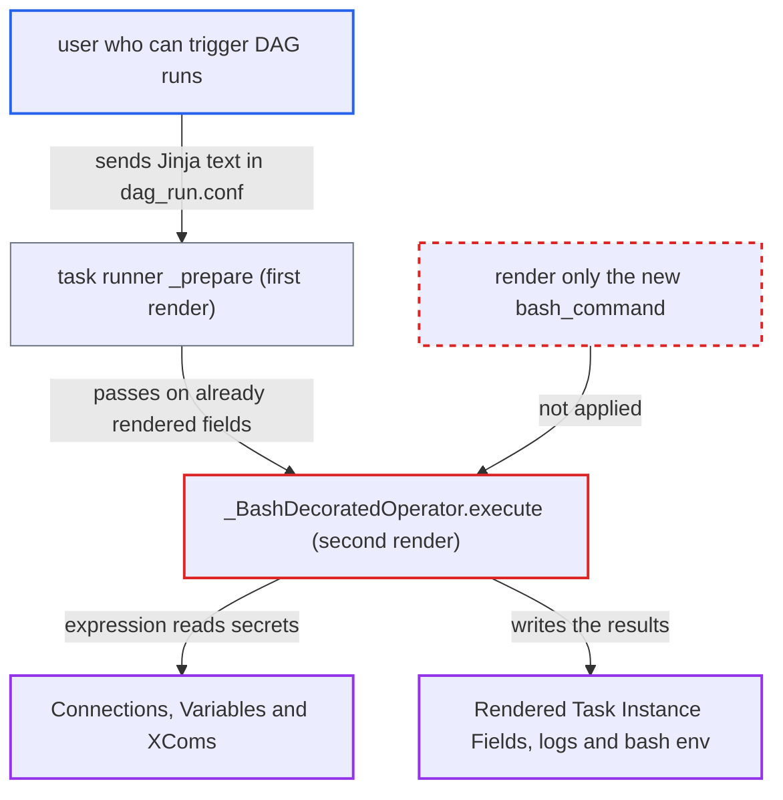

# @task.bash re-renders already-rendered template fields, enabling template injection via dag_run.conf

| Field | Value |
|---|---|
| ID | `find_01KFYL7ZwXAGPcrY673sfu4L` |
| Severity | **High** |
| Status | open |
| CWE | CWE-1336 — Server-side template injection |
| Created | 2026-10-27T21:11:25.199993Z |
| Claude Security | https://claude.ai/security/findings/find_01KFYL7ZwXAGPcrY673sfu4L |

## Description

A user who can trigger a DAG run can make `@task.bash` evaluate their input as Jinja code. That lets them read any Connection or Variable in the deployment, and run shell commands on the worker when the returned command embeds the value, even quoted. It needs a DAG that uses `@task.bash` and passes `dag_run.conf` or `params` through `env`, `cwd` or the returned command, which is the documented pattern. The cause is `_BashDecoratedOperator.execute` calling `render_template_fields` a second time on fields the runner already rendered.

1. **attacker** triggers a DAG run with a Jinja expression in its conf. For example the conf value is `{{ conn.aws_default.password | reverse }}` or `{{ var.value.get('secret') }}`, sent to a DAG that passes `dag_run.conf` into `env` as the docs recommend.
2. **the task runner `_prepare`** renders all template fields once before `execute` runs. `env={'m': '{{ dag_run.conf["m"] }}'}` becomes `env={'m': <attacker string>}`, so the attacker's text is now plain field content. ([`task-sdk/src/airflow/sdk/execution_time/task_runner.py:1507-1508`](https://github.com/cx-benchmark/airflow/blob/a462d683469bb9f55646b0515ef84c41e16650fb/task-sdk/src/airflow/sdk/execution_time/task_runner.py#L1507-L1508))
3. **the operator `_BashDecoratedOperator.execute`** calls `render_template_fields` again after getting the command from the callable. This renders every field in `template_fields` (`op_args`, `op_kwargs`, `bash_command`, `env`, `cwd`), not only the new command string, so the first pass's output is treated as template source. ([`providers/standard/src/airflow/providers/standard/decorators/bash.py:78-86`](https://github.com/cx-benchmark/airflow/blob/a462d683469bb9f55646b0515ef84c41e16650fb/providers/standard/src/airflow/providers/standard/decorators/bash.py#L78-L86))
4. **`render_template`** compiles the attacker string with `jinja_env.from_string()` and renders it with the full task context. Nothing marks a field as already rendered, so any `str` is evaluated with `var`, `conn`, `ti`, `task_instance`, `dag_run` and `macros` available. ([`task-sdk/src/airflow/sdk/definitions/_internal/templater.py:251-258`](https://github.com/cx-benchmark/airflow/blob/a462d683469bb9f55646b0515ef84c41e16650fb/task-sdk/src/airflow/sdk/definitions/_internal/templater.py#L251-L258))
5. **the injected expression** reads Connections and Variables through the `conn` and `var` accessors. These fetch any secret through the Execution API, which has no per-DAG authorization. ([`task-sdk/src/airflow/sdk/execution_time/context.py:631-690`](https://github.com/cx-benchmark/airflow/blob/a462d683469bb9f55646b0515ef84c41e16650fb/task-sdk/src/airflow/sdk/execution_time/context.py#L631-L690))
6. **the task runner** sends the re-rendered field values to the API server as Rendered Task Instance Fields. `overwrite_rtif_after_execution` is `True` on `_BashDecoratedOperator`, so the evaluated result is shown in the UI. The value also reaches the bash environment and logs. ([`task-sdk/src/airflow/sdk/execution_time/task_runner.py:2496-2502`](https://github.com/cx-benchmark/airflow/blob/a462d683469bb9f55646b0515ef84c41e16650fb/task-sdk/src/airflow/sdk/execution_time/task_runner.py#L2496-L2502))

## Assessment

The attacker is an authenticated API or UI user who can trigger runs of a DAG, with low privileges. The DAG must use `@task.bash` and pass `dag_run.conf` or `params` into `env`, `cwd` or the returned command. The documented pattern `env={"message": '{{ dag_run.conf["message"] }}'}` already qualifies. XCom values from upstream tasks are another way in, because the first render also substitutes them into these fields. A second effect is that the double render defeats quoting. A conf value such as `{{ "%c"|format(39) }}` produces a single quote with no quote character in the input, so a `shlex.quote()`-wrapped value still breaks out of its quotes before `bash -c` runs it.

Impact: The attacker can read any Connection or Variable, and any XCom through `ti.xcom_pull(dag_id=...)`. They can show the values in logs or Rendered Task Instance Fields, with `| reverse` or `| list | join(' ')` to evade exact-match secret masking. When the DAG embeds the value in the returned command, they get arbitrary shell execution on the worker as the Airflow user, and `ti.xcom_push(...)` can also be called from the template. They can crash only the affected task, for example through template errors or `macros.time.sleep`.

Subsequent-system impact: Connections hold credentials for external systems such as databases and cloud accounts. Reading them with `{{ conn.X.password }}` gives the attacker those credentials. What they allow depends on each external system, and the report does not say more.

## Recommendation

(1) `_BashDecoratedOperator.execute` re-renders every template field (`op_args`, `op_kwargs`, `env`, `cwd`, `bash_command`) after the task runner already rendered them. Data from `dag_run.conf`, `params` and XCom is therefore evaluated as Jinja in the second pass.

Fix criteria: Only the string newly produced by the callable is Jinja-rendered. `env`, `cwd`, `op_args` and `op_kwargs` are rendered exactly once, by the runner, and never re-evaluated. Test: trigger a DAG whose `@task.bash` uses `env={"m": '{{ dag_run.conf["m"] }}'}` with conf `{"m": "{{ var.value.get('x') }}"}`. The bash env var must contain the literal braces string, not the variable's value. Rendered Task Instance Fields must show the literal string.

(2) The decorator renders the callable's return value as a template, although that value is built at runtime from data the author already treats as untrusted. `shlex.quote` does not survive a Jinja pass, so the documented mitigations are not enough.

Fix criteria: Either the returned command is no longer rendered as a template, since the callable already has the full context, or that rendering is opt-in and documented as evaluating any runtime-derived content in the returned string. Test: a returned command containing the conf value `{{ "%c"|format(39) }}; id #` wrapped in `shlex.quote` must run `echo` with the literal text and must not run `id`.

## Evidence

**https://github.com/cx-benchmark/airflow**

- [`providers/standard/src/airflow/providers/standard/decorators/bash.py:78-86`](https://github.com/cx-benchmark/airflow/blob/a462d683469bb9f55646b0515ef84c41e16650fb/providers/standard/src/airflow/providers/standard/decorators/bash.py#L78-L86)
- [`task-sdk/src/airflow/sdk/execution_time/task_runner.py:1507-1508`](https://github.com/cx-benchmark/airflow/blob/a462d683469bb9f55646b0515ef84c41e16650fb/task-sdk/src/airflow/sdk/execution_time/task_runner.py#L1507-L1508)
- [`task-sdk/src/airflow/sdk/definitions/_internal/templater.py:251-258`](https://github.com/cx-benchmark/airflow/blob/a462d683469bb9f55646b0515ef84c41e16650fb/task-sdk/src/airflow/sdk/definitions/_internal/templater.py#L251-L258)
- [`task-sdk/src/airflow/sdk/execution_time/task_runner.py:2496-2502`](https://github.com/cx-benchmark/airflow/blob/a462d683469bb9f55646b0515ef84c41e16650fb/task-sdk/src/airflow/sdk/execution_time/task_runner.py#L2496-L2502)
- [`task-sdk/src/airflow/sdk/execution_time/context.py:631-690`](https://github.com/cx-benchmark/airflow/blob/a462d683469bb9f55646b0515ef84c41e16650fb/task-sdk/src/airflow/sdk/execution_time/context.py#L631-L690)
- [`providers/standard/docs/operators/bash.rst:136-148`](https://github.com/cx-benchmark/airflow/blob/a462d683469bb9f55646b0515ef84c41e16650fb/providers/standard/docs/operators/bash.rst#L136-L148)

