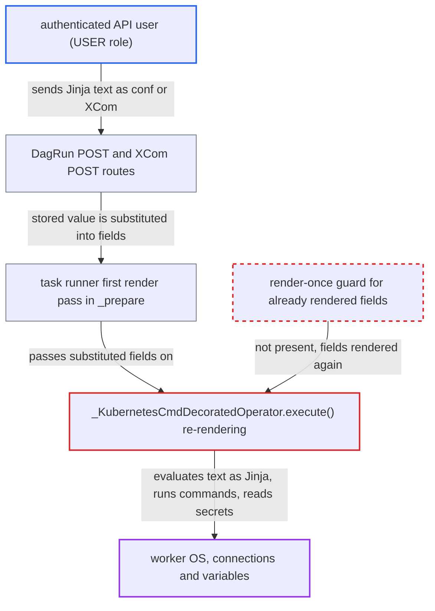

# @task.kubernetes_cmd renders all template fields twice more at execute: SSTI from XCom and dag_run.conf

| Field | Value |
|---|---|
| ID | `find_01SDwAbt7EuFg8cWZSFsM2zg` |
| Severity | **High** |
| Status | open |
| CWE | CWE-1336 — Server-side template injection |
| Created | 2026-10-27T21:35:51.735469Z |
| Claude Security | https://claude.ai/security/findings/find_01SDwAbt7EuFg8cWZSFsM2zg |

## Description

A logged-in API or UI user who can trigger a Dag run, or write XCom values, can run OS commands on the Airflow worker and read every Airflow connection and variable. This works when a `@task.kubernetes_cmd` task receives `dag_run.conf`, `params` or an upstream XCom in its arguments or pod fields. The cause is that `execute()` in `kubernetes_cmd.py` renders all template fields again, so substituted data is run as Jinja.

1. **attacker** supplies Jinja text as `dag_run.conf`, or writes it into an upstream XCom. The trigger endpoint stores the caller's `conf` and needs only DagRun POST on the Dag. The XCom routes accept the value with XCom POST or PATCH, which is the second way in. ([`airflow-core/src/airflow/api_fastapi/core_api/routes/public/dag_run.py:776-853`](https://github.com/cx-benchmark/airflow/blob/a462d683469bb9f55646b0515ef84c41e16650fb/airflow-core/src/airflow/api_fastapi/core_api/routes/public/dag_run.py#L776-L853))
2. **task runner** renders every template field once in `_prepare`. This first pass substitutes the XCom value, `dag_run.conf` and `params` into fields such as `op_args`, `op_kwargs` and `env_vars`, so the attacker's text is now plain string content. ([`task-sdk/src/airflow/sdk/execution_time/task_runner.py:1500-1508`](https://github.com/cx-benchmark/airflow/blob/a462d683469bb9f55646b0515ef84c41e16650fb/task-sdk/src/airflow/sdk/execution_time/task_runner.py#L1500-L1508))
3. **the operator's `execute()`** calls `self.render_template_fields(context)` at line 73, before the decorated function runs, and again at line 82. Line 73 renders the substituted values a second time, and line 82 renders them a third time after `cmds` and `arguments` are set from the function's return value. ([`providers/cncf/kubernetes/src/airflow/providers/cncf/kubernetes/decorators/kubernetes_cmd.py:72-83`](https://github.com/cx-benchmark/airflow/blob/a462d683469bb9f55646b0515ef84c41e16650fb/providers/cncf/kubernetes/src/airflow/providers/cncf/kubernetes/decorators/kubernetes_cmd.py#L72-L83))
4. **`render_template_fields`** treats the already substituted strings as new template source. It starts with an empty `seen_oids` set on every call and records nothing about fields already rendered, so the repeat passes are not stopped. ([`task-sdk/src/airflow/sdk/bases/operator.py:1643-1658`](https://github.com/cx-benchmark/airflow/blob/a462d683469bb9f55646b0515ef84c41e16650fb/task-sdk/src/airflow/sdk/bases/operator.py#L1643-L1658))
5. **template renderer** compiles each string with `jinja_env.from_string()` and evaluates it with the full task context. The sandbox rejects only jinja2 internal attributes, so `macros.uuid.os.system` can be reached and called. ([`task-sdk/src/airflow/sdk/definitions/_internal/templater.py:255-260`](https://github.com/cx-benchmark/airflow/blob/a462d683469bb9f55646b0515ef84c41e16650fb/task-sdk/src/airflow/sdk/definitions/_internal/templater.py#L255-L260))
6. **worker process** runs the attacker's command or reads connections through `conn` and `var`. `macros` imports the stdlib `uuid`, which imports `os`, so `os.system` runs on the worker and not in the pod. ([`task-sdk/src/airflow/sdk/execution_time/macros.py:23`](https://github.com/cx-benchmark/airflow/blob/a462d683469bb9f55646b0515ef84c41e16650fb/task-sdk/src/airflow/sdk/execution_time/macros.py#L23))
7. **task runner** writes the re-rendered values back as Rendered Task Instance Fields. `overwrite_rtif_after_execution = True` publishes them, so the UI shows the results, which gives the attacker a way to read them back. ([`task-sdk/src/airflow/sdk/execution_time/task_runner.py:2496-2500`](https://github.com/cx-benchmark/airflow/blob/a462d683469bb9f55646b0515ef84c41e16650fb/task-sdk/src/airflow/sdk/execution_time/task_runner.py#L2496-L2500))

## Assessment

The attacker is an authenticated API or UI user. In the simple auth manager the USER role is enough, and it has no connection or variable access of its own. The attacker needs DagRun POST on the Dag, or XCom write plus a task instance clear. The Dag must have a `@task.kubernetes_cmd` task that receives `dag_run.conf`, `params` or an upstream XCom in `op_args`, `op_kwargs`, `env_vars` or another `KubernetesPodOperator` field. The official example `execute_in_k8s_pod_full_cmd(foo_result, bar_result)` does this. The attacker triggers the run with `conf={"m": "{{ macros.uuid.os.system('id') }}"}`, or edits the upstream XCom. The REST API is reachable over the network. A plain `KubernetesPodOperator` with the same `env_vars` renders once and is not affected.

Impact: The attacker runs OS commands as the worker process, which can also stop the worker. They can read every Airflow connection and variable, because the Execution API has no per-Dag authorization, and can read the results from logs or the Rendered Task Instance Fields. They also control the re-rendered pod spec fields that the worker then submits.

Subsequent-system impact: Disclosed connection credentials belong to external systems, such as the Kubernetes connection and any cloud or database connections. With command execution on the worker, the attacker can use the same Kubernetes credentials that `KubernetesPodOperator` uses to create pods. That lets them schedule arbitrary workloads in the target cluster.

## Recommendation

`execute()` in `_KubernetesCmdDecoratedOperator` calls `render_template_fields` at `kubernetes_cmd.py:73` and `:82`. This re-runs Jinja over `op_args`, `op_kwargs`, `env_vars` and the other fields the runner already rendered, so XCom, `conf` and `params` data is treated as template source.

Fix criteria: Every field except the newly generated `cmds` and `arguments` is rendered exactly once, by the runner. At execute time only the callable's return value is rendered, so templating of the returned command still works. Test with a Dag whose `@task.kubernetes_cmd` takes an upstream XCom argument and has `env_vars={'X': '{{ dag_run.conf["x"] }}'}`. Trigger it with `x='{{ 7*7 }}'` and set the XCom to `{{ 7*7 }}`. The function must receive the literal string. The pod env and the Rendered Task Instance Fields must show the literal `{{ 7*7 }}`. `{{ macros.uuid.os.system(...) }}` must not run on the worker.

## Evidence

**https://github.com/cx-benchmark/airflow**

- [`providers/cncf/kubernetes/src/airflow/providers/cncf/kubernetes/decorators/kubernetes_cmd.py:72-83`](https://github.com/cx-benchmark/airflow/blob/a462d683469bb9f55646b0515ef84c41e16650fb/providers/cncf/kubernetes/src/airflow/providers/cncf/kubernetes/decorators/kubernetes_cmd.py#L72-L83)
- [`providers/cncf/kubernetes/src/airflow/providers/cncf/kubernetes/decorators/kubernetes_cmd.py:39-41`](https://github.com/cx-benchmark/airflow/blob/a462d683469bb9f55646b0515ef84c41e16650fb/providers/cncf/kubernetes/src/airflow/providers/cncf/kubernetes/decorators/kubernetes_cmd.py#L39-L41)
- [`task-sdk/src/airflow/sdk/execution_time/task_runner.py:1500-1508`](https://github.com/cx-benchmark/airflow/blob/a462d683469bb9f55646b0515ef84c41e16650fb/task-sdk/src/airflow/sdk/execution_time/task_runner.py#L1500-L1508)
- [`task-sdk/src/airflow/sdk/bases/operator.py:1643-1658`](https://github.com/cx-benchmark/airflow/blob/a462d683469bb9f55646b0515ef84c41e16650fb/task-sdk/src/airflow/sdk/bases/operator.py#L1643-L1658)
- [`task-sdk/src/airflow/sdk/definitions/_internal/templater.py:255-260`](https://github.com/cx-benchmark/airflow/blob/a462d683469bb9f55646b0515ef84c41e16650fb/task-sdk/src/airflow/sdk/definitions/_internal/templater.py#L255-L260)
- [`providers/cncf/kubernetes/src/airflow/providers/cncf/kubernetes/operators/pod.py:301-324`](https://github.com/cx-benchmark/airflow/blob/a462d683469bb9f55646b0515ef84c41e16650fb/providers/cncf/kubernetes/src/airflow/providers/cncf/kubernetes/operators/pod.py#L301-L324)
- [`providers/cncf/kubernetes/src/airflow/providers/cncf/kubernetes/operators/pod.py:570-604`](https://github.com/cx-benchmark/airflow/blob/a462d683469bb9f55646b0515ef84c41e16650fb/providers/cncf/kubernetes/src/airflow/providers/cncf/kubernetes/operators/pod.py#L570-L604)
- [`task-sdk/src/airflow/sdk/definitions/_internal/templater.py:315-322`](https://github.com/cx-benchmark/airflow/blob/a462d683469bb9f55646b0515ef84c41e16650fb/task-sdk/src/airflow/sdk/definitions/_internal/templater.py#L315-L322)
- [`task-sdk/src/airflow/sdk/execution_time/macros.py:23`](https://github.com/cx-benchmark/airflow/blob/a462d683469bb9f55646b0515ef84c41e16650fb/task-sdk/src/airflow/sdk/execution_time/macros.py#L23)
- [`task-sdk/src/airflow/sdk/execution_time/task_runner.py:355-363`](https://github.com/cx-benchmark/airflow/blob/a462d683469bb9f55646b0515ef84c41e16650fb/task-sdk/src/airflow/sdk/execution_time/task_runner.py#L355-L363)
- [`providers/cncf/kubernetes/tests/system/cncf/kubernetes/example_kubernetes_cmd_decorator.py:45-65`](https://github.com/cx-benchmark/airflow/blob/a462d683469bb9f55646b0515ef84c41e16650fb/providers/cncf/kubernetes/tests/system/cncf/kubernetes/example_kubernetes_cmd_decorator.py#L45-L65)
- [`airflow-core/src/airflow/api_fastapi/core_api/routes/public/dag_run.py:776-853`](https://github.com/cx-benchmark/airflow/blob/a462d683469bb9f55646b0515ef84c41e16650fb/airflow-core/src/airflow/api_fastapi/core_api/routes/public/dag_run.py#L776-L853)
- [`airflow-core/src/airflow/api_fastapi/core_api/routes/public/xcom.py:323-404`](https://github.com/cx-benchmark/airflow/blob/a462d683469bb9f55646b0515ef84c41e16650fb/airflow-core/src/airflow/api_fastapi/core_api/routes/public/xcom.py#L323-L404)
- [`airflow-core/src/airflow/api_fastapi/auth/managers/simple/simple_auth_manager.py:276-287`](https://github.com/cx-benchmark/airflow/blob/a462d683469bb9f55646b0515ef84c41e16650fb/airflow-core/src/airflow/api_fastapi/auth/managers/simple/simple_auth_manager.py#L276-L287)
- [`task-sdk/src/airflow/sdk/execution_time/task_runner.py:2496-2500`](https://github.com/cx-benchmark/airflow/blob/a462d683469bb9f55646b0515ef84c41e16650fb/task-sdk/src/airflow/sdk/execution_time/task_runner.py#L2496-L2500)

