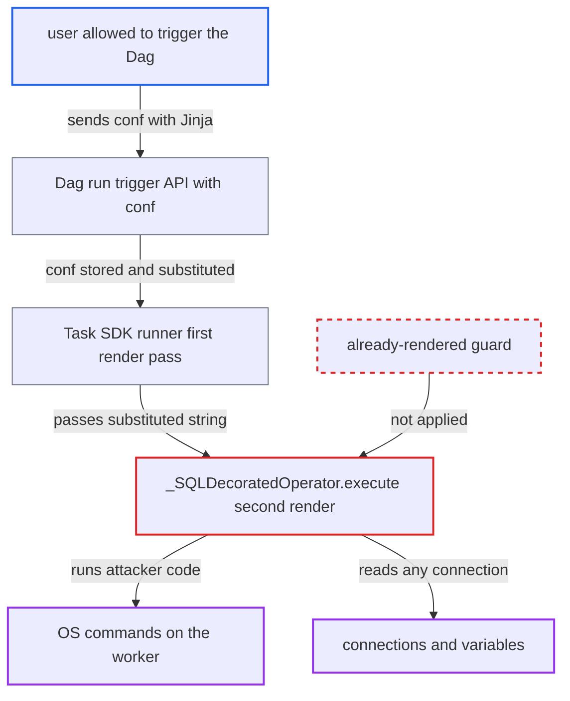

# @task.sql re-renders already-rendered template fields: SSTI from dag_run.conf, params, XCom

| Field | Value |
|---|---|
| ID | `find_01GUhP4EtEi9skyMcExuCESo` |
| Severity | **High** |
| Status | open |
| CWE | CWE-1336 — Server-side template injection |
| Created | 2026-10-27T21:31:32.771639Z |
| Claude Security | https://claude.ai/security/findings/find_01GUhP4EtEi9skyMcExuCESo |

## Description

A user who is allowed to trigger a Dag can run operating-system commands on the Airflow worker and read any connection, with no Dag-file, connection or variable rights. It needs a Dag with a `@task.sql` task that takes `dag_run.conf`, `params` or XCom values as arguments or `parameters`. `_SQLDecoratedOperator.execute()` renders those already-substituted values as Jinja a second time.

1. **attacker** triggers the Dag with a Jinja expression in `conf`. A POST to `/api/v2/dags/{id}/dagRuns` needs only the run permission, and the `conf` is stored on the DagRun; the production FAB `User` role has that permission and no Dag-file write access. ([`airflow-core/src/airflow/api_fastapi/core_api/routes/public/dag_run.py:776-853`](https://github.com/cx-benchmark/airflow/blob/a462d683469bb9f55646b0515ef84c41e16650fb/airflow-core/src/airflow/api_fastapi/core_api/routes/public/dag_run.py#L776-L853))
2. **the Task SDK runner** renders every template field once before `execute()`. This first pass substitutes `dag_run.conf`, `params` and XComArg values, so the field now holds the attacker's string. ([`task-sdk/src/airflow/sdk/execution_time/task_runner.py:1500-1508`](https://github.com/cx-benchmark/airflow/blob/a462d683469bb9f55646b0515ef84c41e16650fb/task-sdk/src/airflow/sdk/execution_time/task_runner.py#L1500-L1508))
3. **the operator `_SQLDecoratedOperator.execute()`** calls the decorated function, then calls `self.render_template_fields(context)`. The second pass is meant for the newly returned `sql`, but it covers every template field, including `op_args`, `op_kwargs`, `parameters`, `conn_id`, `database` and `hook_params`. ([`providers/common/sql/src/airflow/providers/common/sql/decorators/sql.py:96-115`](https://github.com/cx-benchmark/airflow/blob/a462d683469bb9f55646b0515ef84c41e16650fb/providers/common/sql/src/airflow/providers/common/sql/decorators/sql.py#L96-L115))
4. **the templater `_do_render_template_fields`** compiles every string in those fields as a Jinja template and writes the result back. Nothing marks a value as already rendered, and strings nested in lists, tuples or dicts are also compiled with the full task context. ([`task-sdk/src/airflow/sdk/definitions/_internal/templater.py:255-275`](https://github.com/cx-benchmark/airflow/blob/a462d683469bb9f55646b0515ef84c41e16650fb/task-sdk/src/airflow/sdk/definitions/_internal/templater.py#L255-L275))
5. **the injected Jinja expression** reaches the `os` module through `macros.uuid.os`. `macros` exposes the stdlib `uuid` module, and `is_safe_attribute` blocks only dunder and internal attributes, so `{{ macros.uuid.os.system('id') }}` runs as the worker user. ([`task-sdk/src/airflow/sdk/definitions/_internal/templater.py:315-322`](https://github.com/cx-benchmark/airflow/blob/a462d683469bb9f55646b0515ef84c41e16650fb/task-sdk/src/airflow/sdk/definitions/_internal/templater.py#L315-L322))
6. **the injected Jinja expression** reads connections through `conn` and has the output stored for viewing. `{{ conn.<id>.password }}` fetches any connection through the Execution API, which has no per-Dag authorization, and `overwrite_rtif_after_execution = True` writes the second-pass output to Rendered Task Instance Fields shown in the UI. ([`task-sdk/src/airflow/sdk/execution_time/task_runner.py:2496-2500`](https://github.com/cx-benchmark/airflow/blob/a462d683469bb9f55646b0515ef84c41e16650fb/task-sdk/src/airflow/sdk/execution_time/task_runner.py#L2496-L2500))

## Assessment

The attacker is an authenticated user who can trigger the Dag, such as a FAB `User`. They need no Dag-file, connection or variable rights. The Dag must have a `@task.sql` task whose TaskFlow arguments, upstream XComArg inputs or `parameters` carry `dag_run.conf` or `params`, for example `name="{{ dag_run.conf['name'] }}"` or `{{ params.name }}`. The Dag author does nothing unusual, because this is the normal way to pass runtime data. With the default `dag_run_conf_overrides_params=True`, `conf` also overrides `params`. The report says `@task.bash` has the same defect and `@task.analytics` has its own sink.

Impact: The attacker can run arbitrary commands on the worker as the worker user, which compromises the task process and the secrets Airflow holds. They can read any connection or variable and read results back in the UI Rendered tab. Output passes through exact-match redaction, which a transform such as `| reverse` evades. They can also disrupt or corrupt execution on that worker.

Subsequent-system impact: The connections the attacker reads are credentials for external systems Airflow uses, including the database login that the `@task.sql` task writes with. The attacker has no connection rights in Airflow, but can use these credentials to read and modify those systems. Availability impact there is limited.

## Recommendation

`_SQLDecoratedOperator.execute()` renders all template fields again, including `op_args`, `op_kwargs`, `parameters`, `conn_id`, `database` and `hook_params`. The runner's first pass already substituted runtime data (conf, params, XCom) into them, so that data is treated as Jinja source.

Fix criteria: Each field the runner already rendered is rendered exactly once, and at execute time only the string newly returned by the callable is rendered. To verify, trigger a Dag whose `@task.sql` takes `name="{{ dag_run.conf['n'] }}"` and `parameters={'n': "{{ dag_run.conf['n'] }}"}` with `conf={'n': '{{ 7*7 }}'}`. The function, the bound parameter and the Rendered Task Instance Fields must all show the literal `{{ 7*7 }}`. `{{ macros.uuid.os.system(...) }}` must not run.

## Evidence

**https://github.com/cx-benchmark/airflow**

- [`providers/common/sql/src/airflow/providers/common/sql/decorators/sql.py:96-115`](https://github.com/cx-benchmark/airflow/blob/a462d683469bb9f55646b0515ef84c41e16650fb/providers/common/sql/src/airflow/providers/common/sql/decorators/sql.py#L96-L115)
- [`providers/common/sql/src/airflow/providers/common/sql/decorators/sql.py:52-62`](https://github.com/cx-benchmark/airflow/blob/a462d683469bb9f55646b0515ef84c41e16650fb/providers/common/sql/src/airflow/providers/common/sql/decorators/sql.py#L52-L62)
- [`task-sdk/src/airflow/sdk/execution_time/task_runner.py:1500-1508`](https://github.com/cx-benchmark/airflow/blob/a462d683469bb9f55646b0515ef84c41e16650fb/task-sdk/src/airflow/sdk/execution_time/task_runner.py#L1500-L1508)
- [`task-sdk/src/airflow/sdk/bases/operator.py:1643-1658`](https://github.com/cx-benchmark/airflow/blob/a462d683469bb9f55646b0515ef84c41e16650fb/task-sdk/src/airflow/sdk/bases/operator.py#L1643-L1658)
- [`task-sdk/src/airflow/sdk/definitions/_internal/templater.py:184-211`](https://github.com/cx-benchmark/airflow/blob/a462d683469bb9f55646b0515ef84c41e16650fb/task-sdk/src/airflow/sdk/definitions/_internal/templater.py#L184-L211)
- [`task-sdk/src/airflow/sdk/definitions/_internal/templater.py:255-275`](https://github.com/cx-benchmark/airflow/blob/a462d683469bb9f55646b0515ef84c41e16650fb/task-sdk/src/airflow/sdk/definitions/_internal/templater.py#L255-L275)
- [`task-sdk/src/airflow/sdk/bases/decorator.py:569-575`](https://github.com/cx-benchmark/airflow/blob/a462d683469bb9f55646b0515ef84c41e16650fb/task-sdk/src/airflow/sdk/bases/decorator.py#L569-L575)
- [`task-sdk/src/airflow/sdk/execution_time/task_runner.py:355-363`](https://github.com/cx-benchmark/airflow/blob/a462d683469bb9f55646b0515ef84c41e16650fb/task-sdk/src/airflow/sdk/execution_time/task_runner.py#L355-L363)
- [`task-sdk/src/airflow/sdk/execution_time/context.py:1197-1216`](https://github.com/cx-benchmark/airflow/blob/a462d683469bb9f55646b0515ef84c41e16650fb/task-sdk/src/airflow/sdk/execution_time/context.py#L1197-L1216)
- [`task-sdk/src/airflow/sdk/definitions/_internal/templater.py:315-322`](https://github.com/cx-benchmark/airflow/blob/a462d683469bb9f55646b0515ef84c41e16650fb/task-sdk/src/airflow/sdk/definitions/_internal/templater.py#L315-L322)
- [`task-sdk/src/airflow/sdk/execution_time/context.py:631-637`](https://github.com/cx-benchmark/airflow/blob/a462d683469bb9f55646b0515ef84c41e16650fb/task-sdk/src/airflow/sdk/execution_time/context.py#L631-L637)
- [`task-sdk/src/airflow/sdk/execution_time/task_runner.py:2496-2500`](https://github.com/cx-benchmark/airflow/blob/a462d683469bb9f55646b0515ef84c41e16650fb/task-sdk/src/airflow/sdk/execution_time/task_runner.py#L2496-L2500)
- [`airflow-core/src/airflow/api_fastapi/core_api/routes/public/dag_run.py:776-853`](https://github.com/cx-benchmark/airflow/blob/a462d683469bb9f55646b0515ef84c41e16650fb/airflow-core/src/airflow/api_fastapi/core_api/routes/public/dag_run.py#L776-L853)
- [`providers/fab/src/airflow/providers/fab/auth_manager/security_manager/override.py:305-313`](https://github.com/cx-benchmark/airflow/blob/a462d683469bb9f55646b0515ef84c41e16650fb/providers/fab/src/airflow/providers/fab/auth_manager/security_manager/override.py#L305-L313)

