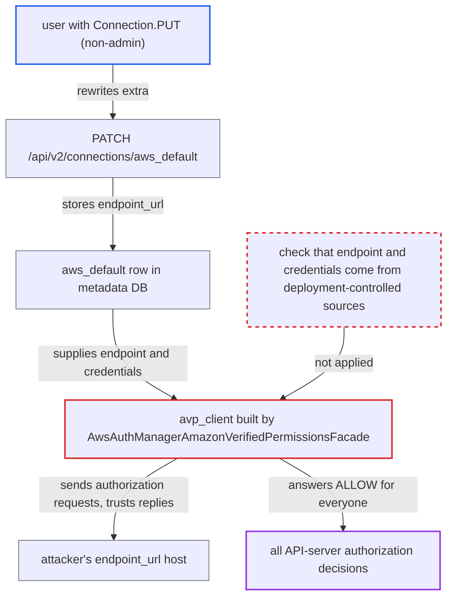

# AWS auth manager takes its Verified Permissions endpoint from a user-editable metastore connection

| Field | Value |
|---|---|
| ID | `find_01Jf7h7YsujPNtfp9jx1ufmw` |
| Severity | **High** |
| Status | open |
| CWE | CWE-807 — Reliance on untrusted inputs |
| Created | 2026-10-27T21:56:13.547370Z |
| Claude Security | https://claude.ai/security/findings/find_01Jf7h7YsujPNtfp9jx1ufmw |

## Description

A user who can edit connections but is not an admin can make the API server approve every authorization request. This needs the AWS auth manager, `Connection.PUT` on the `aws_default` connection (or `Connection.POST` if it is absent), and an API-server restart. The auth manager builds its Verified Permissions client from that editable connection, and `AwsAuthManagerAmazonVerifiedPermissionsFacade` trusts whatever `decision` the host returns.

1. **attacker with `Connection.PUT`** rewrites the `aws_default` connection through `PATCH /api/v2/connections/aws_default`. The `extra` is set to an `endpoint_url` pointing at the attacker's host, with dummy keys, and the route stores it as given; a `Connection.POST` holder can create the row instead if it is absent. ([`airflow-core/src/airflow/api_fastapi/core_api/routes/public/connections.py:261-328`](https://github.com/cx-benchmark/airflow/blob/a462d683469bb9f55646b0515ef84c41e16650fb/airflow-core/src/airflow/api_fastapi/core_api/routes/public/connections.py#L261-L328))
2. **API server** restarts and runs `init()` on the auth manager. `init()` calls `_check_avp_schema_version()`, which builds the cached `avp_client`, so the rewritten row takes effect only at the next process start (deploy, restart or new replica). ([`providers/amazon/src/airflow/providers/amazon/aws/auth_manager/aws_auth_manager.py:74-84`](https://github.com/cx-benchmark/airflow/blob/a462d683469bb9f55646b0515ef84c41e16650fb/providers/amazon/src/airflow/providers/amazon/aws/auth_manager/aws_auth_manager.py#L74-L84))
3. **the hook `VerifiedPermissionsHook`** loads the connection named by the `[aws_auth_manager] conn_id` setting, which defaults to `aws_default`. In the API server the lookup goes through environment variables first and then `MetastoreBackend`, so the edited database row is used unless an environment variable or a custom backend defines that conn_id. ([`task-sdk/src/airflow/sdk/execution_time/supervisor.py:3007-3011`](https://github.com/cx-benchmark/airflow/blob/a462d683469bb9f55646b0515ef84c41e16650fb/task-sdk/src/airflow/sdk/execution_time/supervisor.py#L3007-L3011))
4. **`get_client_type`** builds the boto3 client from the connection's `extra`. It takes `endpoint_url`, `verify`, `config_kwargs` and the credentials from the row without restricting the host. ([`providers/amazon/src/airflow/providers/amazon/aws/hooks/base_aws.py:742-791`](https://github.com/cx-benchmark/airflow/blob/a462d683469bb9f55646b0515ef84c41e16650fb/providers/amazon/src/airflow/providers/amazon/aws/hooks/base_aws.py#L742-L791))
5. **attacker's host** answers the startup schema request. A schema mismatch only logs a warning, so any returned `schema` string lets startup finish. ([`providers/amazon/src/airflow/providers/amazon/aws/auth_manager/aws_auth_manager.py:74-84`](https://github.com/cx-benchmark/airflow/blob/a462d683469bb9f55646b0515ef84c41e16650fb/providers/amazon/src/airflow/providers/amazon/aws/auth_manager/aws_auth_manager.py#L74-L84))
6. **the facade `is_authorized`** returns `resp['decision'] == 'ALLOW'` for the attacker's reply. The facade checks only that `errors` is empty, and the batch path also trusts `result['decision']`, so the attacker's host can answer ALLOW to every request. ([`providers/amazon/src/airflow/providers/amazon/aws/auth_manager/avp/facade.py:120-144`](https://github.com/cx-benchmark/airflow/blob/a462d683469bb9f55646b0515ef84c41e16650fb/providers/amazon/src/airflow/providers/amazon/aws/auth_manager/avp/facade.py#L120-L144))

## Assessment

The attacker is an authenticated user whose Cedar policy grants `Connection.PUT` on `aws_default`, or `Connection.POST` if it does not exist, but who is not an admin. The documented 'Op'-equivalent policy gives this write permission to a non-admin group. The attack needs the AWS auth manager and a conn_id that resolves from the metadata DB, and it takes effect only after an API-server restart. A deployment that defines this conn_id through `AIRFLOW_CONN_*` or a custom secrets backend is not affected, because those are read before the metastore. The report notes that the AWS auth manager is documented as alpha/experimental, but it ships in the provider and is registered under `auth-managers`. The report assumes boto3/botocore at the manifest floor (`>=1.42.93`) honours `endpoint_url`, `verify` and `Config` as documented.

Impact: The attacker's host decides every authorization call in the API server, for every authenticated user. This gives admin-equivalent reach over what the auth manager guards: reading DAGs, source, runs, XComs, task logs, variables, configuration and audit-log views, changing or deleting DAG runs, variables, pools, connections, assets and backfills, and pausing or deleting every DAG and pool. Login is still enforced and the API still masks connection secrets.

## Recommendation

(1) The auth manager takes the endpoint, TLS settings and credentials of its authorization backend (AVP) from an Airflow connection that falls through to the metadata DB. Non-admin connection editors can write that connection.

Fix criteria: No one without Deployment-Manager or admin control can change the AVP client the API server uses for authorization decisions. Its endpoint and credentials come only from deployment-controlled sources (airflow.cfg, environment, the ambient credential chain, or a non-DB secrets backend), or the auth manager refuses to start when the conn_id resolves from `MetastoreBackend`. To verify, a user with the Op policy rewrites or creates `aws_default` with a foreign `endpoint_url` and the API server is restarted. Authorization calls must still reach the genuine AVP endpoint, or startup must fail.

(2) The facade accepts any well-formed `decision` from whatever host the client reaches. It does not check that the endpoint is AWS Verified Permissions.

Fix criteria: Before using answers, the facade fails closed unless the resolved client endpoint is an AWS `verifiedpermissions.<region>.amazonaws.com` host or an endpoint allow-listed in airflow.cfg, not in the connection. To verify, configure a non-AWS endpoint and confirm that `is_authorized` raises or denies instead of returning `ALLOW`.

## Evidence

**https://github.com/cx-benchmark/airflow**

- [`providers/amazon/src/airflow/providers/amazon/aws/auth_manager/avp/facade.py:71-76`](https://github.com/cx-benchmark/airflow/blob/a462d683469bb9f55646b0515ef84c41e16650fb/providers/amazon/src/airflow/providers/amazon/aws/auth_manager/avp/facade.py#L71-L76)
- [`providers/amazon/src/airflow/providers/amazon/aws/auth_manager/avp/facade.py:120-144`](https://github.com/cx-benchmark/airflow/blob/a462d683469bb9f55646b0515ef84c41e16650fb/providers/amazon/src/airflow/providers/amazon/aws/auth_manager/avp/facade.py#L120-L144)
- [`providers/amazon/src/airflow/providers/amazon/aws/auth_manager/avp/facade.py:171-229`](https://github.com/cx-benchmark/airflow/blob/a462d683469bb9f55646b0515ef84c41e16650fb/providers/amazon/src/airflow/providers/amazon/aws/auth_manager/avp/facade.py#L171-L229)
- [`providers/amazon/src/airflow/providers/amazon/aws/auth_manager/aws_auth_manager.py:74-84`](https://github.com/cx-benchmark/airflow/blob/a462d683469bb9f55646b0515ef84c41e16650fb/providers/amazon/src/airflow/providers/amazon/aws/auth_manager/aws_auth_manager.py#L74-L84)
- [`providers/amazon/src/airflow/providers/amazon/aws/hooks/base_aws.py:636-659`](https://github.com/cx-benchmark/airflow/blob/a462d683469bb9f55646b0515ef84c41e16650fb/providers/amazon/src/airflow/providers/amazon/aws/hooks/base_aws.py#L636-L659)
- [`providers/amazon/src/airflow/providers/amazon/aws/hooks/base_aws.py:742-791`](https://github.com/cx-benchmark/airflow/blob/a462d683469bb9f55646b0515ef84c41e16650fb/providers/amazon/src/airflow/providers/amazon/aws/hooks/base_aws.py#L742-L791)
- [`providers/amazon/src/airflow/providers/amazon/aws/utils/connection_wrapper.py:141-159`](https://github.com/cx-benchmark/airflow/blob/a462d683469bb9f55646b0515ef84c41e16650fb/providers/amazon/src/airflow/providers/amazon/aws/utils/connection_wrapper.py#L141-L159)
- [`task-sdk/src/airflow/sdk/execution_time/supervisor.py:3007-3011`](https://github.com/cx-benchmark/airflow/blob/a462d683469bb9f55646b0515ef84c41e16650fb/task-sdk/src/airflow/sdk/execution_time/supervisor.py#L3007-L3011)
- [`airflow-core/src/airflow/api_fastapi/core_api/routes/public/connections.py:261-328`](https://github.com/cx-benchmark/airflow/blob/a462d683469bb9f55646b0515ef84c41e16650fb/airflow-core/src/airflow/api_fastapi/core_api/routes/public/connections.py#L261-L328)
- [`providers/amazon/provider.yaml:1574-1581`](https://github.com/cx-benchmark/airflow/blob/a462d683469bb9f55646b0515ef84c41e16650fb/providers/amazon/provider.yaml#L1574-L1581)
- [`airflow-core/docs/security/security_model.rst:1064-1074`](https://github.com/cx-benchmark/airflow/blob/a462d683469bb9f55646b0515ef84c41e16650fb/airflow-core/docs/security/security_model.rst#L1064-L1074)
- [`providers/amazon/docs/auth-manager/manage/index.rst:217-262`](https://github.com/cx-benchmark/airflow/blob/a462d683469bb9f55646b0515ef84c41e16650fb/providers/amazon/docs/auth-manager/manage/index.rst#L217-L262)

