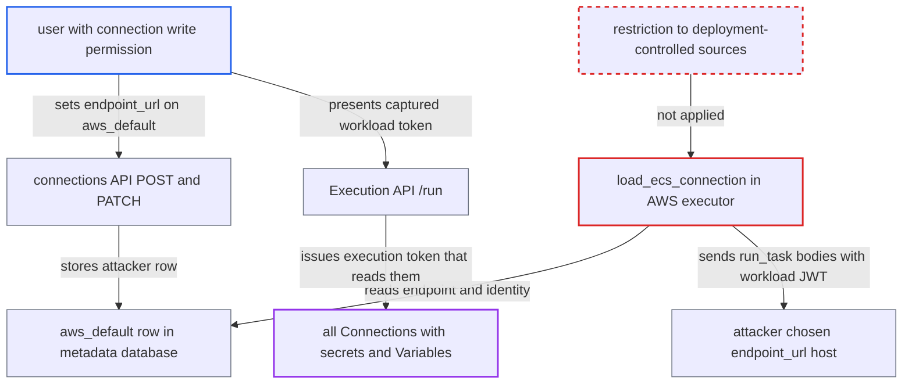

# AWS executors take dispatch endpoint and identity from a connection-config-editable DB connection

| Field | Value |
|---|---|
| ID | `find_015adBxTakRft68da67Jahfa` |
| Severity | **High** |
| Status | open |
| CWE | CWE-15 — External control of configuration |
| Created | 2026-10-27T21:48:49.324401Z |
| Claude Security | https://claude.ai/security/findings/find_015adBxTakRft68da67Jahfa |

## Description

A user who can write connections can capture the workload token of every task the scheduler dispatches. They can then read all Connections with their secrets, and all Variables. This needs connection write permission and an AWS executor (ECS, Batch, Lambda or EKS) whose `conn_id` is resolved from the metadata database. The executors build their AWS clients from that stored connection, so its `endpoint_url` decides where dispatch requests go.

1. **attacker with connection write permission** creates or patches the connection `aws_default` through the connections API. The attacker sets `extra.endpoint_url` to their own host, or sets their own keys and an account that mirrors the cluster names, and the route only checks `requires_access_connection`. ([`airflow-core/src/airflow/api_fastapi/core_api/routes/public/connections.py:261-327`](https://github.com/cx-benchmark/airflow/blob/a462d683469bb9f55646b0515ef84c41e16650fb/airflow-core/src/airflow/api_fastapi/core_api/routes/public/connections.py#L261-L327))
2. **the scheduler** resolves the executor's `conn_id` from the metadata database. In server context the lookup tries environment variables first and then `MetastoreBackend`, so the attacker's row decides the connection unless an environment variable or custom backend defines it. ([`task-sdk/src/airflow/sdk/execution_time/supervisor.py:3007-3011`](https://github.com/cx-benchmark/airflow/blob/a462d683469bb9f55646b0515ef84c41e16650fb/task-sdk/src/airflow/sdk/execution_time/supervisor.py#L3007-L3011))
3. **the executor method `load_ecs_connection`** rebuilds the AWS client from the attacker's row. This happens at scheduler start, because `IS_BOTO_CONNECTION_HEALTHY` starts False, and again after credential errors; the row's `endpoint_url`, `verify`, keys and role settings are honoured. ([`providers/amazon/src/airflow/providers/amazon/aws/executors/ecs/ecs_executor.py:266-300`](https://github.com/cx-benchmark/airflow/blob/a462d683469bb9f55646b0515ef84c41e16650fb/providers/amazon/src/airflow/providers/amazon/aws/executors/ecs/ecs_executor.py#L266-L300))
4. **the executor method `_run_task`** sends `run_task` to the attacker's endpoint. The request body carries `workload.model_dump_json()`, which includes the scheduler-minted workload JWT; Batch `SubmitJob` and Lambda `invoke` do the same. ([`providers/amazon/src/airflow/providers/amazon/aws/executors/ecs/ecs_executor.py:505-541`](https://github.com/cx-benchmark/airflow/blob/a462d683469bb9f55646b0515ef84c41e16650fb/providers/amazon/src/airflow/providers/amazon/aws/executors/ecs/ecs_executor.py#L505-L541))
5. **attacker** presents each captured workload token to `/run`. For a QUEUED task instance, `/run` issues an execution token to whoever presents the workload token. ([`airflow-core/src/airflow/api_fastapi/execution_api/routes/task_instances.py:422-424`](https://github.com/cx-benchmark/airflow/blob/a462d683469bb9f55646b0515ef84c41e16650fb/airflow-core/src/airflow/api_fastapi/execution_api/routes/task_instances.py#L422-L424))
6. **attacker** uses the execution tokens to read Connections and Variables. The execution API serves every Connection with its secrets, and every Variable, to such a token. ([`airflow-core/src/airflow/api_fastapi/execution_api/routes/task_instances.py:422-424`](https://github.com/cx-benchmark/airflow/blob/a462d683469bb9f55646b0515ef84c41e16650fb/airflow-core/src/airflow/api_fastapi/execution_api/routes/task_instances.py#L422-L424))

## Assessment

The attacker is an authenticated user with connection write permission, such as FAB `Op` or a connection-only role. The deployment must use an AWS executor whose `conn_id` (default `aws_default`) is resolved from the metadata database. A deployment is not affected if that `conn_id` is defined by an `AIRFLOW_CONN_*` environment variable or a custom secrets backend, because those are checked before the metastore. The change takes effect when the executor rebuilds its client: at scheduler start, or after a credential error. If no row existed before, the attacker's new row replaces the ambient credentials. For the EKS executor, the row decides which API host receives pod specs and the bearer token. No victim action is needed.

Impact: The attacker gets execution tokens for every dispatched task. With them they read all Connections in plaintext and all Variables, and can also set those task instances' states and XComs and write Variables. While the redirect stands, no task runs on the real infrastructure. The attacker gains no code execution in the scheduler and no direct database access.

Subsequent-system impact: The disclosed Connections are credentials for the external databases, cloud accounts and APIs the deployment uses. The attacker can use them directly with whatever rights they carry, and Airflow does not limit that.

## Recommendation

(1) The scheduler-side AWS executors take their endpoint and identity from a `conn_id` that falls through to the metadata database. A role trusted only for worker-context connection effects can therefore redirect the dispatch path and every task's bearer token.

Fix criteria: The endpoint and credentials an AWS executor uses come only from sources the Deployment Manager controls (config, environment, a non-database secrets backend), or the executor refuses a `conn_id` served by `MetastoreBackend`. Verify this: with an AWS executor configured, an `Op` user creates or edits `aws_default` with `extra.endpoint_url` set to an external host. After a scheduler restart, dispatch calls still reach the configured AWS endpoint and no workload JWT reaches that host.

(2) The dispatch request carries a bearer token that `/run` exchanges for a full execution token. Anyone who can read or redirect the request gets the task's Execution API identity.

Fix criteria: A workload token captured from a dispatch request does not by itself give an execution token to a host that is not the legitimate worker, or the token is not in the request at all. Verify this: replaying the token from a captured `RunTask`, `SubmitJob` or `Invoke` body from another host does not return `Refreshed-API-Token`.

## Evidence

**https://github.com/cx-benchmark/airflow**

- [`providers/amazon/src/airflow/providers/amazon/aws/executors/ecs/ecs_executor.py:266-300`](https://github.com/cx-benchmark/airflow/blob/a462d683469bb9f55646b0515ef84c41e16650fb/providers/amazon/src/airflow/providers/amazon/aws/executors/ecs/ecs_executor.py#L266-L300)
- [`providers/amazon/src/airflow/providers/amazon/aws/hooks/base_aws.py:637-659`](https://github.com/cx-benchmark/airflow/blob/a462d683469bb9f55646b0515ef84c41e16650fb/providers/amazon/src/airflow/providers/amazon/aws/hooks/base_aws.py#L637-L659)
- [`airflow-core/src/airflow/utils/cli.py:113-120`](https://github.com/cx-benchmark/airflow/blob/a462d683469bb9f55646b0515ef84c41e16650fb/airflow-core/src/airflow/utils/cli.py#L113-L120)
- [`task-sdk/src/airflow/sdk/execution_time/supervisor.py:3007-3011`](https://github.com/cx-benchmark/airflow/blob/a462d683469bb9f55646b0515ef84c41e16650fb/task-sdk/src/airflow/sdk/execution_time/supervisor.py#L3007-L3011)
- [`providers/amazon/src/airflow/providers/amazon/aws/utils/connection_wrapper.py:141-159`](https://github.com/cx-benchmark/airflow/blob/a462d683469bb9f55646b0515ef84c41e16650fb/providers/amazon/src/airflow/providers/amazon/aws/utils/connection_wrapper.py#L141-L159)
- [`providers/amazon/src/airflow/providers/amazon/aws/executors/ecs/ecs_executor.py:505-541`](https://github.com/cx-benchmark/airflow/blob/a462d683469bb9f55646b0515ef84c41e16650fb/providers/amazon/src/airflow/providers/amazon/aws/executors/ecs/ecs_executor.py#L505-L541)
- [`providers/amazon/src/airflow/providers/amazon/aws/executors/batch/batch_executor.py:234-247`](https://github.com/cx-benchmark/airflow/blob/a462d683469bb9f55646b0515ef84c41e16650fb/providers/amazon/src/airflow/providers/amazon/aws/executors/batch/batch_executor.py#L234-L247)
- [`providers/amazon/src/airflow/providers/amazon/aws/executors/aws_lambda/lambda_executor.py:197-214`](https://github.com/cx-benchmark/airflow/blob/a462d683469bb9f55646b0515ef84c41e16650fb/providers/amazon/src/airflow/providers/amazon/aws/executors/aws_lambda/lambda_executor.py#L197-L214)
- [`providers/amazon/src/airflow/providers/amazon/aws/executors/eks/_client_factory.py:107-129`](https://github.com/cx-benchmark/airflow/blob/a462d683469bb9f55646b0515ef84c41e16650fb/providers/amazon/src/airflow/providers/amazon/aws/executors/eks/_client_factory.py#L107-L129)
- [`airflow-core/src/airflow/api_fastapi/core_api/routes/public/connections.py:261-327`](https://github.com/cx-benchmark/airflow/blob/a462d683469bb9f55646b0515ef84c41e16650fb/airflow-core/src/airflow/api_fastapi/core_api/routes/public/connections.py#L261-L327)
- [`airflow-core/src/airflow/api_fastapi/execution_api/routes/task_instances.py:422-424`](https://github.com/cx-benchmark/airflow/blob/a462d683469bb9f55646b0515ef84c41e16650fb/airflow-core/src/airflow/api_fastapi/execution_api/routes/task_instances.py#L422-L424)
- [`airflow-core/docs/security/security_model.rst:1064-1074`](https://github.com/cx-benchmark/airflow/blob/a462d683469bb9f55646b0515ef84c41e16650fb/airflow-core/docs/security/security_model.rst#L1064-L1074)

