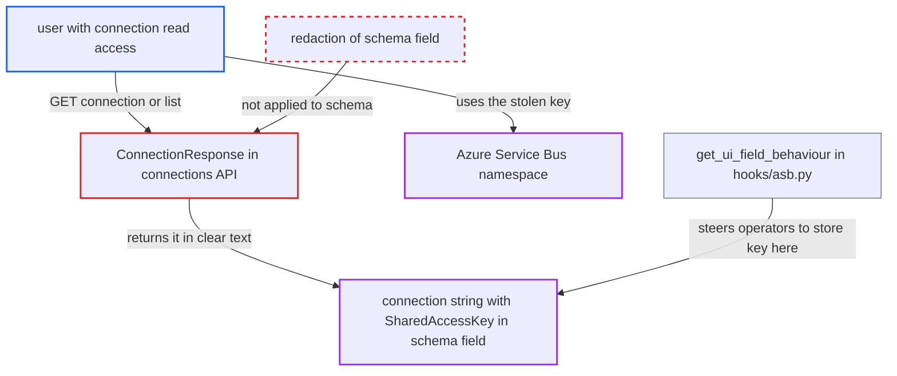

# Azure Service Bus SharedAccessKey stored in unmasked connection `schema` field, readable via API

| Field | Value |
|---|---|
| ID | `find_01YHZccDYY6Ju2km99RMsRRU` |
| Severity | **High** |
| Status | open |
| CWE | CWE-522 — Insufficiently Protected Credentials |
| Created | 2026-10-27T21:44:18.257007Z |
| Claude Security | https://claude.ai/security/findings/find_01YHZccDYY6Ju2km99RMsRRU |

## Description

A logged-in Airflow user who can read connections but is not an admin can see the Azure Service Bus shared access key in clear text. The key can then be used against the Service Bus namespace itself. This works when an operator stored the connection string in the connection's `schema` field, as the provider documents. The provider tells operators to put the secret in `schema`, and `ConnectionResponse` never redacts that field.

1. **operator** stores the Service Bus connection string in the connection's `schema` field. `get_ui_field_behaviour` hides `login`, `password` and `extra`, relabels `schema` as "Connection String" and shows a placeholder containing `SharedAccessKey=<SharedAccessKey>`. ([`providers/microsoft/azure/src/airflow/providers/microsoft/azure/hooks/asb.py:86-98`](https://github.com/cx-benchmark/airflow/blob/a462d683469bb9f55646b0515ef84c41e16650fb/providers/microsoft/azure/src/airflow/providers/microsoft/azure/hooks/asb.py#L86-L98))
2. **the hooks `AdminClientHook.get_conn` and `MessageHook.get_conn`** read the credential only from `schema`. Both pass `str(conn.schema)` to `from_connection_string`, so the connection cannot work without the key sitting in that field. ([`providers/microsoft/azure/src/airflow/providers/microsoft/azure/hooks/asb.py:131-134`](https://github.com/cx-benchmark/airflow/blob/a462d683469bb9f55646b0515ef84c41e16650fb/providers/microsoft/azure/src/airflow/providers/microsoft/azure/hooks/asb.py#L131-L134))
3. **attacker with connection read access** requests the connection through `GET /api/v2/connections/<conn_id>`, the list endpoint or the UI edit form. `get_connection` and `get_connections` only require `requires_access_connection(method="GET")`, which a connection-configuration role such as FAB `Op` has. ([`airflow-core/src/airflow/api_fastapi/core_api/routes/public/connections.py:200-258`](https://github.com/cx-benchmark/airflow/blob/a462d683469bb9f55646b0515ef84c41e16650fb/airflow-core/src/airflow/api_fastapi/core_api/routes/public/connections.py#L200-L258))
4. **`ConnectionResponse`** returns `schema_` exactly as stored. It redacts only `password` and `extra`, so the response contains `Endpoint=sb://...;SharedAccessKeyName=...;SharedAccessKey=<key>` with the real key. ([`airflow-core/src/airflow/api_fastapi/core_api/datamodels/connections.py:77-128`](https://github.com/cx-benchmark/airflow/blob/a462d683469bb9f55646b0515ef84c41e16650fb/airflow-core/src/airflow/api_fastapi/core_api/datamodels/connections.py#L77-L128))
5. **attacker** uses the key directly against the Azure Service Bus namespace. The key works outside Airflow, so Airflow's access controls no longer apply to it.

## Assessment

The attacker is an authenticated Airflow user whose role grants connection read but not admin, for example a connection-configuration role or FAB `Op`. An operator must have set up an `azure_service_bus` connection the documented way, with the connection string in the Connection String (`schema`) field. The attacker then calls `GET /api/v2/connections/<conn_id>` or the list endpoint, or opens the connection's edit form. The task-runtime masker also masks only `password` and `extra`, so the key is not redacted if it shows up in task logs.

Impact: The attacker reads the stored Service Bus connection string including its shared access key. Airflow 3's security model says this role may write connection credentials but not view them. The read changes no Airflow data and does not affect availability.

Subsequent-system impact: The key authenticates to the Azure Service Bus namespace outside Airflow. The attacker can read, send and delete messages on its queues and topics. The provider uses the same string for `AdminClientHook` create and delete operations, so the key holds Manage rights and the attacker can also delete entities. This affects downstream consumers and Airflow's own message-queue-triggered Dags.

## Recommendation

The ASB provider takes its secret connection string from the standard `schema` field and steers operators there. The connection API, the UI and the task-log masker treat that field as non-sensitive and never redact it.

Fix criteria: The Service Bus connection string comes only from a field Airflow masks: `password`, or an `extra` key declared `format: password` (for example `connection_string`, which is also on the default sensitive list). The UI field behaviour and the docs no longer steer operators to `schema`. Existing connections have a migration path. `GET /api/v2/connections/{id}` and the list endpoint return `***` for the connection string, and the ASB hooks still authenticate.

## Evidence

**https://github.com/cx-benchmark/airflow**

- [`providers/microsoft/azure/src/airflow/providers/microsoft/azure/hooks/asb.py:86-98`](https://github.com/cx-benchmark/airflow/blob/a462d683469bb9f55646b0515ef84c41e16650fb/providers/microsoft/azure/src/airflow/providers/microsoft/azure/hooks/asb.py#L86-L98)
- [`providers/microsoft/azure/src/airflow/providers/microsoft/azure/hooks/asb.py:131-134`](https://github.com/cx-benchmark/airflow/blob/a462d683469bb9f55646b0515ef84c41e16650fb/providers/microsoft/azure/src/airflow/providers/microsoft/azure/hooks/asb.py#L131-L134)
- [`providers/microsoft/azure/provider.yaml:910-938`](https://github.com/cx-benchmark/airflow/blob/a462d683469bb9f55646b0515ef84c41e16650fb/providers/microsoft/azure/provider.yaml#L910-L938)
- [`airflow-core/src/airflow/api_fastapi/core_api/datamodels/connections.py:77-128`](https://github.com/cx-benchmark/airflow/blob/a462d683469bb9f55646b0515ef84c41e16650fb/airflow-core/src/airflow/api_fastapi/core_api/datamodels/connections.py#L77-L128)
- [`airflow-core/src/airflow/api_fastapi/core_api/routes/public/connections.py:200-258`](https://github.com/cx-benchmark/airflow/blob/a462d683469bb9f55646b0515ef84c41e16650fb/airflow-core/src/airflow/api_fastapi/core_api/routes/public/connections.py#L200-L258)
- [`providers/fab/src/airflow/providers/fab/auth_manager/security_manager/override.py:318-334`](https://github.com/cx-benchmark/airflow/blob/a462d683469bb9f55646b0515ef84c41e16650fb/providers/fab/src/airflow/providers/fab/auth_manager/security_manager/override.py#L318-L334)
- [`airflow-core/docs/security/security_model.rst:133-155`](https://github.com/cx-benchmark/airflow/blob/a462d683469bb9f55646b0515ef84c41e16650fb/airflow-core/docs/security/security_model.rst#L133-L155)

