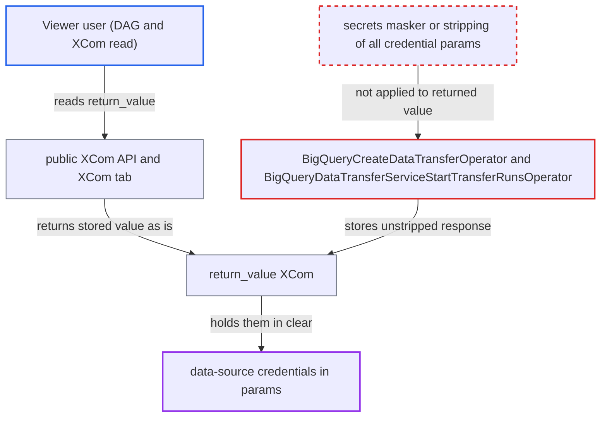

# BigQuery DTS operators return unstripped data-source credentials in XCom return value

| Field | Value |
|---|---|
| ID | `find_01HxFWQubj96mQwRrnzvQhXV` |
| Severity | **High** |
| Status | open |
| CWE | CWE-212 — Improper removal of sensitive information |
| Created | 2026-10-27T21:41:09.860549Z |
| Claude Security | https://claude.ai/security/findings/find_01HxFWQubj96mQwRrnzvQhXV |

## Description

A user with only the default Viewer role can read data-source credentials in clear text from the XCom tab or the public XCom API. This affects Azure Blob SAS tokens and database connector passwords that a DAG author put in a DTS transfer config. `BigQueryCreateDataTransferOperator` strips only two AWS keys from its return value. `BigQueryDataTransferServiceStartTransferRunsOperator` strips nothing.

1. **DAG author** templates a credential into `transfer_config` params. The secret, such as a SAS token or password, comes from an Airflow Connection or Variable and goes into the `params` of a non-AWS data source.
2. **the hook in `hooks/bigquery_dts.py`** sends the `transfer_config` to the API unchanged and returns the raw `TransferConfig` response. The credential `params` are forwarded as given, and the report assumes the service echoes them back, as the operator's AWS stripping also assumes. ([`providers/google/src/airflow/providers/google/cloud/hooks/bigquery_dts.py:141-155`](https://github.com/cx-benchmark/airflow/blob/a462d683469bb9f55646b0515ef84c41e16650fb/providers/google/src/airflow/providers/google/cloud/hooks/bigquery_dts.py#L141-L155))
3. **the operator `BigQueryCreateDataTransferOperator`** converts the response to a dict and returns it after removing only `secret_access_key` and `access_key_id`. Every other credential entry, such as `sas_token` or `connector.authentication.password`, stays in the returned dict. ([`providers/google/src/airflow/providers/google/cloud/operators/bigquery_dts.py:141-147`](https://github.com/cx-benchmark/airflow/blob/a462d683469bb9f55646b0515ef84c41e16650fb/providers/google/src/airflow/providers/google/cloud/operators/bigquery_dts.py#L141-L147))
4. **the operator `BigQueryDataTransferServiceStartTransferRunsOperator`** returns `TransferRun.to_dict(...)` with no stripping. This holds on both the synchronous wait path and the `execute_completed` path, and the AWS keys are not removed either. ([`providers/google/src/airflow/providers/google/cloud/operators/bigquery_dts.py:375-416`](https://github.com/cx-benchmark/airflow/blob/a462d683469bb9f55646b0515ef84c41e16650fb/providers/google/src/airflow/providers/google/cloud/operators/bigquery_dts.py#L375-L416))
5. **the task runner** stores the returned value as the `return_value` XCom without masking it. Rendered template fields are passed through `redact()`, so the secret is hidden in the Rendered tab, but XCom values are not. ([`task-sdk/src/airflow/sdk/execution_time/task_runner.py:2423-2465`](https://github.com/cx-benchmark/airflow/blob/a462d683469bb9f55646b0515ef84c41e16650fb/task-sdk/src/airflow/sdk/execution_time/task_runner.py#L2423-L2465))
6. **Viewer user** opens the XCom tab or calls `GET .../xcomEntries/return_value` and reads the credential. The XCom read endpoint returns the stored value as is to any user with XCom read access on the DAG, which the default Viewer role has. ([`airflow-core/src/airflow/api_fastapi/core_api/routes/public/xcom.py:107-165`](https://github.com/cx-benchmark/airflow/blob/a462d683469bb9f55646b0515ef84c41e16650fb/airflow-core/src/airflow/api_fastapi/core_api/routes/public/xcom.py#L107-L165))

## Assessment

A trusted DAG author uses `BigQueryCreateDataTransferOperator` or `BigQueryDataTransferServiceStartTransferRunsOperator` for an Azure Blob, database or SaaS connector. They template the SAS token or password from a Connection or Variable into `transfer_config.params`. The attacker is a low-privilege user with DAG and XCom read access, which the default FAB Viewer role has. That user needs no other step: they open the XCom tab or call the public XCom API. The leak depends on the Data Transfer Service echoing credential `params` back. The report treats this as remote service behaviour the client library passes through unchanged.

Impact: The attacker reads credentials that Airflow holds in a Connection or Variable and that the Viewer role is meant to see only masked. Only credentials placed in DTS transfer `params` are exposed. Airflow data and service are not modified or disrupted.

Subsequent-system impact: The leaked value is a live credential for an external system, such as an Azure storage SAS token or a PostgreSQL, MySQL, Oracle or Redshift password. With it the attacker can read that system's data. Depending on the grant, they may also be able to write to it.

## Recommendation

Both DTS operators return the raw transfer-config or transfer-run API representation as the task result. That representation echoes DAG-supplied credentials in `params`. Only two AWS keys are removed, and only in the create operator.

Fix criteria: The XCom return value of `BigQueryCreateDataTransferOperator` and `BigQueryDataTransferServiceStartTransferRunsOperator` holds no credential-bearing `params` entry for any data source. This is done either by allow-listing non-sensitive keys, or by dropping or redacting keys that match the secrets masker's sensitive names. To check, create a config with an Azure `sas_token` or `connector.authentication.password`. Then, as a Viewer, read the stored XCom through the public XCom API and confirm it holds no credential value.

## Evidence

**https://github.com/cx-benchmark/airflow**

- [`providers/google/src/airflow/providers/google/cloud/operators/bigquery_dts.py:141-147`](https://github.com/cx-benchmark/airflow/blob/a462d683469bb9f55646b0515ef84c41e16650fb/providers/google/src/airflow/providers/google/cloud/operators/bigquery_dts.py#L141-L147)
- [`providers/google/src/airflow/providers/google/cloud/operators/bigquery_dts.py:375-416`](https://github.com/cx-benchmark/airflow/blob/a462d683469bb9f55646b0515ef84c41e16650fb/providers/google/src/airflow/providers/google/cloud/operators/bigquery_dts.py#L375-L416)
- [`providers/google/src/airflow/providers/google/cloud/operators/bigquery_dts.py:435-454`](https://github.com/cx-benchmark/airflow/blob/a462d683469bb9f55646b0515ef84c41e16650fb/providers/google/src/airflow/providers/google/cloud/operators/bigquery_dts.py#L435-L454)
- [`providers/google/src/airflow/providers/google/cloud/hooks/bigquery_dts.py:141-155`](https://github.com/cx-benchmark/airflow/blob/a462d683469bb9f55646b0515ef84c41e16650fb/providers/google/src/airflow/providers/google/cloud/hooks/bigquery_dts.py#L141-L155)
- [`task-sdk/src/airflow/sdk/execution_time/task_runner.py:2423-2465`](https://github.com/cx-benchmark/airflow/blob/a462d683469bb9f55646b0515ef84c41e16650fb/task-sdk/src/airflow/sdk/execution_time/task_runner.py#L2423-L2465)
- [`task-sdk/src/airflow/sdk/execution_time/task_runner.py:1422-1434`](https://github.com/cx-benchmark/airflow/blob/a462d683469bb9f55646b0515ef84c41e16650fb/task-sdk/src/airflow/sdk/execution_time/task_runner.py#L1422-L1434)
- [`airflow-core/src/airflow/api_fastapi/core_api/routes/public/xcom.py:107-165`](https://github.com/cx-benchmark/airflow/blob/a462d683469bb9f55646b0515ef84c41e16650fb/airflow-core/src/airflow/api_fastapi/core_api/routes/public/xcom.py#L107-L165)
- [`providers/fab/src/airflow/providers/fab/auth_manager/security_manager/override.py:287`](https://github.com/cx-benchmark/airflow/blob/a462d683469bb9f55646b0515ef84c41e16650fb/providers/fab/src/airflow/providers/fab/auth_manager/security_manager/override.py#L287)
- [`providers/google/docs/changelog.rst:3345`](https://github.com/cx-benchmark/airflow/blob/a462d683469bb9f55646b0515ef84c41e16650fb/providers/google/docs/changelog.rst#L3345)

