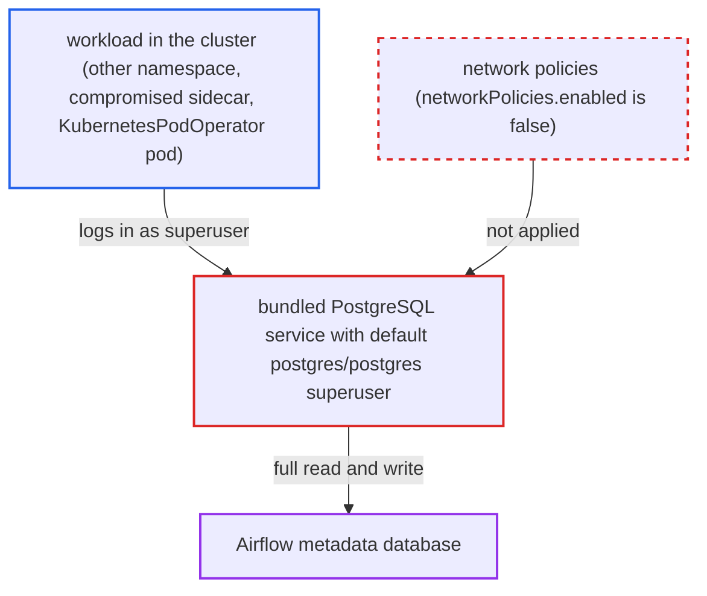

# Bundled PostgreSQL metadata database ships with default superuser password postgres

| Field | Value |
|---|---|
| ID | `find_01QTYareQF9W4HWWkmHV9121` |
| Severity | **High** |
| Status | open |
| CWE | CWE-1392 — Use of default credentials |
| Created | 2026-10-27T21:17:46.006852Z |
| Claude Security | https://claude.ai/security/findings/find_01QTYareQF9W4HWWkmHV9121 |

## Description

Any workload in the cluster that can reach the bundled PostgreSQL service can log in as its superuser and read or rewrite the whole Airflow metadata database. The attacker needs only network access to the service and a default install. The chart enables PostgreSQL with the superuser `postgres` and the fixed password `postgres`, and uses them for Airflow's metadata connection.

1. **the chart's `values.yaml`** enables the bundled PostgreSQL with a fixed superuser password. `postgresql.enabled` is `true`, `auth.enablePostgresUser` is `true` and `auth.postgresPassword` is `postgres` by default. ([`chart/values.yaml:3394-3403`](https://github.com/cx-benchmark/airflow/blob/a462d683469bb9f55646b0515ef84c41e16650fb/chart/values.yaml#L3394-L3403))
2. **the chart's `data.metadataConnection` defaults** point Airflow at that database as the superuser. They set `user: postgres`, `pass: postgres` and `sslmode: disable`. ([`chart/values.yaml:477-484`](https://github.com/cx-benchmark/airflow/blob/a462d683469bb9f55646b0515ef84c41e16650fb/chart/values.yaml#L477-L484))
3. **the metadata connection Secret template** renders the connection URI with these credentials. The URI has the form `postgresql://postgres:*@{release}-postgresql.{ns}:5432/postgres?sslmode=disable` and points at the in-cluster `{release}-postgresql` Service. ([`chart/templates/secrets/metadata-connection-secret.yaml:23-56`](https://github.com/cx-benchmark/airflow/blob/a462d683469bb9f55646b0515ef84c41e16650fb/chart/templates/secrets/metadata-connection-secret.yaml#L23-L56))
4. **the chart's `networkPolicies.enabled` setting** leaves the database reachable from every pod. It defaults to `false`, so nothing restricts which pods may connect to the Service. ([`chart/values.yaml:303-305`](https://github.com/cx-benchmark/airflow/blob/a462d683469bb9f55646b0515ef84c41e16650fb/chart/values.yaml#L303-L305))
5. **an attacker workload in the cluster** connects to `{release}-postgresql.{ns}.svc:5432` with `postgres`/`postgres`. Any PostgreSQL client works, and the default password is identical to the username.
6. **the attacker** reads and rewrites the Airflow metadata database as superuser. This includes Connections, Variables, serialized DAGs, task instances, XComs and FAB users, roles and password hashes.

## Assessment

The attacker is any workload that can open a TCP connection to `{release}-postgresql.{ns}.svc:5432`. Examples are an unprivileged pod in another namespace of the same cluster, a compromised sidecar, a `KubernetesPodOperator` pod, or a DAG author's task pod that already holds the connection URI. No login or victim action is needed. Only the default chart values are required, with `networkPolicies.enabled` left at `false`.

Impact: The attacker gets superuser control of the metadata database. They can read every table, including Connections, Variables (Fernet ciphertext), serialized DAGs, task instances, XComs and FAB users, roles and password hashes. They can change any row, for example to grant the Admin role, change task states, or rewrite serialized DAGs so that workers run attacker code. They can also destroy the database.

## Recommendation

The chart provisions the bundled database superuser with a fixed, well-known password and uses it as Airflow's metadata credential by default.

Fix criteria: A default render contains no static database password. Either a random password is generated into the metadata Secret (for example by a pre-install hook, as for the Fernet key) and the same value is passed to the PostgreSQL subchart, or the render fails unless the deployer sets `postgresql.auth.postgresPassword` and `data.metadataConnection.pass` explicitly. Rendering with default values shows a metadata Secret that does not decode to `postgres:postgres`. On a fresh install, `psql -U postgres` with password `postgres` against the service is rejected.

## Evidence

**https://github.com/cx-benchmark/airflow**

- [`chart/values.yaml:3394-3403`](https://github.com/cx-benchmark/airflow/blob/a462d683469bb9f55646b0515ef84c41e16650fb/chart/values.yaml#L3394-L3403)
- [`chart/values.yaml:477-484`](https://github.com/cx-benchmark/airflow/blob/a462d683469bb9f55646b0515ef84c41e16650fb/chart/values.yaml#L477-L484)
- [`chart/templates/secrets/metadata-connection-secret.yaml:23-56`](https://github.com/cx-benchmark/airflow/blob/a462d683469bb9f55646b0515ef84c41e16650fb/chart/templates/secrets/metadata-connection-secret.yaml#L23-L56)
- [`chart/values.yaml:303-305`](https://github.com/cx-benchmark/airflow/blob/a462d683469bb9f55646b0515ef84c41e16650fb/chart/values.yaml#L303-L305)
- [`chart/templates/NOTES.txt:60-63`](https://github.com/cx-benchmark/airflow/blob/a462d683469bb9f55646b0515ef84c41e16650fb/chart/templates/NOTES.txt#L60-L63)

