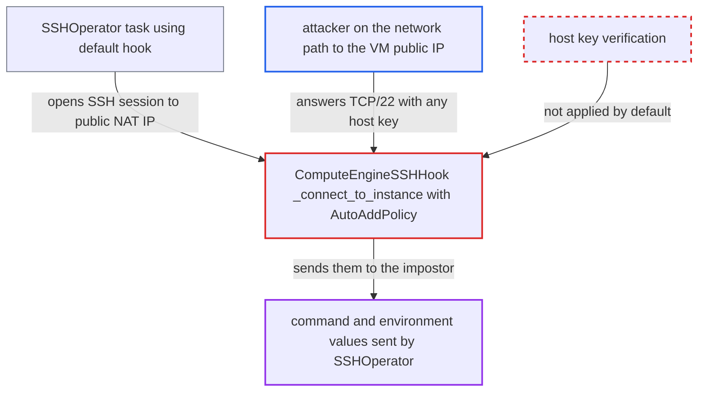

# ComputeEngineSSHHook skips SSH host key verification by default (AutoAddPolicy)

| Field | Value |
|---|---|
| ID | `find_015Y4SUJcU7fn9cJJmEK5QC5` |
| Severity | **High** |
| Status | open |
| CWE | CWE-322 — Key exchange without entity authentication |
| Created | 2026-10-27T21:37:27.338326Z |
| Claude Security | https://claude.ai/security/findings/find_015Y4SUJcU7fn9cJJmEK5QC5 |

## Description

Someone on the network path between an Airflow worker and a Compute Engine VM's public IP can pose as that VM and receive the command and environment values an `SSHOperator` task sends. They also choose the output and exit status the task records. No Airflow access is needed. The cause is `ComputeEngineSSHHook`, whose default `host_key_policy="auto_add"` accepts any server key.

1. **DAG author** creates `ComputeEngineSSHHook` without passing `host_key_policy`. The constructor default is `"auto_add"`, and `_load_connection_config` does not read this setting from the connection, so the connection cannot change it. ([`providers/google/src/airflow/providers/google/cloud/hooks/compute_ssh.py:151`](https://github.com/cx-benchmark/airflow/blob/a462d683469bb9f55646b0515ef84c41e16650fb/providers/google/src/airflow/providers/google/cloud/hooks/compute_ssh.py#L151))
2. **the hook** resolves the VM's public NAT IP as the target. With `use_internal_ip=False` and `use_iap_tunnel=False`, `get_instance_address` returns the public `natIP`, and no tunnel is used. ([`providers/google/src/airflow/providers/google/cloud/hooks/compute.py:841-847`](https://github.com/cx-benchmark/airflow/blob/a462d683469bb9f55646b0515ef84c41e16650fb/providers/google/src/airflow/providers/google/cloud/hooks/compute.py#L841-L847))
3. **the method `_resolve_host_key_policy`** maps `"auto_add"` to `paramiko.AutoAddPolicy()`. This policy accepts any host key that paramiko does not already know. ([`providers/google/src/airflow/providers/google/cloud/hooks/compute_ssh.py:196-202`](https://github.com/cx-benchmark/airflow/blob/a462d683469bb9f55646b0515ef84c41e16650fb/providers/google/src/airflow/providers/google/cloud/hooks/compute_ssh.py#L196-L202))
4. **the method `_connect_to_instance`** installs that policy on a fresh `_GCloudAuthorizedSSHClient` and connects. The client never loads `known_hosts` or any other host key, so every server key counts as unknown and is accepted. ([`providers/google/src/airflow/providers/google/cloud/hooks/compute_ssh.py:354-373`](https://github.com/cx-benchmark/airflow/blob/a462d683469bb9f55646b0515ef84c41e16650fb/providers/google/src/airflow/providers/google/cloud/hooks/compute_ssh.py#L354-L373))
5. **network attacker** answers on TCP/22 for the VM's address with any host key. The hook accepts the key and the attacker accepts the client's public-key login, so the session is established with the impostor.
6. **`SSHOperator`** sends the rendered `command` and the `environment` dict over the session. Both are template fields, and DAGs use them to pass credentials to the remote host. ([`providers/ssh/src/airflow/providers/ssh/operators/ssh.py:157-182`](https://github.com/cx-benchmark/airflow/blob/a462d683469bb9f55646b0515ef84c41e16650fb/providers/ssh/src/airflow/providers/ssh/operators/ssh.py#L157-L182))
7. **network attacker** returns output and an exit status of their choosing. The task records the peer's stdout and exit status as its result and XCom, so the attacker controls what downstream tasks see. ([`providers/ssh/src/airflow/providers/ssh/operators/ssh.py:157-182`](https://github.com/cx-benchmark/airflow/blob/a462d683469bb9f55646b0515ef84c41e16650fb/providers/ssh/src/airflow/providers/ssh/operators/ssh.py#L157-L182))

## Assessment

The attacker needs a position on the network path from the Airflow worker to the VM's public NAT IP, for example a compromised hop, a hostile egress network or a hijacked route. They need no Airflow access. The attack works when a task runs `SSHOperator(ssh_hook=ComputeEngineSSHHook(...))` with the defaults `use_internal_ip=False` and `use_iap_tunnel=False`, which the documented example in `example_compute_ssh.py` uses. Only a DAG author who passes `host_key_policy` explicitly changes the policy. No one has to act beyond the scheduled run.

Impact: The impostor receives the rendered `command` and the `environment` values, which may hold credentials, and the `environment` values are not written to the task log. The impostor also sets the output and exit status the task records, which can steer downstream tasks, and the intended command never runs on the real VM. No reusable credential for the real VM is captured, because the client's signature is bound to the session. Worker availability is not affected.

## Recommendation

(1) `ComputeEngineSSHHook` defaults `host_key_policy` to `"auto_add"` and opens the session on a client with no trusted host keys. The server is never authenticated.

Fix criteria: By default the hook verifies the VM's host key against a trusted source before it sends any command, and refuses unknown or mismatched keys. Trusted sources include the instance's host keys fetched over the authenticated Compute API (guest attributes), a pinned key or a loaded `known_hosts`. Accepting unknown keys needs an explicit opt-in. A default-constructed hook pointed at a server that presents an unexpected key raises before `exec_command` runs.

(2) The documented secure option `"reject"` cannot succeed. `_GCloudAuthorizedSSHClient` never loads `known_hosts` or any other host key, so `RejectPolicy` refuses every host. Only a caller-written policy can verify.

Fix criteria: Any option documented as verifying loads the key source it names. It connects to a legitimate host whose key is in that source and rejects a host whose key is not. Tests cover both outcomes.

## Evidence

**https://github.com/cx-benchmark/airflow**

- [`providers/google/src/airflow/providers/google/cloud/hooks/compute_ssh.py:354-373`](https://github.com/cx-benchmark/airflow/blob/a462d683469bb9f55646b0515ef84c41e16650fb/providers/google/src/airflow/providers/google/cloud/hooks/compute_ssh.py#L354-L373)
- [`providers/google/src/airflow/providers/google/cloud/hooks/compute_ssh.py:151`](https://github.com/cx-benchmark/airflow/blob/a462d683469bb9f55646b0515ef84c41e16650fb/providers/google/src/airflow/providers/google/cloud/hooks/compute_ssh.py#L151)
- [`providers/google/src/airflow/providers/google/cloud/hooks/compute_ssh.py:196-202`](https://github.com/cx-benchmark/airflow/blob/a462d683469bb9f55646b0515ef84c41e16650fb/providers/google/src/airflow/providers/google/cloud/hooks/compute_ssh.py#L196-L202)
- [`providers/google/src/airflow/providers/google/cloud/hooks/compute_ssh.py:48-62`](https://github.com/cx-benchmark/airflow/blob/a462d683469bb9f55646b0515ef84c41e16650fb/providers/google/src/airflow/providers/google/cloud/hooks/compute_ssh.py#L48-L62)
- [`providers/google/src/airflow/providers/google/cloud/hooks/compute_ssh.py:297-305`](https://github.com/cx-benchmark/airflow/blob/a462d683469bb9f55646b0515ef84c41e16650fb/providers/google/src/airflow/providers/google/cloud/hooks/compute_ssh.py#L297-L305)
- [`providers/google/src/airflow/providers/google/cloud/hooks/compute.py:841-847`](https://github.com/cx-benchmark/airflow/blob/a462d683469bb9f55646b0515ef84c41e16650fb/providers/google/src/airflow/providers/google/cloud/hooks/compute.py#L841-L847)
- [`providers/ssh/src/airflow/providers/ssh/operators/ssh.py:157-182`](https://github.com/cx-benchmark/airflow/blob/a462d683469bb9f55646b0515ef84c41e16650fb/providers/ssh/src/airflow/providers/ssh/operators/ssh.py#L157-L182)
- [`providers/ssh/src/airflow/providers/ssh/hooks/ssh.py:351-369`](https://github.com/cx-benchmark/airflow/blob/a462d683469bb9f55646b0515ef84c41e16650fb/providers/ssh/src/airflow/providers/ssh/hooks/ssh.py#L351-L369)
- [`providers/google/tests/system/google/cloud/compute/example_compute_ssh.py:96-108`](https://github.com/cx-benchmark/airflow/blob/a462d683469bb9f55646b0515ef84c41e16650fb/providers/google/tests/system/google/cloud/compute/example_compute_ssh.py#L96-L108)

