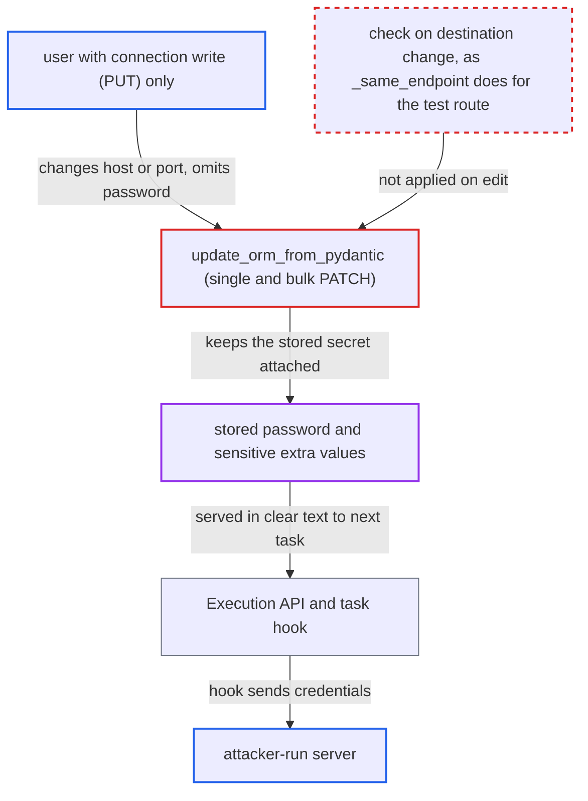

# Connection edit retargets host while keeping stored secret, letting write-only editors recover credentials

| Field | Value |
|---|---|
| ID | `find_01KHfDXiDE2RvxcUcxyEfVNC` |
| Severity | **High** |
| Status | open |
| CWE | CWE-522 — Insufficiently protected credentials |
| Created | 2026-10-27T21:28:26.087274Z |
| Claude Security | https://claude.ai/security/findings/find_01KHfDXiDE2RvxcUcxyEfVNC |

## Description

A user who may edit connections but is not allowed to read their secrets can steal a connection's stored password and sensitive `extra` values. They repoint the connection at a server they run, and the stored secret is sent there. Admin and Op users gain nothing new. The weak code is `update_orm_from_pydantic`, which keeps the stored secret when the destination changes.

1. **attacker with connection write (`PUT`) access** sends a PATCH that changes the connection's destination. The request is `PATCH /api/v2/connections/{connection_id}?update_mask=host` (and `port`), or the bulk `PATCH /api/v2/connections`, with no password in the body. The route checks only `requires_access_connection(method="PUT")`, so reading the connection is not required. ([`airflow-core/src/airflow/api_fastapi/core_api/routes/public/connections.py:290-328`](https://github.com/cx-benchmark/airflow/blob/a462d683469bb9f55646b0515ef84c41e16650fb/airflow-core/src/airflow/api_fastapi/core_api/routes/public/connections.py#L290-L328))
2. **`update_orm_from_pydantic`** saves the new destination fields and carries the stored secret forward. It copies `host`, `port`, `conn_type`, `schema` and `login` from the body. It leaves the password alone when `password` is omitted or not in `update_mask`, restores `***` through `secrets_masker.merge`, and treats `null` or an empty string as a no-op in `set_password`. It never compares the new destination with the stored one. ([`airflow-core/src/airflow/api_fastapi/core_api/services/public/connections.py:43-87`](https://github.com/cx-benchmark/airflow/blob/a462d683469bb9f55646b0515ef84c41e16650fb/airflow-core/src/airflow/api_fastapi/core_api/services/public/connections.py#L43-L87))
3. **`secrets_masker.merge`** restores masked `extra` secrets from the stored `extra`. A `***` value under a sensitive name such as `token`, `private_key` or `secret` is replaced by the stored value, even when `conn_type` changes. ([`shared/secrets_masker/src/airflow_shared/secrets_masker/secrets_masker.py:443-530`](https://github.com/cx-benchmark/airflow/blob/a462d683469bb9f55646b0515ef84c41e16650fb/shared/secrets_masker/src/airflow_shared/secrets_masker/secrets_masker.py#L443-L530))
4. **Execution API** returns the connection with the password in clear text to the next task that uses it. The Execution API connection model has no redaction. The core API masks the password on reads, but this route does not. ([`airflow-core/src/airflow/api_fastapi/execution_api/routes/connections.py:64-85`](https://github.com/cx-benchmark/airflow/blob/a462d683469bb9f55646b0515ef84c41e16650fb/airflow-core/src/airflow/api_fastapi/execution_api/routes/connections.py#L64-L85))
5. **the task's hook** authenticates to the attacker's host. For example `HttpHook` builds `base_url` from `conn.host` and sends `HTTPBasicAuth(login, password)`, so the attacker's server receives the credentials. ([`airflow-core/src/airflow/api_fastapi/execution_api/routes/connections.py:64-85`](https://github.com/cx-benchmark/airflow/blob/a462d683469bb9f55646b0515ef84c41e16650fb/airflow-core/src/airflow/api_fastapi/execution_api/routes/connections.py#L64-L85))

## Assessment

The attacker is an authenticated API user with connection write (`PUT`) permission but no right to read secrets. Examples are a custom FAB role with `can_edit` on Connections, or a Keycloak or AWS auth-manager policy granting connection `PUT`. Either the single `PATCH /api/v2/connections/{connection_id}` or the bulk `PATCH /api/v2/connections` works. Bulk create with `overwrite` also keeps the stored password, because it writes only the fields that are set. The attack then relies on a Dag that uses the connection running later, which is scheduled and outside the attacker's control. For FAB `Admin` and `Op` (and the dev-only SimpleAuthManager `OP`), the security model already entitles them to these credentials, so they gain nothing new.

Impact: The attacker recovers the clear-text password, and the sensitive `extra` values restored by `merge`, of any connection they may edit. The security model says this role must not be able to view them. The role could already modify connections, so Airflow itself loses nothing else.

Subsequent-system impact: The recovered secrets are the credentials Airflow uses for external systems such as databases, HTTP APIs, SSH/SFTP hosts and cloud accounts. With them the attacker reaches those systems directly, outside Airflow's authorization. The access stays after the connection is restored.

## Recommendation

(1) `update_orm_from_pydantic` saves a new `host`, `port`, `conn_type` or `schema` while keeping the stored `password`. This happens when the field is omitted or outside `update_mask`, when `***` goes through `merge`, or when `set_password` ignores a falsy value. A write-only caller can bind a credential they cannot read to a destination they choose.

Fix criteria: An edit that changes the destination (at least host, port, conn_type, schema, as `_same_endpoint` does for the test route) does not keep the stored password. It needs a real, non-masked credential in the request, or a caller authorized to read the secret. Otherwise the request is refused with a 4xx, or the stored secret is cleared. Check single PATCH (with and without `update_mask`), bulk update and bulk create-overwrite: changing `host` with the password omitted, `***` or `null` leaves no stored password that a task would send to the new host.

(2) The `extra` merge restores sensitive-named keys (`token`, `private_key`, `keyfile_dict`, ...) from the stored `extra` through `secrets_masker.merge`, even when `conn_type` or the destination changes. The `conn_type` guard wraps only `restore_provider_sensitive_extra`.

Fix criteria: Masked `extra` secrets are restored only when neither the connection type nor the destination has changed. After such a change, `***` values are rejected or dropped instead of replaced with stored secrets. Patching `conn_type` or `host` with `extra` `{"token": "***"}` does not carry over the stored token.

## Evidence

**https://github.com/cx-benchmark/airflow**

- [`airflow-core/src/airflow/api_fastapi/core_api/services/public/connections.py:43-87`](https://github.com/cx-benchmark/airflow/blob/a462d683469bb9f55646b0515ef84c41e16650fb/airflow-core/src/airflow/api_fastapi/core_api/services/public/connections.py#L43-L87)
- [`airflow-core/src/airflow/api_fastapi/core_api/routes/public/connections.py:290-328`](https://github.com/cx-benchmark/airflow/blob/a462d683469bb9f55646b0515ef84c41e16650fb/airflow-core/src/airflow/api_fastapi/core_api/routes/public/connections.py#L290-L328)
- [`airflow-core/src/airflow/api_fastapi/core_api/routes/public/connections.py:391-404`](https://github.com/cx-benchmark/airflow/blob/a462d683469bb9f55646b0515ef84c41e16650fb/airflow-core/src/airflow/api_fastapi/core_api/routes/public/connections.py#L391-L404)
- [`airflow-core/src/airflow/models/crypto.py:116-121`](https://github.com/cx-benchmark/airflow/blob/a462d683469bb9f55646b0515ef84c41e16650fb/airflow-core/src/airflow/models/crypto.py#L116-L121)
- [`shared/secrets_masker/src/airflow_shared/secrets_masker/secrets_masker.py:443-530`](https://github.com/cx-benchmark/airflow/blob/a462d683469bb9f55646b0515ef84c41e16650fb/shared/secrets_masker/src/airflow_shared/secrets_masker/secrets_masker.py#L443-L530)
- [`airflow-core/src/airflow/ui/src/queries/useEditConnection.tsx:68-112`](https://github.com/cx-benchmark/airflow/blob/a462d683469bb9f55646b0515ef84c41e16650fb/airflow-core/src/airflow/ui/src/queries/useEditConnection.tsx#L68-L112)
- [`airflow-core/src/airflow/api_fastapi/core_api/datamodels/connections.py:91-110`](https://github.com/cx-benchmark/airflow/blob/a462d683469bb9f55646b0515ef84c41e16650fb/airflow-core/src/airflow/api_fastapi/core_api/datamodels/connections.py#L91-L110)
- [`airflow-core/src/airflow/api_fastapi/core_api/services/public/connections.py:128-176`](https://github.com/cx-benchmark/airflow/blob/a462d683469bb9f55646b0515ef84c41e16650fb/airflow-core/src/airflow/api_fastapi/core_api/services/public/connections.py#L128-L176)
- [`airflow-core/src/airflow/api_fastapi/execution_api/routes/connections.py:64-85`](https://github.com/cx-benchmark/airflow/blob/a462d683469bb9f55646b0515ef84c41e16650fb/airflow-core/src/airflow/api_fastapi/execution_api/routes/connections.py#L64-L85)
- [`airflow-core/docs/security/security_model.rst:1064-1074`](https://github.com/cx-benchmark/airflow/blob/a462d683469bb9f55646b0515ef84c41e16650fb/airflow-core/docs/security/security_model.rst#L1064-L1074)

