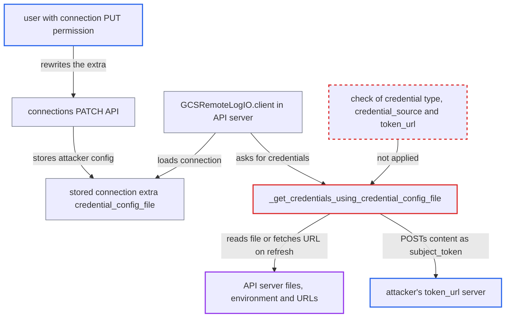

# Connection-supplied Google credential config lets API server exfiltrate local files and fetch URLs

| Field | Value |
|---|---|
| ID | `find_01QnL4ova2rWYPHTV54DKaao` |
| Severity | **High** |
| Status | open |
| CWE | CWE-918 — Server-Side Request Forgery |
| Created | 2026-10-27T21:49:41.545725Z |
| Claude Security | https://claude.ai/security/findings/find_01QnL4ova2rWYPHTV54DKaao |

## Description

A user with connection PUT permission can make the Airflow API server read any file it can access, or fetch a URL, and send the result to a server they choose. In the shipped Helm chart this exposes the JWT signing key, the Fernet key and the database URI. It needs GCS remote logging with `remote_log_conn_id` naming a stored connection. The cause is `_CredentialProvider._get_credentials_using_credential_config_file`, which loads the connection's `credential_config_file` without checking its type, `credential_source` or `token_url`.

1. **attacker with connection PUT permission** rewrites the extra of the connection named by `remote_log_conn_id`. The PATCH keeps only the keys sent, so any old `keyfile_dict` or `key_path` is dropped. The attacker sets only `credential_config_file`, an `external_account` config with `credential_source.file` set to `/proc/self/environ` and `token_url` set to `https://attacker/sts`, and no content validation stops it. ([`airflow-core/src/airflow/api_fastapi/core_api/services/public/connections.py:71-83`](https://github.com/cx-benchmark/airflow/blob/a462d683469bb9f55646b0515ef84c41e16650fb/airflow-core/src/airflow/api_fastapi/core_api/services/public/connections.py#L71-L83))
2. **API server** resolves the connection from the metastore when it handles a task-log request. The API server runs in server context, so `BaseHook.get_connection` falls through to the metastore, where the attacker's edit is stored. ([`airflow-core/src/airflow/api_fastapi/main.py:23-25`](https://github.com/cx-benchmark/airflow/blob/a462d683469bb9f55646b0515ef84c41e16650fb/airflow-core/src/airflow/api_fastapi/main.py#L23-L25))
3. **public task-log endpoint** passes the request to the remote log reader. Any log view triggers this, whether the attacker's own or a routine one by another user, and it reaches `_read_remote_logs` inside the API server. ([`airflow-core/src/airflow/api_fastapi/core_api/routes/public/log.py:90-123`](https://github.com/cx-benchmark/airflow/blob/a462d683469bb9f55646b0515ef84c41e16650fb/airflow-core/src/airflow/api_fastapi/core_api/routes/public/log.py#L90-L123))
4. **`GCSRemoteLogIO.client`** builds `GCSHook` for `remote_log_conn_id` and asks it for credentials. `hook` and `client` are `cached_property` values on a process-wide object, so the edit takes effect at the first remote-log read in that API server process after the change. ([`providers/google/src/airflow/providers/google/cloud/log/gcs_task_handler.py:128-164`](https://github.com/cx-benchmark/airflow/blob/a462d683469bb9f55646b0515ef84c41e16650fb/providers/google/src/airflow/providers/google/cloud/log/gcs_task_handler.py#L128-L164))
5. **`_CredentialProvider._get_credentials_using_credential_config_file`** writes the supplied config to a temp file and loads it with `google.auth.load_credentials_from_file`. It does not check the credential type, `credential_source` or `token_url`, so google-auth accepts the attacker's `external_account` config. ([`providers/google/src/airflow/providers/google/cloud/utils/credentials_provider.py:366-388`](https://github.com/cx-benchmark/airflow/blob/a462d683469bb9f55646b0515ef84c41e16650fb/providers/google/src/airflow/providers/google/cloud/utils/credentials_provider.py#L366-L388))
6. **`GCSRemoteLogIO.stream`** calls `list_blobs`, which refreshes the credentials. The refresh reads the chosen file (or does a GET on the chosen `url`) and POSTs the content as `subject_token` to the attacker's `token_url`. ([`providers/google/src/airflow/providers/google/cloud/log/gcs_task_handler.py:227-233`](https://github.com/cx-benchmark/airflow/blob/a462d683469bb9f55646b0515ef84c41e16650fb/providers/google/src/airflow/providers/google/cloud/log/gcs_task_handler.py#L227-L233))
7. **attacker** uses the received environment to forge API tokens and decrypt connections. In the shipped chart the API server's environment holds `AIRFLOW__API_AUTH__JWT_SECRET`, which workers do not get, plus the Fernet key and the database URI. ([`chart/templates/_helpers.yaml:146-154`](https://github.com/cx-benchmark/airflow/blob/a462d683469bb9f55646b0515ef84c41e16650fb/chart/templates/_helpers.yaml#L146-L154))

## Assessment

The attacker is an authenticated user with connection PUT permission, through the REST API or the UI. The security model calls this role highly privileged but limits it to worker-context effects. GCS remote logging must be set up with `remote_log_conn_id` naming a metastore connection, as the provider docs describe. The attacker's own log view can trigger the read, or a routine log view by anyone else can. If an API server process already cached its hook, the change takes effect only at the first remote-log read in a process after the edit, for example after a restart or on a new replica. Two other routes need settings the project does not ship. One is `test_connection`, which is disabled by default and works only with `[core] test_connection = Enabled`. The other is a GCS DAG bundle, where the DAG processor builds a `GCSHook` from a connection the same way. The report assumes google-auth (pinned `>=2.29.0`) does no allow-listing of `token_url` or of `credential_source.file` or `url`. It could not read the library to confirm this.

Impact: Any file the API server process can read is sent to the attacker. `credential_source.url` also returns the full response of a GET made from the API server. With the chart's environment values the attacker can forge API tokens for any user, decrypt every stored connection and read and write the metadata database. The connection role is not entitled to any of this. Availability is affected only through that gained control.

Subsequent-system impact: A `credential_source.url` aimed at the GCE/GKE metadata server returns the access token of the API server's cloud identity. The decrypted connections hold credentials for external databases, clouds and SaaS services. The attacker can act on those outside systems, limited by what those identities permit.

## Recommendation

(1) `_CredentialProvider._get_credentials_using_credential_config_file` and the `idp_issuer_url` branch accept any credential configuration from connection extras. google-auth then acts on `credential_source.file`, `credential_source.url`, `executable` and any `token_url` or `service_account_impersonation_url`. A connection editor therefore controls which local files and URLs the process reads and where the contents go.

Fix criteria: A credential configuration from a connection cannot read arbitrary local files or contact arbitrary hosts. `credential_source.file`, `url` and `executable` are rejected or ignored, or `file` is limited to an operator-allow-listed directory and `url` to the GCE metadata host. `token_url`, `service_account_impersonation_url` and `idp_issuer_url` must be Google STS/IAM endpoints or on an operator-configured allow-list. Test with the extras from the attack: `GoogleBaseHook.get_credentials()` must raise before any file is read or request is made.

(2) `GCSRemoteLogIO.hook` (and `GCSDagBundle.gcs_hook`) evaluate a metastore connection that connection-configuration users can write. They do this inside the API server and DAG processor, which moves a worker-level trust assumption into control-plane processes.

Fix criteria: Control-plane components get credentials for remote-log reading and DAG bundles only from deployment configuration (`google_key_path`, `remote_task_handler_kwargs`, ADC). They may also use a connection whose extras cannot be changed through the UI or API, such as one from the environment or a secrets backend. Alternatively, the credential loader used there refuses the connection-controlled `credential_config_file` and `key_path` fields. Test that editing the extras of `remote_log_conn_id` cannot change which files or URLs the API server touches.

## Evidence

**https://github.com/cx-benchmark/airflow**

- [`providers/google/src/airflow/providers/google/cloud/utils/credentials_provider.py:366-388`](https://github.com/cx-benchmark/airflow/blob/a462d683469bb9f55646b0515ef84c41e16650fb/providers/google/src/airflow/providers/google/cloud/utils/credentials_provider.py#L366-L388)
- [`providers/google/src/airflow/providers/google/common/hooks/base_google.py:326-386`](https://github.com/cx-benchmark/airflow/blob/a462d683469bb9f55646b0515ef84c41e16650fb/providers/google/src/airflow/providers/google/common/hooks/base_google.py#L326-L386)
- [`providers/google/src/airflow/providers/google/cloud/log/gcs_task_handler.py:128-164`](https://github.com/cx-benchmark/airflow/blob/a462d683469bb9f55646b0515ef84c41e16650fb/providers/google/src/airflow/providers/google/cloud/log/gcs_task_handler.py#L128-L164)
- [`providers/google/src/airflow/providers/google/cloud/log/gcs_task_handler.py:227-233`](https://github.com/cx-benchmark/airflow/blob/a462d683469bb9f55646b0515ef84c41e16650fb/providers/google/src/airflow/providers/google/cloud/log/gcs_task_handler.py#L227-L233)
- [`airflow-core/src/airflow/utils/log/file_task_handler.py:957-988`](https://github.com/cx-benchmark/airflow/blob/a462d683469bb9f55646b0515ef84c41e16650fb/airflow-core/src/airflow/utils/log/file_task_handler.py#L957-L988)
- [`airflow-core/src/airflow/api_fastapi/core_api/routes/public/log.py:90-123`](https://github.com/cx-benchmark/airflow/blob/a462d683469bb9f55646b0515ef84c41e16650fb/airflow-core/src/airflow/api_fastapi/core_api/routes/public/log.py#L90-L123)
- [`airflow-core/src/airflow/api_fastapi/main.py:23-25`](https://github.com/cx-benchmark/airflow/blob/a462d683469bb9f55646b0515ef84c41e16650fb/airflow-core/src/airflow/api_fastapi/main.py#L23-L25)
- [`airflow-core/src/airflow/api_fastapi/core_api/services/public/connections.py:71-83`](https://github.com/cx-benchmark/airflow/blob/a462d683469bb9f55646b0515ef84c41e16650fb/airflow-core/src/airflow/api_fastapi/core_api/services/public/connections.py#L71-L83)
- [`chart/templates/_helpers.yaml:146-154`](https://github.com/cx-benchmark/airflow/blob/a462d683469bb9f55646b0515ef84c41e16650fb/chart/templates/_helpers.yaml#L146-L154)
- [`airflow-core/docs/security/security_model.rst:1064-1074`](https://github.com/cx-benchmark/airflow/blob/a462d683469bb9f55646b0515ef84c41e16650fb/airflow-core/docs/security/security_model.rst#L1064-L1074)
- [`providers/google/src/airflow/providers/google/common/hooks/base_google.py:795-809`](https://github.com/cx-benchmark/airflow/blob/a462d683469bb9f55646b0515ef84c41e16650fb/providers/google/src/airflow/providers/google/common/hooks/base_google.py#L795-L809)
- [`providers/google/src/airflow/providers/google/cloud/bundles/gcs.py:95-99`](https://github.com/cx-benchmark/airflow/blob/a462d683469bb9f55646b0515ef84c41e16650fb/providers/google/src/airflow/providers/google/cloud/bundles/gcs.py#L95-L99)

