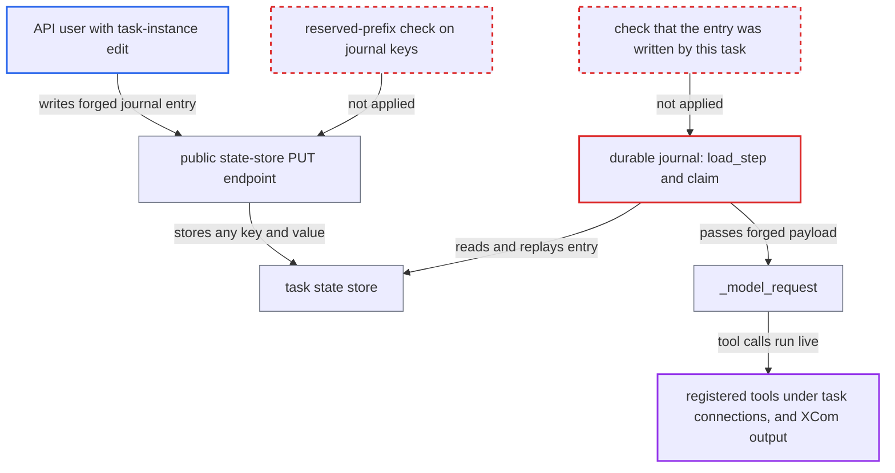

# Durable agent journal replays forged task-state-store entries, letting TI-edit users drive tool calls

| Field | Value |
|---|---|
| ID | `find_019BbU4xQ6bjMmxeFtJxggnJ` |
| Severity | **High** |
| Status | open |
| CWE | CWE-345 — Insufficient Data Authenticity Verification |
| Created | 2026-10-27T21:19:30.315482Z |
| Claude Security | https://claude.ai/security/findings/find_019BbU4xQ6bjMmxeFtJxggnJ |

## Description

A user who can edit task instances on a Dag, such as a FAB `User` who is not a Dag author, can act as the model of a durable agent and run its registered tools with arguments they choose. This works on Airflow 3.3 and later for `AgentOperator(durable=True)`, `@task.agent(durable=True)` and `AirflowDurability`. The journal replays any task-state-store entry whose `name` and `fingerprint` match, and the public state-store PUT endpoint lets such users write those entries.

1. **API user with task-instance edit** reads a genuine journal entry after a failed or failed-marked attempt. GET on the state store needs only task-instance read, so the entry's `name` and `fingerprint` can be copied. ([`airflow-core/src/airflow/api_fastapi/core_api/routes/public/task_state_store.py:269-289`](https://github.com/cx-benchmark/airflow/blob/a462d683469bb9f55646b0515ef84c41e16650fb/airflow-core/src/airflow/api_fastapi/core_api/routes/public/task_state_store.py#L269-L289))
2. **API user with task-instance edit** writes a forged entry under the journal key with the copied `name` and `fingerprint`. The `payload` is replaced with a `ModelResponse` whose `ToolCallPart`s name registered tools and chosen arguments, and the PUT has no reserved-prefix check. ([`airflow-core/src/airflow/api_fastapi/core_api/routes/public/task_state_store.py:269-289`](https://github.com/cx-benchmark/airflow/blob/a462d683469bb9f55646b0515ef84c41e16650fb/airflow-core/src/airflow/api_fastapi/core_api/routes/public/task_state_store.py#L269-L289))
3. **API user with task-instance edit** clears the task instance with `keep_task_state=true`. The same task-instance edit permission allows this, and it keeps the forged entry for the next attempt. ([`airflow-core/src/airflow/api_fastapi/core_api/routes/public/task_instances.py:1318-1322`](https://github.com/cx-benchmark/airflow/blob/a462d683469bb9f55646b0515ef84c41e16650fb/airflow-core/src/airflow/api_fastapi/core_api/routes/public/task_instances.py#L1318-L1322))
4. **the storage `TaskStateStoreDurableStorage.load_step`** returns the forged dict as an earlier attempt's record. It returns any dict under the journal key and does not check who wrote it. ([`providers/common/ai/src/airflow/providers/common/ai/durable/task_state_store.py:86-89`](https://github.com/cx-benchmark/airflow/blob/a462d683469bb9f55646b0515ef84c41e16650fb/providers/common/ai/src/airflow/providers/common/ai/durable/task_state_store.py#L86-L89))
5. **the journal method `DurableRun.claim`** replays the entry. It does this because the stored `name` and `fingerprint` equal the live step's, and the fingerprint is an unkeyed sha256 that authenticates no writer. ([`providers/common/ai/src/airflow/providers/common/ai/durable/journal.py:285-292`](https://github.com/cx-benchmark/airflow/blob/a462d683469bb9f55646b0515ef84c41e16650fb/providers/common/ai/src/airflow/providers/common/ai/durable/journal.py#L285-L292))
6. **the backend method `_model_request`** hands the forged `payload` to pydantic-ai as the model's `ModelResponse`. pydantic-ai then dispatches each `ToolCallPart` to the agent's toolsets. A call with no journal entry runs live, and a stored answer becomes the task's XCom output. ([`providers/common/ai/src/airflow/providers/common/ai/durable/capability.py:364-371`](https://github.com/cx-benchmark/airflow/blob/a462d683469bb9f55646b0515ef84c41e16650fb/providers/common/ai/src/airflow/providers/common/ai/durable/capability.py#L364-L371))

## Assessment

The attacker is an authenticated API user with task-instance edit on a Dag that runs a durable agent with tools. Under FAB this is the `User` role, which has no XCom write and is not a Dag author. They need a run where a model step has been journaled, either by letting it fail or by marking it failed, so they can copy a genuine entry's `name` and `fingerprint`. The Dag author does not need to route any user input into the prompt. The OpenAI Agents adapter and Strands checkpoint resume trust the store the same way, but both are experimental. The report assumes pydantic-ai-slim 2.36.0 or later handles a `ModelResponse` from a durable backend as it does a live one.

Impact: The attacker decides which registered tools run, with what arguments, and what final answer the agent gives. That answer becomes the task's XCom output for downstream tasks, a write the `User` role does not otherwise hold. Tool results, with secrets masked, are journaled where task-instance read can fetch them. Reach stops at the registered tools. `SandboxToolset` is refused with `durable=True` and approval-gated tools fail the task, so there is no shell on the worker.

Subsequent-system impact: The tools act on outside systems with the task's connection credentials. Examples are arbitrary SELECTs through `SQLToolset` (writes with `allow_writes=True`), any `allowed_methods` of a `HookToolset` with unpinned arguments, object-storage reads under the toolset root, MCP server tools and Dag-author function tools. Reach is bounded by the tools the Dag author attached and the grants of their connections.

## Recommendation

(1) The durable journal (`TaskStateStoreDurableStorage.load_step`, `DurableRun.claim`, `_model_request`, and the experimental OpenAI Agents and Strands adapters) treats every entry under its prefix as written by an earlier attempt of the task. The unkeyed fingerprint stored beside the payload proves nothing about who wrote it.

Fix criteria: An entry not written by an attempt of this task instance is never replayed. The provider can tell its own writes apart, for example with a MAC under a secret API users cannot obtain, or a writer attribute the Execution API sets and the public API cannot. When verification fails, the step runs live. Verify by PUTting a forged model-step entry with a copied `name` and `fingerprint` and clearing with `keep_task_state=true`. The step must run live and no forged tool call may execute.

(2) The public task-state-store PUT and PATCH endpoints accept any key and value under task-instance edit. Users who may not direct task execution can therefore write state that worker code consumes as trusted checkpoint data.

Fix criteria: Writing provider-reserved journal keys (`__commonai_durable__*`) through the public API is refused, or requires a privilege that may already alter task behaviour. The task's own writes through the Execution API (`ti:self`) still succeed. Verify that a FAB `User` gets 403 on PUT or PATCH of a journal key.

## Evidence

**https://github.com/cx-benchmark/airflow**

- [`providers/common/ai/src/airflow/providers/common/ai/durable/task_state_store.py:86-89`](https://github.com/cx-benchmark/airflow/blob/a462d683469bb9f55646b0515ef84c41e16650fb/providers/common/ai/src/airflow/providers/common/ai/durable/task_state_store.py#L86-L89)
- [`providers/common/ai/src/airflow/providers/common/ai/durable/journal.py:285-292`](https://github.com/cx-benchmark/airflow/blob/a462d683469bb9f55646b0515ef84c41e16650fb/providers/common/ai/src/airflow/providers/common/ai/durable/journal.py#L285-L292)
- [`providers/common/ai/src/airflow/providers/common/ai/durable/capability.py:364-371`](https://github.com/cx-benchmark/airflow/blob/a462d683469bb9f55646b0515ef84c41e16650fb/providers/common/ai/src/airflow/providers/common/ai/durable/capability.py#L364-L371)
- [`providers/common/ai/src/airflow/providers/common/ai/durable/fingerprint.py:516-518`](https://github.com/cx-benchmark/airflow/blob/a462d683469bb9f55646b0515ef84c41e16650fb/providers/common/ai/src/airflow/providers/common/ai/durable/fingerprint.py#L516-L518)
- [`providers/common/ai/src/airflow/providers/common/ai/durable/journal.py:545-550`](https://github.com/cx-benchmark/airflow/blob/a462d683469bb9f55646b0515ef84c41e16650fb/providers/common/ai/src/airflow/providers/common/ai/durable/journal.py#L545-L550)
- [`providers/common/ai/src/airflow/providers/common/ai/operators/agent.py:1062-1063`](https://github.com/cx-benchmark/airflow/blob/a462d683469bb9f55646b0515ef84c41e16650fb/providers/common/ai/src/airflow/providers/common/ai/operators/agent.py#L1062-L1063)
- [`airflow-core/src/airflow/api_fastapi/core_api/routes/public/task_state_store.py:269-289`](https://github.com/cx-benchmark/airflow/blob/a462d683469bb9f55646b0515ef84c41e16650fb/airflow-core/src/airflow/api_fastapi/core_api/routes/public/task_state_store.py#L269-L289)
- [`airflow-core/src/airflow/api_fastapi/core_api/routes/public/task_instances.py:1318-1322`](https://github.com/cx-benchmark/airflow/blob/a462d683469bb9f55646b0515ef84c41e16650fb/airflow-core/src/airflow/api_fastapi/core_api/routes/public/task_instances.py#L1318-L1322)
- [`providers/fab/src/airflow/providers/fab/auth_manager/security_manager/override.py:304-317`](https://github.com/cx-benchmark/airflow/blob/a462d683469bb9f55646b0515ef84c41e16650fb/providers/fab/src/airflow/providers/fab/auth_manager/security_manager/override.py#L304-L317)

