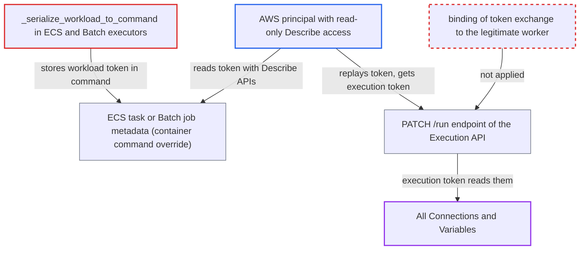

# ECS and Batch executors expose task workload JWT in AWS container overrides

| Field | Value |
|---|---|
| ID | `find_016WrZt72FSi5WZHbBH5zGs6` |
| Severity | **High** |
| Status | open |
| CWE | CWE-522 — Insufficiently protected credentials |
| Created | 2026-10-27T21:42:14.122728Z |
| Claude Security | https://claude.ai/security/findings/find_016WrZt72FSi5WZHbBH5zGs6 |

## Description

An AWS user with only read-only access to ECS or Batch, and no Airflow role, can steal a task's workload token. They can swap it for an execution token and read every Airflow Connection and Variable. The token sits in the `RunTask`/`SubmitJob` command override, which the Describe APIs return, and `/run` hands out an execution token to whoever presents it first while the task is `QUEUED`. Code at fault: `_serialize_workload_to_command`.

1. **the scheduler** mints a workload token for each queued task instance. The token has `workload` scope, is signed with `sub=ti.id`, and is valid for `[scheduler] task_queued_timeout` (600 s by default). ([`airflow-core/src/airflow/jobs/scheduler_job_runner.py:1303-1308`](https://github.com/cx-benchmark/airflow/blob/a462d683469bb9f55646b0515ef84c41e16650fb/airflow-core/src/airflow/jobs/scheduler_job_runner.py#L1303-L1308))
2. **the ECS executor's `_serialize_workload_to_command`** puts the whole workload JSON, token included, into the container command. `workload.model_dump_json()` includes `token`, because `Field(repr=False)` only hides it from `repr`. ([`providers/amazon/src/airflow/providers/amazon/aws/executors/ecs/ecs_executor.py:621-634`](https://github.com/cx-benchmark/airflow/blob/a462d683469bb9f55646b0515ef84c41e16650fb/providers/amazon/src/airflow/providers/amazon/aws/executors/ecs/ecs_executor.py#L621-L634))
3. **the Batch executor's `_serialize_workload_to_command`** does the same for Batch jobs. It puts `workload.model_dump_json()` after `--json-string` in the command. ([`providers/amazon/src/airflow/providers/amazon/aws/executors/batch/batch_executor.py:549-562`](https://github.com/cx-benchmark/airflow/blob/a462d683469bb9f55646b0515ef84c41e16650fb/providers/amazon/src/airflow/providers/amazon/aws/executors/batch/batch_executor.py#L549-L562))
4. **the executors** send the command to AWS as a container override in `ecs:RunTask` or `batch:SubmitJob`. The ECS code sets `container_override["command"]` and calls `self.ecs.run_task`. The Batch code sets `containerOverrides["command"]` and calls `self.batch.submit_job`. AWS stores the override as task or job metadata. ([`providers/amazon/src/airflow/providers/amazon/aws/executors/ecs/ecs_executor.py:505-541`](https://github.com/cx-benchmark/airflow/blob/a462d683469bb9f55646b0515ef84c41e16650fb/providers/amazon/src/airflow/providers/amazon/aws/executors/ecs/ecs_executor.py#L505-L541))
5. **the attacker with read-only AWS access** polls `ecs:ListTasks`/`ecs:DescribeTasks` or `batch:ListJobs`/`batch:DescribeJobs` and reads `token` and `ti.id` from the `--json-string` command. The task instance stays `QUEUED` until the container starts and calls `/run`. That wait covers Fargate provisioning and image pull, or a Batch job sitting in `RUNNABLE`. ([`airflow-core/src/airflow/jobs/scheduler_job_runner.py:1633-1636`](https://github.com/cx-benchmark/airflow/blob/a462d683469bb9f55646b0515ef84c41e16650fb/airflow-core/src/airflow/jobs/scheduler_job_runner.py#L1633-L1636))
6. **the attacker** sends `PATCH /execution/task-instances/{id}/run` with the stolen token before the container does. For a `QUEUED` task instance the endpoint does not check who the caller is. It records the caller's hostname, unixname and pid and sets the task instance to RUNNING. ([`airflow-core/src/airflow/api_fastapi/execution_api/routes/task_instances.py:259-286`](https://github.com/cx-benchmark/airflow/blob/a462d683469bb9f55646b0515ef84c41e16650fb/airflow-core/src/airflow/api_fastapi/execution_api/routes/task_instances.py#L259-L286))
7. **the Execution API** returns a fresh `execution` token in `Refreshed-API-Token`. Any caller presenting a workload-scope token gets this token. ([`airflow-core/src/airflow/api_fastapi/execution_api/routes/task_instances.py:422-424`](https://github.com/cx-benchmark/airflow/blob/a462d683469bb9f55646b0515ef84c41e16650fb/airflow-core/src/airflow/api_fastapi/execution_api/routes/task_instances.py#L422-L424))
8. **the attacker** calls `GET /execution/connections/{id}` and `/variables/{key}` with the execution token. `has_connection_access` always returns True, so any Connection can be read. Variables behave the same way. ([`airflow-core/src/airflow/api_fastapi/execution_api/routes/connections.py:36-53`](https://github.com/cx-benchmark/airflow/blob/a462d683469bb9f55646b0515ef84c41e16650fb/airflow-core/src/airflow/api_fastapi/execution_api/routes/connections.py#L36-L53))

## Assessment

The attacker is an AWS principal with read-only `ecs:ListTasks`/`ecs:DescribeTasks` (or `batch:ListJobs`/`batch:DescribeJobs`) on the executor's account. This permission is commonly granted to principals who hold no Airflow role. The attacker must also be able to reach the Execution API over the network. They poll for newly launched tasks or jobs and must win a start-up race, because the token only works while the task instance is still `QUEUED`. The token is also visible in CloudTrail, since both requests are management events. That route is weaker, because CloudTrail delivery is delayed and the 600 s token may have expired by then. The report assumes, and does not confirm, that the Describe APIs return the overrides.

Impact: The attacker acts as that task instance. They read every Connection and Variable in plaintext, write Variables and XComs, trigger or clear Dag runs, and set the hijacked task instance's state. The real container then gets a 409 from `/run`, so that task attempt fails. The attacker gets no code execution and no database access.

Subsequent-system impact: The Connections hold credentials for external systems such as databases, cloud accounts and APIs. The attacker can use them directly, with whatever rights they carry, and Airflow code does not limit that.

## Recommendation

(1) The ECS and Batch executors put the Execution API token in the `RunTask`/`SubmitJob` container command override. AWS stores that override as metadata that read-only Describe APIs and CloudTrail expose. The token's secrecy therefore depends on AWS read permissions instead of Airflow's trust boundary.

Fix criteria: No Execution API token appears in any field of the `RunTask` or `SubmitJob` request or in the stored task or job description. The token reaches the container through a channel that read-only Describe or CloudTrail access cannot read. `DescribeTasks`/`DescribeJobs` output for a queued task and the matching CloudTrail record contain no JWT. The container still starts and runs the task.

(2) `/run` exchanges a workload token for an execution token for whoever presents it first while the task instance is `QUEUED`. A leaked workload token therefore gives the task's full Execution API identity.

Fix criteria: Either a workload token alone is not enough to obtain an execution token, because the exchange is bound to the legitimate worker, or the docs state accurately what an intercepted workload token yields. Replaying a captured workload token from a non-worker host cannot obtain a `Refreshed-API-Token`.

## Evidence

**https://github.com/cx-benchmark/airflow**

- [`providers/amazon/src/airflow/providers/amazon/aws/executors/ecs/ecs_executor.py:621-634`](https://github.com/cx-benchmark/airflow/blob/a462d683469bb9f55646b0515ef84c41e16650fb/providers/amazon/src/airflow/providers/amazon/aws/executors/ecs/ecs_executor.py#L621-L634)
- [`providers/amazon/src/airflow/providers/amazon/aws/executors/ecs/ecs_executor.py:505-541`](https://github.com/cx-benchmark/airflow/blob/a462d683469bb9f55646b0515ef84c41e16650fb/providers/amazon/src/airflow/providers/amazon/aws/executors/ecs/ecs_executor.py#L505-L541)
- [`providers/amazon/src/airflow/providers/amazon/aws/executors/batch/batch_executor.py:549-562`](https://github.com/cx-benchmark/airflow/blob/a462d683469bb9f55646b0515ef84c41e16650fb/providers/amazon/src/airflow/providers/amazon/aws/executors/batch/batch_executor.py#L549-L562)
- [`providers/amazon/src/airflow/providers/amazon/aws/executors/batch/batch_executor.py:478-507`](https://github.com/cx-benchmark/airflow/blob/a462d683469bb9f55646b0515ef84c41e16650fb/providers/amazon/src/airflow/providers/amazon/aws/executors/batch/batch_executor.py#L478-L507)
- [`airflow-core/src/airflow/jobs/scheduler_job_runner.py:1303-1308`](https://github.com/cx-benchmark/airflow/blob/a462d683469bb9f55646b0515ef84c41e16650fb/airflow-core/src/airflow/jobs/scheduler_job_runner.py#L1303-L1308)
- [`airflow-core/src/airflow/jobs/scheduler_job_runner.py:1633-1636`](https://github.com/cx-benchmark/airflow/blob/a462d683469bb9f55646b0515ef84c41e16650fb/airflow-core/src/airflow/jobs/scheduler_job_runner.py#L1633-L1636)
- [`airflow-core/src/airflow/api_fastapi/execution_api/routes/task_instances.py:259-286`](https://github.com/cx-benchmark/airflow/blob/a462d683469bb9f55646b0515ef84c41e16650fb/airflow-core/src/airflow/api_fastapi/execution_api/routes/task_instances.py#L259-L286)
- [`airflow-core/src/airflow/api_fastapi/execution_api/routes/task_instances.py:422-424`](https://github.com/cx-benchmark/airflow/blob/a462d683469bb9f55646b0515ef84c41e16650fb/airflow-core/src/airflow/api_fastapi/execution_api/routes/task_instances.py#L422-L424)
- [`airflow-core/src/airflow/api_fastapi/execution_api/routes/connections.py:36-53`](https://github.com/cx-benchmark/airflow/blob/a462d683469bb9f55646b0515ef84c41e16650fb/airflow-core/src/airflow/api_fastapi/execution_api/routes/connections.py#L36-L53)
- [`airflow-core/docs/security/jwt_token_authentication.rst:354-357`](https://github.com/cx-benchmark/airflow/blob/a462d683469bb9f55646b0515ef84c41e16650fb/airflow-core/docs/security/jwt_token_authentication.rst#L354-L357)

