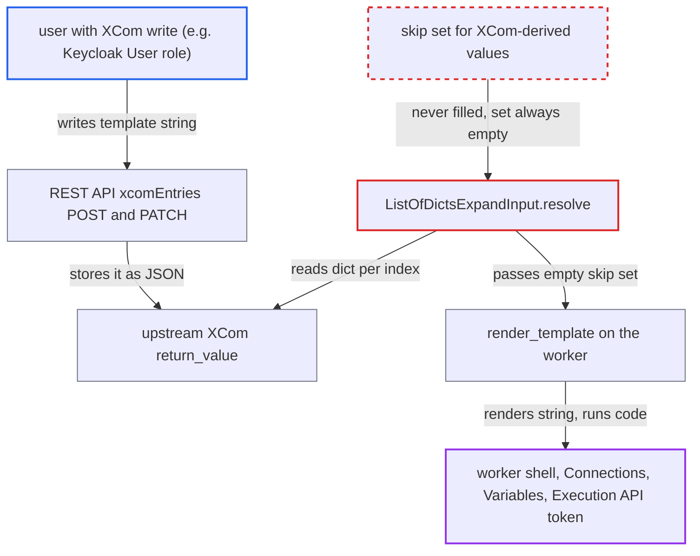

# expand_kwargs renders upstream XCom values as Jinja templates, letting XCom editors run code on workers

| Field | Value |
|---|---|
| ID | `find_01RzzXBXyJt459uf34mQzGVX` |
| Severity | **High** |
| Status | open |
| CWE | CWE-1336 — Template injection |
| Created | 2026-10-27T21:15:05.227128Z |
| Claude Security | https://claude.ai/security/findings/find_01RzzXBXyJt459uf34mQzGVX |

## Description

A user with XCom write permission, who is not a Dag author, can run shell commands on Airflow workers. They can also read Connections and Variables. It needs a Dag that maps an operator with `expand_kwargs(<XComArg>)`, and a role with XCom write such as the Keycloak `User` role. `ListOfDictsExpandInput.resolve` never marks XCom-derived values as unrendered, so they are rendered as Jinja templates.

1. **attacker with XCom write** overwrites the upstream task's `return_value` through the REST API. The `PATCH` or `POST` on `xcomEntries` accepts any JSON list of dicts, for example one whose templated field holds `{{ macros.uuid.os.popen('id').read() }}`. ([`airflow-core/src/airflow/api_fastapi/core_api/routes/public/xcom.py:428-495`](https://github.com/cx-benchmark/airflow/blob/a462d683469bb9f55646b0515ef84c41e16650fb/airflow-core/src/airflow/api_fastapi/core_api/routes/public/xcom.py#L428-L495))
2. **attacker** clears the mapped task instance so it runs again. The same role that writes XCom may clear task instances, so no further access is needed. ([`providers/keycloak/src/airflow/providers/keycloak/auth_manager/cli/commands.py:476-490`](https://github.com/cx-benchmark/airflow/blob/a462d683469bb9f55646b0515ef84c41e16650fb/providers/keycloak/src/airflow/providers/keycloak/auth_manager/cli/commands.py#L476-L490))
3. **`ListOfDictsExpandInput.resolve`** returns the poisoned dict with an empty set of ids to skip. The set is built with `_is_parse_time_mappable`, which is false only for `XComArg` and `MappedArgument` objects, and these never appear in an already-resolved XCom dict. ([`task-sdk/src/airflow/sdk/definitions/_internal/expandinput.py:241-269`](https://github.com/cx-benchmark/airflow/blob/a462d683469bb9f55646b0515ef84c41e16650fb/task-sdk/src/airflow/sdk/definitions/_internal/expandinput.py#L241-L269))
4. **`MappedOperator.render_template_fields`** builds the operator from the XCom dict and renders its template fields with the empty `seen_oids`. The dict keys become `__init__` kwargs, so the attacker's string lands in a templated field with nothing protecting it. ([`task-sdk/src/airflow/sdk/definitions/mappedoperator.py:842-856`](https://github.com/cx-benchmark/airflow/blob/a462d683469bb9f55646b0515ef84c41e16650fb/task-sdk/src/airflow/sdk/definitions/mappedoperator.py#L842-L856))
5. **`render_template`** compiles the string with `jinja_env.from_string(value)` and renders it with the full task context. The context includes `conn`, `var`, `ti`, `macros`, `task` and `dag`. ([`task-sdk/src/airflow/sdk/definitions/_internal/templater.py:249-261`](https://github.com/cx-benchmark/airflow/blob/a462d683469bb9f55646b0515ef84c41e16650fb/task-sdk/src/airflow/sdk/definitions/_internal/templater.py#L249-L261))
6. **Jinja environment on the worker** lets the template reach `os` through `macros.uuid`. The Airflow sandbox blocks only dunder names, and `macros` exposes a module that imports `uuid`, which imports `os`, so `os.popen` runs a shell command as the worker process. ([`task-sdk/src/airflow/sdk/execution_time/macros.py:21-30`](https://github.com/cx-benchmark/airflow/blob/a462d683469bb9f55646b0515ef84c41e16650fb/task-sdk/src/airflow/sdk/execution_time/macros.py#L21-L30))

## Assessment

The attacker is an authenticated user who is not a Dag author but holds `DagAccessEntity.XCOM` write on a Dag. The Keycloak auth manager's shipped `User` role has this, and custom FAB or AWS roles can grant it too. Under FAB defaults XCom write is `Op`-only, and `Op` is admin-equivalent, so nothing is gained there. The Dag must map an operator with `expand_kwargs(upstream.output)` or with a literal list containing an `XComArg`. After the upstream task succeeds, the attacker overwrites its `return_value` with a list of dicts whose templated-field value is a Jinja expression, such as `{{ macros.uuid.os.popen('id').read() }}` or `{{ conn.x.password | reverse }}`. The attacker then clears the mapped task instance, which the same role may do. With `render_template_as_native_obj=True` the environment is not sandboxed at all. The documentation says mapped values in templated fields are not templated, so Dag authors have no reason to treat upstream XCom as template source.

Impact: The attacker runs shell commands as the worker process. They can read every Connection (password, extra) and Variable through `conn` and `var`, even though their own role has no Connection or Variable access. They can also use the task's Execution API token, which is not limited to one Dag, to change state of other Dags. The rendered fields are sent to the API server, where users with task-instance read can view them.

Subsequent-system impact: Connection credentials read on the worker belong to external systems such as databases and cloud accounts that Dags use. The attacker can use them directly against those systems, outside Airflow, to read and modify their data.

## Recommendation

`ListOfDictsExpandInput.resolve` tests the already-resolved values with `_is_parse_time_mappable`, so values that came from an `XComArg` at run time are never added to the ids that `render_template` must skip. XCom content is therefore compiled as Jinja source with the full task context.

Fix criteria: Every value obtained at run time from an `XComArg` reaches the operator unrendered, whether it comes from `expand_kwargs(xcom_arg)` or from an `XComArg` element of a literal list. Dicts written literally in the Dag file are still rendered. With an upstream XCom of `[{"arg1": "{{ ds }}"}]`, the mapped task's `arg1` after `render_template_fields` is the literal `{{ ds }}`. A literal `expand_kwargs([{"arg1": "{{ ds }}"}])` still renders. An XCom written through the REST API containing `{{ macros.uuid.os.popen('id').read() }}` is passed through as text.

## Evidence

**https://github.com/cx-benchmark/airflow**

- [`task-sdk/src/airflow/sdk/definitions/_internal/expandinput.py:241-269`](https://github.com/cx-benchmark/airflow/blob/a462d683469bb9f55646b0515ef84c41e16650fb/task-sdk/src/airflow/sdk/definitions/_internal/expandinput.py#L241-L269)
- [`task-sdk/src/airflow/sdk/definitions/mappedoperator.py:842-856`](https://github.com/cx-benchmark/airflow/blob/a462d683469bb9f55646b0515ef84c41e16650fb/task-sdk/src/airflow/sdk/definitions/mappedoperator.py#L842-L856)
- [`task-sdk/src/airflow/sdk/definitions/_internal/templater.py:249-261`](https://github.com/cx-benchmark/airflow/blob/a462d683469bb9f55646b0515ef84c41e16650fb/task-sdk/src/airflow/sdk/definitions/_internal/templater.py#L249-L261)
- [`task-sdk/src/airflow/sdk/definitions/_internal/templater.py:315-330`](https://github.com/cx-benchmark/airflow/blob/a462d683469bb9f55646b0515ef84c41e16650fb/task-sdk/src/airflow/sdk/definitions/_internal/templater.py#L315-L330)
- [`task-sdk/src/airflow/sdk/execution_time/macros.py:21-30`](https://github.com/cx-benchmark/airflow/blob/a462d683469bb9f55646b0515ef84c41e16650fb/task-sdk/src/airflow/sdk/execution_time/macros.py#L21-L30)
- [`task-sdk/src/airflow/sdk/execution_time/task_runner.py:1499-1512`](https://github.com/cx-benchmark/airflow/blob/a462d683469bb9f55646b0515ef84c41e16650fb/task-sdk/src/airflow/sdk/execution_time/task_runner.py#L1499-L1512)
- [`airflow-core/src/airflow/api_fastapi/core_api/routes/public/xcom.py:428-495`](https://github.com/cx-benchmark/airflow/blob/a462d683469bb9f55646b0515ef84c41e16650fb/airflow-core/src/airflow/api_fastapi/core_api/routes/public/xcom.py#L428-L495)
- [`providers/keycloak/src/airflow/providers/keycloak/auth_manager/cli/commands.py:476-490`](https://github.com/cx-benchmark/airflow/blob/a462d683469bb9f55646b0515ef84c41e16650fb/providers/keycloak/src/airflow/providers/keycloak/auth_manager/cli/commands.py#L476-L490)
- [`airflow-core/docs/authoring-and-scheduling/dynamic-task-mapping.rst:614-621`](https://github.com/cx-benchmark/airflow/blob/a462d683469bb9f55646b0515ef84c41e16650fb/airflow-core/docs/authoring-and-scheduling/dynamic-task-mapping.rst#L614-L621)
- [`task-sdk/tests/task_sdk/definitions/test_mappedoperator.py:337-362`](https://github.com/cx-benchmark/airflow/blob/a462d683469bb9f55646b0515ef84c41e16650fb/task-sdk/tests/task_sdk/definitions/test_mappedoperator.py#L337-L362)

