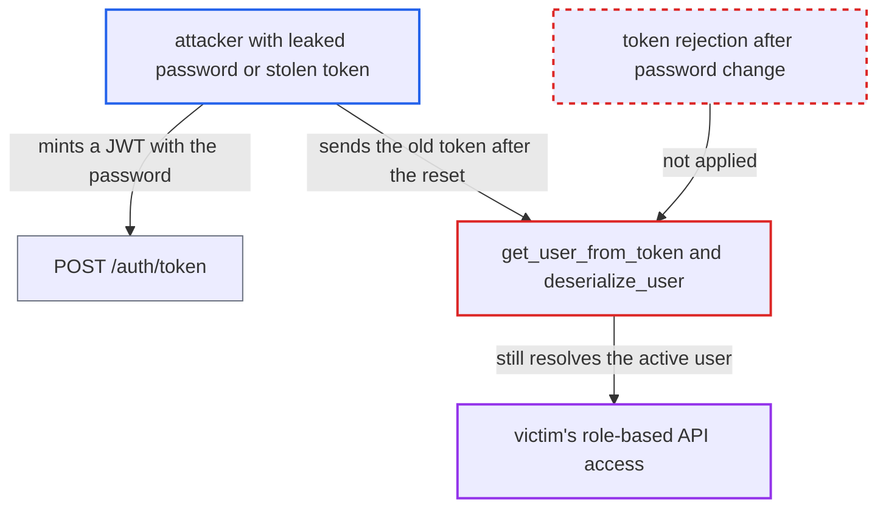

# FAB password reset leaves previously issued Airflow API JWTs valid until expiry

| Field | Value |
|---|---|
| ID | `find_01LwoqTekWnmpmn7C33P6UTn` |
| Severity | **High** |
| Status | open |
| CWE | CWE-613 — Insufficient Session Expiration |
| Created | 2026-10-27T21:20:04.928233Z |
| Claude Security | https://claude.ai/security/findings/find_01LwoqTekWnmpmn7C33P6UTn |

## Description

Anyone holding an Airflow API token issued before a password reset keeps the user's full access until the token expires, which is 24 hours by default. The attacker needs a valid token for the victim, for example from a leaked password or a stolen token. `reset_password` and the `PATCH /fab/v1/users/{username}` path end only Flask sessions, and `deserialize_user` never checks whether the password changed.

1. **attacker** obtains a valid JWT for the victim. The attacker calls `POST /auth/token` with a leaked password, which returns a 24 h token by default (`/auth/token/cli` gives 1 h), or steals an existing token. ([`providers/fab/src/airflow/providers/fab/auth_manager/api_fastapi/routes/login.py:70-95`](https://github.com/cx-benchmark/airflow/blob/a462d683469bb9f55646b0515ef84c41e16650fb/providers/fab/src/airflow/providers/fab/auth_manager/api_fastapi/routes/login.py#L70-L95))
2. **administrator or victim** resets the password with `airflow users reset-password` or `PATCH /fab/v1/users/{username}`. Both paths rely on `reset_user_sessions`, which only deletes Flask-Session rows, or just flashes a warning for `securecookie`. ([`providers/fab/src/airflow/providers/fab/auth_manager/security_manager/override.py:615-671`](https://github.com/cx-benchmark/airflow/blob/a462d683469bb9f55646b0515ef84c41e16650fb/providers/fab/src/airflow/providers/fab/auth_manager/security_manager/override.py#L615-L671))
3. **password-change code** leaves every issued JWT untouched. No token is revoked, no password-changed marker is stored, and `iat` is never compared with the change time. ([`providers/fab/src/airflow/providers/fab/auth_manager/api_fastapi/services/users.py:188-221`](https://github.com/cx-benchmark/airflow/blob/a462d683469bb9f55646b0515ef84c41e16650fb/providers/fab/src/airflow/providers/fab/auth_manager/api_fastapi/services/users.py#L188-L221))
4. **attacker** keeps sending the old token as `Authorization: Bearer`. `get_user_from_token` checks only the signature, `exp` and whether the `jti` is revoked, so the old token passes. ([`airflow-core/src/airflow/api_fastapi/auth/managers/base_auth_manager.py:158-174`](https://github.com/cx-benchmark/airflow/blob/a462d683469bb9f55646b0515ef84c41e16650fb/airflow-core/src/airflow/api_fastapi/auth/managers/base_auth_manager.py#L158-L174))
5. **`deserialize_user`** loads the victim as the current user. It re-checks only `is_active`, and the token carries only `sub`, so nothing ties the token to the old password. ([`providers/fab/src/airflow/providers/fab/auth_manager/fab_auth_manager.py:310-346`](https://github.com/cx-benchmark/airflow/blob/a462d683469bb9f55646b0515ef84c41e16650fb/providers/fab/src/airflow/providers/fab/auth_manager/fab_auth_manager.py#L310-L346))

## Assessment

The attacker first needs a valid JWT for the victim. They can get one by calling the unauthenticated `POST /auth/token` with a leaked password, or by stealing a token, such as the UI's `_token` cookie. An administrator or the victim then resets the password through `airflow users reset-password` or `PATCH /fab/v1/users/{username}`. The attack works only if the token still has lifetime left, and the attacker does not control when the reset happens. The UI token is capped only if `[fab] session_max_lifetime_minutes` is set, and its default is 0. FAB tokens are not refreshed past `exp`. The victim's own logout revokes only the `jti` of the cookie it presents, so it does not stop a token the attacker minted. The report did not trace the FAB-library UI reset view `CustomResetPasswordView`.

Impact: The attacker keeps the victim's full role-based API access for the rest of the token's life, up to 24 h by default. For an Admin victim this covers connections, variables, DAG runs and user management, which is enough to create a persistent account before the token expires. Deactivating the user does take effect, after the 30 s `cache_ttl`.

## Recommendation

A JWT is accepted if its signature, `exp`, `jti` and the user's `is_active` flag are valid. The password-change paths end only Flask sessions, so tokens issued before the change keep working. This contradicts the documented and commented intent that a captured session must stop authenticating.

Fix criteria: After a password is changed through `reset_password` or the user API, every Airflow JWT issued to that user before the change is rejected. One way is to bind tokens to a per-user credential version or password-changed timestamp that `deserialize_user` checks. The `deserialize_user` cache entry is also invalidated. To verify, mint a token at `/auth/token` and reset the password. The old token must then get 401/403 on `/api/v2/...` within the cache TTL.

## Evidence

**https://github.com/cx-benchmark/airflow**

- [`providers/fab/src/airflow/providers/fab/auth_manager/security_manager/override.py:615-671`](https://github.com/cx-benchmark/airflow/blob/a462d683469bb9f55646b0515ef84c41e16650fb/providers/fab/src/airflow/providers/fab/auth_manager/security_manager/override.py#L615-L671)
- [`providers/fab/src/airflow/providers/fab/auth_manager/fab_auth_manager.py:310-346`](https://github.com/cx-benchmark/airflow/blob/a462d683469bb9f55646b0515ef84c41e16650fb/providers/fab/src/airflow/providers/fab/auth_manager/fab_auth_manager.py#L310-L346)
- [`airflow-core/src/airflow/api_fastapi/auth/managers/base_auth_manager.py:158-174`](https://github.com/cx-benchmark/airflow/blob/a462d683469bb9f55646b0515ef84c41e16650fb/airflow-core/src/airflow/api_fastapi/auth/managers/base_auth_manager.py#L158-L174)
- [`providers/fab/src/airflow/providers/fab/auth_manager/api_fastapi/services/users.py:188-221`](https://github.com/cx-benchmark/airflow/blob/a462d683469bb9f55646b0515ef84c41e16650fb/providers/fab/src/airflow/providers/fab/auth_manager/api_fastapi/services/users.py#L188-L221)
- [`providers/fab/src/airflow/providers/fab/auth_manager/api_fastapi/routes/login.py:70-95`](https://github.com/cx-benchmark/airflow/blob/a462d683469bb9f55646b0515ef84c41e16650fb/providers/fab/src/airflow/providers/fab/auth_manager/api_fastapi/routes/login.py#L70-L95)
- [`providers/fab/src/airflow/providers/fab/www/views.py:118-156`](https://github.com/cx-benchmark/airflow/blob/a462d683469bb9f55646b0515ef84c41e16650fb/providers/fab/src/airflow/providers/fab/www/views.py#L118-L156)
- [`providers/fab/provider.yaml:206-215`](https://github.com/cx-benchmark/airflow/blob/a462d683469bb9f55646b0515ef84c41e16650fb/providers/fab/provider.yaml#L206-L215)

