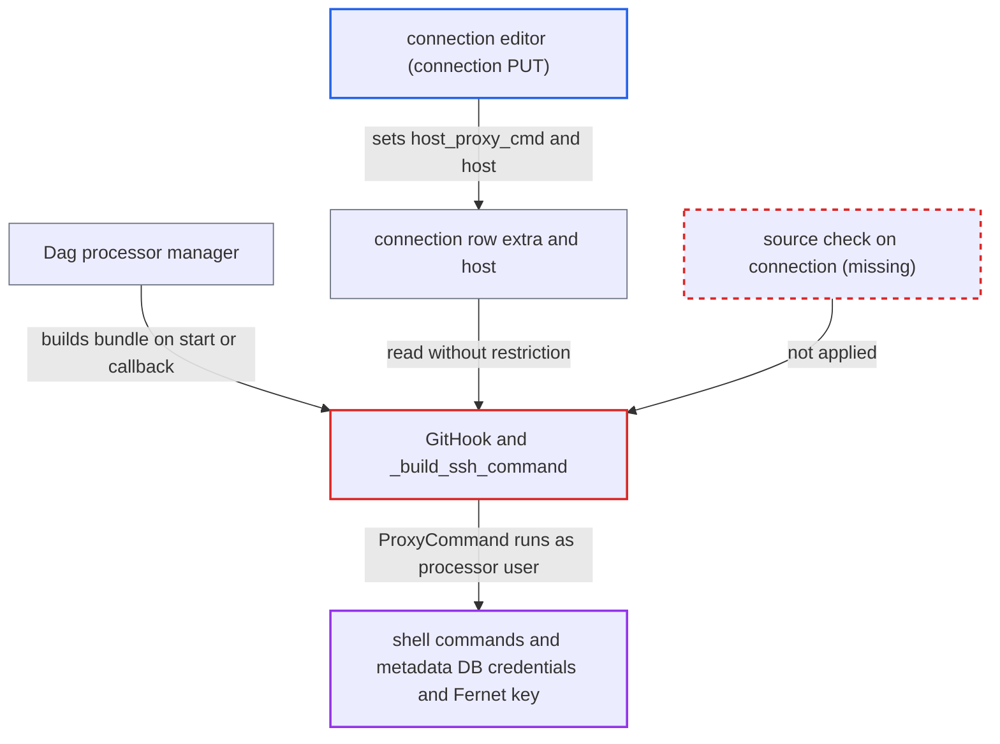

# Git DAG bundle runs connection-supplied SSH ProxyCommand and repo source in Dag processor

| Field | Value |
|---|---|
| ID | `find_01Y7Nm9PXCqikFuvrcbtyvwf` |
| Severity | **High** |
| Status | open |
| CWE | CWE-15 — External configuration control |
| Created | 2026-10-27T21:42:14.293160Z |
| Claude Security | https://claude.ai/security/findings/find_01Y7Nm9PXCqikFuvrcbtyvwf |

## Description

A user who can edit connections through the API can run shell commands as the Dag processor user. That process holds the metadata DB connection and the Fernet key. The attack needs a processor restart or a callback for a new bundle version. The cause is that `GitHook` reads `host_proxy_cmd` and `ssh_config_file` from the editable connection `extra` and turns them into an SSH `ProxyCommand`.

1. **connection editor** sends a PATCH to the bundle's connection. The caller needs only connection PUT on `PATCH /api/v2/connections/{id}`. The caller sets `extra.host_proxy_cmd`, and also sets `host` to an SSH URL if `repo_url` is not pinned. The service merges the sent `extra` into the stored row as it is. ([`airflow-core/src/airflow/api_fastapi/core_api/services/public/connections.py:79-93`](https://github.com/cx-benchmark/airflow/blob/a462d683469bb9f55646b0515ef84c41e16650fb/airflow-core/src/airflow/api_fastapi/core_api/services/public/connections.py#L79-L93))
2. **Dag processor manager** builds `GitDagBundle` and `GitHook` from that connection. The manager sets `_AIRFLOW_PROCESS_CONTEXT=server`, so the connection resolves from the metastore. This happens at the next processor start, or when a callback request carries a `bundle_version` not yet on the processor. ([`airflow-core/src/airflow/dag_processing/manager.py:781-791`](https://github.com/cx-benchmark/airflow/blob/a462d683469bb9f55646b0515ef84c41e16650fb/airflow-core/src/airflow/dag_processing/manager.py#L781-L791))
3. **`GitHook`** reads `host_proxy_cmd` and `ssh_config_file` from the connection `extra`. It does not check where the connection came from or which component is calling. ([`providers/git/src/airflow/providers/git/hooks/git.py:125-143`](https://github.com/cx-benchmark/airflow/blob/a462d683469bb9f55646b0515ef84c41e16650fb/providers/git/src/airflow/providers/git/hooks/git.py#L125-L143))
4. **`_build_ssh_command`** puts the values into `GIT_SSH_COMMAND`. The value is added as `-F` and `-o ProxyCommand=`. `configure_hook_env` stores it in `hook.env`. ([`providers/git/src/airflow/providers/git/hooks/git.py:227-231`](https://github.com/cx-benchmark/airflow/blob/a462d683469bb9f55646b0515ef84c41e16650fb/providers/git/src/airflow/providers/git/hooks/git.py#L227-L231))
5. **`_fetch_bare_repo`** runs `git fetch` or the clone with that environment. `_clone_bare_repo_if_required` always reaches the fetch, even when the bare repo exists. OpenSSH runs `ProxyCommand` through the shell on SSH transport, so the command runs as the Dag processor user. ([`providers/git/src/airflow/providers/git/bundles/git.py:445-451`](https://github.com/cx-benchmark/airflow/blob/a462d683469bb9f55646b0515ef84c41e16650fb/providers/git/src/airflow/providers/git/bundles/git.py#L445-L451))

## Assessment

The attacker is an authenticated API user holding connection PUT. The security model calls this role highly privileged but limits it to worker-context execution. The connection must resolve from the metastore, and git must use SSH transport. A Dag processor restart or a callback with a new `bundle_version` must also occur. A bundle whose stored origin is https, on storage that is not fresh, runs nothing. An existing bare repo keeps its stored origin URL unless that URL carries credentials. A second route applies when `repo_url` is not pinned, as in the chart example. Setting `host` to an attacker repository makes a freshly cloned bare repo fetch attacker code, which the processor parses. This turns the connection editor into a Dag author.

Impact: The attacker runs arbitrary shell commands as the Dag processor manager user. They can read and decrypt every stored connection and variable, rewrite any DB state, and disrupt parsing and scheduling. They can also substitute Dag code, which is then parsed and run across the deployment.

## Recommendation

(1) `GitHook` accepts exec-capable SSH options (`host_proxy_cmd`, `ssh_config_file`) from a connection row that a connection editor can change. The Dag processor manager, which holds DB credentials, then applies them.

Fix criteria: These options come only from deployment-controlled sources, such as bundle kwargs or connections defined by environment or secrets backend. Otherwise they are refused when the connection resolves from the metastore. After a REST edit sets `host_proxy_cmd` on the bundle's connection, a Dag processor restart or a versioned callback does not run that command.

(2) The repository for the deployment's Dag source defaults to the `host` of the editable connection. Whoever edits the connection therefore chooses what code the Dag processor clones and parses.

Fix criteria: A `repo_url` pinned in bundle configuration is required, or strongly enforced. Changing `host` on the bundle's connection does not change the repository cloned on fresh bundle storage.

## Evidence

**https://github.com/cx-benchmark/airflow**

- [`providers/git/src/airflow/providers/git/hooks/git.py:227-231`](https://github.com/cx-benchmark/airflow/blob/a462d683469bb9f55646b0515ef84c41e16650fb/providers/git/src/airflow/providers/git/hooks/git.py#L227-L231)
- [`providers/git/src/airflow/providers/git/hooks/git.py:125-143`](https://github.com/cx-benchmark/airflow/blob/a462d683469bb9f55646b0515ef84c41e16650fb/providers/git/src/airflow/providers/git/hooks/git.py#L125-L143)
- [`providers/git/src/airflow/providers/git/hooks/git.py:399-424`](https://github.com/cx-benchmark/airflow/blob/a462d683469bb9f55646b0515ef84c41e16650fb/providers/git/src/airflow/providers/git/hooks/git.py#L399-L424)
- [`providers/git/src/airflow/providers/git/bundles/git.py:135`](https://github.com/cx-benchmark/airflow/blob/a462d683469bb9f55646b0515ef84c41e16650fb/providers/git/src/airflow/providers/git/bundles/git.py#L135)
- [`providers/git/src/airflow/providers/git/bundles/git.py:223-232`](https://github.com/cx-benchmark/airflow/blob/a462d683469bb9f55646b0515ef84c41e16650fb/providers/git/src/airflow/providers/git/bundles/git.py#L223-L232)
- [`providers/git/src/airflow/providers/git/bundles/git.py:445-451`](https://github.com/cx-benchmark/airflow/blob/a462d683469bb9f55646b0515ef84c41e16650fb/providers/git/src/airflow/providers/git/bundles/git.py#L445-L451)
- [`airflow-core/src/airflow/dag_processing/manager.py:396-399`](https://github.com/cx-benchmark/airflow/blob/a462d683469bb9f55646b0515ef84c41e16650fb/airflow-core/src/airflow/dag_processing/manager.py#L396-L399)
- [`airflow-core/src/airflow/dag_processing/manager.py:781-791`](https://github.com/cx-benchmark/airflow/blob/a462d683469bb9f55646b0515ef84c41e16650fb/airflow-core/src/airflow/dag_processing/manager.py#L781-L791)
- [`airflow-core/src/airflow/api_fastapi/core_api/services/public/connections.py:79-93`](https://github.com/cx-benchmark/airflow/blob/a462d683469bb9f55646b0515ef84c41e16650fb/airflow-core/src/airflow/api_fastapi/core_api/services/public/connections.py#L79-L93)
- [`airflow-core/docs/security/security_model.rst:1064-1073`](https://github.com/cx-benchmark/airflow/blob/a462d683469bb9f55646b0515ef84c41e16650fb/airflow-core/docs/security/security_model.rst#L1064-L1073)

