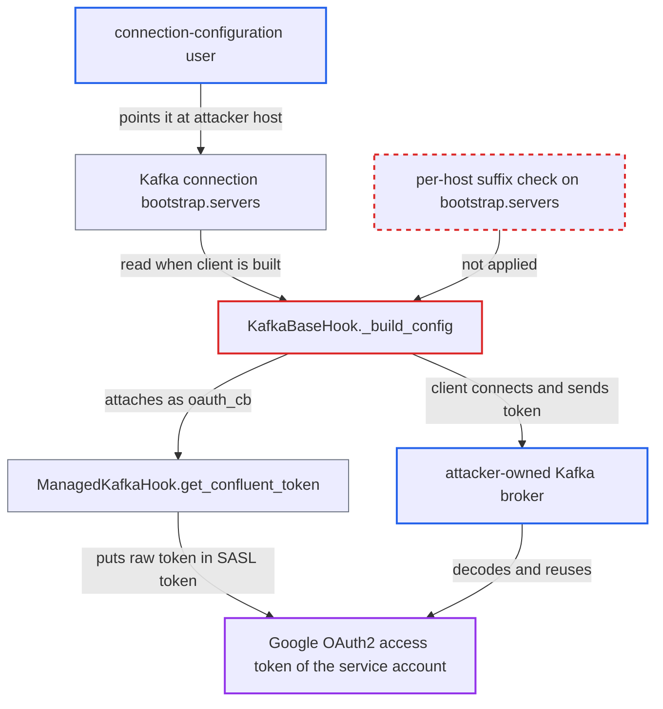

# Google OAuth access token sent to attacker broker via substring match on Kafka bootstrap servers

| Field | Value |
|---|---|
| ID | `find_01SFAN8WjfZZkw7QMsb5xTEu` |
| Severity | **High** |
| Status | open |
| CWE | CWE-522 — Insufficiently Protected Credentials |
| Created | 2026-10-27T21:42:14.175693Z |
| Claude Security | https://claude.ai/security/findings/find_01SFAN8WjfZZkw7QMsb5xTEu |

## Description

A user with the connection-configuration role can steal a live Google OAuth2 access token that belongs to Airflow's service account. They do this by pointing a Kafka connection at a broker they control. The flaw is in `KafkaBaseHook._build_config`, which attaches Google's token callback whenever `bootstrap.servers` merely contains `cloud.goog` and `managedkafka` anywhere in the string. The token is valid for Google Cloud outside Airflow.

1. **connection-configuration user** edits a Kafka connection to use an attacker-owned broker. The extras set `bootstrap.servers` to a name such as `managedkafka.cloud.goog.attacker.example:9092`, with `security.protocol` `SASL_SSL` and `sasl.mechanisms` `OAUTHBEARER`; the whole client config comes from the connection's extras. ([`providers/apache/kafka/src/airflow/providers/apache/kafka/hooks/base.py:156-157`](https://github.com/cx-benchmark/airflow/blob/a462d683469bb9f55646b0515ef84c41e16650fb/providers/apache/kafka/src/airflow/providers/apache/kafka/hooks/base.py#L156-L157))
2. **Airflow component** builds a Kafka client from that connection. Any operator, sensor, trigger, the event-producer plugin or `test_connection` reaches `_build_config`, so the attacker only has to wait for one of them to run. ([`providers/apache/kafka/src/airflow/providers/apache/kafka/hooks/base.py:230-243`](https://github.com/cx-benchmark/airflow/blob/a462d683469bb9f55646b0515ef84c41e16650fb/providers/apache/kafka/src/airflow/providers/apache/kafka/hooks/base.py#L230-L243))
3. **`KafkaBaseHook._build_config`** decides the broker is Google Managed Kafka and sets `oauth_cb`. It only checks that the string contains `cloud.goog` and `managedkafka`. It does not anchor the check to a host suffix or test each host, so the attacker's name passes, as does a mixed list with one real Google host. ([`providers/apache/kafka/src/airflow/providers/apache/kafka/hooks/base.py:162-180`](https://github.com/cx-benchmark/airflow/blob/a462d683469bb9f55646b0515ef84c41e16650fb/providers/apache/kafka/src/airflow/providers/apache/kafka/hooks/base.py#L162-L180))
4. **`ManagedKafkaHook.get_confluent_token`** refreshes the process's Google credentials and builds a SASL token. The third segment of that token is the raw Google OAuth2 access token, base64url-encoded, taken from the `google_cloud_default` connection or Application Default Credentials. ([`providers/google/src/airflow/providers/google/cloud/hooks/managed_kafka.py:79-94`](https://github.com/cx-benchmark/airflow/blob/a462d683469bb9f55646b0515ef84c41e16650fb/providers/google/src/airflow/providers/google/cloud/hooks/managed_kafka.py#L79-L94))
5. **librdkafka client** sends the token to the attacker's broker. With `OAUTHBEARER`, the token goes in the client's first message to every broker it connects to, including the attacker's.
6. **attacker's broker** decodes the embedded access token. The token is a bearer credential with the service account's scopes, `cloud-platform` by default, so the attacker can use it against Google Cloud. ([`providers/google/src/airflow/providers/google/common/hooks/base_google.py:326-405`](https://github.com/cx-benchmark/airflow/blob/a462d683469bb9f55646b0515ef84c41e16650fb/providers/google/src/airflow/providers/google/common/hooks/base_google.py#L326-L405))

## Assessment

The attacker is an authenticated user with the connection-configuration role, working over the network through the UI or REST API. The deployment must have the Google provider installed and Google credentials available to Airflow processes, either a keyfile in `google_cloud_default` or Workload Identity. The attacker edits a Kafka connection and waits for any client to be built from it. That can be a worker running Consume or Produce operators or sensors, the triggerer running `AwaitMessageTrigger` or shared-stream triggers, the scheduler or API server running the `plugins/event_producer.py` plugin when enabled, or the API server running `test_connection` when that feature is enabled. A host list that mixes the attacker's host with a real Managed Kafka host also passes the check.

Impact: The attacker recovers a live Google OAuth2 bearer token for Airflow's service account. That is a secret the connection-configuration role can write but not read. The report says no Airflow data or behaviour is modified.

Subsequent-system impact: The token carries the service account's scopes, `cloud-platform` by default. It is valid for about an hour, and a new one is issued each time a client is built. With it the attacker gets the service account's read and write access to Google Cloud resources outside Airflow.

## Recommendation

Google Managed Kafka tokens are attached after an unanchored substring test on the editable `bootstrap.servers` string. A non-Google host, alone or in a list, therefore receives Google credentials.

Fix criteria: Google OAuth tokens are only presented to brokers whose hostnames are verified Google Managed Kafka endpoints. `bootstrap.servers` is split into individual host:port entries. Every host must end with the Managed Kafka domain suffix (exact suffix match, e.g. `.managedkafka.<region>.cloud.goog`), and mixed lists are refused. `oauth_cb` is attached only when TLS (`security.protocol=SASL_SSL`) with certificate verification is in use. Tests confirm that `managedkafka.cloud.goog.attacker.example:9092` and `attacker.example:9092,<real>.managedkafka.cloud.goog:9092` no longer get an `oauth_cb` injected.

## Evidence

**https://github.com/cx-benchmark/airflow**

- [`providers/apache/kafka/src/airflow/providers/apache/kafka/hooks/base.py:162-180`](https://github.com/cx-benchmark/airflow/blob/a462d683469bb9f55646b0515ef84c41e16650fb/providers/apache/kafka/src/airflow/providers/apache/kafka/hooks/base.py#L162-L180)
- [`providers/apache/kafka/src/airflow/providers/apache/kafka/hooks/base.py:156-157`](https://github.com/cx-benchmark/airflow/blob/a462d683469bb9f55646b0515ef84c41e16650fb/providers/apache/kafka/src/airflow/providers/apache/kafka/hooks/base.py#L156-L157)
- [`providers/google/src/airflow/providers/google/cloud/hooks/managed_kafka.py:79-94`](https://github.com/cx-benchmark/airflow/blob/a462d683469bb9f55646b0515ef84c41e16650fb/providers/google/src/airflow/providers/google/cloud/hooks/managed_kafka.py#L79-L94)
- [`providers/google/src/airflow/providers/google/cloud/hooks/managed_kafka.py:124-128`](https://github.com/cx-benchmark/airflow/blob/a462d683469bb9f55646b0515ef84c41e16650fb/providers/google/src/airflow/providers/google/cloud/hooks/managed_kafka.py#L124-L128)
- [`providers/google/src/airflow/providers/google/common/hooks/base_google.py:326-405`](https://github.com/cx-benchmark/airflow/blob/a462d683469bb9f55646b0515ef84c41e16650fb/providers/google/src/airflow/providers/google/common/hooks/base_google.py#L326-L405)
- [`providers/apache/kafka/src/airflow/providers/apache/kafka/hooks/base.py:230-243`](https://github.com/cx-benchmark/airflow/blob/a462d683469bb9f55646b0515ef84c41e16650fb/providers/apache/kafka/src/airflow/providers/apache/kafka/hooks/base.py#L230-L243)
- [`airflow-core/docs/security/security_model.rst:1064-1074`](https://github.com/cx-benchmark/airflow/blob/a462d683469bb9f55646b0515ef84c41e16650fb/airflow-core/docs/security/security_model.rst#L1064-L1074)

