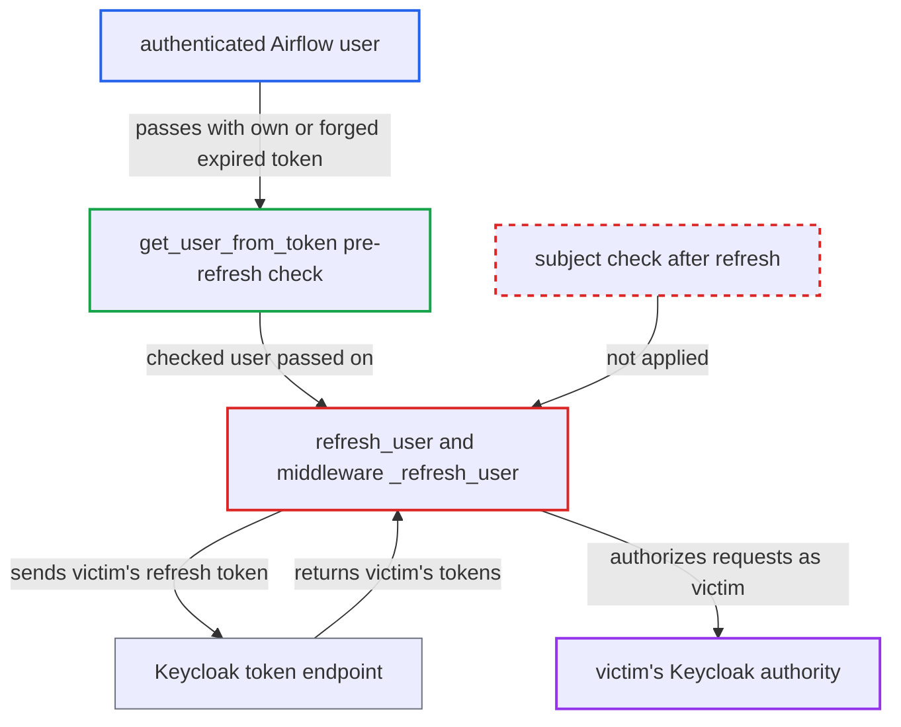

# Keycloak refresh path binds another user's refreshed tokens to the caller's session

| Field | Value |
|---|---|
| ID | `find_013cXJRy3Mj4WeJvX7T25vui` |
| Severity | **High** |
| Status | open |
| CWE | CWE-863 — Incorrect authorization |
| Created | 2026-10-27T21:16:25.345674Z |
| Claude Security | https://claude.ai/security/findings/find_013cXJRy3Mj4WeJvX7T25vui |

## Description

An authenticated Airflow user who holds another user's live Keycloak refresh token can act with that user's full permissions, including reading connections, variables and config, editing them, and triggering or deleting DAG runs. The gain is capped at the victim's privileges and the lifetime of their Keycloak session. Cause: `refresh_user` takes the tokens Keycloak returns for a cookie-supplied refresh token and never checks that their subject matches the session `user_id`.

1. **attacker** sends a request with their own `_token` and the victim's `_refresh_token`. The `_access_token` cookie is the attacker's own expired token or a forged unsigned token whose `sub` is the attacker's id and whose `exp` is 0. ([`providers/keycloak/src/airflow/providers/keycloak/auth_manager/middleware.py:263-284`](https://github.com/cx-benchmark/airflow/blob/a462d683469bb9f55646b0515ef84c41e16650fb/providers/keycloak/src/airflow/providers/keycloak/auth_manager/middleware.py#L263-L284))
2. **`get_user_from_token`** checks the cookie access token's `sub` against the session `user_id`. The check reads the unsigned payload through `_token_subject` and never looks at the refresh token, so the attacker's own or forged token passes. ([`providers/keycloak/src/airflow/providers/keycloak/auth_manager/keycloak_auth_manager.py:209-220`](https://github.com/cx-benchmark/airflow/blob/a462d683469bb9f55646b0515ef84c41e16650fb/providers/keycloak/src/airflow/providers/keycloak/auth_manager/keycloak_auth_manager.py#L209-L220))
3. **`refresh_user`** decides the access token is expired and starts a refresh. `_token_expired` reads the unsigned `exp`, so the attacker's forged value of 0 forces the refresh branch. ([`providers/keycloak/src/airflow/providers/keycloak/auth_manager/keycloak_auth_manager.py:917-952`](https://github.com/cx-benchmark/airflow/blob/a462d683469bb9f55646b0515ef84c41e16650fb/providers/keycloak/src/airflow/providers/keycloak/auth_manager/keycloak_auth_manager.py#L917-L952))
4. **`refresh_tokens`** posts the cookie-supplied refresh token to Keycloak with Airflow's confidential client credentials. Keycloak returns tokens that belong to the victim, the owner of that refresh token. ([`providers/keycloak/src/airflow/providers/keycloak/auth_manager/keycloak_auth_manager.py:255-263`](https://github.com/cx-benchmark/airflow/blob/a462d683469bb9f55646b0515ef84c41e16650fb/providers/keycloak/src/airflow/providers/keycloak/auth_manager/keycloak_auth_manager.py#L255-L263))
5. **`refresh_user`** overwrites `user.access_token` and `user.refresh_token` with the returned tokens. It never checks that the new access token's subject is still `user.get_id()`, so the attacker's session identity now carries the victim's tokens. ([`providers/keycloak/src/airflow/providers/keycloak/auth_manager/keycloak_auth_manager.py:245-251`](https://github.com/cx-benchmark/airflow/blob/a462d683469bb9f55646b0515ef84c41e16650fb/providers/keycloak/src/airflow/providers/keycloak/auth_manager/keycloak_auth_manager.py#L245-L251))
6. **the middleware** installs this user as `request.state.user`. It is marked `USER_INJECTED_BY_TRUSTED_MIDDLEWARE`, so `get_user` hands it to every `requires_access_*` dependency. ([`providers/keycloak/src/airflow/providers/keycloak/auth_manager/middleware.py:86-95`](https://github.com/cx-benchmark/airflow/blob/a462d683469bb9f55646b0515ef84c41e16650fb/providers/keycloak/src/airflow/providers/keycloak/auth_manager/middleware.py#L86-L95))
7. **`_is_authorized`** sends the victim's refreshed token as the Bearer to Keycloak. Keycloak therefore authorizes the request as the victim, while `user_id` and `name` for audit and HITL identity stay the attacker's. ([`providers/keycloak/src/airflow/providers/keycloak/auth_manager/keycloak_auth_manager.py:521-526`](https://github.com/cx-benchmark/airflow/blob/a462d683469bb9f55646b0515ef84c41e16650fb/providers/keycloak/src/airflow/providers/keycloak/auth_manager/keycloak_auth_manager.py#L521-L526))

## Assessment

The attacker is any authenticated Airflow user on Airflow 3.3 or later with the Keycloak auth manager. They must hold a live Keycloak refresh token of another user, issued to the Airflow client. One realistic source is an expired or revoked Airflow API or CLI JWT, because `generate_api_jwt` puts the refresh token in a readable claim. Logout revokes only the JWT `jti`, so such a token can still carry a live refresh token. The attacker sends their own `_token`, their own expired `_access_token` or a forged unsigned one, and the victim's `_refresh_token`. The victim does nothing. Without this flaw the token would be useless, because the Airflow client is confidential and its secret is not leaked.

Impact: The attacker gets the victim's full Airflow permission set in Keycloak. That means reading connections, variables and config, editing variables and connections, triggering, clearing or deleting DAG runs, and using admin views if the victim is an admin. Audit log and HITL responder identity stay the attacker's own. The gain lasts as long as the victim's Keycloak session, and destructive actions are limited to what the victim's role allows. Also, `_set_new_token` returns the victim's refreshed tokens to the attacker as cookies, and `filter_authorized_*` results are cached under the attacker's `user_id` for the default 30 s TTL.

## Recommendation

(1) After a refresh, `refresh_user` adopts the tokens Keycloak returns for a cookie-controlled refresh token. It does not verify that the new access token's subject is the session's `user_id`, so the link between the Airflow session and the authorizing Keycloak token is lost.

Fix criteria: The Keycloak access token used for any authorization decision belongs to the session user from the signed Airflow JWT, both before and after a refresh. A refresh that returns an access token with a different subject is rejected with 401 or 403 and the session cookies are cleared. Such tokens are not cached or set as cookies. Replay the attack with a forged expired access token and another user's refresh token. The request must be rejected and none of the other user's permissions may be observed, including through the `filter_authorized_*` caches.

(2) `_token_subject` and `_token_expired` trust unsigned JWT payloads from cookies. The caller can therefore choose which branch (`refresh`) runs and which subject the pre-refresh check sees.

Fix criteria: Subject and expiry decisions about cookie-supplied Keycloak tokens rest on a signature-verified token (for example against the realm JWKS) or on Keycloak's own answer. A locally forged token can no longer steer the middleware. A forged `_access_token` cookie is rejected before any refresh is attempted.

## Evidence

**https://github.com/cx-benchmark/airflow**

- [`providers/keycloak/src/airflow/providers/keycloak/auth_manager/keycloak_auth_manager.py:245-251`](https://github.com/cx-benchmark/airflow/blob/a462d683469bb9f55646b0515ef84c41e16650fb/providers/keycloak/src/airflow/providers/keycloak/auth_manager/keycloak_auth_manager.py#L245-L251)
- [`providers/keycloak/src/airflow/providers/keycloak/auth_manager/keycloak_auth_manager.py:209-220`](https://github.com/cx-benchmark/airflow/blob/a462d683469bb9f55646b0515ef84c41e16650fb/providers/keycloak/src/airflow/providers/keycloak/auth_manager/keycloak_auth_manager.py#L209-L220)
- [`providers/keycloak/src/airflow/providers/keycloak/auth_manager/keycloak_auth_manager.py:917-952`](https://github.com/cx-benchmark/airflow/blob/a462d683469bb9f55646b0515ef84c41e16650fb/providers/keycloak/src/airflow/providers/keycloak/auth_manager/keycloak_auth_manager.py#L917-L952)
- [`providers/keycloak/src/airflow/providers/keycloak/auth_manager/keycloak_auth_manager.py:255-263`](https://github.com/cx-benchmark/airflow/blob/a462d683469bb9f55646b0515ef84c41e16650fb/providers/keycloak/src/airflow/providers/keycloak/auth_manager/keycloak_auth_manager.py#L255-L263)
- [`providers/keycloak/src/airflow/providers/keycloak/auth_manager/middleware.py:263-284`](https://github.com/cx-benchmark/airflow/blob/a462d683469bb9f55646b0515ef84c41e16650fb/providers/keycloak/src/airflow/providers/keycloak/auth_manager/middleware.py#L263-L284)
- [`providers/keycloak/src/airflow/providers/keycloak/auth_manager/middleware.py:86-95`](https://github.com/cx-benchmark/airflow/blob/a462d683469bb9f55646b0515ef84c41e16650fb/providers/keycloak/src/airflow/providers/keycloak/auth_manager/middleware.py#L86-L95)
- [`providers/keycloak/src/airflow/providers/keycloak/auth_manager/keycloak_auth_manager.py:521-526`](https://github.com/cx-benchmark/airflow/blob/a462d683469bb9f55646b0515ef84c41e16650fb/providers/keycloak/src/airflow/providers/keycloak/auth_manager/keycloak_auth_manager.py#L521-L526)
- [`providers/keycloak/src/airflow/providers/keycloak/auth_manager/keycloak_auth_manager.py:564-591`](https://github.com/cx-benchmark/airflow/blob/a462d683469bb9f55646b0515ef84c41e16650fb/providers/keycloak/src/airflow/providers/keycloak/auth_manager/keycloak_auth_manager.py#L564-L591)
- [`providers/keycloak/src/airflow/providers/keycloak/auth_manager/keycloak_auth_manager.py:171-194`](https://github.com/cx-benchmark/airflow/blob/a462d683469bb9f55646b0515ef84c41e16650fb/providers/keycloak/src/airflow/providers/keycloak/auth_manager/keycloak_auth_manager.py#L171-L194)

