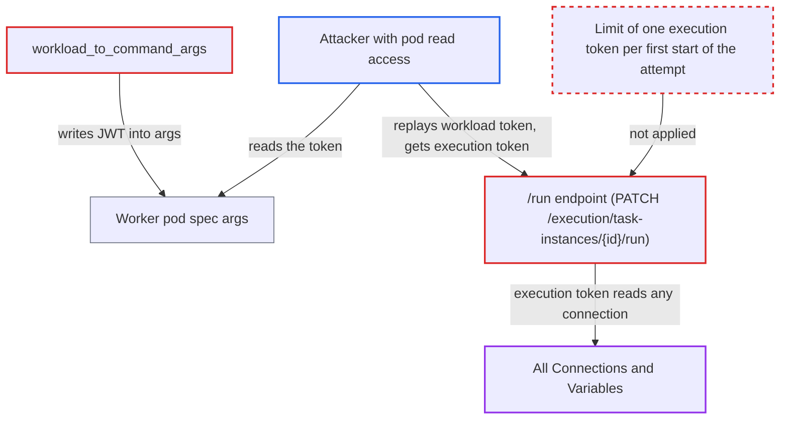

# KubernetesExecutor exposes task workload JWT in pod args, letting pod readers obtain execution tokens

| Field | Value |
|---|---|
| ID | `find_01QE6SmJNf624fzk47LAHFPP` |
| Severity | **High** |
| Status | open |
| CWE | CWE-522 — Insufficiently protected credentials |
| Created | 2026-10-27T21:20:05.018234Z |
| Claude Security | https://claude.ai/security/findings/find_01QE6SmJNf624fzk47LAHFPP |

## Description

Anyone who can read pods in the KubernetesExecutor namespace, for example through the built-in `view` role, can take over a task's identity in the Execution API. They can then read every Connection and Variable in plaintext. No Airflow role is needed. The cause is `workload_to_command_args`, which writes the task's `workload`-scope JWT into the pod's container args, and `/run`, which swaps that token for an `execution` token.

1. **the scheduler** mints a workload JWT for the task instance. The token has scope `workload`, its `sub` is the TI id, and it is valid for `[scheduler] task_queued_timeout` (default 600 s). ([`airflow-core/src/airflow/executors/workloads/base.py:112-127`](https://github.com/cx-benchmark/airflow/blob/a462d683469bb9f55646b0515ef84c41e16650fb/airflow-core/src/airflow/executors/workloads/base.py#L112-L127))
2. **`workload_to_command_args`** writes the whole workload, token included, into the worker command. It uses `workload.model_dump_json()`, and `Field(repr=False)` only hides the token from `repr`, so `token` stays in the JSON after `--json-string`. ([`providers/cncf/kubernetes/src/airflow/providers/cncf/kubernetes/pod_generator.py:65-79`](https://github.com/cx-benchmark/airflow/blob/a462d683469bb9f55646b0515ef84c41e16650fb/providers/cncf/kubernetes/src/airflow/providers/cncf/kubernetes/pod_generator.py#L65-L79))
3. **`_build_pod_request`** passes that command as the `args` of the pod's `base` container. The pod is created through the Kubernetes API, so the JWT is stored in plaintext in the Pod object. ([`providers/cncf/kubernetes/src/airflow/providers/cncf/kubernetes/executors/kubernetes_executor_utils.py:640-675`](https://github.com/cx-benchmark/airflow/blob/a462d683469bb9f55646b0515ef84c41e16650fb/providers/cncf/kubernetes/src/airflow/providers/cncf/kubernetes/executors/kubernetes_executor_utils.py#L640-L675))
4. **the attacker with pod read access** reads `token` and `ti.id` from the new worker pod's args. Kubernetes does not treat Pod specs as secret, so the `view` role, dashboards and monitoring tools can all see container args.
5. **the attacker** sends `PATCH /execution/task-instances/{id}/run` with the stolen token. The call works while the TI is QUEUED, for example before the pod's own supervisor calls `/run` or while the pod is Pending. It also works for a RUNNING TI when hostname (the pod name), unixname and pid match, and nothing ties the caller to the pod the token was issued to. ([`airflow-core/src/airflow/api_fastapi/execution_api/routes/task_instances.py:249-271`](https://github.com/cx-benchmark/airflow/blob/a462d683469bb9f55646b0515ef84c41e16650fb/airflow-core/src/airflow/api_fastapi/execution_api/routes/task_instances.py#L249-L271))
6. **the `/run` endpoint** returns a fresh `execution` token in `Refreshed-API-Token`. The endpoint mints this token whenever the caller presented a workload token, and `JWTReissueMiddleware` keeps refreshing it. ([`airflow-core/src/airflow/api_fastapi/execution_api/routes/task_instances.py:422-424`](https://github.com/cx-benchmark/airflow/blob/a462d683469bb9f55646b0515ef84c41e16650fb/airflow-core/src/airflow/api_fastapi/execution_api/routes/task_instances.py#L422-L424))
7. **the attacker** calls `GET /execution/connections/{id}` with the execution token. Any execution token can read any connection or variable, because `has_connection_access` always returns True. ([`airflow-core/src/airflow/api_fastapi/execution_api/routes/connections.py:36-66`](https://github.com/cx-benchmark/airflow/blob/a462d683469bb9f55646b0515ef84c41e16650fb/airflow-core/src/airflow/api_fastapi/execution_api/routes/connections.py#L36-L66))

## Assessment

The attacker needs Kubernetes read access to pods in the executor namespace, such as the built-in `view` role, and no Airflow role. The same access also covers dashboards and monitoring tools that read pods. They watch for a new worker pod and read its args. They then call `/run` before the pod's own supervisor does, or while the pod is Pending. Once the task is running, a replay that matches the stored hostname (the pod name), unixname and pid also works. The project documents the Pod spec as the delivery channel for this token. Its docs say interception is limited to starting an already queued task, but starting the task is what yields the execution token. DAG authors' own task pods gain nothing from this, because the chart's worker service account already has pods create and exec.

Impact: The attacker acts as that task instance. They can read every Connection and Variable in plaintext by id or key. They can write XComs, trigger or clear Dag runs for any Dag, and control the hijacked TI's state. If the attacker wins the race, the real pod's `/run` gets a 409 and that task fails. The report says this alone gives no code execution or database access.

Subsequent-system impact: The Connections returned are credentials for external systems the deployment integrates with. The attacker can use them directly, with whatever rights they carry, and the code does not limit those rights.

## Recommendation

(1) `workload_to_command_args` serializes the Execution API bearer token into the container args. Anyone who can read pods can see that field of the Pod object.

Fix criteria: No Execution API token appears in the Pod spec. The token reaches the task through a channel that `pods` get/list cannot read, such as a Secret-backed volume or a `secretKeyRef` env var that is cleaned up with the pod. `kubectl get pod -o yaml` on a running or pending worker pod shows no JWT. Adoption still works from the `task_instance_id` annotation or label.

(2) `/run` exchanges a workload token for an execution token for any caller that holds it. It does the same on the RUNNING duplicate path, so a leaked workload token equals the task's full identity.

Fix criteria: A workload token yields at most one execution token, bound to the first successful start of that attempt. A duplicate-start request does not mint a new execution token for a workload-scoped caller. Replaying a captured workload token against a running TI, with matching hostname, unixname and pid, returns no `Refreshed-API-Token`.

## Evidence

**https://github.com/cx-benchmark/airflow**

- [`providers/cncf/kubernetes/src/airflow/providers/cncf/kubernetes/pod_generator.py:65-79`](https://github.com/cx-benchmark/airflow/blob/a462d683469bb9f55646b0515ef84c41e16650fb/providers/cncf/kubernetes/src/airflow/providers/cncf/kubernetes/pod_generator.py#L65-L79)
- [`providers/cncf/kubernetes/src/airflow/providers/cncf/kubernetes/executors/kubernetes_executor_utils.py:640-675`](https://github.com/cx-benchmark/airflow/blob/a462d683469bb9f55646b0515ef84c41e16650fb/providers/cncf/kubernetes/src/airflow/providers/cncf/kubernetes/executors/kubernetes_executor_utils.py#L640-L675)
- [`airflow-core/src/airflow/executors/workloads/base.py:112-127`](https://github.com/cx-benchmark/airflow/blob/a462d683469bb9f55646b0515ef84c41e16650fb/airflow-core/src/airflow/executors/workloads/base.py#L112-L127)
- [`airflow-core/src/airflow/api_fastapi/execution_api/routes/task_instances.py:249-271`](https://github.com/cx-benchmark/airflow/blob/a462d683469bb9f55646b0515ef84c41e16650fb/airflow-core/src/airflow/api_fastapi/execution_api/routes/task_instances.py#L249-L271)
- [`airflow-core/src/airflow/api_fastapi/execution_api/routes/task_instances.py:422-424`](https://github.com/cx-benchmark/airflow/blob/a462d683469bb9f55646b0515ef84c41e16650fb/airflow-core/src/airflow/api_fastapi/execution_api/routes/task_instances.py#L422-L424)
- [`airflow-core/src/airflow/api_fastapi/execution_api/routes/connections.py:36-66`](https://github.com/cx-benchmark/airflow/blob/a462d683469bb9f55646b0515ef84c41e16650fb/airflow-core/src/airflow/api_fastapi/execution_api/routes/connections.py#L36-L66)
- [`airflow-core/docs/security/jwt_token_authentication.rst:354-357`](https://github.com/cx-benchmark/airflow/blob/a462d683469bb9f55646b0515ef84c41e16650fb/airflow-core/docs/security/jwt_token_authentication.rst#L354-L357)
- [`chart/templates/_helpers.yaml:66-93`](https://github.com/cx-benchmark/airflow/blob/a462d683469bb9f55646b0515ef84c41e16650fb/chart/templates/_helpers.yaml#L66-L93)

