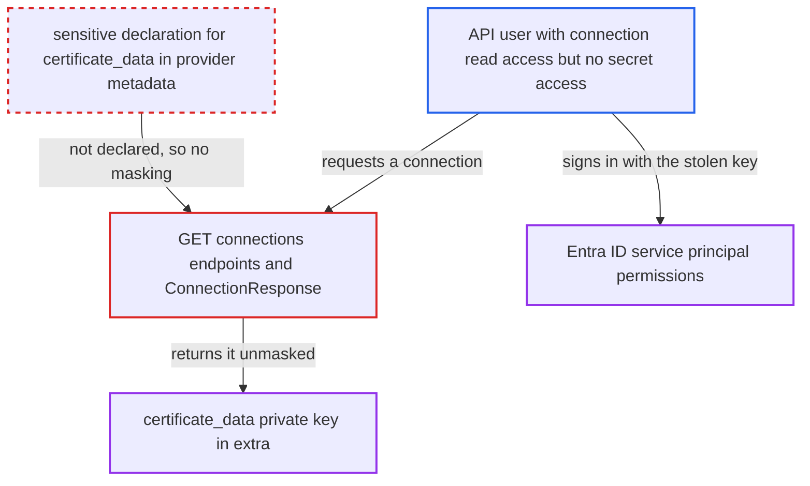

# Microsoft Graph `certificate_data` private key not declared sensitive, returned unmasked by connections API

| Field | Value |
|---|---|
| ID | `find_01JSxjmw5wwEAFSSJ5dri1ps` |
| Severity | **High** |
| Status | open |
| CWE | CWE-522 — Insufficiently Protected Credentials |
| Created | 2026-10-27T21:43:50.949337Z |
| Claude Security | https://claude.ai/security/findings/find_01JSxjmw5wwEAFSSJ5dri1ps |

## Description

A user who may read connections through the API, but is not meant to see secrets, can read the private key of a Microsoft Graph or Power BI service principal in clear text. This needs an `msgraph` or `powerbi` connection that stores an unencrypted key in `certificate_data`. The provider never marks `certificate_data` as sensitive, so the connections API does not mask it.

1. **the provider metadata** declares `certificate_data` without a password format. The `conn-fields` entry has only `type: ["string","null"]` and no `format: password`. The generated `get_provider_info.py` repeats this. ([`providers/microsoft/azure/provider.yaml:1031-1034`](https://github.com/cx-benchmark/airflow/blob/a462d683469bb9f55646b0515ef84c41e16650fb/providers/microsoft/azure/provider.yaml#L1031-L1034))
2. **`ProvidersManager._add_widgets`** records the field as not sensitive. It sets `is_sensitive` only when the field schema has `format == "password"`, so `certificate_data` and `extra__msgraph__certificate_data` are stored as non-sensitive. ([`airflow-core/src/airflow/providers_manager.py:981-1004`](https://github.com/cx-benchmark/airflow/blob/a462d683469bb9f55646b0515ef84c41e16650fb/airflow-core/src/airflow/providers_manager.py#L981-L1004))
3. **the attacker** calls `GET /api/v2/connections/{id}` or the list endpoint. The route needs only `requires_access_connection(method="GET")`, so a role that can read connections but not secrets is enough. ([`airflow-core/src/airflow/api_fastapi/core_api/routes/public/connections.py:200-217`](https://github.com/cx-benchmark/airflow/blob/a462d683469bb9f55646b0515ef84c41e16650fb/airflow-core/src/airflow/api_fastapi/core_api/routes/public/connections.py#L200-L217))
4. **`ConnectionResponse`** returns `extra` with the full PEM in clear text. `_sensitive_extra_keys` lists only fields flagged sensitive, and name-based `redact()` finds no sensitive substring in `certificate_data`, so neither masks it. ([`airflow-core/src/airflow/api_fastapi/core_api/datamodels/connections.py:37-126`](https://github.com/cx-benchmark/airflow/blob/a462d683469bb9f55646b0515ef84c41e16650fb/airflow-core/src/airflow/api_fastapi/core_api/datamodels/connections.py#L37-L126))
5. **the attacker** signs in to Microsoft Entra ID as the service principal. The key, together with the unmasked client id and tenant id, is what `CertificateCredential` is built from in `get_credentials`. ([`providers/microsoft/azure/src/airflow/providers/microsoft/azure/hooks/msgraph.py:548-571`](https://github.com/cx-benchmark/airflow/blob/a462d683469bb9f55646b0515ef84c41e16650fb/providers/microsoft/azure/src/airflow/providers/microsoft/azure/hooks/msgraph.py#L548-L571))

## Assessment

The attacker is an authenticated API user whose role allows connection `GET` but who is not meant to read secrets, such as a write-only connection configuration user. This could be a custom FAB role or a Keycloak or AWS policy. FAB Admin and Op roles already have credential access and gain nothing. The deployment must hold an `msgraph` or `powerbi` connection whose `certificate_data` has an unencrypted key. The single-connection endpoint, the list endpoint and the UI edit form all return the value. The Graph object-storage backend uses the same path. The report assumes that, with the pinned `azure-identity>=1.25.3`, `certificate_data` holds the PEM or PKCS12 bytes including the private key.

Impact: The attacker reads the service principal's private key, along with the unmasked client id and tenant id. The project's security model says this role must not see such credentials. Only `password`, the optional key passphrase, is masked. The read changes nothing in Airflow, and the role could already modify connections.

Subsequent-system impact: With the key, client id and tenant id, the attacker can authenticate to Microsoft Entra ID as the service principal from outside Airflow. They get every Graph or Power BI application permission granted to it, such as mail, SharePoint or OneDrive drives and dataset operations. They keep this access after their Airflow access is revoked, until the certificate is rotated.

## Recommendation

The provider stores private-key material in the `certificate_data` extra but declares it as a non-sensitive field in its `conn-fields` metadata and in the legacy widget. The connections API therefore does not know to mask it.

Fix criteria: `certificate_data` (plain and `extra__msgraph__certificate_data`) is declared sensitive in `provider.yaml` and the generated `get_provider_info.py`, so it appears in `_sensitive_extra_keys()`. Single and list connection responses return `***` for it. An edit that sends the mask back keeps the stored value. `KiotaRequestAdapterHook.get_credentials` and `fs/msgraph.py` still build `CertificateCredential` from the real stored value.

## Evidence

**https://github.com/cx-benchmark/airflow**

- [`providers/microsoft/azure/provider.yaml:1031-1034`](https://github.com/cx-benchmark/airflow/blob/a462d683469bb9f55646b0515ef84c41e16650fb/providers/microsoft/azure/provider.yaml#L1031-L1034)
- [`providers/microsoft/azure/src/airflow/providers/microsoft/azure/get_provider_info.py:1020`](https://github.com/cx-benchmark/airflow/blob/a462d683469bb9f55646b0515ef84c41e16650fb/providers/microsoft/azure/src/airflow/providers/microsoft/azure/get_provider_info.py#L1020)
- [`airflow-core/src/airflow/providers_manager.py:981-1004`](https://github.com/cx-benchmark/airflow/blob/a462d683469bb9f55646b0515ef84c41e16650fb/airflow-core/src/airflow/providers_manager.py#L981-L1004)
- [`airflow-core/src/airflow/api_fastapi/core_api/datamodels/connections.py:37-126`](https://github.com/cx-benchmark/airflow/blob/a462d683469bb9f55646b0515ef84c41e16650fb/airflow-core/src/airflow/api_fastapi/core_api/datamodels/connections.py#L37-L126)
- [`shared/secrets_masker/src/airflow_shared/secrets_masker/secrets_masker.py:51-76`](https://github.com/cx-benchmark/airflow/blob/a462d683469bb9f55646b0515ef84c41e16650fb/shared/secrets_masker/src/airflow_shared/secrets_masker/secrets_masker.py#L51-L76)
- [`providers/microsoft/azure/src/airflow/providers/microsoft/azure/hooks/msgraph.py:548-571`](https://github.com/cx-benchmark/airflow/blob/a462d683469bb9f55646b0515ef84c41e16650fb/providers/microsoft/azure/src/airflow/providers/microsoft/azure/hooks/msgraph.py#L548-L571)
- [`providers/microsoft/azure/src/airflow/providers/microsoft/azure/hooks/msgraph.py:281`](https://github.com/cx-benchmark/airflow/blob/a462d683469bb9f55646b0515ef84c41e16650fb/providers/microsoft/azure/src/airflow/providers/microsoft/azure/hooks/msgraph.py#L281)
- [`airflow-core/src/airflow/api_fastapi/core_api/routes/public/connections.py:200-217`](https://github.com/cx-benchmark/airflow/blob/a462d683469bb9f55646b0515ef84c41e16650fb/airflow-core/src/airflow/api_fastapi/core_api/routes/public/connections.py#L200-L217)

