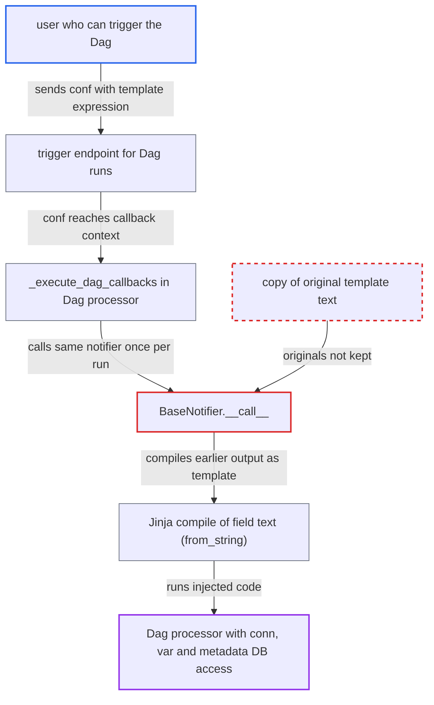

# Notifier re-renders its own rendered fields when the Dag processor runs batched callbacks

| Field | Value |
|---|---|
| ID | `find_01DLhm23UNRQF2rFWMeA8njY` |
| Severity | **High** |
| Status | open |
| CWE | CWE-1336 — Server-side template injection |
| Created | 2026-10-27T21:42:14.235036Z |
| Claude Security | https://claude.ai/security/findings/find_01DLhm23UNRQF2rFWMeA8njY |

## Description

A user who can only trigger a Dag can run operating-system commands inside the Dag processor. From there they can read every connection and variable. It needs a Dag-level notifier whose template uses a per-run value such as `params` or `dag_run.conf`, and two callbacks for that file handled in one processor batch. `BaseNotifier.__call__` overwrites its template fields with the rendered text, so a second call compiles the first run's output as a template.

1. **attacker** triggers Dag run A with a template expression in `conf`. The trigger endpoint stores the supplied `conf`, and so `params`, and needs only DagRun POST permission. ([`airflow-core/src/airflow/api_fastapi/core_api/routes/public/dag_run.py:776-853`](https://github.com/cx-benchmark/airflow/blob/a462d683469bb9f55646b0515ef84c41e16650fb/airflow-core/src/airflow/api_fastapi/core_api/routes/public/dag_run.py#L776-L853))
2. **attacker** triggers run B so both callbacks reach the same processor batch. The manager appends all callback requests for a file to one list and pops that list when it spawns the file's processor. ([`airflow-core/src/airflow/dag_processing/manager.py:801-817`](https://github.com/cx-benchmark/airflow/blob/a462d683469bb9f55646b0515ef84c41e16650fb/airflow-core/src/airflow/dag_processing/manager.py#L801-L817))
3. **Dag processor `_execute_callbacks`** runs every queued callback request against one parsed `DagBag`. The Dag object, and the notifier instance on it, is the same for each request. ([`airflow-core/src/airflow/dag_processing/processor.py:343-375`](https://github.com/cx-benchmark/airflow/blob/a462d683469bb9f55646b0515ef84c41e16650fb/airflow-core/src/airflow/dag_processing/processor.py#L343-L375))
4. **the handler `_execute_dag_callbacks`** calls the shared notifier once per request with that run's context. The context is built from `dag_run.conf` and `params` of each run. ([`airflow-core/src/airflow/dag_processing/processor.py:377-425`](https://github.com/cx-benchmark/airflow/blob/a462d683469bb9f55646b0515ef84c41e16650fb/airflow-core/src/airflow/dag_processing/processor.py#L377-L425))
5. **`BaseNotifier.__call__`** renders the template fields and writes the result back onto the notifier. On the call for run A, the attacker's string replaces the original template and no copy of the original is kept. ([`task-sdk/src/airflow/sdk/definitions/_internal/templater.py:162-211`](https://github.com/cx-benchmark/airflow/blob/a462d683469bb9f55646b0515ef84c41e16650fb/task-sdk/src/airflow/sdk/definitions/_internal/templater.py#L162-L211))
6. **`BaseNotifier.__call__`** compiles the already-rendered text again on the call for run B. Any string field is passed to `jinja_env.from_string()`, so the attacker's text is now treated as template source. ([`task-sdk/src/airflow/sdk/definitions/_internal/templater.py:255-260`](https://github.com/cx-benchmark/airflow/blob/a462d683469bb9f55646b0515ef84c41e16650fb/task-sdk/src/airflow/sdk/definitions/_internal/templater.py#L255-L260))
7. **Jinja sandbox** lets the injected expression reach `macros.uuid.os.system`. The sandbox blocks only `__` and internal attributes, and `macros.uuid` leads to the stdlib `uuid` module and then to `os`, so the command runs in the Dag processor. ([`task-sdk/src/airflow/sdk/definitions/_internal/templater.py:315-322`](https://github.com/cx-benchmark/airflow/blob/a462d683469bb9f55646b0515ef84c41e16650fb/task-sdk/src/airflow/sdk/definitions/_internal/templater.py#L315-L322))

## Assessment

The attacker is an authenticated user who can trigger the Dag, such as a USER role or FAB User, and does not need to be a Dag author. The Dag must have a Dag-level notifier callback whose template uses a per-run value like `params` or `dag_run.conf`. The callbacks documentation permits this by pointing at the full template context, though its own examples use only `{{ dag.dag_id }}` and `{{ ti.task_id }}`. The attacker also needs two callback requests for that file handled in one processor batch, which they can influence by triggering several runs together. The attack goes over the public REST API. A second route is a task-level notifier shared through `default_args` when several `TaskCallbackRequest`s for one file are batched. Any other caller that invokes one notifier instance twice in a process is affected the same way.

Impact: The attacker gets arbitrary Jinja evaluation inside the Dag processor. That means OS command execution and reading every connection and variable through the `conn` and `var` accessors. The security model says this component has direct metadata-DB access, so the Airflow control plane could be fully compromised.

Subsequent-system impact: Disclosed connection credentials belong to external systems configured in Airflow. The attacker can use them to read and modify those systems.

## Recommendation

`BaseNotifier.__call__` and `__await__` render the notifier's template fields in place and destroy the original templates. The Dag processor can call the same notifier instance several times in one process, so one render's output is compiled as a template on the next call.

Fix criteria: Rendering a notifier never feeds a previous render's output back into Jinja. Each call renders from the originally configured template text, either by rendering onto a copy or keeping the originals, or the processor uses a fresh notifier or Dag object per callback request. Test: a Dag with `on_success_callback=SlackNotifier(text='{{ params.x }}')` and two runs with `conf={'x': '{{ 7*7 }}'}` processed in one batch. The second notification must contain the literal `{{ 7*7 }}`, not `49`. `{{ macros.uuid.os.system(...) }}` must not execute in the processor.

## Evidence

**https://github.com/cx-benchmark/airflow**

- [`task-sdk/src/airflow/sdk/bases/notifier.py:119-150`](https://github.com/cx-benchmark/airflow/blob/a462d683469bb9f55646b0515ef84c41e16650fb/task-sdk/src/airflow/sdk/bases/notifier.py#L119-L150)
- [`task-sdk/src/airflow/sdk/bases/notifier.py:77-93`](https://github.com/cx-benchmark/airflow/blob/a462d683469bb9f55646b0515ef84c41e16650fb/task-sdk/src/airflow/sdk/bases/notifier.py#L77-L93)
- [`task-sdk/src/airflow/sdk/definitions/_internal/templater.py:162-211`](https://github.com/cx-benchmark/airflow/blob/a462d683469bb9f55646b0515ef84c41e16650fb/task-sdk/src/airflow/sdk/definitions/_internal/templater.py#L162-L211)
- [`task-sdk/src/airflow/sdk/definitions/_internal/templater.py:255-260`](https://github.com/cx-benchmark/airflow/blob/a462d683469bb9f55646b0515ef84c41e16650fb/task-sdk/src/airflow/sdk/definitions/_internal/templater.py#L255-L260)
- [`airflow-core/src/airflow/dag_processing/processor.py:343-375`](https://github.com/cx-benchmark/airflow/blob/a462d683469bb9f55646b0515ef84c41e16650fb/airflow-core/src/airflow/dag_processing/processor.py#L343-L375)
- [`airflow-core/src/airflow/dag_processing/processor.py:377-425`](https://github.com/cx-benchmark/airflow/blob/a462d683469bb9f55646b0515ef84c41e16650fb/airflow-core/src/airflow/dag_processing/processor.py#L377-L425)
- [`airflow-core/src/airflow/dag_processing/manager.py:801-817`](https://github.com/cx-benchmark/airflow/blob/a462d683469bb9f55646b0515ef84c41e16650fb/airflow-core/src/airflow/dag_processing/manager.py#L801-L817)
- [`task-sdk/src/airflow/sdk/execution_time/task_runner.py:330-363`](https://github.com/cx-benchmark/airflow/blob/a462d683469bb9f55646b0515ef84c41e16650fb/task-sdk/src/airflow/sdk/execution_time/task_runner.py#L330-L363)
- [`task-sdk/src/airflow/sdk/execution_time/macros.py:23`](https://github.com/cx-benchmark/airflow/blob/a462d683469bb9f55646b0515ef84c41e16650fb/task-sdk/src/airflow/sdk/execution_time/macros.py#L23)
- [`task-sdk/src/airflow/sdk/definitions/_internal/templater.py:315-322`](https://github.com/cx-benchmark/airflow/blob/a462d683469bb9f55646b0515ef84c41e16650fb/task-sdk/src/airflow/sdk/definitions/_internal/templater.py#L315-L322)
- [`airflow-core/src/airflow/api_fastapi/core_api/routes/public/dag_run.py:776-853`](https://github.com/cx-benchmark/airflow/blob/a462d683469bb9f55646b0515ef84c41e16650fb/airflow-core/src/airflow/api_fastapi/core_api/routes/public/dag_run.py#L776-L853)
- [`airflow-core/docs/administration-and-deployment/logging-monitoring/callbacks.rst:73-77`](https://github.com/cx-benchmark/airflow/blob/a462d683469bb9f55646b0515ef84c41e16650fb/airflow-core/docs/administration-and-deployment/logging-monitoring/callbacks.rst#L73-L77)

