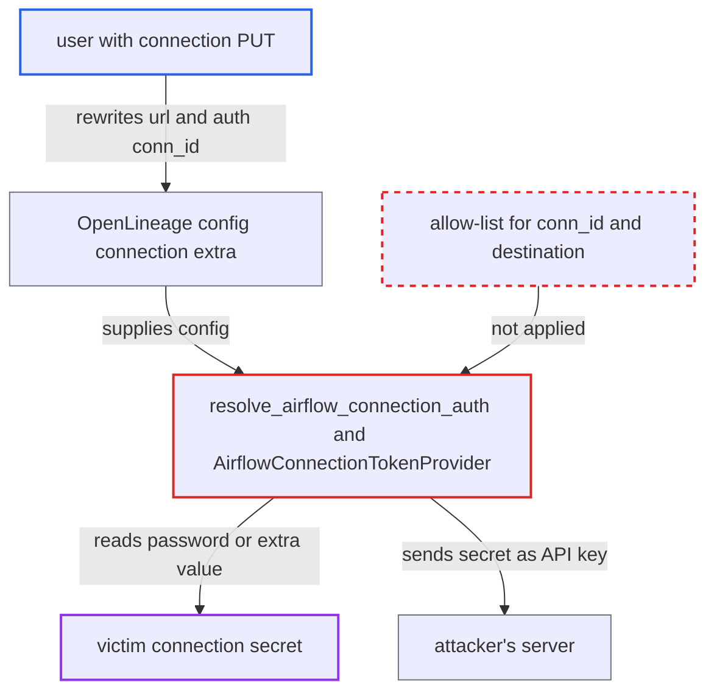

# OpenLineage config connection lets connection editors send any connection's secret to their server

| Field | Value |
|---|---|
| ID | `find_01UWZNjL6fRYq3RgHeG12LZK` |
| Severity | **High** |
| Status | open |
| CWE | CWE-522 — Insufficiently protected credentials |
| Created | 2026-10-27T22:07:52.075280Z |
| Claude Security | https://claude.ai/security/findings/find_01UWZNjL6fRYq3RgHeG12LZK |

## Description

A user who can edit connections but is not allowed to read their secrets can steal the clear-text password or token of any connection that Airflow's workers or scheduler can resolve. This needs connection `PUT` and an OpenLineage setup that uses `[openlineage] config_conn_id`. The cause is `resolve_airflow_connection_auth`: it resolves any `conn_id` named in the editable config and sends the secret to the `url` in that same config.

1. **attacker with connection `PUT`** sends a PATCH to `/api/v2/connections/{id}` for the OpenLineage config connection. The new `extra` sets an HTTP transport `url` to the attacker's server and an `auth` block of type `airflow_connection_api_key` whose `conn_id` names the victim connection. ([`airflow-core/src/airflow/api_fastapi/core_api/routes/public/connections.py:290-328`](https://github.com/cx-benchmark/airflow/blob/a462d683469bb9f55646b0515ef84c41e16650fb/airflow-core/src/airflow/api_fastapi/core_api/routes/public/connections.py#L290-L328))
2. **the connection service** stores the submitted `extra` unchanged. Only `***` placeholders are restored, so the attacker's `transport.url` and `auth.conn_id` are saved as sent. ([`airflow-core/src/airflow/api_fastapi/core_api/services/public/connections.py:71-86`](https://github.com/cx-benchmark/airflow/blob/a462d683469bb9f55646b0515ef84c41e16650fb/airflow-core/src/airflow/api_fastapi/core_api/services/public/connections.py#L71-L86))
3. **the forked emitter in the listener** builds a new OpenLineage client on the next task event. Every task-level hook runs emission with `use_fork=True`, so the client is built from the current config. In the scheduler, a DagRun listener pool process does this on its first event after it starts. ([`providers/openlineage/src/airflow/providers/openlineage/plugins/listener.py:970-977`](https://github.com/cx-benchmark/airflow/blob/a462d683469bb9f55646b0515ef84c41e16650fb/providers/openlineage/src/airflow/providers/openlineage/plugins/listener.py#L970-L977))
4. **`AirflowConnectionConfigProvider.get_config`** loads the whole client config from the connection's `extra`. It only checks for a `transport` dict, so the connection chooses the transport type, `url` and `auth`. ([`providers/openlineage/src/airflow/providers/openlineage/token_provider.py:50-63`](https://github.com/cx-benchmark/airflow/blob/a462d683469bb9f55646b0515ef84c41e16650fb/providers/openlineage/src/airflow/providers/openlineage/token_provider.py#L50-L63))
5. **`resolve_airflow_connection_auth`** replaces the auth block with the victim connection's secret. It builds `AirflowConnectionTokenProvider` from the block's own `conn_id`, with no allow-list. `get_api_key` returns the clear-text `password` or the `extra` value. The secret is written as `apiKey`. ([`providers/openlineage/src/airflow/providers/openlineage/token_provider.py:107-133`](https://github.com/cx-benchmark/airflow/blob/a462d683469bb9f55646b0515ef84c41e16650fb/providers/openlineage/src/airflow/providers/openlineage/token_provider.py#L107-L133))
6. **`OpenLineageClient`** sends the secret to the attacker's `url` as the API key. The client is built with `OpenLineageClient(config=config)`. The report assumes the `http` transport sends `api_key` auth as an `Authorization: Bearer` header to its `url`. ([`providers/openlineage/src/airflow/providers/openlineage/plugins/adapter.py:88-116`](https://github.com/cx-benchmark/airflow/blob/a462d683469bb9f55646b0515ef84c41e16650fb/providers/openlineage/src/airflow/providers/openlineage/plugins/adapter.py#L88-L116))

## Assessment

The attacker is an authenticated API user with connection `PUT` but no right to read secrets, such as a custom FAB role or a Keycloak/AWS policy that grants connection `PUT`. OpenLineage must be enabled through `[openlineage] config_conn_id`, and the config connection must live in the metastore, where API edits take effect. No victim action is needed. On workers the next task event picks up the edit. In the scheduler, a DagRun listener pool process picks it up when it is next started, because each caches one client. `BaseHook.get_connection` resolves through every configured backend, so the attacker can also reach connections they cannot edit or list. These include `AIRFLOW_CONN_*` and external secrets backends. A composite transport lets one edit target several victims. FAB `Admin` and `Op` are documented as already having credential access, so the gain is for custom connection-configuration roles. The attack also assumes that openlineage-python `>=1.52.0` sends `api_key` auth as an `Authorization: Bearer` header to its configured `url`.

Impact: The attacker reads the clear-text password, or any named `extra` value, of any connection the worker or scheduler can resolve. They also receive the lineage event stream. The report finds no further integrity or availability impact on Airflow itself, since the role can already modify connections.

Subsequent-system impact: The stolen secrets are Airflow's credentials for external systems such as databases, cloud accounts and SaaS APIs. The attacker can act in those systems directly, with each connection's privileges and outside Airflow's authorization. That access remains after the OpenLineage connection is restored.

## Recommendation

(1) `resolve_airflow_connection_auth` and `AirflowConnectionTokenProvider` resolve whatever `conn_id` and `extra_key` a connection-sourced config names into a clear-text secret. That secret then goes into an outbound auth header whose destination the same editable config picks.

Fix criteria: A config loaded from `config_conn_id` can only name a connection that the Deployment Manager designated in deployment configuration, for example only the config connection itself or an `airflow.cfg` allow-list. A test shows that a config connection whose `auth.conn_id` names another connection yields no token. The same test shows that no request carrying that connection's secret is sent.

(2) The complete OpenLineage client configuration, including transport type, URL, TLS settings and auth, is read from an API-editable connection and used in the scheduler and on workers. A connection editor therefore controls where credentials and control-plane telemetry are sent.

Fix criteria: The transport destination and type come from configuration only the Deployment Manager can change. Alternatively, a destination change that comes from the connection carries no credential resolved from another connection. A test shows that editing the config connection's `extra` cannot make a worker or the scheduler send a resolved secret to a new URL.

## Evidence

**https://github.com/cx-benchmark/airflow**

- [`providers/openlineage/src/airflow/providers/openlineage/token_provider.py:107-133`](https://github.com/cx-benchmark/airflow/blob/a462d683469bb9f55646b0515ef84c41e16650fb/providers/openlineage/src/airflow/providers/openlineage/token_provider.py#L107-L133)
- [`providers/openlineage/src/airflow/providers/openlineage/token_provider.py:74-104`](https://github.com/cx-benchmark/airflow/blob/a462d683469bb9f55646b0515ef84c41e16650fb/providers/openlineage/src/airflow/providers/openlineage/token_provider.py#L74-L104)
- [`providers/openlineage/src/airflow/providers/openlineage/token_provider.py:50-63`](https://github.com/cx-benchmark/airflow/blob/a462d683469bb9f55646b0515ef84c41e16650fb/providers/openlineage/src/airflow/providers/openlineage/token_provider.py#L50-L63)
- [`providers/openlineage/src/airflow/providers/openlineage/plugins/adapter.py:88-116`](https://github.com/cx-benchmark/airflow/blob/a462d683469bb9f55646b0515ef84c41e16650fb/providers/openlineage/src/airflow/providers/openlineage/plugins/adapter.py#L88-L116)
- [`airflow-core/src/airflow/api_fastapi/core_api/routes/public/connections.py:290-328`](https://github.com/cx-benchmark/airflow/blob/a462d683469bb9f55646b0515ef84c41e16650fb/airflow-core/src/airflow/api_fastapi/core_api/routes/public/connections.py#L290-L328)
- [`airflow-core/src/airflow/api_fastapi/core_api/services/public/connections.py:71-86`](https://github.com/cx-benchmark/airflow/blob/a462d683469bb9f55646b0515ef84c41e16650fb/airflow-core/src/airflow/api_fastapi/core_api/services/public/connections.py#L71-L86)
- [`providers/openlineage/src/airflow/providers/openlineage/plugins/listener.py:970-977`](https://github.com/cx-benchmark/airflow/blob/a462d683469bb9f55646b0515ef84c41e16650fb/providers/openlineage/src/airflow/providers/openlineage/plugins/listener.py#L970-L977)
- [`providers/openlineage/src/airflow/providers/openlineage/plugins/listener.py:122-130`](https://github.com/cx-benchmark/airflow/blob/a462d683469bb9f55646b0515ef84c41e16650fb/providers/openlineage/src/airflow/providers/openlineage/plugins/listener.py#L122-L130)
- [`task-sdk/src/airflow/sdk/execution_time/supervisor.py:2981-3018`](https://github.com/cx-benchmark/airflow/blob/a462d683469bb9f55646b0515ef84c41e16650fb/task-sdk/src/airflow/sdk/execution_time/supervisor.py#L2981-L3018)
- [`providers/openlineage/src/airflow/providers/openlineage/conf.py:136-157`](https://github.com/cx-benchmark/airflow/blob/a462d683469bb9f55646b0515ef84c41e16650fb/providers/openlineage/src/airflow/providers/openlineage/conf.py#L136-L157)
- [`providers/openlineage/docs/configurations-ref.rst:73-101`](https://github.com/cx-benchmark/airflow/blob/a462d683469bb9f55646b0515ef84c41e16650fb/providers/openlineage/docs/configurations-ref.rst#L73-L101)
- [`airflow-core/docs/security/security_model.rst:1064-1074`](https://github.com/cx-benchmark/airflow/blob/a462d683469bb9f55646b0515ef84c41e16650fb/airflow-core/docs/security/security_model.rst#L1064-L1074)

