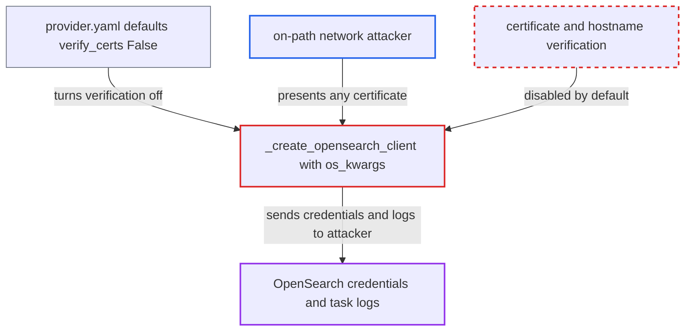

# OpenSearch task log handler disables TLS certificate verification by default

| Field | Value |
|---|---|
| ID | `find_01XPwCXN6LV38yxtLcT77LDZ` |
| Severity | **High** |
| Status | open |
| CWE | CWE-295 — Improper certificate validation |
| Created | 2026-10-27T21:37:27.280850Z |
| Claude Security | https://claude.ai/security/findings/find_01XPwCXN6LV38yxtLcT77LDZ |

## Description

An attacker on the network path between Airflow and its OpenSearch server can read the OpenSearch username and password and every task log, and can alter or delete stored logs. This applies when the deployment uses TLS to OpenSearch and leaves `verify_certs` at its shipped default. The provider's defaults in `[opensearch_configs]` turn off certificate and hostname checks, and `get_os_kwargs_from_config()` passes them to the client.

1. **the provider** ships defaults that turn verification off. The `[opensearch_configs]` section defaults to `verify_certs = False`, `ssl_assert_hostname = False` and `ssl_show_warn = False`, which overrides the client library's default of verifying. ([`providers/opensearch/provider.yaml:220-252`](https://github.com/cx-benchmark/airflow/blob/a462d683469bb9f55646b0515ef84c41e16650fb/providers/opensearch/provider.yaml#L220-L252))
2. **`get_os_kwargs_from_config()`** forwards the whole section unchanged to the client settings. The config parser turns the string "False" into a boolean `False`, and every key is passed on as it is. ([`providers/opensearch/src/airflow/providers/opensearch/log/os_task_handler.py:189-197`](https://github.com/cx-benchmark/airflow/blob/a462d683469bb9f55646b0515ef84c41e16650fb/providers/opensearch/src/airflow/providers/opensearch/log/os_task_handler.py#L189-L197))
3. **`_create_opensearch_client`** builds `OpenSearch(**os_kwargs)` together with basic-auth credentials. With an `https://` host or `use_ssl=True`, the connection accepts any certificate, checks no hostname and prints no warning, and it sends `[opensearch] username` and `password` to whoever answers. ([`providers/opensearch/src/airflow/providers/opensearch/log/os_task_handler.py:218-236`](https://github.com/cx-benchmark/airflow/blob/a462d683469bb9f55646b0515ef84c41e16650fb/providers/opensearch/src/airflow/providers/opensearch/log/os_task_handler.py#L218-L236))
4. **on-path attacker** presents any certificate and intercepts the connection. The client accepts the certificate, so the attacker receives the credentials and all log reads and bulk writes.
5. **on-path attacker** returns forged log documents or changes stored logs. The handler renders returned documents in the UI, and with the stolen credentials the attacker can modify or delete stored logs.

## Assessment

The attacker sits on the network path between an Airflow component and the OpenSearch cluster. The components are the API server, workers and triggerer. The deployment must use TLS to OpenSearch, with an `https://` host or `use_ssl = True`. It must also have left `[opensearch_configs] verify_certs` at the shipped default instead of setting it to `True`. The attacker needs no Airflow privileges and no user interaction.

Impact: The attacker learns the OpenSearch username and password and can read every task log that Airflow fetches or uploads. The attacker can also substitute log content shown to users and, with the credentials, modify or delete stored logs. Airflow's availability is not affected beyond failed log reads.

Subsequent-system impact: The stolen credentials let the attacker log in to the OpenSearch cluster directly. They can read or change whatever those credentials allow, which can reach beyond the Airflow log indices. The code places no limit on the credential's scope.

## Recommendation

The shipped defaults for `[opensearch_configs]` turn off certificate verification, hostname assertion and the insecure-connection warning. This overrides the client library's secure default for the log channel.

Fix criteria: A deployment that sets an `https://` OpenSearch host or `use_ssl=True` without touching `[opensearch_configs]` validates the server certificate against a CA bundle and asserts the hostname, and the connection fails on a mismatch. Turning verification off needs an explicit opt-in and emits a warning. To check, build the handler with only `[opensearch] host=https://...` set and confirm the client rejects a self-signed or mismatched certificate.

## Evidence

**https://github.com/cx-benchmark/airflow**

- [`providers/opensearch/provider.yaml:220-252`](https://github.com/cx-benchmark/airflow/blob/a462d683469bb9f55646b0515ef84c41e16650fb/providers/opensearch/provider.yaml#L220-L252)
- [`providers/opensearch/src/airflow/providers/opensearch/log/os_task_handler.py:189-197`](https://github.com/cx-benchmark/airflow/blob/a462d683469bb9f55646b0515ef84c41e16650fb/providers/opensearch/src/airflow/providers/opensearch/log/os_task_handler.py#L189-L197)
- [`providers/opensearch/src/airflow/providers/opensearch/log/os_task_handler.py:218-236`](https://github.com/cx-benchmark/airflow/blob/a462d683469bb9f55646b0515ef84c41e16650fb/providers/opensearch/src/airflow/providers/opensearch/log/os_task_handler.py#L218-L236)
- [`providers/elasticsearch/src/airflow/providers/elasticsearch/get_provider_info.py:176-185`](https://github.com/cx-benchmark/airflow/blob/a462d683469bb9f55646b0515ef84c41e16650fb/providers/elasticsearch/src/airflow/providers/elasticsearch/get_provider_info.py#L176-L185)

