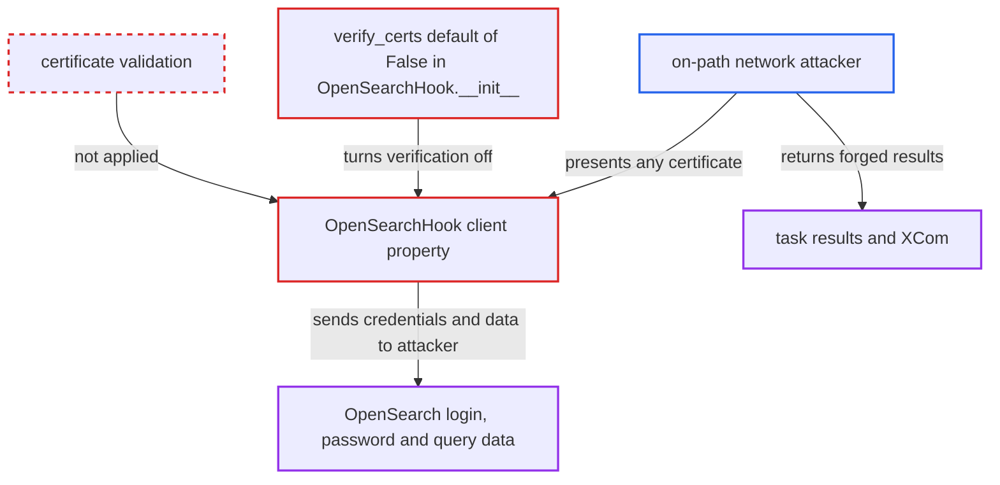

# OpenSearchHook defaults verify_certs to False, disabling TLS certificate validation

| Field | Value |
|---|---|
| ID | `find_0169nbTpZbgS9PFFpXNieSRU` |
| Severity | **High** |
| Status | open |
| CWE | CWE-295 — Improper certificate validation |
| Created | 2026-10-27T21:36:25.031451Z |
| Claude Security | https://claude.ai/security/findings/find_0169nbTpZbgS9PFFpXNieSRU |

## Description

A network attacker between an Airflow worker and an OpenSearch server can read the connection's login and password and the query and index data. They can also send back forged results. It works when the connection turns on TLS but does not set `verify_certs`. The cause is `OpenSearchHook.__init__`, which turns a missing `verify_certs` into `False`, so certificates are never checked.

1. **the connection owner** enables TLS on an `opensearch` connection without `verify_certs`. The extra is `{"use_ssl": true}` or the `scheme` extra is `https`, which is the natural way to turn TLS on.
2. **the hook `OpenSearchHook.__init__`** replaces the missing `verify_certs` extra with `False`. It reads `extra.get("verify_certs", False)`, so "not configured" becomes "verification off". The client library would otherwise verify by default. ([`providers/opensearch/src/airflow/providers/opensearch/hooks/opensearch.py:74-75`](https://github.com/cx-benchmark/airflow/blob/a462d683469bb9f55646b0515ef84c41e16650fb/providers/opensearch/src/airflow/providers/opensearch/hooks/opensearch.py#L74-L75))
3. **the `client` property** passes `verify_certs=self.verify_certs` and `http_auth=(login, password)` to `opensearchpy.OpenSearch`. With `use_ssl` on and verification off, the client accepts any certificate while still sending the connection's login and password as basic auth. ([`providers/opensearch/src/airflow/providers/opensearch/hooks/opensearch.py:92-115`](https://github.com/cx-benchmark/airflow/blob/a462d683469bb9f55646b0515ef84c41e16650fb/providers/opensearch/src/airflow/providers/opensearch/hooks/opensearch.py#L92-L115))
4. **on-path network attacker** answers the worker's connection with a certificate of their choosing. This happens when a task using an OpenSearch operator runs. The client accepts the certificate, so the attacker ends the TLS session themselves.
5. **on-path network attacker** captures the credentials and traffic and returns forged results. The task then processes the forged results or pushes them to XCom.

## Assessment

The attacker sits on the network path between an Airflow worker or triggerer and the OpenSearch endpoint of an `opensearch` connection. The connection must enable TLS (`use_ssl` or `scheme=https`) and must not set `verify_certs`. The attack starts when a task using any OpenSearch operator runs. The report names `OpenSearchQueryOperator`, `OpenSearchCreateIndexOperator` and `OpenSearchAddDocumentOperator`, and all of them use this client. The attacker needs no Airflow privileges and no user interaction. The connection documentation states that `verify_certs` "Default is false", so the insecure default is documented behaviour.

Impact: The attacker obtains the connection's login and password and the data the task reads from or writes to OpenSearch. They can also feed forged query results into the task and change what the DAG does next. Airflow's availability is not affected.

Subsequent-system impact: With the captured credentials the attacker can log in to the OpenSearch cluster directly and read or modify whatever those credentials allow. The code places no limit on their scope.

## Recommendation

`OpenSearchHook` replaces a missing `verify_certs` extra with `False`. Enabling TLS on a connection therefore silently turns off server-certificate validation.

Fix criteria: A connection that enables TLS without `verify_certs` validates the server certificate and hostname, and refuses mismatching or untrusted certificates. Turning validation off requires an explicit `verify_certs: false`. To check, build `OpenSearchHook` from a connection with extra `{"use_ssl": true}` and confirm the created client rejects a self-signed certificate.

## Evidence

**https://github.com/cx-benchmark/airflow**

- [`providers/opensearch/src/airflow/providers/opensearch/hooks/opensearch.py:74-75`](https://github.com/cx-benchmark/airflow/blob/a462d683469bb9f55646b0515ef84c41e16650fb/providers/opensearch/src/airflow/providers/opensearch/hooks/opensearch.py#L74-L75)
- [`providers/opensearch/src/airflow/providers/opensearch/hooks/opensearch.py:92-115`](https://github.com/cx-benchmark/airflow/blob/a462d683469bb9f55646b0515ef84c41e16650fb/providers/opensearch/src/airflow/providers/opensearch/hooks/opensearch.py#L92-L115)
- [`providers/opensearch/docs/connections/opensearch.rst:36-37`](https://github.com/cx-benchmark/airflow/blob/a462d683469bb9f55646b0515ef84c41e16650fb/providers/opensearch/docs/connections/opensearch.rst#L36-L37)

