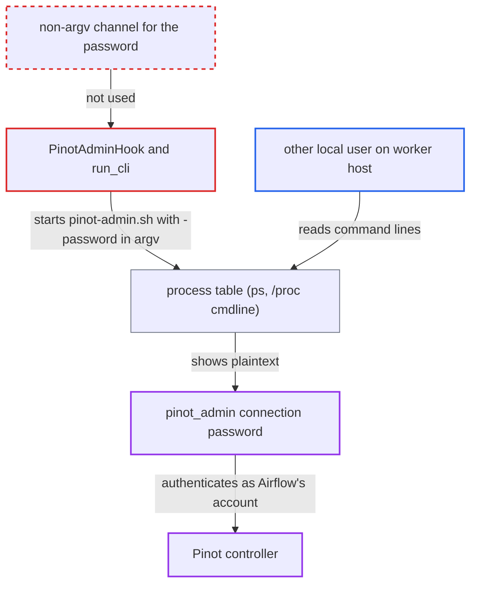

# PinotAdminHook passes connection password to pinot-admin.sh via -password on argv

| Field | Value |
|---|---|
| ID | `find_01C1CQoWQwoc8UotuJEzYMFW` |
| Severity | **High** |
| Status | open |
| CWE | CWE-214 — Secrets in process arguments |
| Created | 2026-10-27T21:58:55.317045Z |
| Claude Security | https://claude.ai/security/findings/find_01C1CQoWQwoc8UotuJEzYMFW |

## Description

Another local user on an Airflow worker host can read the Pinot controller password from the process list while a Pinot admin task runs. With that password they can act on the Pinot cluster as Airflow's account. The attacker needs no Airflow privileges, but the `pinot_admin` connection must have a password. The cause is that `PinotAdminHook` passes the password to `pinot-admin.sh` as a `-password` command-line argument.

1. **the Airflow task** calls a `PinotAdminHook` method such as `add_schema`. When the `pinot_admin` connection has a password, the command builder appends `-password` and the password to the argument list; `add_table`, `create_segment` and `upload_segment` do the same. ([`providers/apache/pinot/src/airflow/providers/apache/pinot/hooks/pinot.py:107-108`](https://github.com/cx-benchmark/airflow/blob/a462d683469bb9f55646b0515ef84c41e16650fb/providers/apache/pinot/src/airflow/providers/apache/pinot/hooks/pinot.py#L107-L108))
2. **the method `run_cli`** starts `pinot-admin.sh` with `subprocess.Popen`. The password stays in the child process's argument list for as long as the command runs, and `create_segment` and `upload_segment` can run for minutes. ([`providers/apache/pinot/src/airflow/providers/apache/pinot/hooks/pinot.py:253-255`](https://github.com/cx-benchmark/airflow/blob/a462d683469bb9f55646b0515ef84c41e16650fb/providers/apache/pinot/src/airflow/providers/apache/pinot/hooks/pinot.py#L253-L255))
3. **a local account on the worker host** reads `/proc/<pid>/cmdline` or runs `ps` during that time. The project already treats other local users on the same host as untrusted, and no Airflow access or victim action is needed. ([`airflow-core/docs/security/kerberos.rst:95-102`](https://github.com/cx-benchmark/airflow/blob/a462d683469bb9f55646b0515ef84c41e16650fb/airflow-core/docs/security/kerberos.rst#L95-L102))
4. **the local attacker** uses the password against the Pinot controller. The credential authenticates as Airflow's account on the controller.

## Assessment

The attacker is another local account on an Airflow worker host and has no Airflow privileges. A task must be running that uses `PinotAdminHook` with a `pinot_admin` connection that has a password. While `pinot-admin.sh` runs, the attacker reads `/proc/*/cmdline` or runs `ps -ef`. The command builders `add_schema`, `add_table`, `create_segment` and `upload_segment` all expose the password this way. The task log is not an extra route, because the SDK masks the echoed command there.

Impact: The attacker obtains the plaintext password of the Airflow connection without touching the metadata database or the API. The worker itself is not modified.

Subsequent-system impact: The password authenticates to the Pinot controller as Airflow's account. The attacker can read and change the Pinot cluster, including adding or altering schemas and tables and uploading segments, to the extent of that account's rights.

## Recommendation

The four command builders in `PinotAdminHook` (`add_schema`, `add_table`, `create_segment`, `upload_segment`) put the connection password directly into the `pinot-admin.sh` argument list. Any local user can read it from the process table while the command runs.

Fix criteria: No process spawned by `PinotAdminHook` carries the connection password in its argv. Check this with `ps -o args` or `/proc/<pid>/cmdline` while `add_schema`, `add_table`, `create_segment` and `upload_segment` run. The credential is supplied through a channel other users cannot read, such as the child's environment, a 0600 config or auth file, or a token mechanism that is not an argv value. The task log stays masked.

## Evidence

**https://github.com/cx-benchmark/airflow**

- [`providers/apache/pinot/src/airflow/providers/apache/pinot/hooks/pinot.py:107-108`](https://github.com/cx-benchmark/airflow/blob/a462d683469bb9f55646b0515ef84c41e16650fb/providers/apache/pinot/src/airflow/providers/apache/pinot/hooks/pinot.py#L107-L108)
- [`providers/apache/pinot/src/airflow/providers/apache/pinot/hooks/pinot.py:127-128`](https://github.com/cx-benchmark/airflow/blob/a462d683469bb9f55646b0515ef84c41e16650fb/providers/apache/pinot/src/airflow/providers/apache/pinot/hooks/pinot.py#L127-L128)
- [`providers/apache/pinot/src/airflow/providers/apache/pinot/hooks/pinot.py:163-164`](https://github.com/cx-benchmark/airflow/blob/a462d683469bb9f55646b0515ef84c41e16650fb/providers/apache/pinot/src/airflow/providers/apache/pinot/hooks/pinot.py#L163-L164)
- [`providers/apache/pinot/src/airflow/providers/apache/pinot/hooks/pinot.py:233-234`](https://github.com/cx-benchmark/airflow/blob/a462d683469bb9f55646b0515ef84c41e16650fb/providers/apache/pinot/src/airflow/providers/apache/pinot/hooks/pinot.py#L233-L234)
- [`providers/apache/pinot/src/airflow/providers/apache/pinot/hooks/pinot.py:253-255`](https://github.com/cx-benchmark/airflow/blob/a462d683469bb9f55646b0515ef84c41e16650fb/providers/apache/pinot/src/airflow/providers/apache/pinot/hooks/pinot.py#L253-L255)
- [`airflow-core/docs/security/kerberos.rst:95-102`](https://github.com/cx-benchmark/airflow/blob/a462d683469bb9f55646b0515ef84c41e16650fb/airflow-core/docs/security/kerberos.rst#L95-L102)

