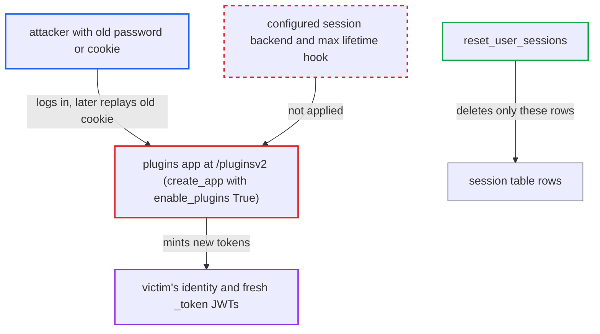

# Plugins Flask app ignores session backend; its logins survive password reset and re-mint JWTs

| Field | Value |
|---|---|
| ID | `find_012wJcSRpQKADnxnk1U1rdS3` |
| Severity | **High** |
| Status | open |
| CWE | CWE-613 — Insufficient Session Expiration |
| Created | 2026-10-27T21:48:38.649343Z |
| Claude Security | https://claude.ai/security/findings/find_012wJcSRpQKADnxnk1U1rdS3 |

## Description

Someone who once had a user's password, or a copy of that user's `/pluginsv2` session cookie, can keep access after the password is reset. They can keep minting fresh API tokens for up to 30 days by default. This needs the FAB auth manager and an installed Airflow 2 style Flask plugin. The plugins app made by `create_app(enable_plugins=True)` ignores the configured session backend, so `reset_user_sessions` never revokes its sessions.

1. **attacker** signs in at `POST /pluginsv2/login/` with the victim's password and keeps the `session` cookie. The FAB login views are registered on the plugins app, and its `LoginManager` stores the login in that app's own cookie session. ([`providers/fab/src/airflow/providers/fab/auth_manager/security_manager/override.py:597-603`](https://github.com/cx-benchmark/airflow/blob/a462d683469bb9f55646b0515ef84c41e16650fb/providers/fab/src/airflow/providers/fab/auth_manager/security_manager/override.py#L597-L603))
2. **plugins app from `create_app(enable_plugins=True)`** keeps Flask's default signed-cookie session interface. `init_airflow_session_interface` and `init_session_max_lifetime` run only in the `/auth` branch, so the session is not in the `session` table and `[fab] session_backend` is ignored. ([`providers/fab/src/airflow/providers/fab/www/app.py:119-133`](https://github.com/cx-benchmark/airflow/blob/a462d683469bb9f55646b0515ef84c41e16650fb/providers/fab/src/airflow/providers/fab/www/app.py#L119-L133))
3. **victim or admin** resets the password through the CLI, the `/auth` views or `PATCH /auth/fab/v1/users/{username}`. `reset_user_sessions` deletes only rows of the `session` table, and the attacker's cookie is not in that table. ([`providers/fab/src/airflow/providers/fab/auth_manager/security_manager/override.py:615-671`](https://github.com/cx-benchmark/airflow/blob/a462d683469bb9f55646b0515ef84c41e16650fb/providers/fab/src/airflow/providers/fab/auth_manager/security_manager/override.py#L615-L671))
4. **attacker** sends `GET /pluginsv2/login/?next=/` with the old cookie. The cookie is still accepted for `PERMANENT_SESSION_LIFETIME`, which is `[fab] session_lifetime_minutes` (default 43200), so `redirect_if_authenticated()` treats the attacker as logged in. ([`providers/fab/src/airflow/providers/fab/auth_manager/views/auth_login.py:34-56`](https://github.com/cx-benchmark/airflow/blob/a462d683469bb9f55646b0515ef84c41e16650fb/providers/fab/src/airflow/providers/fab/auth_manager/views/auth_login.py#L34-L56))
5. **`redirect()` in `www/views.py`** mints a fresh `_token` JWT with a new `jti` for `g.user`. No login stamp exists in the plugins app, so `get_token_expiration_seconds()` returns the full `[api_auth] jwt_expiration_time`. The attacker can repeat this for up to 30 days. ([`providers/fab/src/airflow/providers/fab/www/views.py:118-156`](https://github.com/cx-benchmark/airflow/blob/a462d683469bb9f55646b0515ef84c41e16650fb/providers/fab/src/airflow/providers/fab/www/views.py#L118-L156))

## Assessment

The attacker needs the victim's password before it is reset, or a copy of the victim's `/pluginsv2` session cookie. The FAB auth manager must be in use, which is the Helm chart default, and an Airflow 2 style Flask plugin (blueprint, `appbuilder_views` or menu link) must be installed so the `/pluginsv2` app is mounted. The password reset can come from the CLI command `airflow users reset-password`, the `/auth` reset views or `PATCH /auth/fab/v1/users/{username}`. If the reset is done from the duplicated `/pluginsv2` reset-password views, `reset_user_sessions` deletes nothing, not even the user's `/auth` sessions. Separately, if an operator sets `[fab] session_max_lifetime_minutes` (default `0`), it is not enforced on this app either.

Impact: After the password reset, the attacker keeps the victim's identity and can mint new API tokens, each valid for the full `jwt_expiration_time`, for up to `session_lifetime_minutes` after the cookie was last written. Only deactivating the user or rotating `[api] secret_key` stops it. For an Admin or Op victim this means reading and editing connections and variables, controlling DAG runs and managing users. Availability impact is limited to what such a user can pause or delete.

## Recommendation

(1) `create_app(enable_plugins=True)` keeps Flask's default signed-cookie session interface and has no max-lifetime enforcement, yet it still registers the FAB login and user-management views. Sessions created there sit outside the configured `[fab] session_backend` store.

Fix criteria: Every Flask app that authenticates FAB users uses the configured session backend and the same login stamp and max-lifetime hook as the `/auth` app. With `database`, that means `AirflowDatabaseSessionInterface` and the `session` table. Otherwise that app does not register the login and security views. To verify, log in at `/pluginsv2/login/` and reset that user's password via the CLI or the users API. Then `GET /pluginsv2/login/?next=/` with the old cookie must not authenticate or set `_token`.

(2) `reset_user_sessions` chooses what to delete from `current_app.session_interface`. When it runs inside the plugins app, through its duplicated reset-password views, it deletes nothing, not even the user's `/auth` database sessions.

Fix criteria: A password change invalidates all of the user's sessions, whichever Flask app handled the request. To verify, reset a password from `/pluginsv2/resetpassword/form?pk=N`. The user's rows in the `session` table must be gone, and their `/auth` cookie must no longer authenticate.

## Evidence

**https://github.com/cx-benchmark/airflow**

- [`providers/fab/src/airflow/providers/fab/www/app.py:119-133`](https://github.com/cx-benchmark/airflow/blob/a462d683469bb9f55646b0515ef84c41e16650fb/providers/fab/src/airflow/providers/fab/www/app.py#L119-L133)
- [`providers/fab/src/airflow/providers/fab/www/app.py:72-75`](https://github.com/cx-benchmark/airflow/blob/a462d683469bb9f55646b0515ef84c41e16650fb/providers/fab/src/airflow/providers/fab/www/app.py#L72-L75)
- [`providers/fab/src/airflow/providers/fab/www/extensions/init_appbuilder.py:200-219`](https://github.com/cx-benchmark/airflow/blob/a462d683469bb9f55646b0515ef84c41e16650fb/providers/fab/src/airflow/providers/fab/www/extensions/init_appbuilder.py#L200-L219)
- [`providers/fab/src/airflow/providers/fab/www/extensions/init_appbuilder.py:308-315`](https://github.com/cx-benchmark/airflow/blob/a462d683469bb9f55646b0515ef84c41e16650fb/providers/fab/src/airflow/providers/fab/www/extensions/init_appbuilder.py#L308-L315)
- [`providers/fab/src/airflow/providers/fab/auth_manager/security_manager/override.py:597-603`](https://github.com/cx-benchmark/airflow/blob/a462d683469bb9f55646b0515ef84c41e16650fb/providers/fab/src/airflow/providers/fab/auth_manager/security_manager/override.py#L597-L603)
- [`providers/fab/src/airflow/providers/fab/auth_manager/security_manager/override.py:615-671`](https://github.com/cx-benchmark/airflow/blob/a462d683469bb9f55646b0515ef84c41e16650fb/providers/fab/src/airflow/providers/fab/auth_manager/security_manager/override.py#L615-L671)
- [`providers/fab/src/airflow/providers/fab/auth_manager/views/auth_login.py:34-56`](https://github.com/cx-benchmark/airflow/blob/a462d683469bb9f55646b0515ef84c41e16650fb/providers/fab/src/airflow/providers/fab/auth_manager/views/auth_login.py#L34-L56)
- [`providers/fab/src/airflow/providers/fab/www/views.py:118-156`](https://github.com/cx-benchmark/airflow/blob/a462d683469bb9f55646b0515ef84c41e16650fb/providers/fab/src/airflow/providers/fab/www/views.py#L118-L156)
- [`airflow-core/src/airflow/api_fastapi/core_api/app.py:239-267`](https://github.com/cx-benchmark/airflow/blob/a462d683469bb9f55646b0515ef84c41e16650fb/airflow-core/src/airflow/api_fastapi/core_api/app.py#L239-L267)
- [`airflow-core/src/airflow/api_fastapi/app.py:172-174`](https://github.com/cx-benchmark/airflow/blob/a462d683469bb9f55646b0515ef84c41e16650fb/airflow-core/src/airflow/api_fastapi/app.py#L172-L174)
- [`providers/fab/src/airflow/providers/fab/auth_manager/api_fastapi/routes/login.py:42-67`](https://github.com/cx-benchmark/airflow/blob/a462d683469bb9f55646b0515ef84c41e16650fb/providers/fab/src/airflow/providers/fab/auth_manager/api_fastapi/routes/login.py#L42-L67)
- [`providers/fab/provider.yaml:206-224`](https://github.com/cx-benchmark/airflow/blob/a462d683469bb9f55646b0515ef84c41e16650fb/providers/fab/provider.yaml#L206-L224)
- [`chart/values.yaml:3420`](https://github.com/cx-benchmark/airflow/blob/a462d683469bb9f55646b0515ef84c41e16650fb/chart/values.yaml#L3420)
- [`airflow-core/src/airflow/ui/src/layouts/Nav/Nav.tsx:119-139`](https://github.com/cx-benchmark/airflow/blob/a462d683469bb9f55646b0515ef84c41e16650fb/airflow-core/src/airflow/ui/src/layouts/Nav/Nav.tsx#L119-L139)

