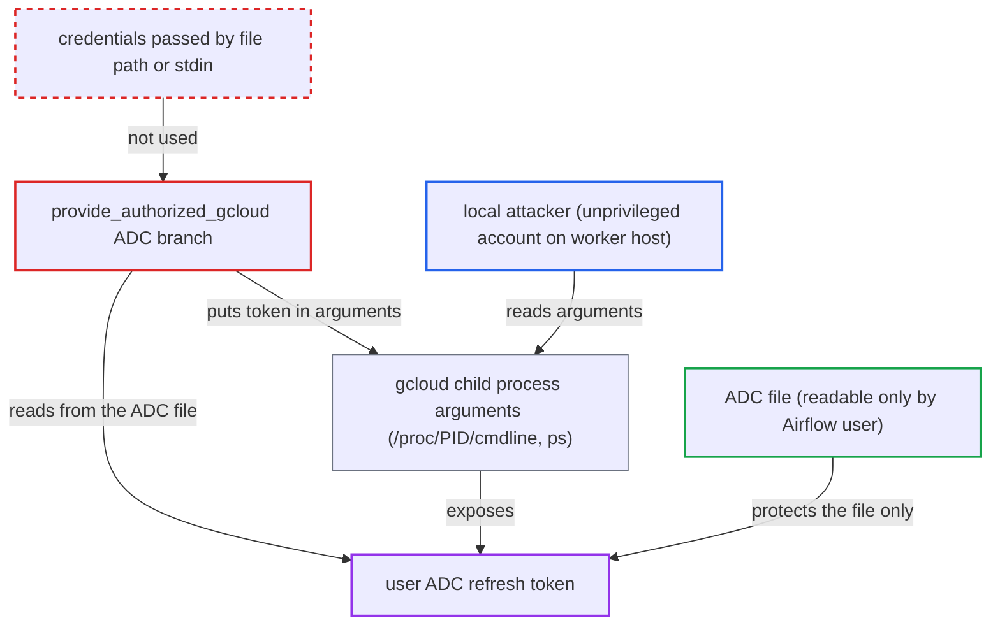

# provide_authorized_gcloud exposes user ADC refresh token in gcloud process arguments

| Field | Value |
|---|---|
| ID | `find_01QuvfkUBAa6WMQ9eEtASCd3` |
| Severity | **High** |
| Status | open |
| CWE | CWE-214 — Secrets in process arguments |
| Created | 2026-10-27T21:59:30.258921Z |
| Claude Security | https://claude.ai/security/findings/find_01QuvfkUBAa6WMQ9eEtASCd3 |

## Description

A local user on a shared Airflow worker host can steal the Airflow user's long-lived Google OAuth refresh token and use it to read, change or delete cloud resources. It needs a host without `hidepid` on `/proc`, where Airflow authenticates with user Application Default Credentials. `provide_authorized_gcloud` passes the token to `gcloud` as command-line arguments.

1. **Airflow task** enters `provide_authorized_gcloud` with no key configured. The connection has no `key_path` or `keyfile_dict`, `GOOGLE_APPLICATION_CREDENTIALS` is unset, and the worker user has user ADC in `application_default_credentials.json`, so the `elif` branch at L750 runs. ([`providers/google/src/airflow/providers/google/common/hooks/base_google.py:729-749`](https://github.com/cx-benchmark/airflow/blob/a462d683469bb9f55646b0515ef84c41e16650fb/providers/google/src/airflow/providers/google/common/hooks/base_google.py#L729-L749))
2. **the hook `provide_authorized_gcloud`** reads the ADC file and starts `gcloud` child processes with the secrets as arguments. It runs `gcloud config set auth/client_secret` with the client secret and `gcloud auth activate-refresh-token` with the client ID and refresh token, so both values sit in the child's argv. ([`providers/google/src/airflow/providers/google/common/hooks/base_google.py:750-770`](https://github.com/cx-benchmark/airflow/blob/a462d683469bb9f55646b0515ef84c41e16650fb/providers/google/src/airflow/providers/google/common/hooks/base_google.py#L750-L770))
3. **Airflow tasks** trigger this branch regularly. It runs on every Compute SSH connect, and also for Dataflow YAML jobs, Dataproc GKE cluster creation and Cloud SQL IAM login. ([`providers/google/src/airflow/providers/google/cloud/hooks/compute_ssh.py:57-58`](https://github.com/cx-benchmark/airflow/blob/a462d683469bb9f55646b0515ef84c41e16650fb/providers/google/src/airflow/providers/google/cloud/hooks/compute_ssh.py#L57-L58))
4. **local attacker** polls `/proc/*/cmdline` or runs `ps` while such a task runs. Any local account can read process arguments unless `/proc` is mounted with `hidepid`, and the `gcloud auth activate-refresh-token` child is short-lived but recurs with each task. ([`airflow-core/docs/security/security_model.rst:1020-1023`](https://github.com/cx-benchmark/airflow/blob/a462d683469bb9f55646b0515ef84c41e16650fb/airflow-core/docs/security/security_model.rst#L1020-L1023))
5. **local attacker** copies the refresh token from the arguments. The token can then mint Google access tokens for the ADC grant's scopes until it is revoked.

## Assessment

The attacker holds an unprivileged local account on the worker host and is not the Airflow user. The host must be shared and `/proc` must not be mounted with `hidepid`. The Airflow user must authenticate to Google Cloud with user ADC (from `gcloud auth application-default login`) rather than a key file or the metadata server. The attacker needs no Airflow role and no victim action. Any of the following tasks exposes the token: Compute SSH connect, Dataflow YAML job, Dataproc GKE cluster creation or Cloud SQL IAM login. Because tasks recur, a cheap poll wins the race.

Impact: The attacker obtains the deployment's long-lived Google refresh token, which backs every keyless Google connection on the host. Nothing on the worker is modified or disrupted. The `client_secret` is normally gcloud's public client secret, so it is sensitive only when ADC was created with a custom OAuth client.

Subsequent-system impact: The refresh token mints access tokens for the ADC grant's scopes until it is revoked. With gcloud's default login that scope is `cloud-platform`. The attacker can then read, modify or delete resources in every Google Cloud project the ADC identity's IAM roles reach, and those roles are the only limit.

## Recommendation

The ADC fallback branch of `provide_authorized_gcloud` (`base_google.py:750-770`) copies `refresh_token` and `client_secret` from the user-private credentials file into `gcloud` command-line arguments. Any local account can read those through the process table, which defeats the file permissions.

Fix criteria: No `gcloud` process started by `provide_authorized_gcloud` carries a refresh token or client secret in its argv. Credentials reach gcloud only through a channel other local users cannot read, such as a file path inside the private temporary `CLOUDSDK_CONFIG` directory or stdin. Reading `/proc/<pid>/cmdline` of every child during a Compute SSH, Dataflow YAML or Cloud SQL IAM task with user ADC configured shows no secrets.

## Evidence

**https://github.com/cx-benchmark/airflow**

- [`providers/google/src/airflow/providers/google/common/hooks/base_google.py:750-770`](https://github.com/cx-benchmark/airflow/blob/a462d683469bb9f55646b0515ef84c41e16650fb/providers/google/src/airflow/providers/google/common/hooks/base_google.py#L750-L770)
- [`providers/google/src/airflow/providers/google/common/hooks/base_google.py:729-749`](https://github.com/cx-benchmark/airflow/blob/a462d683469bb9f55646b0515ef84c41e16650fb/providers/google/src/airflow/providers/google/common/hooks/base_google.py#L729-L749)
- [`providers/google/src/airflow/providers/google/cloud/hooks/compute_ssh.py:57-58`](https://github.com/cx-benchmark/airflow/blob/a462d683469bb9f55646b0515ef84c41e16650fb/providers/google/src/airflow/providers/google/cloud/hooks/compute_ssh.py#L57-L58)
- [`providers/google/src/airflow/providers/google/cloud/hooks/dataflow.py:1026-1032`](https://github.com/cx-benchmark/airflow/blob/a462d683469bb9f55646b0515ef84c41e16650fb/providers/google/src/airflow/providers/google/cloud/hooks/dataflow.py#L1026-L1032)
- [`airflow-core/docs/security/security_model.rst:1020-1023`](https://github.com/cx-benchmark/airflow/blob/a462d683469bb9f55646b0515ef84c41e16650fb/airflow-core/docs/security/security_model.rst#L1020-L1023)

