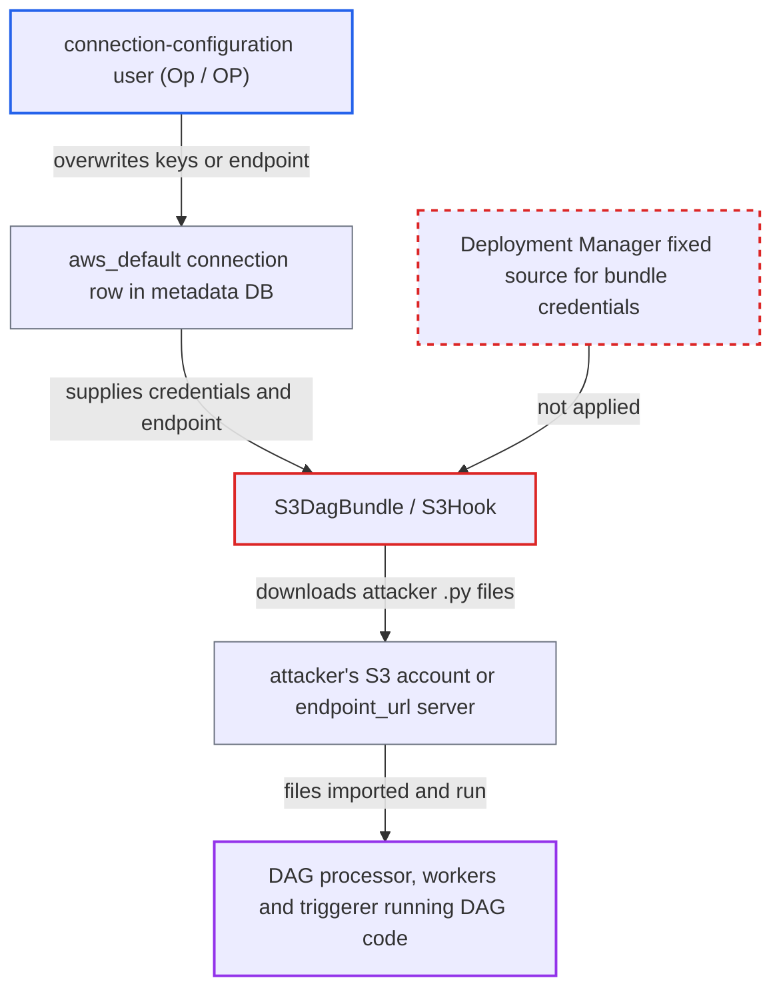

# S3 DAG bundle fetches DAG code with a DB-stored connection editable by connection-config users

| Field | Value |
|---|---|
| ID | `find_01HRSZS4Pw7FTizADTafzahh` |
| Severity | **High** |
| Status | open |
| CWE | CWE-269 — Improper privilege management |
| Created | 2026-10-27T21:48:49.387406Z |
| Claude Security | https://claude.ai/security/findings/find_01HRSZS4Pw7FTizADTafzahh |

## Description

A user who may edit connections but is not a DAG author or admin (FAB `Op`, simple-auth `OP`) can make the deployment run their own Python code in the DAG processor, on every worker and in the triggerer. This works when `S3DagBundle` is used with the default `aws_default` connection. The bundle fetches DAG code through `S3Hook(aws_conn_id=self.aws_conn_id)`, and the connection comes from the metadata DB, which that user can rewrite.

1. **connection-configuration user** creates or overwrites the `aws_default` connection through `POST/PATCH /api/v2/connections`. The row is set to the attacker's own AWS access keys, or to an `extra.endpoint_url` pointing at an S3-compatible server they run, while the bucket and prefix names stay as the Deployment Manager configured them. ([`providers/amazon/src/airflow/providers/amazon/aws/bundles/s3.py:45-56`](https://github.com/cx-benchmark/airflow/blob/a462d683469bb9f55646b0515ef84c41e16650fb/providers/amazon/src/airflow/providers/amazon/aws/bundles/s3.py#L45-L56))
2. **attacker** places `.py` files under the same bucket and prefix names on their own account or server. The files only need to exist under the configured `bucket_name` and prefix on the source the connection now points to.
3. **DAG processor manager** resolves the connection from the metadata DB. It sets `_AIRFLOW_PROCESS_CONTEXT=server` on purpose, so hook lookups go through `MetastoreBackend` and read the edited row. ([`airflow-core/src/airflow/dag_processing/manager.py:390-399`](https://github.com/cx-benchmark/airflow/blob/a462d683469bb9f55646b0515ef84c41e16650fb/airflow-core/src/airflow/dag_processing/manager.py#L390-L399))
4. **`AwsBaseHook.conn_config`** loads the DB row and honours its fields. Credentials, `extra.endpoint_url`, `extra.role_arn`, `extra.region_name` and `extra.verify` are taken from the connection without restriction. ([`providers/amazon/src/airflow/providers/amazon/aws/hooks/base_aws.py:637-659`](https://github.com/cx-benchmark/airflow/blob/a462d683469bb9f55646b0515ef84c41e16650fb/providers/amazon/src/airflow/providers/amazon/aws/hooks/base_aws.py#L637-L659))
5. **`S3DagBundle.refresh()`** syncs the attacker's files into the bundle directory with `delete_stale=True`. This happens on the next bundle refresh or DAG-processor restart, because the hook is cached per bundle instance. The real DAG files are deleted and replaced. ([`providers/amazon/src/airflow/providers/amazon/aws/bundles/s3.py:124-141`](https://github.com/cx-benchmark/airflow/blob/a462d683469bb9f55646b0515ef84c41e16650fb/providers/amazon/src/airflow/providers/amazon/aws/bundles/s3.py#L124-L141))
6. **DAG processor, scheduler and triggerer** import and run the attacker's code. Module-level code runs in the DAG-processor child, the scheduler runs the tasks on every worker, and trigger code runs in the triggerer.

## Assessment

The attacker is an authenticated API or UI user with connection write permission (FAB `Op`, simple-auth `OP`) but without DAG-author or admin rights. The deployment must use `S3DagBundle` with the default `aws_conn_id`, `aws_default`. If the `aws_default` row does not exist, the attacker can create it. If it exists, they can edit it. No user interaction is needed. The attack takes effect at the next bundle refresh or DAG-processor restart. A deployment is not affected if the bundle's connection is stored in a non-DB secrets backend, or if connection-edit rights are removed from every non-admin role.

Impact: The connection-configuration user becomes a DAG author for the whole deployment. Their code runs in the DAG-processor child, which is inside the control-plane trust boundary and can reach DB credentials. It also runs on every worker, where execution tokens can read all connections and variables, and in the triggerer. They can read all secrets and change any DAG or run state. They can also stop the real DAGs from running by replacing them.

## Recommendation

The source of trusted DAG code, meaning the S3 credentials and endpoint, is set by a metadata-DB connection row. A lower-privileged connection-config role can rewrite that row, so a role meant only to maintain credentials for existing DAGs decides which code the control plane imports.

Fix criteria: The AWS identity and endpoint used to fetch DAG bundle code are fixed by the Deployment Manager (configuration, environment or a non-DB secrets backend). They do not change when a user edits or creates a connection through the API/UI. Verify this with `S3DagBundle` configured. An `Op` user creates or edits `aws_default` with foreign credentials or an `endpoint_url`. After refresh and restart, the bundle still syncs from the originally configured source, or refuses to start with an explicit error.

## Evidence

**https://github.com/cx-benchmark/airflow**

- [`providers/amazon/src/airflow/providers/amazon/aws/bundles/s3.py:96-103`](https://github.com/cx-benchmark/airflow/blob/a462d683469bb9f55646b0515ef84c41e16650fb/providers/amazon/src/airflow/providers/amazon/aws/bundles/s3.py#L96-L103)
- [`providers/amazon/src/airflow/providers/amazon/aws/bundles/s3.py:124-141`](https://github.com/cx-benchmark/airflow/blob/a462d683469bb9f55646b0515ef84c41e16650fb/providers/amazon/src/airflow/providers/amazon/aws/bundles/s3.py#L124-L141)
- [`providers/amazon/src/airflow/providers/amazon/aws/bundles/s3.py:45-56`](https://github.com/cx-benchmark/airflow/blob/a462d683469bb9f55646b0515ef84c41e16650fb/providers/amazon/src/airflow/providers/amazon/aws/bundles/s3.py#L45-L56)
- [`airflow-core/src/airflow/dag_processing/manager.py:390-399`](https://github.com/cx-benchmark/airflow/blob/a462d683469bb9f55646b0515ef84c41e16650fb/airflow-core/src/airflow/dag_processing/manager.py#L390-L399)
- [`providers/amazon/src/airflow/providers/amazon/aws/hooks/base_aws.py:637-659`](https://github.com/cx-benchmark/airflow/blob/a462d683469bb9f55646b0515ef84c41e16650fb/providers/amazon/src/airflow/providers/amazon/aws/hooks/base_aws.py#L637-L659)
- [`providers/amazon/src/airflow/providers/amazon/aws/utils/connection_wrapper.py:192-258`](https://github.com/cx-benchmark/airflow/blob/a462d683469bb9f55646b0515ef84c41e16650fb/providers/amazon/src/airflow/providers/amazon/aws/utils/connection_wrapper.py#L192-L258)

