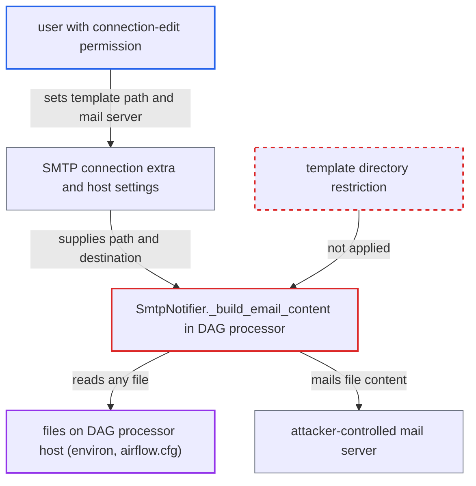

# SMTP connection template-path extras let connection editors read and exfiltrate DAG processor files

| Field | Value |
|---|---|
| ID | `find_01UohoLQt5RrSG3xP7mUTQyu` |
| Severity | **High** |
| Status | open |
| CWE | CWE-73 — Arbitrary file read |
| Created | 2026-10-27T21:45:22.038540Z |
| Claude Security | https://claude.ai/security/findings/find_01UohoLQt5RrSG3xP7mUTQyu |

## Description

A user who can edit connections (the Op role) can make the DAG processor read any file it can access, such as `/proc/self/environ` or `airflow.cfg`, and email it to a server they pick. This needs a DAG-level `SmtpNotifier` callback that uses the default subject and body. The cause is `SmtpNotifier._build_email_content`, which reads a path from the SMTP connection extra with no restriction.

1. **attacker with connection-edit permission** edits the SMTP connection. They set `host` and `port` to a mail server they control, adjust `disable_tls`/`disable_ssl` as needed, and set `extra.html_content_template` to a path such as `/proc/self/environ` or `/opt/airflow/airflow.cfg`. ([`providers/smtp/src/airflow/providers/smtp/hooks/smtp.py:698-703`](https://github.com/cx-benchmark/airflow/blob/a462d683469bb9f55646b0515ef84c41e16650fb/providers/smtp/src/airflow/providers/smtp/hooks/smtp.py#L698-L703))
2. **attacker** triggers a run of a DAG that has a DAG-level `SmtpNotifier` callback. The DAG registers `SmtpNotifier(to=...)` as `on_failure_callback` or `on_success_callback` with `subject=None` and `html_content=None`, and the attacker can trigger a run.
3. **the DAG processor** runs the DAG-level callback. DAG-level callbacks run inside the DAG processor, which holds the DB credentials and the Fernet key, and not on a worker. ([`airflow-core/src/airflow/dag_processing/processor.py:377-381`](https://github.com/cx-benchmark/airflow/blob/a462d683469bb9f55646b0515ef84c41e16650fb/airflow-core/src/airflow/dag_processing/processor.py#L377-L381))
4. **the notifier `SmtpNotifier._build_email_content`** takes the template path from the connection extra. Because `subject` or `html_content` is None, it uses the path from the connection extra, which `SmtpHook` exposes as `subject_template` / `html_content_template`. ([`providers/smtp/src/airflow/providers/smtp/notifications/smtp.py:122-152`](https://github.com/cx-benchmark/airflow/blob/a462d683469bb9f55646b0515ef84c41e16650fb/providers/smtp/src/airflow/providers/smtp/notifications/smtp.py#L122-L152))
5. **the helper `_read_template`** reads the file at that path. It calls `Path(template_path).read_text()` with no base directory, extension check or allow-list. ([`providers/smtp/src/airflow/providers/smtp/notifications/smtp.py:114-115`](https://github.com/cx-benchmark/airflow/blob/a462d683469bb9f55646b0515ef84c41e16650fb/providers/smtp/src/airflow/providers/smtp/notifications/smtp.py#L114-L115))
6. **`SmtpHook`** sends the file content as the mail body. The server, port and TLS settings come from the same connection, so the mail goes to the attacker's server. ([`providers/smtp/src/airflow/providers/smtp/hooks/smtp.py:219-237`](https://github.com/cx-benchmark/airflow/blob/a462d683469bb9f55646b0515ef84c41e16650fb/providers/smtp/src/airflow/providers/smtp/hooks/smtp.py#L219-L237))

## Assessment

The attacker is an authenticated API or UI user with connection-edit permission (the Op role). They need no DAG-author or deployment access. A DAG must register `SmtpNotifier` as a DAG-level `on_failure_callback` or `on_success_callback` and rely on the default templates (`subject=None`, `html_content=None`). The connection is by default `smtp_default`. This is a deployment condition. The attacker can trigger a run of that DAG so the callback fires. Task-level uses (`EmailOperator`, task callbacks) run on workers, where connection editors already have execution rights under the security model. The DAG processor case is the one that crosses the boundary.

Impact: The attacker can read any file the DAG processor can read and receive it by email. This includes the metadata DB connection string, the Fernet key and the JWT secret. With these they can decrypt stored connections and variables and write arbitrary metadata-DB state. The report says the code itself only reads and sends files, and the integrity and availability loss follows from the disclosed credentials.

## Recommendation

A file path taken from a connection extra that anyone with connection-edit permission can change is read without restriction. The content is then sent to a server chosen by the same connection, in a component (the DAG processor) whose files that role is not meant to read.

Fix criteria: Template paths from a connection are confined to a directory the deployment controls, or only paths from Airflow configuration are accepted and not paths from connection extras. Symlink and `..` escapes are rejected. Setting `html_content_template` to `/proc/self/environ` or `/etc/passwd` on the SMTP connection makes the notifier fail instead of mailing the file. This is checked in both the worker and the DAG-processor callback paths.

## Evidence

**https://github.com/cx-benchmark/airflow**

- [`providers/smtp/src/airflow/providers/smtp/notifications/smtp.py:122-152`](https://github.com/cx-benchmark/airflow/blob/a462d683469bb9f55646b0515ef84c41e16650fb/providers/smtp/src/airflow/providers/smtp/notifications/smtp.py#L122-L152)
- [`providers/smtp/src/airflow/providers/smtp/notifications/smtp.py:114-115`](https://github.com/cx-benchmark/airflow/blob/a462d683469bb9f55646b0515ef84c41e16650fb/providers/smtp/src/airflow/providers/smtp/notifications/smtp.py#L114-L115)
- [`providers/smtp/src/airflow/providers/smtp/hooks/smtp.py:698-703`](https://github.com/cx-benchmark/airflow/blob/a462d683469bb9f55646b0515ef84c41e16650fb/providers/smtp/src/airflow/providers/smtp/hooks/smtp.py#L698-L703)
- [`providers/smtp/src/airflow/providers/smtp/hooks/smtp.py:219-237`](https://github.com/cx-benchmark/airflow/blob/a462d683469bb9f55646b0515ef84c41e16650fb/providers/smtp/src/airflow/providers/smtp/hooks/smtp.py#L219-L237)
- [`airflow-core/src/airflow/dag_processing/processor.py:377-381`](https://github.com/cx-benchmark/airflow/blob/a462d683469bb9f55646b0515ef84c41e16650fb/airflow-core/src/airflow/dag_processing/processor.py#L377-L381)

