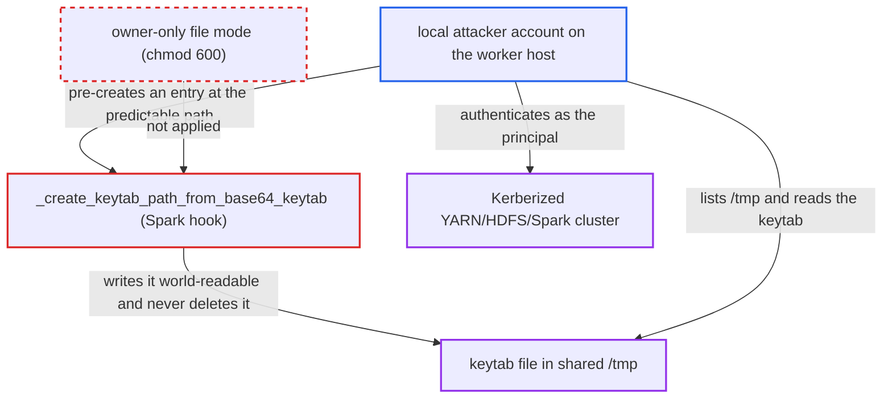

# Spark submit hook writes the connection's Kerberos keytab world-readable into shared /tmp

| Field | Value |
|---|---|
| ID | `find_012S3r5iDsKUGeYBJdrcNAGh` |
| Severity | **High** |
| Status | open |
| CWE | CWE-378 — Insecure temporary file |
| Created | 2026-10-27T21:43:50.703597Z |
| Claude Security | https://claude.ai/security/findings/find_012S3r5iDsKUGeYBJdrcNAGh |

## Description

Any other local account on a shared Spark worker host can read the Kerberos keytab from a Spark connection and authenticate as its principal. It needs no Airflow role, only a Spark task running on a connection with a `keytab` extra. `_create_keytab_path_from_base64_keytab` writes the keytab into the shared temp directory with a plain `open()` and never sets the mode or deletes the file.

1. **the Spark task** builds the hook from a connection whose extra holds `keytab`. `__init__` calls `_resolve_connection`, which calls the keytab method whenever that extra is present, so every such task writes the file. ([`providers/apache/spark/src/airflow/providers/apache/spark/hooks/spark_submit.py:530-535`](https://github.com/cx-benchmark/airflow/blob/a462d683469bb9f55646b0515ef84c41e16650fb/providers/apache/spark/src/airflow/providers/apache/spark/hooks/spark_submit.py#L530-L535))
2. **the hook method `_create_keytab_path_from_base64_keytab`** picks a path in the shared temp directory. The path is `airflow_keytab-` followed by the principal (or a uuid when no principal is set) under `tempfile.gettempdir()`, normally `/tmp`, so it is predictable and listable. ([`providers/apache/spark/src/airflow/providers/apache/spark/hooks/spark_submit.py:560-566`](https://github.com/cx-benchmark/airflow/blob/a462d683469bb9f55646b0515ef84c41e16650fb/providers/apache/spark/src/airflow/providers/apache/spark/hooks/spark_submit.py#L560-L566))
3. **the hook method `_create_keytab_path_from_base64_keytab`** writes the decoded keytab with a plain `open(staging_path, "wb")` and moves it into place with `shutil.move`. No mode is set, so the file gets `0o666 & ~umask`, which is `0644` under the shipped systemd unit's default umask and `0664` under the Docker image's `umask 0002`. ([`providers/apache/spark/src/airflow/providers/apache/spark/hooks/spark_submit.py:583-590`](https://github.com/cx-benchmark/airflow/blob/a462d683469bb9f55646b0515ef84c41e16650fb/providers/apache/spark/src/airflow/providers/apache/spark/hooks/spark_submit.py#L583-L590))
4. **the worker service** runs in the foreground without a restrictive umask. The shipped unit has no `UMask=`, and only `--daemon` mode applies `daemon_umask` `0o077`. The keytab is also never removed, so it stays readable after the task ends. ([`scripts/systemd/airflow-worker.service:24-29`](https://github.com/cx-benchmark/airflow/blob/a462d683469bb9f55646b0515ef84c41e16650fb/scripts/systemd/airflow-worker.service#L24-L29))
5. **a local attacker account** lists `/tmp`, reads the keytab and runs `kinit -kt` as the principal. The keytab is the full credential, so no further secret is needed to authenticate to the Kerberized cluster.

## Assessment

The attacker is an unprivileged local account with no Airflow role on a worker host shared with others, such as a bare-metal or VM Celery worker or a Hadoop edge node. A Spark task must run on a connection whose extra holds `keytab`. No victim action is needed beyond the scheduled run. A second route is denial of service. The attacker pre-creates a directory or an unreadable file at the predictable `airflow_keytab-<principal>` path. The hook opens that entry at line 576, outside the `try`, so every task using that connection fails on that host. If the planted file is world-writable, `rename` fails with `EPERM` in sticky `/tmp` and `shutil.move` falls back to `copy2`. That writes the keytab into the attacker's file, but only where `fs.protected_regular` is `0`. Mainstream distribution defaults (`protected_regular` and `protected_symlinks` enabled) block this and the symlink variant. Containers with a private `/tmp`, and workers with a private `TMPDIR` set by the operator, are not exposed to other accounts.

Impact: The attacker gets the complete Kerberos keytab stored in the Spark connection, without any Airflow privilege. A directory or unreadable file planted at the predictable path makes every Spark task using that principal fail on that host until it is removed. Airflow's own data and behaviour are not modified.

Subsequent-system impact: With the keytab, the attacker authenticates as the connection's Kerberos principal to the Kerberized YARN/HDFS/Spark cluster, for as long as the key stays valid. They can submit Spark jobs, kill that principal's applications, and read or write any data the principal can. The report does not say how far the principal's rights reach, because that depends on the deployment.

## Recommendation

(1) The keytab, a connection secret, is written into the shared system temp directory with a plain `open()`. Its mode is left to the process umask, so it is world-readable under the shipped defaults. It is never deleted, so other local accounts can read it during and after the task.

Fix criteria: The keytab file is readable only by the worker's own user whatever the umask, with owner-only mode from creation and no window of broader access. It sits in a directory other local accounts cannot list or write, and it is removed when the hook no longer needs it. To verify, run a Spark task with a `keytab` extra under umask `022` on a host with a second account. That account must not be able to find or read the keytab during or after the task.

(2) The final path `airflow_keytab-<principal>` in `/tmp` is predictable. The hook reads whatever entry already exists there, and via the `shutil.move` copy fallback it can write to it. Another user can pre-create that entry to break the task or, where kernel protections are off, receive the keytab.

Fix criteria: The hook never reads, writes or follows an entry at a path another local user can create. It uses an exclusively created, unpredictable file or a private directory, or checks ownership and type before use and refuses otherwise. To verify, have another user plant a directory, an unreadable file and a world-writable file at the old path. None of them may receive the keytab or make the task fail.

## Evidence

**https://github.com/cx-benchmark/airflow**

- [`providers/apache/spark/src/airflow/providers/apache/spark/hooks/spark_submit.py:583-590`](https://github.com/cx-benchmark/airflow/blob/a462d683469bb9f55646b0515ef84c41e16650fb/providers/apache/spark/src/airflow/providers/apache/spark/hooks/spark_submit.py#L583-L590)
- [`providers/apache/spark/src/airflow/providers/apache/spark/hooks/spark_submit.py:560-566`](https://github.com/cx-benchmark/airflow/blob/a462d683469bb9f55646b0515ef84c41e16650fb/providers/apache/spark/src/airflow/providers/apache/spark/hooks/spark_submit.py#L560-L566)
- [`providers/apache/spark/src/airflow/providers/apache/spark/hooks/spark_submit.py:575-580`](https://github.com/cx-benchmark/airflow/blob/a462d683469bb9f55646b0515ef84c41e16650fb/providers/apache/spark/src/airflow/providers/apache/spark/hooks/spark_submit.py#L575-L580)
- [`providers/apache/spark/src/airflow/providers/apache/spark/hooks/spark_submit.py:530-535`](https://github.com/cx-benchmark/airflow/blob/a462d683469bb9f55646b0515ef84c41e16650fb/providers/apache/spark/src/airflow/providers/apache/spark/hooks/spark_submit.py#L530-L535)
- [`scripts/systemd/airflow-worker.service:24-29`](https://github.com/cx-benchmark/airflow/blob/a462d683469bb9f55646b0515ef84c41e16650fb/scripts/systemd/airflow-worker.service#L24-L29)
- [`airflow-core/docs/security/kerberos.rst:94-102`](https://github.com/cx-benchmark/airflow/blob/a462d683469bb9f55646b0515ef84c41e16650fb/airflow-core/docs/security/kerberos.rst#L94-L102)
- [`providers/apache/spark/provider.yaml:212-219`](https://github.com/cx-benchmark/airflow/blob/a462d683469bb9f55646b0515ef84c41e16650fb/providers/apache/spark/provider.yaml#L212-L219)
- [`providers/google/src/airflow/providers/google/cloud/hooks/cloud_sql.py:694-697`](https://github.com/cx-benchmark/airflow/blob/a462d683469bb9f55646b0515ef84c41e16650fb/providers/google/src/airflow/providers/google/cloud/hooks/cloud_sql.py#L694-L697)

