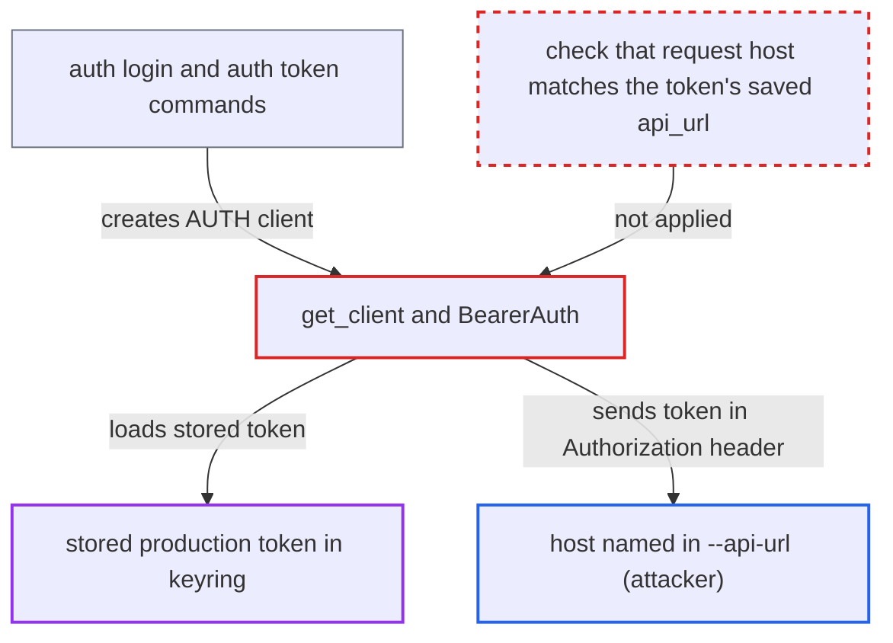

# Stored API token sent as Bearer header to any --api-url during auth login/token

| Field | Value |
|---|---|
| ID | `find_01UUh8zt4MqbcoNKTvzXYKNN` |
| Severity | **High** |
| Status | open |
| CWE | CWE-522 — Credential exposure |
| Created | 2026-10-27T21:07:40.294728Z |
| Claude Security | https://claude.ai/security/findings/find_01UUh8zt4MqbcoNKTvzXYKNN |

## Description

A person who runs a server the victim logs into can steal the victim's stored airflowctl API token, which is valid for the production Airflow API. The victim has to run `airflowctl auth login` or `airflowctl auth token` with `--api-url` pointing at that server, and have a token already stored. The cause is that the login-only client built by `get_client` still carries the stored token, and `BearerAuth` sends it to whatever host `--api-url` names.

1. **the victim** runs `airflowctl auth login --username/--password` or `airflowctl auth token` with `--api-url` set to a host the attacker controls. The victim has already logged in to production, so a token is stored in the keyring under `api_token_production`, and no `--env` is given. ([`airflow-ctl/src/airflowctl/ctl/commands/auth_command.py:36-82`](https://github.com/cx-benchmark/airflow/blob/a462d683469bb9f55646b0515ef84c41e16650fb/airflow-ctl/src/airflowctl/ctl/commands/auth_command.py#L36-L82))
2. **`get_client`** builds the login client with the stored token. `ClientKind.AUTH` is handled like `ClientKind.CLI`, so the token saved for the environment is loaded and passed as `token=resolved_token`. Only `NO_AUTH` skips this. ([`airflow-ctl/src/airflowctl/api/client.py:530-543`](https://github.com/cx-benchmark/airflow/blob/a462d683469bb9f55646b0515ef84c41e16650fb/airflow-ctl/src/airflowctl/api/client.py#L530-L543))
3. **`Client.__init__`** installs `BearerAuth(token)` on the client. This happens for every kind except `NO_AUTH`, so it includes the login-only `AUTH` client. ([`airflow-ctl/src/airflowctl/api/client.py:366-378`](https://github.com/cx-benchmark/airflow/blob/a462d683469bb9f55646b0515ef84c41e16650fb/airflow-ctl/src/airflowctl/api/client.py#L366-L378))
4. **the command `get_token` or `login`** points the client at `args.api_url` with `refresh_base_url` and posts the username and password to `/auth/token/cli`. The `auth token` command has no `--env` option, so it always uses the `production` token. ([`airflow-ctl/src/airflowctl/ctl/commands/auth_command.py:107-118`](https://github.com/cx-benchmark/airflow/blob/a462d683469bb9f55646b0515ef84c41e16650fb/airflow-ctl/src/airflowctl/ctl/commands/auth_command.py#L107-L118))
5. **`BearerAuth.auth_flow`** adds `Authorization: Bearer <token>` to the login request. It does this for every request when a token is present and never checks that the destination is the server that issued the token. The login endpoint does not need the header. ([`airflow-ctl/src/airflowctl/api/client.py:311-318`](https://github.com/cx-benchmark/airflow/blob/a462d683469bb9f55646b0515ef84c41e16650fb/airflow-ctl/src/airflowctl/api/client.py#L311-L318))
6. **the attacker's server** receives the production token in the request header. The attacker can use the token against the production API until it expires. The default lifetime is 3600 s.

## Assessment

The attacker controls a host that the victim will log into with airflowctl, or a listener on the victim's `localhost:8080`, which is the default `--api-url` and uses cleartext HTTP. Examples are a staging or dev Airflow run by a less-trusted party, or a phished URL. The victim must have logged in to production before, so a token sits in the keyring under `api_token_production`. The victim then runs `airflowctl auth login --api-url <attacker host> --username u --password p` without `--env`, or `airflowctl auth token --api-url <attacker host>`. The `auth token` command has no `--env` option, so it always attaches the `production` token. Running `auth token` against a local or dev server while a production token is stored also leaks it, to whatever listens on port 8080. TLS is verified and redirects are not followed, so this is not a man-in-the-middle or redirect leak. The recipient is the operator of, or a listener at, the `--api-url` host.

Impact: The attacker obtains the victim's stored API bearer token for the selected environment, `production` by default. No modification of the client and no loss of its availability results.

Subsequent-system impact: The leaked token is a valid JWT for the production Airflow API server and carries the victim's full role. Until it expires (default 3600 s), the attacker can read connections and variables if the victim's role permits. The attacker can also create, modify and delete variables, connections, pools and DAG runs, trigger DAGs, and pause DAGs. Availability impact is limited to what the API allows, such as pausing DAGs or deleting runs.

## Recommendation

(1) `get_client` and `Client.__init__` attach the stored bearer token to a client whose only job is to call the login endpoint, which needs no token. `BearerAuth` then sends it whatever the destination.

Fix criteria: A client created for `ClientKind.AUTH` carries no stored or environment-provided token, and requests to `/auth/token/cli` have no `Authorization` header. A test captures the request made by `auth login --username/--password` and by `auth token` while a token is stored in the keyring, and again while `AIRFLOW_CLI_TOKEN` is set. In both cases it asserts the header is absent.

(2) Tokens are keyed only by environment name, and `refresh_base_url` lets a request go to a URL other than the one recorded in `{env}.json`. A token obtained from one server can therefore be presented to another. The `auth token` command also has no `--env` option.

Fix criteria: Before a bearer token is sent, the client confirms the request host matches the `api_url` the token was saved with, or it refuses or warns when `--api-url` differs from the stored URL for the environment. The `auth token` command either accepts `--env` or never loads stored credentials. A test stores a token for `production` pointing at host A and runs `auth login --api-url https://B ...`. It confirms that no token for A is transmitted to B.

## Evidence

**https://github.com/cx-benchmark/airflow**

- [`airflow-ctl/src/airflowctl/api/client.py:530-543`](https://github.com/cx-benchmark/airflow/blob/a462d683469bb9f55646b0515ef84c41e16650fb/airflow-ctl/src/airflowctl/api/client.py#L530-L543)
- [`airflow-ctl/src/airflowctl/api/client.py:366-378`](https://github.com/cx-benchmark/airflow/blob/a462d683469bb9f55646b0515ef84c41e16650fb/airflow-ctl/src/airflowctl/api/client.py#L366-L378)
- [`airflow-ctl/src/airflowctl/api/client.py:311-318`](https://github.com/cx-benchmark/airflow/blob/a462d683469bb9f55646b0515ef84c41e16650fb/airflow-ctl/src/airflowctl/api/client.py#L311-L318)
- [`airflow-ctl/src/airflowctl/api/client.py:251-284`](https://github.com/cx-benchmark/airflow/blob/a462d683469bb9f55646b0515ef84c41e16650fb/airflow-ctl/src/airflowctl/api/client.py#L251-L284)
- [`airflow-ctl/src/airflowctl/ctl/commands/auth_command.py:107-118`](https://github.com/cx-benchmark/airflow/blob/a462d683469bb9f55646b0515ef84c41e16650fb/airflow-ctl/src/airflowctl/ctl/commands/auth_command.py#L107-L118)
- [`airflow-ctl/src/airflowctl/ctl/commands/auth_command.py:36-82`](https://github.com/cx-benchmark/airflow/blob/a462d683469bb9f55646b0515ef84c41e16650fb/airflow-ctl/src/airflowctl/ctl/commands/auth_command.py#L36-L82)
- [`airflow-ctl/src/airflowctl/api/operations.py:278-282`](https://github.com/cx-benchmark/airflow/blob/a462d683469bb9f55646b0515ef84c41e16650fb/airflow-ctl/src/airflowctl/api/operations.py#L278-L282)
- [`airflow-ctl/src/airflowctl/ctl/cli_config.py:266-272`](https://github.com/cx-benchmark/airflow/blob/a462d683469bb9f55646b0515ef84c41e16650fb/airflow-ctl/src/airflowctl/ctl/cli_config.py#L266-L272)
- [`airflow-ctl/src/airflowctl/ctl/cli_config.py:1157-1169`](https://github.com/cx-benchmark/airflow/blob/a462d683469bb9f55646b0515ef84c41e16650fb/airflow-ctl/src/airflowctl/ctl/cli_config.py#L1157-L1169)

