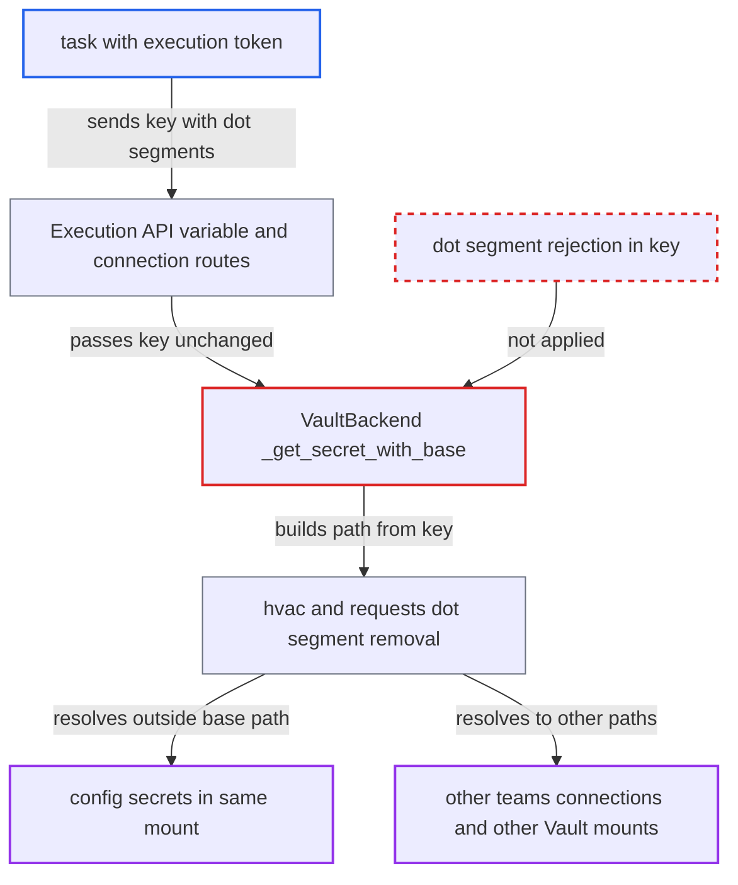

# Vault secrets backend: dot-segment traversal in secret key escapes variables/connections path

| Field | Value |
|---|---|
| ID | `find_01AhGo8WcKMXQJnMgDiCpB5f` |
| Severity | **High** |
| Status | open |
| CWE | CWE-23 — Path traversal |
| Created | 2026-10-27T21:43:03.847508Z |
| Claude Security | https://claude.ai/security/findings/find_01AhGo8WcKMXQJnMgDiCpB5f |

## Description

A Dag author or compromised task holding any Execution API token can read Vault secrets outside the variables and connections paths. These include Airflow's own `config/` secrets such as `sql_alchemy_conn`, and in multi-team mode another team's connections. It only works when the deployment uses `VaultBackend`. The backend joins the caller's key into the Vault path without rejecting `..` segments, and `_names_a_team_namespace` does not stop this.

1. **task with an execution token** requests a variable or connection whose key contains dot segments. For example the variable key `../config/sql_alchemy_conn`, or `Connection.get('../B/db')` from the SDK, whose `quote(conn_id, safe='')` keeps `..` intact; for variables the dots are percent-encoded or the request is sent directly. ([`airflow-core/src/airflow/api_fastapi/execution_api/routes/variables.py:111-135`](https://github.com/cx-benchmark/airflow/blob/a462d683469bb9f55646b0515ef84c41e16650fb/airflow-core/src/airflow/api_fastapi/execution_api/routes/variables.py#L111-L135))
2. **Execution API route** accepts the key and passes it unchanged to `Variable.get`. The route is declared as `/{variable_key:path}`, `has_variable_access` always returns True, and nothing normalises the key, so it reaches the secrets backend verbatim. ([`airflow-core/src/airflow/api_fastapi/execution_api/routes/variables.py:111-135`](https://github.com/cx-benchmark/airflow/blob/a462d683469bb9f55646b0515ef84c41e16650fb/airflow-core/src/airflow/api_fastapi/execution_api/routes/variables.py#L111-L135))
3. **`_get_secret_with_base`** builds the Vault path by joining the base path and the key. It produces `variables/../config/sql_alchemy_conn` and does not reject `.` or `..` segments. ([`providers/hashicorp/src/airflow/providers/hashicorp/secrets/vault.py:229-243`](https://github.com/cx-benchmark/airflow/blob/a462d683469bb9f55646b0515ef84c41e16650fb/providers/hashicorp/src/airflow/providers/hashicorp/secrets/vault.py#L229-L243))
4. **`_names_a_team_namespace`** lets the key through. It rejects keys containing `/` only in multi-team mode for a caller with no team, so it returns False in the default single-team deployment and for every caller that has a team. ([`providers/hashicorp/src/airflow/providers/hashicorp/secrets/vault.py:245-272`](https://github.com/cx-benchmark/airflow/blob/a462d683469bb9f55646b0515ef84c41e16650fb/providers/hashicorp/src/airflow/providers/hashicorp/secrets/vault.py#L245-L272))
5. **hvac and requests** form the HTTP path and remove the `..` segments before sending. hvac builds `/v1/secret/data/variables/../config/sql_alchemy_conn` and requests/urllib3 resolve it to `/v1/secret/data/config/sql_alchemy_conn`, outside `variables_path`. ([`providers/hashicorp/src/airflow/providers/hashicorp/_internal_client/vault_client.py:503-548`](https://github.com/cx-benchmark/airflow/blob/a462d683469bb9f55646b0515ef84c41e16650fb/providers/hashicorp/src/airflow/providers/hashicorp/_internal_client/vault_client.py#L503-L548))
6. **`get_variable`** returns the secret's `value` to the task. It returns `response["value"]`, the same shape `get_config` reads, so a configuration secret comes back as if it were a variable. ([`providers/hashicorp/src/airflow/providers/hashicorp/secrets/vault.py:328-365`](https://github.com/cx-benchmark/airflow/blob/a462d683469bb9f55646b0515ef84c41e16650fb/providers/hashicorp/src/airflow/providers/hashicorp/secrets/vault.py#L328-L365))

## Assessment

The attacker is a Dag author or a compromised task that holds any execution token, which the threat model lists as lateral use of a task's Execution API token. The deployment must use `VaultBackend`. In a default single-team deployment the task reads `config/` secrets in the same mount, such as `sql_alchemy_conn`, `fernet_key` and `jwt_secret`. In multi-team mode (marked experimental) a team-A task can request `connections/A/../B/db` and read team B's connection. A key such as `../../../othermount/data/x` reaches another KV mount. The report assumes hvac quotes the path with the default `safe='/'`; it read requests 2.34.2 and urllib3 2.8.0 from the installed sources.

Impact: The task can read any Vault KV entry that the API server's Vault token can read, bypassing the variables and connections namespaces. With the metadata database connection string or the JWT signing secret, the attacker gets full read and write access to the metadata database and can mint API tokens. The only limit is the Vault policy attached to the backend's token.

Subsequent-system impact: The traversal also leaves Airflow's KV namespaces and reaches any other mount or path in the HashiCorp Vault server that the backend token's policy permits. The code sets no limit of its own. Only reads are possible, because lookups are GET requests.

## Recommendation

(1) `_get_secret_with_base` and `_get_secret` concatenate a caller-controlled key into the Vault HTTP path without rejecting dot segments. The resolved path can therefore leave `connections_path` or `variables_path` and the team sub-path.

Fix criteria: A lookup can only address a path strictly beneath the configured base path, and the team path when one is used. Keys with `.` or `..` segments, after splitting on `/` and after percent-decoding, are refused and return None for every caller, with or without a team, in and out of multi-team mode. Variable `../config/sql_alchemy_conn`, connection `../B/db` and `..%2Fconfig%2Fx` all return not-found. None of them produces a Vault request outside the base path.

(2) `_names_a_team_namespace` is the only guard, and its claim that a team caller never reaches outside the team path rests on string concatenation alone. It applies only in multi-team mode with no team, so the default deployment is unguarded.

Fix criteria: The guard holds for all callers regardless of the multi-team setting and `team_name`, and its documentation matches the property it enforces. Unit tests cover single-team and multi-team callers. They show that no composed secret path resolves, after RFC 3986 dot-segment removal, to a path outside the intended base.

## Evidence

**https://github.com/cx-benchmark/airflow**

- [`providers/hashicorp/src/airflow/providers/hashicorp/secrets/vault.py:229-243`](https://github.com/cx-benchmark/airflow/blob/a462d683469bb9f55646b0515ef84c41e16650fb/providers/hashicorp/src/airflow/providers/hashicorp/secrets/vault.py#L229-L243)
- [`providers/hashicorp/src/airflow/providers/hashicorp/secrets/vault.py:245-272`](https://github.com/cx-benchmark/airflow/blob/a462d683469bb9f55646b0515ef84c41e16650fb/providers/hashicorp/src/airflow/providers/hashicorp/secrets/vault.py#L245-L272)
- [`providers/hashicorp/src/airflow/providers/hashicorp/secrets/vault.py:274-297`](https://github.com/cx-benchmark/airflow/blob/a462d683469bb9f55646b0515ef84c41e16650fb/providers/hashicorp/src/airflow/providers/hashicorp/secrets/vault.py#L274-L297)
- [`providers/hashicorp/src/airflow/providers/hashicorp/secrets/vault.py:328-365`](https://github.com/cx-benchmark/airflow/blob/a462d683469bb9f55646b0515ef84c41e16650fb/providers/hashicorp/src/airflow/providers/hashicorp/secrets/vault.py#L328-L365)
- [`providers/hashicorp/src/airflow/providers/hashicorp/_internal_client/vault_client.py:503-548`](https://github.com/cx-benchmark/airflow/blob/a462d683469bb9f55646b0515ef84c41e16650fb/providers/hashicorp/src/airflow/providers/hashicorp/_internal_client/vault_client.py#L503-L548)
- [`airflow-core/src/airflow/api_fastapi/execution_api/routes/variables.py:111-135`](https://github.com/cx-benchmark/airflow/blob/a462d683469bb9f55646b0515ef84c41e16650fb/airflow-core/src/airflow/api_fastapi/execution_api/routes/variables.py#L111-L135)
- [`airflow-core/src/airflow/api_fastapi/execution_api/routes/connections.py:65-88`](https://github.com/cx-benchmark/airflow/blob/a462d683469bb9f55646b0515ef84c41e16650fb/airflow-core/src/airflow/api_fastapi/execution_api/routes/connections.py#L65-L88)
- [`task-sdk/src/airflow/sdk/api/client.py:515-520`](https://github.com/cx-benchmark/airflow/blob/a462d683469bb9f55646b0515ef84c41e16650fb/task-sdk/src/airflow/sdk/api/client.py#L515-L520)
- [`providers/hashicorp/docs/secrets-backends/hashicorp-vault.rst:192-222`](https://github.com/cx-benchmark/airflow/blob/a462d683469bb9f55646b0515ef84c41e16650fb/providers/hashicorp/docs/secrets-backends/hashicorp-vault.rst#L192-L222)

