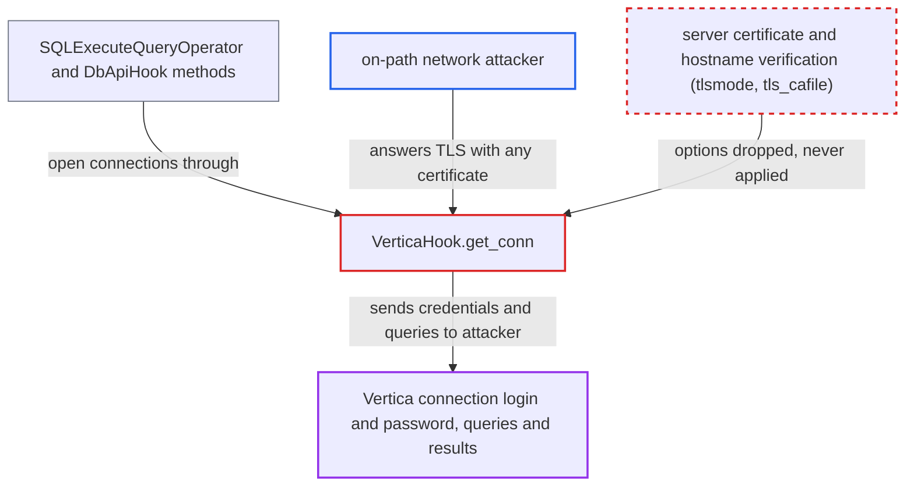

# Vertica hook offers only unverified TLS; certificate-verifying options are dropped

| Field | Value |
|---|---|
| ID | `find_016mSCLLKhAGmV5e4hFS1Cnz` |
| Severity | **High** |
| Status | open |
| CWE | CWE-295 — Improper certificate validation |
| Created | 2026-10-27T21:40:09.611786Z |
| Claude Security | https://claude.ai/security/findings/find_016mSCLLKhAGmV5e4hFS1Cnz |

## Description

An attacker on the network path between an Airflow worker and the Vertica host can capture the Vertica connection's login and password. They can also read and change every statement and result. No Airflow account is needed, but the connection must have TLS on (`"ssl": true`). `VerticaHook.get_conn` forwards only `ssl` to the driver and drops the options that verify the server, so the server certificate is never checked.

1. **the operator** sets TLS on the Vertica connection. The connection extra is `"ssl": true`, or a verifying `tlsmode` as the provider docs describe, to protect the credentials. ([`providers/vertica/docs/operators.rst:53-55`](https://github.com/cx-benchmark/airflow/blob/a462d683469bb9f55646b0515ef84c41e16650fb/providers/vertica/docs/operators.rst#L53-L55))
2. **the hook `VerticaHook.get_conn`** copies only `ssl` from the extras into the connect arguments. `ssl` is the only TLS extra on the list, and it is copied as-is. `tlsmode`, `tls_cafile`, `tls_certfile` and `tls_keyfile` are dropped, and JSON cannot express an `ssl.SSLContext`. ([`providers/vertica/src/airflow/providers/vertica/hooks/vertica.py:93-110`](https://github.com/cx-benchmark/airflow/blob/a462d683469bb9f55646b0515ef84c41e16650fb/providers/vertica/src/airflow/providers/vertica/hooks/vertica.py#L93-L110))
3. **the hook `VerticaHook.get_conn`** calls `connect(**conn_config)` with the scalar `ssl` value. The report assumes vertica-python 1.4.0 treats a truthy non-`SSLContext` `ssl` as TLS with no check of the certificate or hostname. ([`providers/vertica/src/airflow/providers/vertica/hooks/vertica.py:137-138`](https://github.com/cx-benchmark/airflow/blob/a462d683469bb9f55646b0515ef84c41e16650fb/providers/vertica/src/airflow/providers/vertica/hooks/vertica.py#L137-L138))
4. **a task** runs a Vertica operation through `get_conn`. `SQLExecuteQueryOperator` and the `DbApiHook` methods all reach `get_conn`, so each one takes the unverified path. ([`providers/common/sql/src/airflow/providers/common/sql/hooks/sql.py:968-970`](https://github.com/cx-benchmark/airflow/blob/a462d683469bb9f55646b0515ef84c41e16650fb/providers/common/sql/src/airflow/providers/common/sql/hooks/sql.py#L968-L970))
5. **the network attacker** completes the TLS handshake with any certificate. The driver accepts the certificate without checking it.
6. **the network attacker** asks for cleartext password authentication, or relays to the real server. The connection's `user` and `password` are then sent over the attacker-controlled channel. The attacker can read and change statements and results. ([`providers/vertica/src/airflow/providers/vertica/hooks/vertica.py:137-138`](https://github.com/cx-benchmark/airflow/blob/a462d683469bb9f55646b0515ef84c41e16650fb/providers/vertica/src/airflow/providers/vertica/hooks/vertica.py#L137-L138))

## Assessment

The attacker is an on-path network attacker between an Airflow worker and the Vertica host. They need no Airflow privileges and no user interaction. The one precondition, outside their control, is that the Vertica connection has TLS on (`"ssl": true`). When a task runs a Vertica operation, `get_conn` sends the TLS request. This covers `SQLExecuteQueryOperator`, the `DbApiHook` methods `run`, `get_records`, `get_df` and `insert_rows`, and the Vertica-to-MySQL/Hive transfers. No connection setting makes the hook verify the server. The finding assumes vertica-python 1.4.0 (locked in `uv.lock`, floor `>=1.3.0`) behaves as described, and the library is not in the checkout.

Impact: The attacker obtains the connection's login and password, which are an Airflow Connection secret. They can also read all query data in transit. They can feed forged results into the task, and from there into XCom and downstream tasks. Airflow's availability is not affected.

Subsequent-system impact: With the captured credentials the attacker can log in to the Vertica database directly. They can also change the statements the task runs there. What they can reach is bounded by that database account's grants, which the code does not set.

## Recommendation

`VerticaHook.get_conn` maps TLS only to vertica-python's unverified scalar `ssl` mode and drops the driver's verifying options. A TLS-enabled Vertica connection therefore never authenticates the server.

Fix criteria: A Vertica connection with TLS enabled verifies the server certificate chain (system trust store or a configured CA file) and the hostname, unless verification is explicitly turned off in the extra. Test: point a connection with `"ssl": true` (or a verifying `tlsmode`) at an endpoint with an untrusted or mismatched certificate, and `get_conn` must fail. Any TLS extra the docs list must take effect and not be ignored.

## Evidence

**https://github.com/cx-benchmark/airflow**

- [`providers/vertica/src/airflow/providers/vertica/hooks/vertica.py:93-110`](https://github.com/cx-benchmark/airflow/blob/a462d683469bb9f55646b0515ef84c41e16650fb/providers/vertica/src/airflow/providers/vertica/hooks/vertica.py#L93-L110)
- [`providers/vertica/src/airflow/providers/vertica/hooks/vertica.py:137-138`](https://github.com/cx-benchmark/airflow/blob/a462d683469bb9f55646b0515ef84c41e16650fb/providers/vertica/src/airflow/providers/vertica/hooks/vertica.py#L137-L138)
- [`providers/common/sql/src/airflow/providers/common/sql/hooks/sql.py:968-970`](https://github.com/cx-benchmark/airflow/blob/a462d683469bb9f55646b0515ef84c41e16650fb/providers/common/sql/src/airflow/providers/common/sql/hooks/sql.py#L968-L970)
- [`providers/vertica/docs/operators.rst:53-55`](https://github.com/cx-benchmark/airflow/blob/a462d683469bb9f55646b0515ef84c41e16650fb/providers/vertica/docs/operators.rst#L53-L55)
- [`providers/vertica/docs/connections/vertica.rst:57`](https://github.com/cx-benchmark/airflow/blob/a462d683469bb9f55646b0515ef84c41e16650fb/providers/vertica/docs/connections/vertica.rst#L57)
- [`uv.lock:25502-25503`](https://github.com/cx-benchmark/airflow/blob/a462d683469bb9f55646b0515ef84c41e16650fb/uv.lock#L25502-L25503)

