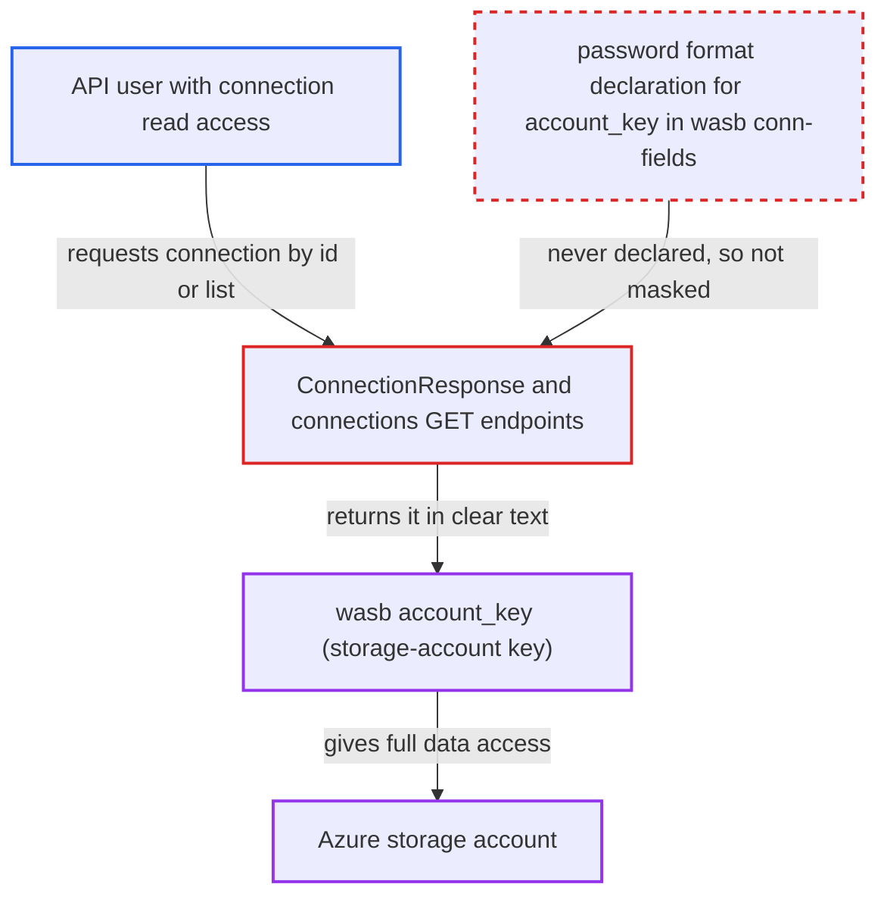

# WASB `account_key` connection extra not declared sensitive, returned in clear by connections API

| Field | Value |
|---|---|
| ID | `find_01A4ku9ntRUqPyju7doh53QY` |
| Severity | **High** |
| Status | open |
| CWE | CWE-212 — Sensitive information exposure |
| Created | 2026-10-27T21:43:50.846191Z |
| Claude Security | https://claude.ai/security/findings/find_01A4ku9ntRUqPyju7doh53QY |

## Description

A user who can read connections through the API, but who is not meant to see stored secrets, can read the full Azure storage-account key of a `wasb` connection in clear text. That key gives full access to the storage account. The attack needs a stored `wasb` connection that keeps the key in the `account_key` extra. The cause is that the Azure provider's `conn-fields` never declare `account_key` as a password field, and its name does not match the sensitive-name list, so the connections API does not mask it.

1. **Deployment Manager** stores a `wasb` connection with the storage key in the `account_key` extra. The Azure docs describe this as authentication method 5, and the hook uses the value as a live credential. ([`providers/microsoft/azure/docs/connections/wasb.rst:36-41`](https://github.com/cx-benchmark/airflow/blob/a462d683469bb9f55646b0515ef84c41e16650fb/providers/microsoft/azure/docs/connections/wasb.rst#L36-L41))
2. **Azure provider metadata** lists `connection_string`, `shared_access_key` and `sas_token` as password fields but leaves out `account_key`. This metadata is the only way the provider tells the API which extra keys are secret. ([`providers/microsoft/azure/provider.yaml:814-841`](https://github.com/cx-benchmark/airflow/blob/a462d683469bb9f55646b0515ef84c41e16650fb/providers/microsoft/azure/provider.yaml#L814-L841))
3. **`ConnectionResponse`** masks `extra` only by sensitive name and by declared password fields. `account_key` matches neither rule, because none of the sensitive-name entries is a substring of it and it is not declared. ([`airflow-core/src/airflow/api_fastapi/core_api/datamodels/connections.py:99-128`](https://github.com/cx-benchmark/airflow/blob/a462d683469bb9f55646b0515ef84c41e16650fb/airflow-core/src/airflow/api_fastapi/core_api/datamodels/connections.py#L99-L128))
4. **attacker with connection read access** calls `GET /api/v2/connections/{id}` or the list endpoint. These endpoints are gated only by `requires_access_connection(method="GET")`. ([`airflow-core/src/airflow/api_fastapi/core_api/routes/public/connections.py:200-258`](https://github.com/cx-benchmark/airflow/blob/a462d683469bb9f55646b0515ef84c41e16650fb/airflow-core/src/airflow/api_fastapi/core_api/routes/public/connections.py#L200-L258))
5. **connections API** returns the full storage-account key in `extra`. The attacker now holds a credential the security model says this role must not be able to view.

## Assessment

The attacker is an authenticated API principal with connection GET permission who is not entitled to read secrets. Examples are the documented write-only connection configuration role, or a custom read-only role under FAB, Keycloak or AWS. Admin and Op already have credential access, so they gain nothing. A Deployment Manager must have stored a `wasb` connection with the key in the `account_key` extra. The attacker calls `GET /api/v2/connections/{id}`, lists connections, or opens the connection in the UI. The ADLS filesystem in `fs/adls.py` also reads `account_key` from the extra, so such connections carry the same key.

Impact: The attacker reads a stored connection credential in clear text that the security model says this role must not view. Only connections that hold the key under `account_key` are exposed, and the read changes nothing in Airflow.

Subsequent-system impact: The value is the Azure storage-account shared key. Under Azure's documented shared-key behaviour, it gives full data-plane access to the storage account outside Airflow's authorization. The holder can read, overwrite and delete every container and blob, and can sign new SAS tokens.

## Recommendation

The Azure provider uses `account_key` as a credential in a connection extra but never declares it as a password-format connection field. Its name also misses the sensitive-name list, so the connections API returns it in clear text.

Fix criteria: A stored `account_key`, in both the plain and the `extra__wasb__account_key` forms, comes back as `***` from `GET /api/v2/connections/{id}` and from the list endpoint. This holds for `wasb` and for any other connection type that reads it. Sending the masked response back through PATCH keeps the stored key and does not overwrite it with the mask. `WasbHook` and the ADLS filesystem still authenticate with the stored value.

## Evidence

**https://github.com/cx-benchmark/airflow**

- [`providers/microsoft/azure/provider.yaml:814-841`](https://github.com/cx-benchmark/airflow/blob/a462d683469bb9f55646b0515ef84c41e16650fb/providers/microsoft/azure/provider.yaml#L814-L841)
- [`providers/microsoft/azure/src/airflow/providers/microsoft/azure/get_provider_info.py:813-838`](https://github.com/cx-benchmark/airflow/blob/a462d683469bb9f55646b0515ef84c41e16650fb/providers/microsoft/azure/src/airflow/providers/microsoft/azure/get_provider_info.py#L813-L838)
- [`providers/microsoft/azure/src/airflow/providers/microsoft/azure/hooks/wasb.py:212-218`](https://github.com/cx-benchmark/airflow/blob/a462d683469bb9f55646b0515ef84c41e16650fb/providers/microsoft/azure/src/airflow/providers/microsoft/azure/hooks/wasb.py#L212-L218)
- [`providers/microsoft/azure/docs/connections/wasb.rst:36-41`](https://github.com/cx-benchmark/airflow/blob/a462d683469bb9f55646b0515ef84c41e16650fb/providers/microsoft/azure/docs/connections/wasb.rst#L36-L41)
- [`airflow-core/src/airflow/providers_manager.py:981-1004`](https://github.com/cx-benchmark/airflow/blob/a462d683469bb9f55646b0515ef84c41e16650fb/airflow-core/src/airflow/providers_manager.py#L981-L1004)
- [`airflow-core/src/airflow/api_fastapi/core_api/datamodels/connections.py:99-128`](https://github.com/cx-benchmark/airflow/blob/a462d683469bb9f55646b0515ef84c41e16650fb/airflow-core/src/airflow/api_fastapi/core_api/datamodels/connections.py#L99-L128)
- [`shared/secrets_masker/src/airflow_shared/secrets_masker/secrets_masker.py:51-74`](https://github.com/cx-benchmark/airflow/blob/a462d683469bb9f55646b0515ef84c41e16650fb/shared/secrets_masker/src/airflow_shared/secrets_masker/secrets_masker.py#L51-L74)
- [`airflow-core/src/airflow/api_fastapi/core_api/routes/public/connections.py:200-258`](https://github.com/cx-benchmark/airflow/blob/a462d683469bb9f55646b0515ef84c41e16650fb/airflow-core/src/airflow/api_fastapi/core_api/routes/public/connections.py#L200-L258)
- [`providers/microsoft/azure/src/airflow/providers/microsoft/azure/fs/adls.py:80-99`](https://github.com/cx-benchmark/airflow/blob/a462d683469bb9f55646b0515ef84c41e16650fb/providers/microsoft/azure/src/airflow/providers/microsoft/azure/fs/adls.py#L80-L99)
- [`airflow-core/docs/security/security_model.rst:136-154`](https://github.com/cx-benchmark/airflow/blob/a462d683469bb9f55646b0515ef84c41e16650fb/airflow-core/docs/security/security_model.rst#L136-L154)

