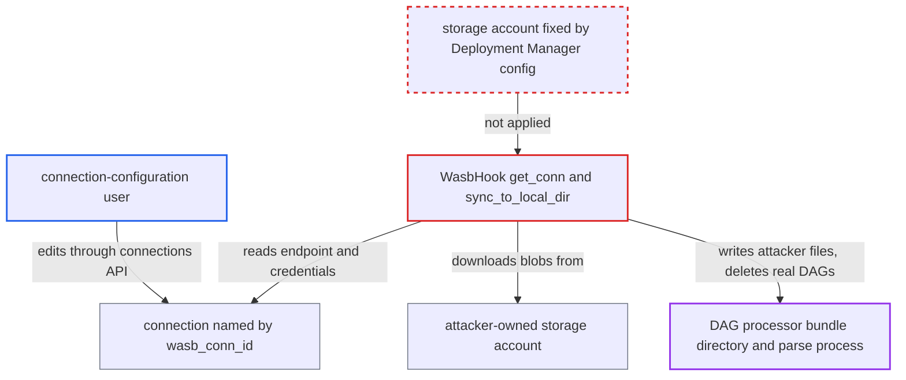

# WASB DAG bundle syncs DAG code from a connection-editor-chosen storage account in the DAG processor

| Field | Value |
|---|---|
| ID | `find_01AYq4kM3V4qgFPtbnoTBC57` |
| Severity | **High** |
| Status | open |
| CWE | CWE-829 — Untrusted code inclusion |
| Created | 2026-10-27T22:04:55.750809Z |
| Claude Security | https://claude.ai/security/findings/find_01AYq4kM3V4qgFPtbnoTBC57 |

## Description

A user with only the connection-configuration role can run their own Python code in the Airflow DAG processor and replace the deployment's DAGs. The deployment must use `WasbDagBundle`, and the attacker needs no DAG-author access. The bundle config pins only the container name and prefix, so the connection named by `wasb_conn_id` alone decides which storage account `WasbHook.get_conn()` pulls DAG code from.

1. **connection-configuration user** edits the connection named by `wasb_conn_id`. The user changes `connection_string`, or `host` plus `password`, or an `https://` `sas_token` URL so that it points to a storage account they own; the default connection name is `wasb_default`.
2. **connection-configuration user** prepares the files in their own storage account. They create a container with the name set in the bundle config and upload Python files to it.
3. **DAG processor manager** refreshes every configured bundle on its next tick. `_refresh_dag_bundles` calls `bundle.initialize()` and `bundle.refresh()`. The cached hook picks up the edit at its first use in a DAG processor process, typically after a restart, or at once if the bundle is not yet initialized. ([`airflow-core/src/airflow/dag_processing/manager.py:896-949`](https://github.com/cx-benchmark/airflow/blob/a462d683469bb9f55646b0515ef84c41e16650fb/airflow-core/src/airflow/dag_processing/manager.py#L896-L949))
4. **the hook `WasbHook.get_conn()`** builds the storage client from the edited connection. The endpoint and credentials come from the connection, `parse_blob_account_url` accepts any URL, and nothing ties the account to the one the deployment intended. ([`providers/microsoft/azure/src/airflow/providers/microsoft/azure/hooks/wasb.py:170-231`](https://github.com/cx-benchmark/airflow/blob/a462d683469bb9f55646b0515ef84c41e16650fb/providers/microsoft/azure/src/airflow/providers/microsoft/azure/hooks/wasb.py#L170-L231))
5. **the bundle's `refresh()` method** calls `sync_to_local_dir` with `delete_stale=True`. It downloads the attacker's blobs into the bundle directory and deletes local DAG files that are not in the attacker's listing. ([`providers/microsoft/azure/src/airflow/providers/microsoft/azure/hooks/wasb.py:534-572`](https://github.com/cx-benchmark/airflow/blob/a462d683469bb9f55646b0515ef84c41e16650fb/providers/microsoft/azure/src/airflow/providers/microsoft/azure/hooks/wasb.py#L534-L572))
6. **DAG processor** imports and runs the attacker's modules, then stores the resulting DAGs. The parse child inherits the manager's environment, including DB credentials and `[core] fernet_key`. The scheduler then runs the attacker's tasks on the workers. ([`airflow-core/src/airflow/dag_processing/manager.py:896-949`](https://github.com/cx-benchmark/airflow/blob/a462d683469bb9f55646b0515ef84c41e16650fb/airflow-core/src/airflow/dag_processing/manager.py#L896-L949))

## Assessment

The attacker is an authenticated user with the connection-configuration role (write access to `/api/v2/connections` via PATCH, POST or DELETE). They need no DAG-author or admin rights. The deployment must serve DAGs with `WasbDagBundle`. The attacker edits or recreates the connection named by `wasb_conn_id` and prepares a container with the configured name in an account they control. No victim action is needed. The bundle and its hook cache the client, so the change takes effect at the first hook use in a DAG processor process. That is typically after a restart, which the malicious connection simply waits for. It is immediate if the bundle is not yet initialized in that process.

Impact: The attacker gets arbitrary Python code running in the DAG processor parse process. That process can read the metadata DB credentials, the `[core] fernet_key` and the secrets-backend configuration, so every connection and variable secret is exposed. The attacker also controls which DAGs exist and what their tasks do on all workers. Legitimate DAG files are deleted, so existing DAGs are replaced or deactivated.

## Recommendation

(1) `WasbDagBundle` lets a connection stored in the metadata DB choose the storage account and endpoint that DAG code is fetched from and run. The connection is writable by a role that is trusted only with worker-side effects. This breaks the boundary between connection configuration and DAG authorship.

Fix criteria: The storage account or endpoint a DAG bundle pulls code from is fixed by Deployment-Manager-controlled configuration (bundle kwargs or airflow.cfg). Editing the connection cannot change it. A connection may at most supply credentials for that fixed account. To verify, edit `wasb_default` to point to another account URL or connection string. The DAG processor must then still sync only from the configured account, or refuse to sync. It must never write blobs from the edited account into the bundle directory.

(2) Hooks built inside control-plane processes resolve connections from the same DB table that connection-configuration users edit. A connection edit therefore reaches the DAG processor manager.

Fix criteria: Connections used by control-plane components (bundles, remote-log readers) come from a Deployment-Manager-only channel, such as configuration or a dedicated secrets backend. Alternatively, the API refuses edits to connections referenced by bundle or logging configuration. To verify, confirm that a user who can PUT connections cannot change which credentials or endpoint the DAG processor uses for bundle sync.

## Evidence

**https://github.com/cx-benchmark/airflow**

- [`providers/microsoft/azure/src/airflow/providers/microsoft/azure/bundles/wasb.py:115-132`](https://github.com/cx-benchmark/airflow/blob/a462d683469bb9f55646b0515ef84c41e16650fb/providers/microsoft/azure/src/airflow/providers/microsoft/azure/bundles/wasb.py#L115-L132)
- [`providers/microsoft/azure/src/airflow/providers/microsoft/azure/bundles/wasb.py:92-94`](https://github.com/cx-benchmark/airflow/blob/a462d683469bb9f55646b0515ef84c41e16650fb/providers/microsoft/azure/src/airflow/providers/microsoft/azure/bundles/wasb.py#L92-L94)
- [`providers/microsoft/azure/src/airflow/providers/microsoft/azure/hooks/wasb.py:170-231`](https://github.com/cx-benchmark/airflow/blob/a462d683469bb9f55646b0515ef84c41e16650fb/providers/microsoft/azure/src/airflow/providers/microsoft/azure/hooks/wasb.py#L170-L231)
- [`providers/microsoft/azure/src/airflow/providers/microsoft/azure/utils.py:194-224`](https://github.com/cx-benchmark/airflow/blob/a462d683469bb9f55646b0515ef84c41e16650fb/providers/microsoft/azure/src/airflow/providers/microsoft/azure/utils.py#L194-L224)
- [`providers/microsoft/azure/src/airflow/providers/microsoft/azure/hooks/wasb.py:534-572`](https://github.com/cx-benchmark/airflow/blob/a462d683469bb9f55646b0515ef84c41e16650fb/providers/microsoft/azure/src/airflow/providers/microsoft/azure/hooks/wasb.py#L534-L572)
- [`airflow-core/src/airflow/dag_processing/manager.py:896-949`](https://github.com/cx-benchmark/airflow/blob/a462d683469bb9f55646b0515ef84c41e16650fb/airflow-core/src/airflow/dag_processing/manager.py#L896-L949)
- [`airflow-core/src/airflow/dag_processing/manager.py:384-399`](https://github.com/cx-benchmark/airflow/blob/a462d683469bb9f55646b0515ef84c41e16650fb/airflow-core/src/airflow/dag_processing/manager.py#L384-L399)
- [`airflow-core/docs/security/security_model.rst:1064-1073`](https://github.com/cx-benchmark/airflow/blob/a462d683469bb9f55646b0515ef84c41e16650fb/airflow-core/docs/security/security_model.rst#L1064-L1073)

