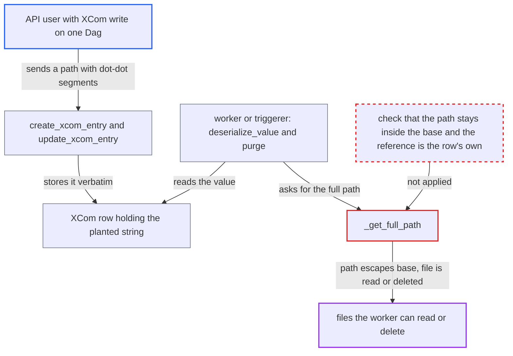

# XCom object-storage backend follows `..` in REST-planted references to read and delete worker files

| Field | Value |
|---|---|
| ID | `find_01JUYmtTj6s6sDt3tcuMVm52` |
| Severity | **High** |
| Status | open |
| CWE | CWE-23 — Path traversal |
| Created | 2026-10-27T21:20:56.720729Z |
| Claude Security | https://claude.ai/security/findings/find_01JUYmtTj6s6sDt3tcuMVm52 |

## Description

A user who can edit XCom values over the REST API can make a worker or triggerer read any JSON file it can read, or delete any file it can delete. It needs `XComObjectStorageBackend` on a path-honouring store such as `file://` or `local://`, plus Dag edit and XCom create/edit rights on one Dag. `_get_full_path` only checks the path prefix as text and never resolves `..`, and the backend trusts any stored string.

1. **authenticated API user** plants a path string as an XCom value through the REST API. The value looks like `<base>/../../path/x.json`, and `create_xcom_entry` stores it verbatim with `serialize=False`; `update_xcom_entry` does the same for an existing row such as a task's `return_value`. ([`airflow-core/src/airflow/api_fastapi/core_api/routes/public/xcom.py:395-406`](https://github.com/cx-benchmark/airflow/blob/a462d683469bb9f55646b0515ef84c41e16650fb/airflow-core/src/airflow/api_fastapi/core_api/routes/public/xcom.py#L395-L406))
2. **REST validation** lets the string through. The only check on REST-supplied XCom values rejects reserved serialization keys, so a plain string naming a storage path passes. ([`airflow-core/src/airflow/api_fastapi/core_api/datamodels/xcom.py:92-103`](https://github.com/cx-benchmark/airflow/blob/a462d683469bb9f55646b0515ef84c41e16650fb/airflow-core/src/airflow/api_fastapi/core_api/datamodels/xcom.py#L92-L103))
3. **worker or triggerer** pulls the XCom and hands the raw row value to the backend's `deserialize_value`. The provider overrides `deserialize_value` and not `load_value`, so the planted string goes straight to the backend on every `xcom_pull`. ([`task-sdk/src/airflow/sdk/bases/xcom.py:728-747`](https://github.com/cx-benchmark/airflow/blob/a462d683469bb9f55646b0515ef84c41e16650fb/task-sdk/src/airflow/sdk/bases/xcom.py#L728-L747))
4. **`_get_full_path`** accepts the string and joins it onto the base path. `is_relative_to` compares path parents as text and does not resolve `..`, so the joined path keeps its `..` segments and the OS resolves them to a location outside the base. ([`providers/common/io/src/airflow/providers/common/io/xcom/backend.py:92-113`](https://github.com/cx-benchmark/airflow/blob/a462d683469bb9f55646b0515ef84c41e16650fb/providers/common/io/src/airflow/providers/common/io/xcom/backend.py#L92-L113))
5. **`deserialize_value`** opens the escaped path and parses it as JSON. The file's content is returned as the pulled XCom value and can appear in the consumer's rendered fields, which anyone with read access to the Dag can see. ([`providers/common/io/src/airflow/providers/common/io/xcom/backend.py:182-205`](https://github.com/cx-benchmark/airflow/blob/a462d683469bb9f55646b0515ef84c41e16650fb/providers/common/io/src/airflow/providers/common/io/xcom/backend.py#L182-L205))
6. **task runner** deletes the planted XCom when a task instance that has not started yet begins running. The server lists every XCom key on that attempt, REST-planted ones included, in `xcom_keys_to_clear`, and the runner calls `XCom.delete` for each before the task runs. ([`task-sdk/src/airflow/sdk/execution_time/task_runner.py:1653-1661`](https://github.com/cx-benchmark/airflow/blob/a462d683469bb9f55646b0515ef84c41e16650fb/task-sdk/src/airflow/sdk/execution_time/task_runner.py#L1653-L1661))
7. **`purge`** unlinks whatever path the stored string resolves to. It calls `unlink(missing_ok=True)` on the escaped path, so the target file is deleted. ([`providers/common/io/src/airflow/providers/common/io/xcom/backend.py:207-212`](https://github.com/cx-benchmark/airflow/blob/a462d683469bb9f55646b0515ef84c41e16650fb/providers/common/io/src/airflow/providers/common/io/xcom/backend.py#L207-L212))

## Assessment

The attacker is an authenticated API user with Dag edit and XCom create/edit on one Dag. The report says the Keycloak auth manager's default `User` role has this, as can a custom role. With FAB defaults only Op and Admin have it. The backend must be configured on a path-honouring store, such as the documented `file://` or `local://` setups. For a read, the attacker overwrites task T's `return_value` with `<base>/../../path/x.json` and clears consumer D, and D's worker then reads the file into D's input and rendered fields. For a delete, the attacker posts an XCom with the same kind of value onto a task instance that has not started yet, and the worker purges the target when it runs. The attacker must know the path of the target file. The API server never runs the backend, so only workers and triggerers act on the planted string.

Impact: The attacker can read any JSON-parseable file the worker or triggerer process can read, such as credential or config JSON. The content shows up in the attacker's own Dag's rendered fields or in downstream XComs, where masking redacts common secret key names and the rendered field length is capped. The attacker can also delete any file the process can remove, such as Dag bundle files, configuration, installed packages or other tasks' stored XCom objects. That breaks pipelines and the worker. On S3 or GCS, `..` is only a literal key component. A reference there can still name any object under the prefix, but reaching another Dag's object needs its producer's task-instance UUID, which is part of the key.

## Recommendation

(1) `_get_full_path` checks a stored reference only with a text-based `is_relative_to` prefix test, which neither rejects nor resolves `.`/`..` segments. A reference can escape the configured XCom base path when the worker opens or unlinks it.

Fix criteria: A stored reference is dereferenced only if its normalised path is strictly inside the configured base path. References containing `.`/`..` segments are rejected or treated as plain values before any filesystem call. With a `file://` base, a row holding `<base>/../../tmp/x.json` makes `deserialize_value` return the string unchanged. On the same base, `purge` leaves `/tmp/x.json` in place.

(2) The backend treats any string in an XCom row as a reference it wrote itself, although the public REST API stores caller-supplied values verbatim. A user with XCom write can point a worker at storage the backend never wrote for that row.

Fix criteria: Only references the backend produced for that row are opened or deleted. For example, the reference is checked against the row's own dag_id, run_id, task_id and task-instance location, or it carries an integrity-protected marker. A REST-written string naming any other location is returned as a plain value and is never opened or unlinked.

## Evidence

**https://github.com/cx-benchmark/airflow**

- [`providers/common/io/src/airflow/providers/common/io/xcom/backend.py:92-113`](https://github.com/cx-benchmark/airflow/blob/a462d683469bb9f55646b0515ef84c41e16650fb/providers/common/io/src/airflow/providers/common/io/xcom/backend.py#L92-L113)
- [`providers/common/io/src/airflow/providers/common/io/xcom/backend.py:182-205`](https://github.com/cx-benchmark/airflow/blob/a462d683469bb9f55646b0515ef84c41e16650fb/providers/common/io/src/airflow/providers/common/io/xcom/backend.py#L182-L205)
- [`providers/common/io/src/airflow/providers/common/io/xcom/backend.py:207-212`](https://github.com/cx-benchmark/airflow/blob/a462d683469bb9f55646b0515ef84c41e16650fb/providers/common/io/src/airflow/providers/common/io/xcom/backend.py#L207-L212)
- [`airflow-core/src/airflow/api_fastapi/core_api/routes/public/xcom.py:395-406`](https://github.com/cx-benchmark/airflow/blob/a462d683469bb9f55646b0515ef84c41e16650fb/airflow-core/src/airflow/api_fastapi/core_api/routes/public/xcom.py#L395-L406)
- [`airflow-core/src/airflow/api_fastapi/core_api/routes/public/xcom.py:486-495`](https://github.com/cx-benchmark/airflow/blob/a462d683469bb9f55646b0515ef84c41e16650fb/airflow-core/src/airflow/api_fastapi/core_api/routes/public/xcom.py#L486-L495)
- [`airflow-core/src/airflow/api_fastapi/core_api/datamodels/xcom.py:92-103`](https://github.com/cx-benchmark/airflow/blob/a462d683469bb9f55646b0515ef84c41e16650fb/airflow-core/src/airflow/api_fastapi/core_api/datamodels/xcom.py#L92-L103)
- [`task-sdk/src/airflow/sdk/bases/xcom.py:728-747`](https://github.com/cx-benchmark/airflow/blob/a462d683469bb9f55646b0515ef84c41e16650fb/task-sdk/src/airflow/sdk/bases/xcom.py#L728-L747)
- [`task-sdk/src/airflow/sdk/bases/xcom.py:778-805`](https://github.com/cx-benchmark/airflow/blob/a462d683469bb9f55646b0515ef84c41e16650fb/task-sdk/src/airflow/sdk/bases/xcom.py#L778-L805)
- [`airflow-core/src/airflow/api_fastapi/execution_api/routes/task_instances.py:344-371`](https://github.com/cx-benchmark/airflow/blob/a462d683469bb9f55646b0515ef84c41e16650fb/airflow-core/src/airflow/api_fastapi/execution_api/routes/task_instances.py#L344-L371)
- [`task-sdk/src/airflow/sdk/execution_time/task_runner.py:1653-1661`](https://github.com/cx-benchmark/airflow/blob/a462d683469bb9f55646b0515ef84c41e16650fb/task-sdk/src/airflow/sdk/execution_time/task_runner.py#L1653-L1661)
- [`task-sdk/src/airflow/sdk/definitions/_internal/templater.py:264-265`](https://github.com/cx-benchmark/airflow/blob/a462d683469bb9f55646b0515ef84c41e16650fb/task-sdk/src/airflow/sdk/definitions/_internal/templater.py#L264-L265)

