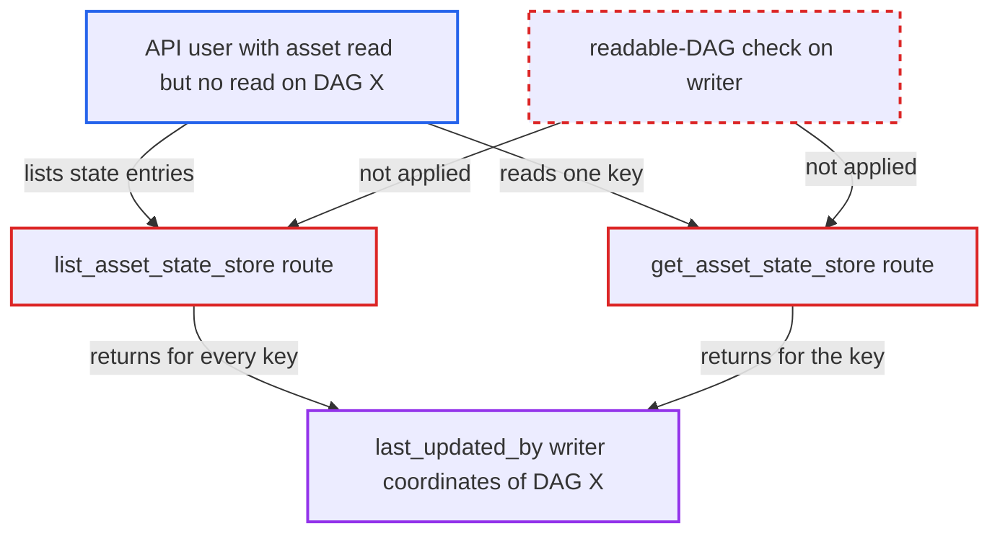

# Asset state store read routes leak writer DAG, run and task of unreadable DAGs

| Field | Value |
|---|---|
| ID | `find_01RJPxN1edngxt6VMBUJDXZg` |
| Severity | **Medium** |
| Status | open |
| CWE | CWE-201 — Information exposure |
| Created | 2026-10-27T21:14:05.830958Z |
| Claude Security | https://claude.ai/security/findings/find_01RJPxN1edngxt6VMBUJDXZg |

## Description

A logged-in API user who can read assets but not a particular DAG can learn that DAG exists. They can also read the run id, task id, map index, task-instance UUID and try number of its last write to an asset state key. The two asset state-store read routes only check asset read access. They never check whether the caller may read the DAG that wrote the entry. The leak is limited to these writer coordinates.

1. **a task of DAG `X`** writes an asset state key through the Execution API. With the default `MetastoreBackend` and `kind=TASK`, the stored row records the writing task instance's real `dag_id`, `run_id`, `task_id`, task-instance id and `try_number`. ([`airflow-core/src/airflow/api_fastapi/execution_api/routes/asset_state_store.py:158-175`](https://github.com/cx-benchmark/airflow/blob/a462d683469bb9f55646b0515ef84c41e16650fb/airflow-core/src/airflow/api_fastapi/execution_api/routes/asset_state_store.py#L158-L175))
2. **attacker** sends `GET /api/v2/assets/{asset_id}/state-store` or `GET /api/v2/assets/{asset_id}/state-store/{key}`. The attacker has a role that grants asset read but no read access on DAG `X`.
3. **FAB auth manager** lets the request through the only check, `requires_access_asset(method="GET")`. `is_authorized_asset` checks only the global Assets resource, so a role limited to certain DAGs still passes for every asset. ([`providers/fab/src/airflow/providers/fab/auth_manager/fab_auth_manager.py:531-534`](https://github.com/cx-benchmark/airflow/blob/a462d683469bb9f55646b0515ef84c41e16650fb/providers/fab/src/airflow/providers/fab/auth_manager/fab_auth_manager.py#L531-L534))
4. **the handler `list_asset_state_store`** returns every entry with a `last_updated_by` object built from the writer columns. No filter against the DAGs the caller may read is applied, so DAG `X`'s coordinates are included. ([`airflow-core/src/airflow/api_fastapi/core_api/routes/public/asset_state_store.py:60-120`](https://github.com/cx-benchmark/airflow/blob/a462d683469bb9f55646b0515ef84c41e16650fb/airflow-core/src/airflow/api_fastapi/core_api/routes/public/asset_state_store.py#L60-L120))
5. **the handler `get_asset_state_store`** returns the same writer coordinates for a single key. This route has the same asset-only check and no narrowing. ([`airflow-core/src/airflow/api_fastapi/core_api/routes/public/asset_state_store.py:123-177`](https://github.com/cx-benchmark/airflow/blob/a462d683469bb9f55646b0515ef84c41e16650fb/airflow-core/src/airflow/api_fastapi/core_api/routes/public/asset_state_store.py#L123-L177))

## Assessment

The attacker is an authenticated user of the public REST API. Their role grants asset read but not read on a DAG `X`. Per-DAG roles are a documented capability. A task of DAG `X` must already have written an asset state key through the Execution API. The attacker then calls either read route, `GET /api/v2/assets/{asset_id}/state-store` or `GET /api/v2/assets/{asset_id}/state-store/{key}`. No action by any victim is needed.

Impact: The attacker learns that DAG `X` exists. For each key, they also learn the `run_id`, `task_id`, `map_index`, task-instance UUID, region fields and `try_number` of its last writer. The stored `value` is state the asset owns and any asset reader may already read. The routes are read-only, so nothing can be changed.

## Recommendation

`list_asset_state_store` and `get_asset_state_store` return the writer task's DAG, run and task coordinates without checking that the caller may read that DAG. This breaks the per-DAG read isolation that the other asset routes apply to nested DAG references.

Fix criteria: A caller who cannot read DAG `X` receives none of its writer coordinates (`dag_id`, `run_id`, `task_id`, `map_index`, `task_instance_id`, region fields, `try_number`) from either read route. A caller who can read DAG `X` still sees them. To check, read an entry written by a task of an unreadable DAG with a DAG-scoped role. Confirm that `last_updated_by` holds no writer coordinates.

## Evidence

**https://github.com/cx-benchmark/airflow**

- [`airflow-core/src/airflow/api_fastapi/core_api/routes/public/asset_state_store.py:60-120`](https://github.com/cx-benchmark/airflow/blob/a462d683469bb9f55646b0515ef84c41e16650fb/airflow-core/src/airflow/api_fastapi/core_api/routes/public/asset_state_store.py#L60-L120)
- [`airflow-core/src/airflow/api_fastapi/core_api/routes/public/asset_state_store.py:123-177`](https://github.com/cx-benchmark/airflow/blob/a462d683469bb9f55646b0515ef84c41e16650fb/airflow-core/src/airflow/api_fastapi/core_api/routes/public/asset_state_store.py#L123-L177)
- [`airflow-core/src/airflow/api_fastapi/core_api/datamodels/asset_state_store.py:31-42`](https://github.com/cx-benchmark/airflow/blob/a462d683469bb9f55646b0515ef84c41e16650fb/airflow-core/src/airflow/api_fastapi/core_api/datamodels/asset_state_store.py#L31-L42)
- [`airflow-core/src/airflow/api_fastapi/execution_api/routes/asset_state_store.py:158-175`](https://github.com/cx-benchmark/airflow/blob/a462d683469bb9f55646b0515ef84c41e16650fb/airflow-core/src/airflow/api_fastapi/execution_api/routes/asset_state_store.py#L158-L175)
- [`providers/fab/src/airflow/providers/fab/auth_manager/fab_auth_manager.py:531-534`](https://github.com/cx-benchmark/airflow/blob/a462d683469bb9f55646b0515ef84c41e16650fb/providers/fab/src/airflow/providers/fab/auth_manager/fab_auth_manager.py#L531-L534)
- [`airflow-core/src/airflow/api_fastapi/core_api/datamodels/assets.py:130-148`](https://github.com/cx-benchmark/airflow/blob/a462d683469bb9f55646b0515ef84c41e16650fb/airflow-core/src/airflow/api_fastapi/core_api/datamodels/assets.py#L130-L148)
- [`airflow-core/src/airflow/api_fastapi/core_api/security.py:341-355`](https://github.com/cx-benchmark/airflow/blob/a462d683469bb9f55646b0515ef84c41e16650fb/airflow-core/src/airflow/api_fastapi/core_api/security.py#L341-L355)

