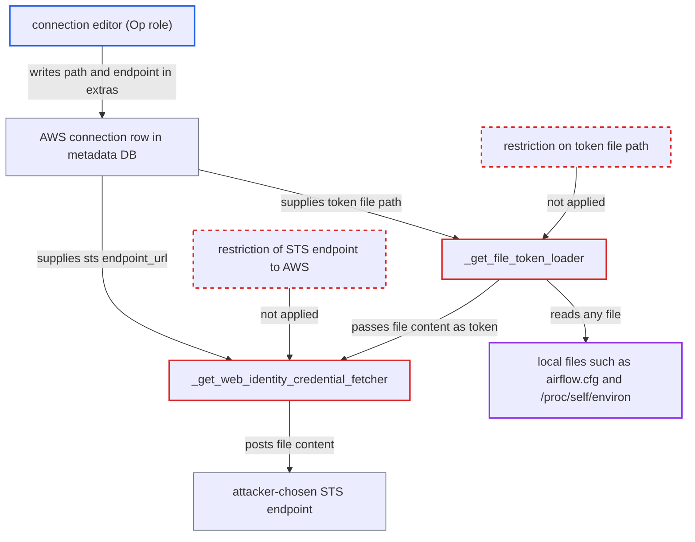

# AWS connection extras make server-side session factory read any local file and send it to a connection-chosen endpoint

| Field | Value |
|---|---|
| ID | `find_01UjmRJmgYyxReAYMfHEuKdC` |
| Severity | **Medium** |
| Status | open |
| CWE | CWE-73 — Arbitrary file read |
| Created | 2026-10-27T21:50:12.325933Z |
| Claude Security | https://claude.ai/security/findings/find_01UjmRJmgYyxReAYMfHEuKdC |

## Description

A user who can edit connections (the Op role) can make the API server, scheduler, DAG processor or triggerer read any file the process can open and send it to a server the attacker picks. Files such as `airflow.cfg` and `/proc/self/environ` hold the API JWT secret, the Fernet key and the metadata DB URI. The cause is `BaseSessionFactory` in `base_aws.py`: it takes both the token file path and the STS `endpoint_url` from connection extras without restriction.

1. **connection editor** edits an AWS connection used by a server-side component. The extras set `role_arn`, `assume_role_method` to `assume_role_with_web_identity`, `assume_role_with_web_identity_federation` to `file`, `assume_role_with_web_identity_token_file` to a path such as `/proc/self/environ`, and `service_config.sts.endpoint_url` to the attacker's host.
2. **server-side AWS hook** loads the edited connection from the metadata database. `conn_config` resolves the connection with `get_connection`, which in these non-worker processes goes through the metastore backend, the row the editor can change. ([`providers/amazon/src/airflow/providers/amazon/aws/hooks/base_aws.py:612-634`](https://github.com/cx-benchmark/airflow/blob/a462d683469bb9f55646b0515ef84c41e16650fb/providers/amazon/src/airflow/providers/amazon/aws/hooks/base_aws.py#L612-L634))
3. **`_create_session_with_assume_role`** wires the credential fetcher into refreshable credentials. The file is read and posted on the first signed AWS API call through the session, for example the first `ListObjectsV2` of a log read, or any deferral in the triggerer. ([`providers/amazon/src/airflow/providers/amazon/aws/hooks/base_aws.py:223-252`](https://github.com/cx-benchmark/airflow/blob/a462d683469bb9f55646b0515ef84c41e16650fb/providers/amazon/src/airflow/providers/amazon/aws/hooks/base_aws.py#L223-L252))
4. **`_get_file_token_loader`** reads the file named in the connection extras. The path goes straight to botocore's `FileWebIdentityTokenLoader`, which returns the whole file content as the web-identity token; no allow-list or prefix check is applied. ([`providers/amazon/src/airflow/providers/amazon/aws/hooks/base_aws.py:445-452`](https://github.com/cx-benchmark/airflow/blob/a462d683469bb9f55646b0515ef84c41e16650fb/providers/amazon/src/airflow/providers/amazon/aws/hooks/base_aws.py#L445-L452))
5. **`get_service_endpoint_url`** returns the STS endpoint chosen in the connection. For assume-role calls it drops the global `endpoint_url` but still returns `service_config.sts.endpoint_url` from the extras. ([`providers/amazon/src/airflow/providers/amazon/aws/utils/connection_wrapper.py:141-159`](https://github.com/cx-benchmark/airflow/blob/a462d683469bb9f55646b0515ef84c41e16650fb/providers/amazon/src/airflow/providers/amazon/aws/utils/connection_wrapper.py#L141-L159))
6. **`_get_web_identity_credential_fetcher`** posts the file content as `WebIdentityToken` to that endpoint. The unsigned `AssumeRoleWithWebIdentity` call goes to the attacker's host, which receives the file text verbatim. ([`providers/amazon/src/airflow/providers/amazon/aws/hooks/base_aws.py:418-443`](https://github.com/cx-benchmark/airflow/blob/a462d683469bb9f55646b0515ef84c41e16650fb/providers/amazon/src/airflow/providers/amazon/aws/hooks/base_aws.py#L418-L443))

## Assessment

The attacker is an authenticated user with permission to edit connections (the Op role). The low-privilege Viewer and User roles cannot edit connections. The attacker changes a connection that a server-side component uses, such as `aws_default` or the connection named in `[logging] remote_log_conn_id`. They keep or replace its credentials and add the extras. No victim action is needed, but the deployment must use an AWS-backed server-side component. The attack fires the next time that component builds its hook. Examples are the first log view after an API-server start, auth-manager start (`aws_auth_manager` `conn_id`, default `aws_default`), executor start (ECS, Batch or Lambda in the scheduler), an S3 DAG bundle refresh in the DAG processor, or any deferral of an AWS trigger in the triggerer. A second route uses `assume_role_with_web_identity_federation: google`. The hosting process then mints a Google ID token from its ambient Google credentials for a connection-chosen `audience` and sends it to the same connection-chosen STS endpoint. The report also notes a related SSRF through `assume_role_with_saml`, filed separately. The report treats a connection editor affecting a client library on a worker as by design. It treats recovering a secret, or reaching the Scheduler or API server, as a vulnerability.

Impact: The attacker reads any file the API server, scheduler, DAG processor or triggerer process can open and receives it unchanged on their own server. This covers `airflow.cfg`, `/proc/self/environ`, mounted secrets and the host's `~/.aws/credentials`. The connection-configuration role is not supposed to read these secrets. The primitive is read-only and does not itself change data or availability.

Subsequent-system impact: The stolen files are credentials for other systems. The metadata DB URI gives direct read of every stored connection and variable, and the Fernet key from the same process decrypts them. A cloud credentials file on the host gives the component's cloud access. What the attacker can do next depends on the scope of those credentials.

## Recommendation

(1) `_get_file_token_loader` takes any filesystem path from the connection extras, and botocore reads it. A connection author therefore controls which file the hosting process opens.

Fix criteria: A connection cannot name an arbitrary file to be read as a web-identity token. The token file comes only from deployment-controlled configuration (an environment variable or Airflow config), or the extras value is limited to a deployment-defined allow-list or directory and rejected otherwise. Test: set `assume_role_with_web_identity_token_file` to `/etc/passwd` on a connection and confirm the hook refuses it before any read.

(2) `get_service_endpoint_url(..., sts_connection_assume=True)` honors `service_config.sts.endpoint_url` from the connection for assume-role calls. The connection author therefore also chooses where the token and any other assume-role material is sent.

Fix criteria: Assume-role STS calls made from connection-derived settings go only to AWS STS endpoints, or to an endpoint fixed by deployment configuration, and never to a host named in the connection row. Test: set `service_config.sts.endpoint_url` to a non-AWS host and confirm the assume-role client ignores or rejects it.

## Evidence

**https://github.com/cx-benchmark/airflow**

- [`providers/amazon/src/airflow/providers/amazon/aws/hooks/base_aws.py:445-452`](https://github.com/cx-benchmark/airflow/blob/a462d683469bb9f55646b0515ef84c41e16650fb/providers/amazon/src/airflow/providers/amazon/aws/hooks/base_aws.py#L445-L452)
- [`providers/amazon/src/airflow/providers/amazon/aws/hooks/base_aws.py:418-443`](https://github.com/cx-benchmark/airflow/blob/a462d683469bb9f55646b0515ef84c41e16650fb/providers/amazon/src/airflow/providers/amazon/aws/hooks/base_aws.py#L418-L443)
- [`providers/amazon/src/airflow/providers/amazon/aws/hooks/base_aws.py:223-252`](https://github.com/cx-benchmark/airflow/blob/a462d683469bb9f55646b0515ef84c41e16650fb/providers/amazon/src/airflow/providers/amazon/aws/hooks/base_aws.py#L223-L252)
- [`providers/amazon/src/airflow/providers/amazon/aws/utils/connection_wrapper.py:141-159`](https://github.com/cx-benchmark/airflow/blob/a462d683469bb9f55646b0515ef84c41e16650fb/providers/amazon/src/airflow/providers/amazon/aws/utils/connection_wrapper.py#L141-L159)
- [`providers/amazon/src/airflow/providers/amazon/aws/hooks/base_aws.py:612-634`](https://github.com/cx-benchmark/airflow/blob/a462d683469bb9f55646b0515ef84c41e16650fb/providers/amazon/src/airflow/providers/amazon/aws/hooks/base_aws.py#L612-L634)
- [`task-sdk/src/airflow/sdk/execution_time/context.py:218-258`](https://github.com/cx-benchmark/airflow/blob/a462d683469bb9f55646b0515ef84c41e16650fb/task-sdk/src/airflow/sdk/execution_time/context.py#L218-L258)
- [`providers/amazon/src/airflow/providers/amazon/aws/log/s3_task_handler.py:105-111`](https://github.com/cx-benchmark/airflow/blob/a462d683469bb9f55646b0515ef84c41e16650fb/providers/amazon/src/airflow/providers/amazon/aws/log/s3_task_handler.py#L105-L111)
- [`providers/amazon/src/airflow/providers/amazon/aws/auth_manager/avp/facade.py:71-76`](https://github.com/cx-benchmark/airflow/blob/a462d683469bb9f55646b0515ef84c41e16650fb/providers/amazon/src/airflow/providers/amazon/aws/auth_manager/avp/facade.py#L71-L76)
- [`providers/amazon/src/airflow/providers/amazon/aws/executors/ecs/ecs_executor.py:268-274`](https://github.com/cx-benchmark/airflow/blob/a462d683469bb9f55646b0515ef84c41e16650fb/providers/amazon/src/airflow/providers/amazon/aws/executors/ecs/ecs_executor.py#L268-L274)

