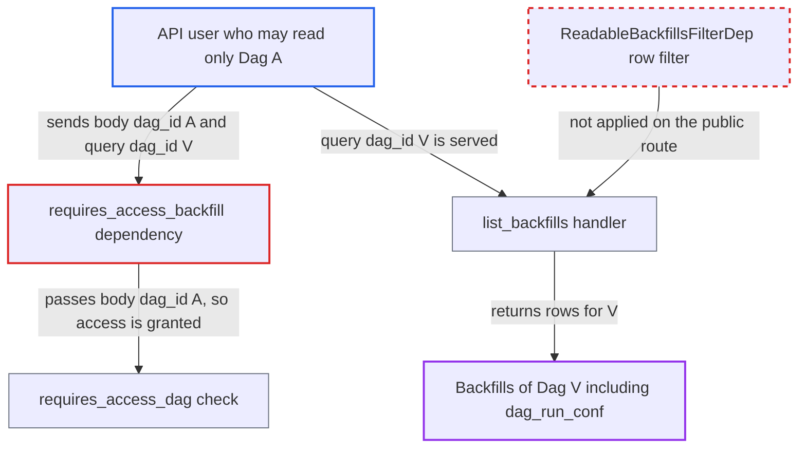

# Backfill list authorizes the body's dag_id but returns the query's dag_id

| Field | Value |
|---|---|
| ID | `find_013ipt45aMc2fAawTZQuk541` |
| Severity | **Medium** |
| Status | open |
| CWE | CWE-863 — Incorrect authorization |
| Created | 2026-10-27T21:12:04.604491Z |
| Claude Security | https://claude.ai/security/findings/find_013ipt45aMc2fAawTZQuk541 |

## Description

A logged-in API user who may read only one Dag can list the backfills of any other Dag, including each backfill's `dag_run_conf`. The attacker needs to know the other Dag's id, and the auth manager must scope access per Dag or per team. The cause is `requires_access_backfill`, which authorizes the `dag_id` in the JSON body of a GET request, while `list_backfills` returns rows for the query-string `dag_id`.

1. **attacker** sends a GET request to `/api/v2/backfills?dag_id=V` with the JSON body `{"dag_id":"A"}`. The attacker may read Dag `A` but not Dag `V`, and no Content-Type header is needed.
2. **the dependency `requires_access_backfill`** parses the request body even though the method is GET. The path has no `backfill_id`, so it reads the body on every HTTP method and passes the string `dag_id` from the body as `param_dag_id`. ([`airflow-core/src/airflow/api_fastapi/core_api/security.py:616-636`](https://github.com/cx-benchmark/airflow/blob/a462d683469bb9f55646b0515ef84c41e16650fb/airflow-core/src/airflow/api_fastapi/core_api/security.py#L616-L636))
3. **the function `requires_access_dag`** authorizes the caller against Dag `A`. It falls back to the path or query `dag_id` only when `param_dag_id` is None, so the body value decides the check, and the `team_name` is also taken from the body Dag. ([`airflow-core/src/airflow/api_fastapi/core_api/security.py:201-226`](https://github.com/cx-benchmark/airflow/blob/a462d683469bb9f55646b0515ef84c41e16650fb/airflow-core/src/airflow/api_fastapi/core_api/security.py#L201-L226))
4. **the handler `list_backfills`** queries backfills using the query-string `dag_id`. It reads `dag_id` only from the query string and applies no `ReadableBackfillsFilterDep` row filter, so it returns every backfill of Dag `V`, including `dag_run_conf`. ([`airflow-core/src/airflow/api_fastapi/core_api/routes/public/backfills.py:90-116`](https://github.com/cx-benchmark/airflow/blob/a462d683469bb9f55646b0515ef84c41e16650fb/airflow-core/src/airflow/api_fastapi/core_api/routes/public/backfills.py#L90-L116))

## Assessment

The attacker is an authenticated API user with read access to one Dag (`A`) but not to another (`V`). They need only the id of `V`. The impact needs an auth manager that scopes access per Dag or per team. FAB is the Helm chart default and checks per-Dag permissions. `SimpleAuthManager` (the core default, for development only) checks `team_name`, which is also taken from the body Dag. No victim action is involved. The UI route `list_backfills_ui` uses the same dependency but also applies `ReadableBackfillsFilterDep`, so it is not affected.

Impact: The attacker can read backfill metadata of Dags or teams they may not access: ids, date ranges, reprocess behaviour, pause and completion state, `max_active_runs` and the full `dag_run_conf`. The disclosure is read-only. No write path is reachable through this route, and connections and variables are not exposed.

## Recommendation

(1) `requires_access_backfill` reads the authorization subject from the request body on every method, including GET list routes whose handler never reads a body. The authorized Dag can therefore differ from the Dag the handler serves.

Fix criteria: On every route guarded by `requires_access_backfill`, the Dag id used for authorization comes from the same source the handler reads: the body only on routes that declare a body model, otherwise the query or path. A `GET /api/v2/backfills?dag_id=V` request with the JSON body `{"dag_id":"A"}`, sent by a user who may read only `A`, returns 403 or 404 and no rows of `V`.

(2) `list_backfills` returns every row for a client-chosen `dag_id` with no row-level readable-Dag filter. It relies entirely on the dependency.

Fix criteria: The public list never returns rows for Dags the caller cannot read, however the dependency resolved the Dag. One way is the readable-Dag filter the UI route applies. No combination of query string and body lets a user with read access to `A` only obtain rows of `V`.

## Evidence

**https://github.com/cx-benchmark/airflow**

- [`airflow-core/src/airflow/api_fastapi/core_api/security.py:616-636`](https://github.com/cx-benchmark/airflow/blob/a462d683469bb9f55646b0515ef84c41e16650fb/airflow-core/src/airflow/api_fastapi/core_api/security.py#L616-L636)
- [`airflow-core/src/airflow/api_fastapi/core_api/security.py:201-226`](https://github.com/cx-benchmark/airflow/blob/a462d683469bb9f55646b0515ef84c41e16650fb/airflow-core/src/airflow/api_fastapi/core_api/security.py#L201-L226)
- [`airflow-core/src/airflow/api_fastapi/core_api/routes/public/backfills.py:90-116`](https://github.com/cx-benchmark/airflow/blob/a462d683469bb9f55646b0515ef84c41e16650fb/airflow-core/src/airflow/api_fastapi/core_api/routes/public/backfills.py#L90-L116)
- [`airflow-core/src/airflow/api_fastapi/core_api/routes/ui/backfills.py:72-85`](https://github.com/cx-benchmark/airflow/blob/a462d683469bb9f55646b0515ef84c41e16650fb/airflow-core/src/airflow/api_fastapi/core_api/routes/ui/backfills.py#L72-L85)
- [`chart/values.yaml:3420`](https://github.com/cx-benchmark/airflow/blob/a462d683469bb9f55646b0515ef84c41e16650fb/chart/values.yaml#L3420)

