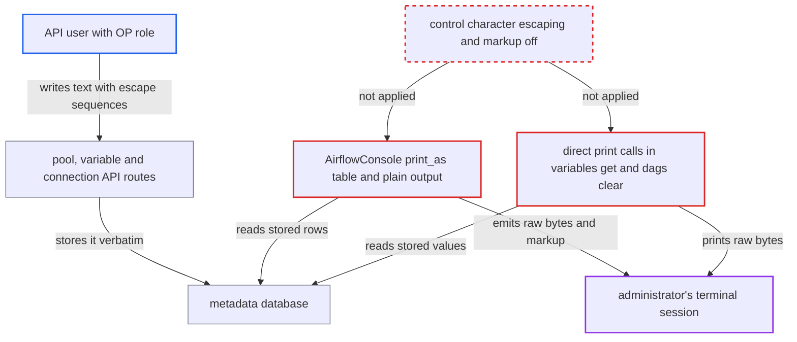

# Core airflow CLI table/plain output passes DB-stored escape sequences and rich markup to terminal

| Field | Value |
|---|---|
| ID | `find_01Fx2FPc3VcxvfdhVAFxKyz8` |
| Severity | **Medium** |
| Status | open |
| CWE | CWE-150 — Terminal escape injection |
| Created | 2026-10-27T21:33:04.751487Z |
| Claude Security | https://claude.ai/security/findings/find_01Fx2FPc3VcxvfdhVAFxKyz8 |

## Description

A user who can write pools, variables or connections (the `OP` role in the simple auth manager, `Op` in FAB) can store terminal control sequences or rich markup that later run in an administrator's terminal. The attacker can hide, overwrite or spoof output, but cannot read data or run commands. The cause is that `AirflowConsole.print_as_table`, `print_as_plain_table` and some direct `print()` calls print database strings without neutralizing `ESC` or rich markup.

1. **attacker with write access** sends a pool, variable or connection containing escape sequences or rich markup to the API. For example `POST /api/v2/pools` with a `pool` name or `description` holding `ESC` sequences or `[link=...]` markup, which `OP` users are allowed to write. ([`airflow-core/src/airflow/api_fastapi/auth/managers/simple/simple_auth_manager.py:342-380`](https://github.com/cx-benchmark/airflow/blob/a462d683469bb9f55646b0515ef84c41e16650fb/airflow-core/src/airflow/api_fastapi/auth/managers/simple/simple_auth_manager.py#L342-L380))
2. **API routes** store the submitted text unchanged in the metadata database. `PoolBody.pool` only requires one non-whitespace character and `description` is free text, so no character filtering happens anywhere. ([`airflow-core/src/airflow/api_fastapi/core_api/datamodels/pools.py:98-112`](https://github.com/cx-benchmark/airflow/blob/a462d683469bb9f55646b0515ef84c41e16650fb/airflow-core/src/airflow/api_fastapi/core_api/datamodels/pools.py#L98-L112))
3. **administrator** runs a listing command such as `airflow pools list` on a host with metadata-DB access. The command reads the stored rows and passes them to `AirflowConsole().print_as`, and `table` is the default output format. ([`airflow-core/src/airflow/cli/commands/pool_command.py:35-70`](https://github.com/cx-benchmark/airflow/blob/a462d683469bb9f55646b0515ef84c41e16650fb/airflow-core/src/airflow/cli/commands/pool_command.py#L35-L70))
4. **`print_as_table` and `print_as_plain_table`** emit the stored strings to the terminal as they are. In table mode rich keeps markup on and strips only BEL, BS, VT, FF and CR, never `ESC`. In plain mode the values go through `tabulate` and `print()` unchanged. ([`airflow-core/src/airflow/cli/simple_table.py:63-83`](https://github.com/cx-benchmark/airflow/blob/a462d683469bb9f55646b0515ef84c41e16650fb/airflow-core/src/airflow/cli/simple_table.py#L63-L83))
5. **administrator's terminal** interprets the sequences and markup. It can clear the screen, move the cursor over other rows, show spoofed rows or fake hyperlinks, or change the window title.

## Assessment

The main attacker is an authenticated API user allowed to write pools, variables or connections: the `OP` role in the simple auth manager, `Op` in FAB. The security model treats Operations users as having admin-level Airflow access, but that does not cover writing control sequences into another operator's terminal. The victim is a deployment manager or administrator who runs `airflow pools list` or `get`, `airflow variables list --show-values`, `airflow variables get`, or `airflow connections list --show-values` or `get`, on a host with metadata-DB access. A narrower route exists for a regular `USER`-role user on a Dag scheduled with `PartitionedAtRuntime()`. The trigger body's `partition_key` may be any non-blank string up to 250 characters. `airflow dags clear` with `--run-id` or `--partition-key` and without `--yes` echoes it raw in the confirmation prompt. A related path the report did not trace is `airflow tasks render`, which prints rendered template fields with raw `print()`. User-supplied `conf` reaches the terminal there wherever a Dag's templates reference `dag_run.conf` or conf-overridden `params`. Run ids are regex-limited and `dags state` prints `conf` through `json.dumps`, so those are not vectors. The `json` and `yaml` output formats are not affected.

Impact: The attacker can change what the operator sees: clear the screen, overwrite other rows, spoof rows, show fake hyperlinks, change the window title, or write to the clipboard on terminals that allow it. This can mislead an administrator into wrong actions. It does not by itself read data or run commands, so the effect is limited.

## Recommendation

(1) `AirflowConsole.print_as_table` and `print_as_plain_table` in `simple_table.py` render database strings without neutralizing control characters such as `ESC`. In table mode rich markup is also left enabled.

Fix criteria: Every string printed in `table` and `plain` formats has no terminal control characters (at least `\x00-\x1f`, `\x7f` and C1 `\x80-\x9f`). They are replaced or shown escaped, and are not read as rich markup, either by building cells as `rich.text.Text` or with `escape()`, or by creating the console with `markup=False`. Verify by storing a pool named `\x1b]0;pwned\x07[link=https://x]a[/link]` and checking that `airflow pools list -o table` and `-o plain` show an escaped literal, with no title change and no hyperlink.

(2) Some places print database-stored values with plain `print()` outside the shared sink. `variables_get` in `variable_command.py` prints the raw variable value, and `dag_clear` in `dag_command.py` puts `partition_key` into the confirmation prompt, so a fix in `simple_table.py` would not cover them.

Fix criteria: These sites use the same sanitizing helper, or `repr()`-style escaping as `partition_command.py:102` already does with `!r`. A variable value or partition key containing `\x1b` or other control bytes is then shown escaped. Verify with a variable whose value contains `\x1b[2J` and a `PartitionedAtRuntime` DAG run whose `partition_key` contains `\x1b[2J`. Neither `airflow variables get` nor the `dags clear` prompt may clear the screen.

## Evidence

**https://github.com/cx-benchmark/airflow**

- [`airflow-core/src/airflow/cli/simple_table.py:63-83`](https://github.com/cx-benchmark/airflow/blob/a462d683469bb9f55646b0515ef84c41e16650fb/airflow-core/src/airflow/cli/simple_table.py#L63-L83)
- [`airflow-core/src/airflow/cli/commands/pool_command.py:35-70`](https://github.com/cx-benchmark/airflow/blob/a462d683469bb9f55646b0515ef84c41e16650fb/airflow-core/src/airflow/cli/commands/pool_command.py#L35-L70)
- [`airflow-core/src/airflow/cli/commands/variable_command.py:62-116`](https://github.com/cx-benchmark/airflow/blob/a462d683469bb9f55646b0515ef84c41e16650fb/airflow-core/src/airflow/cli/commands/variable_command.py#L62-L116)
- [`airflow-core/src/airflow/api_fastapi/core_api/datamodels/pools.py:98-112`](https://github.com/cx-benchmark/airflow/blob/a462d683469bb9f55646b0515ef84c41e16650fb/airflow-core/src/airflow/api_fastapi/core_api/datamodels/pools.py#L98-L112)
- [`airflow-core/src/airflow/api_fastapi/core_api/datamodels/variables.py:57-75`](https://github.com/cx-benchmark/airflow/blob/a462d683469bb9f55646b0515ef84c41e16650fb/airflow-core/src/airflow/api_fastapi/core_api/datamodels/variables.py#L57-L75)
- [`airflow-core/src/airflow/api_fastapi/auth/managers/simple/simple_auth_manager.py:342-380`](https://github.com/cx-benchmark/airflow/blob/a462d683469bb9f55646b0515ef84c41e16650fb/airflow-core/src/airflow/api_fastapi/auth/managers/simple/simple_auth_manager.py#L342-L380)
- [`airflow-core/src/airflow/cli/commands/connection_command.py:84-185`](https://github.com/cx-benchmark/airflow/blob/a462d683469bb9f55646b0515ef84c41e16650fb/airflow-core/src/airflow/cli/commands/connection_command.py#L84-L185)
- [`airflow-core/src/airflow/cli/commands/dag_command.py:189-199`](https://github.com/cx-benchmark/airflow/blob/a462d683469bb9f55646b0515ef84c41e16650fb/airflow-core/src/airflow/cli/commands/dag_command.py#L189-L199)

